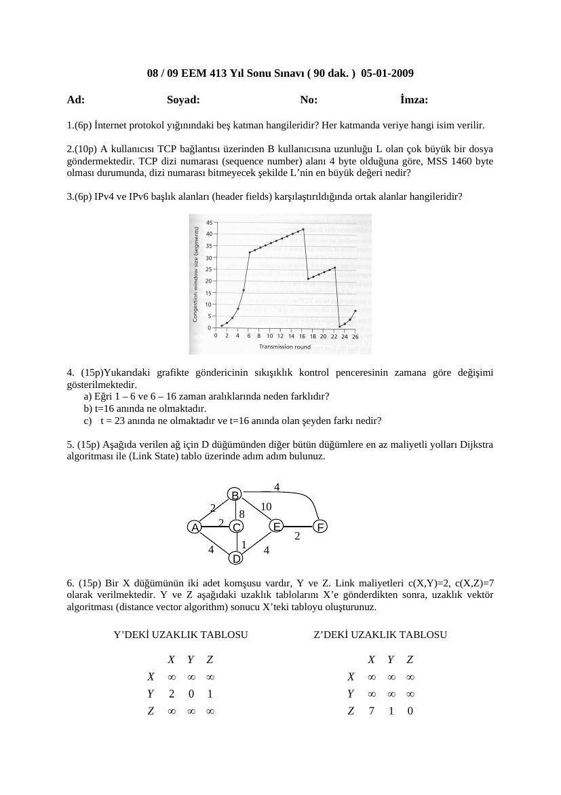
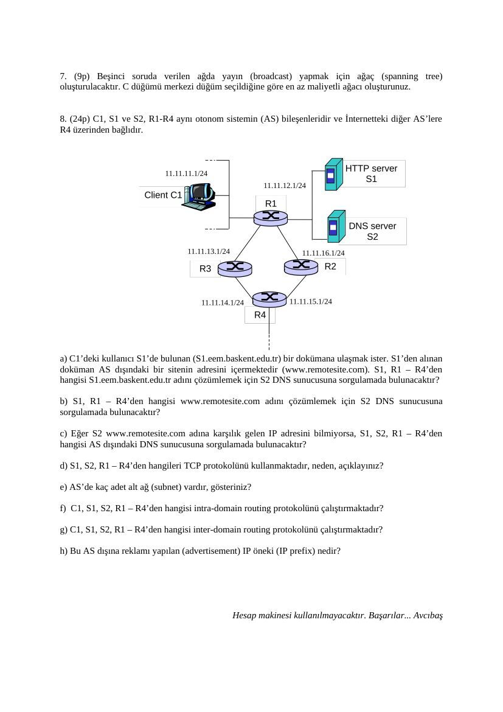
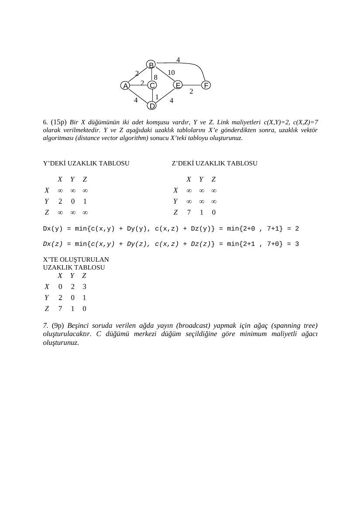

Başkent Üniversitesi, Avcıbaş imzalı 5 Ocak 2009 final sınavı ve cevap anahtarıdır. Belgelerin PDF kopyaları yazının sonunda indirilebilir.

## EEM413 Final 2009

08 / 09 EEM 413 Yıl Sonu Sınavı ( 90 dak. ) 05-01-2009

**1.** (6p) İnternet protokol yığınındaki beş katman hangileridir? Her katmanda veriye hangi isim verilir.

**2.** (10p) A kullanıcısı TCP bağlantısı üzerinden B kullanıcısına uzunluğu L olan çok büyük bir dosya göndermektedir. TCP dizi numarası (sequence number) alanı 4 byte olduğuna göre, MSS 1460 byte olması durumunda, dizi numarası bitmeyecek şekilde L’nin en büyük değeri nedir?

**3.** (6p) IPv4 ve IPv6 başlık alanları (header fields) karşılaştırıldığında ortak alanlar hangileridir?

**4.** (15p)Yukarıdaki grafikte göndericinin sıkışıklık kontrol penceresinin zamana göre değişimi gösterilmektedir. a) Eğri 1 – 6 ve 6 – 16 zaman aralıklarında neden farklıdır? b) t=16 anında ne olmaktadır. c) t = 23 anında ne olmaktadır ve t=16 anında olan şeyden farkı nedir?

**5.** (15p) Aşağıda verilen ağ için D düğümünden diğer bütün düğümlere en az maliyetli yolları Dijkstra algoritması ile (Link State) tablo üzerinde adım adım bulunuz.

B 2 10 A 2 C E F 4 1 4 D

**6.** (15p) Bir X düğümünün iki adet komşusu vardır, Y ve Z. Link maliyetleri c(X,Y)=2, c(X,Z)=7 olarak verilmektedir. Y ve Z aşağıdaki uzaklık tablolarını X’e gönderdikten sonra, uzaklık vektör algoritması (distance vector algorithm) sonucu X’teki tabloyu oluşturunuz.

Y’DEKİ UZAKLIK TABLOSU Z’DEKİ UZAKLIK TABLOSU

**7.** (9p) Beşinci soruda verilen ağda yayın (broadcast) yapmak için ağaç (spanning tree) oluşturulacaktır. C düğümü merkezi düğüm seçildiğine göre en az maliyetli ağacı oluşturunuz.

**8.** (24p) C1, S1 ve S2, R1-R4 aynı otonom sistemin (AS) bileşenleridir ve İnternetteki diğer AS’lere R4 üzerinden bağlıdır.

a) C1’deki kullanıcı S1’de bulunan (S1.eem.baskent.edu.tr) bir dokümana ulaşmak ister. S1’den alınan doküman AS dışındaki bir sitenin adresini içermektedir (www.remotesite.com). S1, R1 – R4’den hangisi S1.eem.baskent.edu.tr adını çözümlemek için S2 DNS sunucusuna sorgulamada bulunacaktır?

b) S1, R1 – R4’den hangisi www.remotesite.com adını çözümlemek için S2 DNS sunucusuna sorgulamada bulunacaktır?

c) Eğer S2 www.remotesite.com adına karşılık gelen IP adresini bilmiyorsa, S1, S2, R1 – R4’den hangisi AS dışındaki DNS sunucusuna sorgulamada bulunacaktır?

d) S1, S2, R1 – R4’den hangileri TCP protokolünü kullanmaktadır, neden, açıklayınız?

e) AS’de kaç adet alt ağ (subnet) vardır, gösteriniz?

f) C1, S1, S2, R1 – R4’den hangisi intra-domain routing protokolünü çalıştırmaktadır?

g) C1, S1, S2, R1 – R4’den hangisi inter-domain routing protokolünü çalıştırmaktadır?

h) Bu AS dışına reklamı yapılan (advertisement) IP öneki (IP prefix) nedir?

## EEM413 Final 2009 Cevap Anahtar

Başkent Üniversitesi 08 / 09 EEM 413 Yıl Sonu Sınavı ( 90 dak. ) 05-01-2009

**1.** (6p) İnternet protokol yığınındaki beş katman hangileridir? Her katmanda veriye hangi isim verilir. Application- Message Transport-Segment Network-Datagram Link-Frame Physical-Bit

**2.** (10p) A kullanıcısı TCP bağlantısı üzerinden B kullanıcısına uzunluğu L olan çok büyük bir dosya göndermektedir. TCP dizi numarası (sequence number) alanı 4 byte olduğuna göre, MSS 1460 byte olması durumunda, dizi numarası bitmeyecek şekilde L’nin maksimum değeri nedir? adet dizi numarası vardır. Her gönderilen segmentle birlikte dizi numarası bir artmaz, bunun yerine gönderilen byte kadar artar. Bu açıdan MSS büyüklüğü önemsizdir. A’nın B’ye gönderebileceği maksimum dosya uzunluğu .

**3.** (6p) IPv4 ve IPv6 başlık alanları (header fields) karşılaştırıldığında ortak alanlar hangileridir? Source address, destination address, data, version, payload ortak.

**4.** (15p)Yukarıdaki grafikte göndericinin sıkışıklık kontrol penceresinin zamana göre değişimi gösterilmektedir. a) Eğri 1 – 6 ve 6 – 16 zaman aralıklarında neden farklıdır? b) t=16 anında ne olmaktadır. c) t = 23 anında ne olmaktadır ve t=16 anında olan şeyden farkı nedir?.

**5.** (15p) Aşağida verilen ağ için D düğümünden diğer bütün düğümlere en az maliyetli yolları Dijkstra algoritması ile (Link State) tablo üzerinde göstererek adım adım bulunuz.

N D(A),p(A) D(B),p(B) D(C),p(C) D(E),p(E) D(F),p(F) D 4,A infty 1,C 4,E infty DC 3,C 9,C 4,E infty DCA 5,A 4,E infty DCAE 5,A 6,E DCAEB 6,E DCAEBF

B 2 10 A 2 C E F 4 1 4 D

**6.** (15p) Bir X düğümünün iki adet komşusu vardır, Y ve Z. Link maliyetleri c(X,Y)=2, c(X,Z)=7 olarak verilmektedir. Y ve Z aşağıdaki uzaklık tablolarını X’e gönderdikten sonra, uzaklık vektör algoritması (distance vector algorithm) sonucu X’teki tabloyu oluşturunuz.

Y’DEKİ UZAKLIK TABLOSU Z’DEKİ UZAKLIK TABLOSU

Dx(y) = min{c(x,y) + Dy(y), c(x,z) + Dz(y)} = min{2+0 , 7+1} = 2

Dx(z) = min{c(x,y) + Dy(z), c(x,z) + Dz(z)} = min{2+1 , 7+0} = 3

X’TE OLUŞTURULAN UZAKLIK TABLOSU

**7.** (9p) Beşinci soruda verilen ağda yayın (broadcast) yapmak için ağaç (spanning tree) oluşturulacaktır. C düğümü merkezi düğüm seçildiğine göre minimum maliyetli ağacı oluşturunuz.

**8.** (24p) C1, S1 ve S2, R1-R4 aynı otonom sistemin bileşenleridir ve İnternetteki diğer otonom sistemlere (AS) R4 üzerinden bağlıdır.

a) C1’deki kullanıcı S1’de bulunan (S1.eem.baskent.edu.tr) bir dökümana ulaşmak ister, S1’den gelen döküman AS dışındaki bir sitenin adresini içermektedir (www.remotesite.com). S1, R1 – R4’den hangisi S1.eem.baskent.edu.tr adını çözümlemek için S2 DNS sunucusuna sorgulamada bulunacaktır? The client C1 will need to contact the DNS in order to get the IP address of HTTP server S1 b) S1, R1 – R4’den hangisi www.remotesite.com adını çözümlemek için S2 DNS sunucusuna sorgulamada bulunacaktır? Client C1 will contact DN server S2 in order to resolve the name www.remotesite.com c) Eğer S2 www.remotesite.com adına karşılık gelen IP adresini bilmiyorsa, S1, R1 – R4’den hangisi AS dışındaki DNS sunucusuna sorgulamada bulunacaktır? S2 will contact an external DNS server, under recursive DNS queries. d) S1, R1 – R4’den hangileri TCP protokolünü kullanmaktadır, neden, açıklayınız? C1 and S1 are know to be running HTTP, which requires TCP. R4 must be running BGP (the only interdomain protocol being used in the Internet) in order for the BGP speaker in R4 to talk to the BGP speaker on the other side of the ISP access link, in order to get and advertise BGP tables. Hence R4 must also be running TCP. DNS uses UDP, so server S2 need not run TCP. If the intradomain routers were running OSPF, they would not need to run TCP to exchange tables. e) AS’de kaç adet alt ağ (subnet) vardır, gösteriniz? There are six networks, as shown in the figure above. f) C1, S1, S2, R1 – R4’den hangisi intra-domain routing protokolünü çalıştırmaktadır? All of these must all run the intradomain routing protocol g) C1, S1, S2, R1 – R4’den hangisi inter-domain routing protokolünü çalıştırmaktadır? R4. h) Bu AS dışına reklamı yapılan (advertisement) IP öneki (IP prefix) nadir? The prefix 11.11/16 could be advertised to the outside world, since all IP addresses within the network fall within this range.

*Not: Anahtardaki görsel formül 2³² = 4.294.967.296 bayttır; TCP sıra numarası baytları saydığı için MSS bu sınırı değiştirmez. Uzaklık vektörü hesabı Dₓ(y) = 2, Dₓ(z) = 3 sonucunu verir. Soru seçeneklerinde C1 yer almasa da DNS sorgusunu istemci C1 yapar. DNS yalnız UDP ile sınırlı değildir; anahtarın bu ifadesi genelleme olarak okunmamalıdır.*

