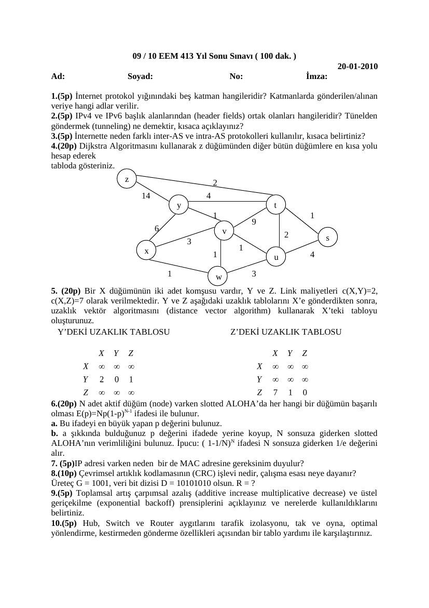
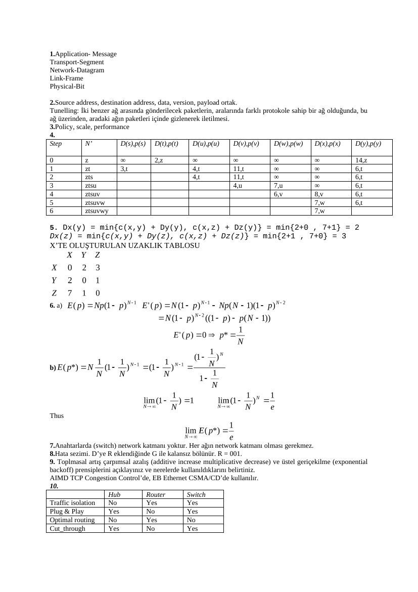

This is the final exam of 20 January 2010, signed by Avcıbaş, together with its answer key, from Başkent University. PDF copies of the documents can be downloaded at the end of the post.

## EEM413 Final 2010

09 / 10 EEM 413 End-of-Year Exam ( 100 min. ) 20-01-2010

**1.** (5p) What are the five layers in the Internet protocol stack? What names are given to the data sent/received at each layer?

**2.** (5p) Which header fields do IPv4 and IPv6 have in common? What is meant by tunneling? Explain briefly.

**3.** (5p) Why are different inter-AS and intra-AS protocols used in the Internet? Explain briefly.

**4.** (20p) Using Dijkstra's algorithm, compute the shortest paths from node z to all other nodes and show them in a table. z 2 14 4 y t 1 1 6 v 2 s x 1 1 u 4

1 w 3

**5.** (20p) A node X has two neighbors, Y and Z. The link costs are given as c(X,Y)=2, c(X,Z)=7. After Y and Z send their distance tables below to X, construct the table at X using the distance vector algorithm. DISTANCE TABLE AT Y DISTANCE TABLE AT Z

**6.** (20p) With N active nodes in slotted ALOHA, the probability that any given node succeeds is given by E(p)=Np(1-p)N-1. a. Find the value of p that maximizes this expression. b. Substitute the value of p found in part a into the expression and find the efficiency of slotted ALOHA as N goes to infinity. Hint: the expression ( 1-1/N) N approaches 1/e as N goes to infinity.

**7.** (5p) Why is a MAC address needed when there is already an IP address?

**8.** (10p) What is the function of the cyclic redundancy check (CRC), and what is its working principle based on? Let the generator be G = 1001 and the data bit sequence be D = 1010 1010. R = ?

**9.** (5p) Explain the principles of additive increase multiplicative decrease and exponential backoff, and state where they are used.

**10.** (5p) Compare hubs, switches and routers in terms of traffic isolation, plug and play, optimal routing and cut-through, with the help of a table.

## EEM413 Final 2010 Answer Key

**1.** Application - Message; Transport - Segment; Network - Datagram; Link - Frame; Physical - Bit

**2.** Source address, destination address, data, version and payload are common. Tunneling: when packets to be sent between two similar networks must pass through a network running a different protocol, they are carried across that network by being encapsulated inside the packets of the intermediate network.

**3.** Policy, scale, performance

**4.**  Step N’ D(s),p(s) D(t),p(t) D(u),p(u) D(v),p(v) D(w),p(w) D(x),p(x) D(y),p(y)

0 z ∞ 2,z ∞ ∞ ∞ ∞ 14,z 1 zt 3,t 4,t 11,t ∞ ∞ 6,t 2 zts 4,t 11,t ∞ ∞ 6,t 3 ztsu 4,u 7,u ∞ 6,t 4 ztsuv 6,v 8,v 6,t 5 ztsuvw 7,w 6,t 6 ztsuvwy 7,w

**5.** Dx(y) = min{c(x,y) + Dy(y), c(x,z) + Dz(y)} = min{2+0 , 7+1} = 2 Dx(z) = min{c(x,y) + Dy(z), c(x,z) + Dz(z)} = min{2+1 , 7+0} = 3 DISTANCE TABLE CONSTRUCTED AT X

**6.** a)

b)

Thus

**7.** Switches have no network layer. Not every network device needs to have a network layer.

**8.** Error detection. When R is appended to D, the result is divisible by G with no remainder. R = 001.

**9.** Additive increase multiplicative decrease (AIMD) is used in TCP congestion control; exponential backoff (EB) is used in Ethernet CSMA/CD.

**10.**  Hub Router Switch Traffic isolation No Yes Yes Plug & Play Yes No Yes Optimal routing No Yes No Cut_through Yes No Yes

*Note: The CRC remainder is 001; for ALOHA, p = 1/N and the limit is 1/e; the distance vector results Dₓ(y) = 2, Dₓ(z) = 3 have been verified. In the Dijkstra answer key, the total cost of v is written as 4 even though the u→v cost is 1; the shortest distance from z to v is 5.*
