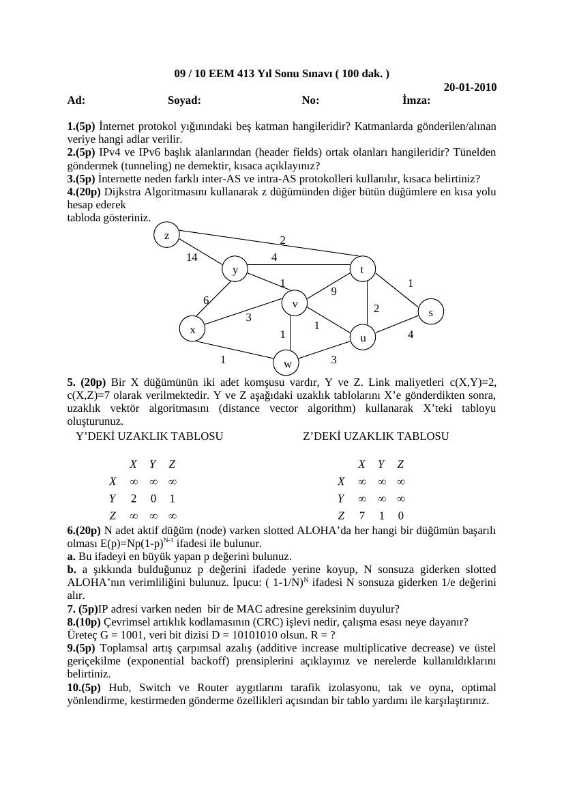
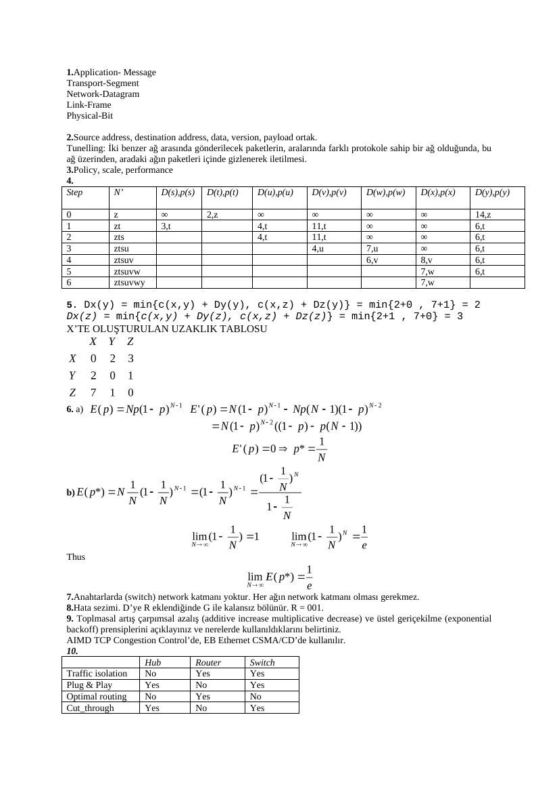

Başkent Üniversitesi, Avcıbaş imzalı 20 Ocak 2010 final sınavı ve cevap anahtarıdır. Belgelerin PDF kopyaları yazının sonunda indirilebilir.

## EEM413 Final 2010

09 / 10 EEM 413 Yıl Sonu Sınavı ( 100 dak. ) 20-01-2010

**1.** (5p) İnternet protokol yığınındaki beş katman hangileridir? Katmanlarda gönderilen/alınan veriye hangi adlar verilir.

**2.** (5p) IPv4 ve IPv6 başlık alanlarından (header fields) ortak olanları hangileridir? Tünelden göndermek (tunneling) ne demektir, kısaca açıklayınız?

**3.** (5p) İnternette neden farklı inter-AS ve intra-AS protokolleri kullanılır, kısaca belirtiniz?

**4.** (20p) Dijkstra Algoritmasını kullanarak z düğümünden diğer bütün düğümlere en kısa yolu hesap ederek tabloda gösteriniz. z 2 14 4 y t 1 1 6 v 2 s x 1 1 u 4

1 w 3

**5.** (20p) Bir X düğümünün iki adet komşusu vardır, Y ve Z. Link maliyetleri c(X,Y)=2, c(X,Z)=7 olarak verilmektedir. Y ve Z aşağıdaki uzaklık tablolarını X’e gönderdikten sonra, uzaklık vektör algoritmasını (distance vector algorithm) kullanarak X’teki tabloyu oluşturunuz. Y’DEKİ UZAKLIK TABLOSU Z’DEKİ UZAKLIK TABLOSU

**6.** (20p) N adet aktif düğüm (node) varken slotted ALOHA’da her hangi bir düğümün başarılı olması E(p)=Np(1-p)N-1 ifadesi ile bulunur. a. Bu ifadeyi en büyük yapan p değerini bulunuz. b. a şıkkında bulduğunuz p değerini ifadede yerine koyup, N sonsuza giderken slotted ALOHA’nın verimliliğini bulunuz. İpucu: ( 1-1/N) N ifadesi N sonsuza giderken 1/e değerini alır.

**7.** (5p)IP adresi varken neden bir de MAC adresine gereksinim duyulur?

**8.** (10p) Çevrimsel artıklık kodlamasının (CRC) işlevi nedir, çalışma esası neye dayanır? Üreteç G = 1001, veri bit dizisi D = 1010 1010 olsun. R = ?

**9.** (5p) Toplamsal artış çarpımsal azalış (additive increase multiplicative decrease) ve üstel geriçekilme (exponential backoff) prensiplerini açıklayınız ve nerelerde kullanıldıklarını belirtiniz.

**10.** (5p) Hub, Switch ve Router aygıtlarını tarafik izolasyonu, tak ve oyna, optimal yönlendirme, kestirmeden gönderme özellikleri açısından bir tablo yardımı ile karşılaştırınız.

## EEM413 Final 2010 Cevap Anahtar

**1.** Application- Message Transport-Segment Network-Datagram Link-Frame Physical-Bit

**2.** Source address, destination address, data, version, payload ortak. Tunelling: İki benzer ağ arasında gönderilecek paketlerin, aralarında farklı protokole sahip bir ağ olduğunda, bu ağ üzerinden, aradaki ağın paketleri içinde gizlenerek iletilmesi.

**3.** Policy, scale, performance

**4.**  Step N’ D(s),p(s) D(t),p(t) D(u),p(u) D(v),p(v) D(w),p(w) D(x),p(x) D(y),p(y)

0 z ∞ 2,z ∞ ∞ ∞ ∞ 14,z 1 zt 3,t 4,t 11,t ∞ ∞ 6,t 2 zts 4,t 11,t ∞ ∞ 6,t 3 ztsu 4,u 7,u ∞ 6,t 4 ztsuv 6,v 8,v 6,t 5 ztsuvw 7,w 6,t 6 ztsuvwy 7,w

**5.** Dx(y) = min{c(x,y) + Dy(y), c(x,z) + Dz(y)} = min{2+0 , 7+1} = 2 Dx(z) = min{c(x,y) + Dy(z), c(x,z) + Dz(z)} = min{2+1 , 7+0} = 3 X’TE OLUŞTURULAN UZAKLIK TABLOSU

**6.** a)

b)

Thus

**7.** Anahtarlarda (switch) network katmanı yoktur. Her ağın network katmanı olması gerekmez.

**8.** Hata sezimi. D’ye R eklendiğinde G ile kalansız bölünür. R = 001.

**9.** Toplmasal artış çarpımsal azalış (additive increase multiplicative decrease) ve üstel geriçekilme (exponential backoff) prensiplerini açıklayınız ve nerelerde kullanıldıklarını belirtiniz. AIMD TCP Congestion Control’de, EB Ethernet CSMA/CD’de kullanılır.

**10.**  Hub Router Switch Traffic isolation No Yes Yes Plug & Play Yes No Yes Optimal routing No Yes No Cut_through Yes No Yes

*Not: CRC kalanı 001; ALOHA için p = 1/N ve limit 1/e; uzaklık vektörü için Dₓ(y) = 2, Dₓ(z) = 3 sonuçları doğrulanmıştır. Dijkstra anahtarında u→v maliyeti 1 olmasına rağmen v toplam maliyeti 4 yazılmıştır; z’den v’ye en kısa mesafe 5’tir.*

