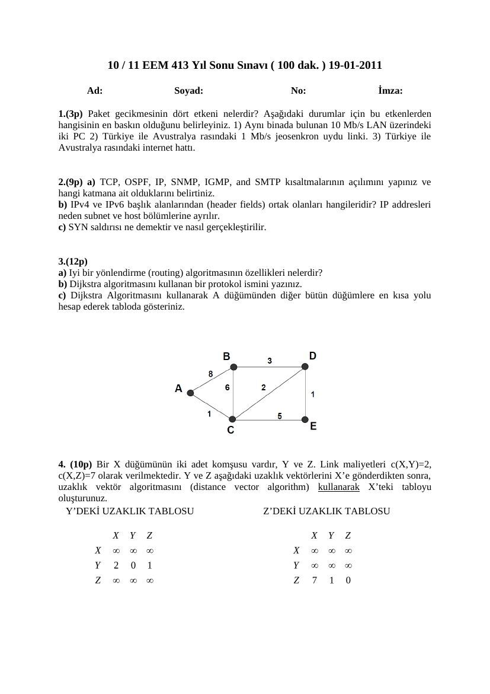
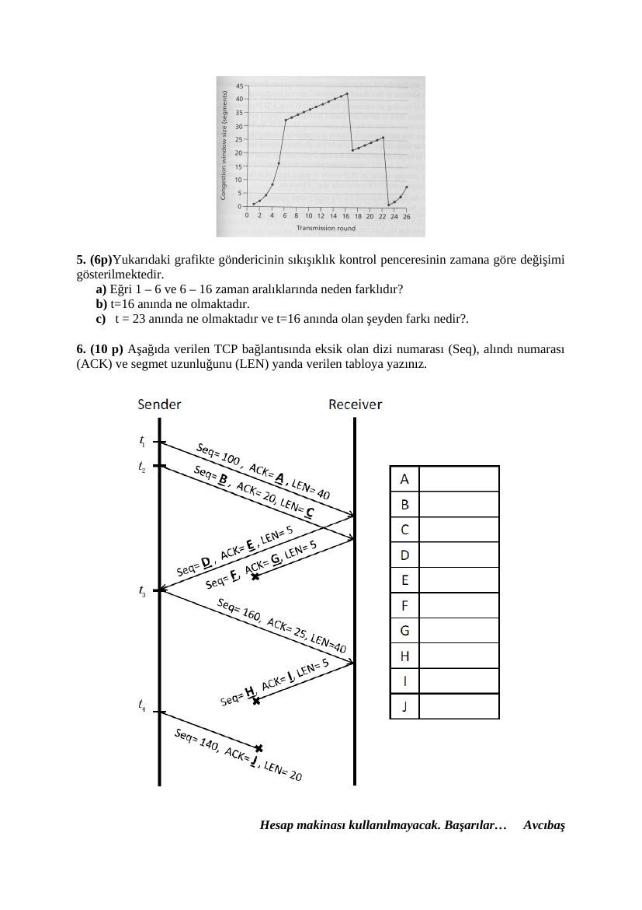

The final exam of 19 January 2011, signed by Avcıbaş at Başkent University, is presented here together with its detailed and short answer-key versions. PDF copies of the documents can be downloaded at the end of the post.

## EEM413 Final 2011

10 / 11 EEM 413 End-of-Year Exam ( 100 min. ) 19-01-2011

**1.** (3p) What are the four factors of packet delay? For the following cases, determine which of these factors is the most dominant. 1) Two PCs on a 10 Mb/s LAN in the same building 2) A 1 Mb/s geosynchronous satellite link between Turkey and Australia. 3) An internet connection between Turkey and Australia.

**2.** (9p) a) Expand the abbreviations TCP, OSPF, IP, SNMP, IGMP, and SMTP and state which layer each belongs to. b) Which header fields are common to IPv4 and IPv6? Why are IP addresses divided into subnet and host parts? c) What is a SYN attack and how is it carried out?

**3.** (12p) a) What are the properties of a good routing algorithm? b) Name a protocol that uses the Dijkstra algorithm. c) Using the Dijkstra algorithm, compute the shortest path from node A to all other nodes and show it in a table.

**4.** (10p) A node X has two neighbors, Y and Z. The link costs are given as c(X,Y)=2, c(X,Z)=7. After Y and Z send the following distance vectors to X, construct the table at X using the distance vector algorithm. DISTANCE TABLE AT Y DISTANCE TABLE AT Z

**5.** (6p) The graph above shows the variation of the sender's congestion control window over time. a) Why is the curve different in the time intervals 1 – 6 and 6 – 16? b) What happens at t=16? c) What happens at t = 23, and how does it differ from what happens at t=16?

**6.** (10 p) In the TCP connection given below, write the missing sequence number (Seq), acknowledgment number (ACK), and segment length (LEN) in the table provided alongside.

## EEM413 Final 2011 Answer Key (1)

10 / 11 EEM 413 End-of-Year Exam ( 100 min. ) 19-01-2011

**1.** (3p). What are the four factors of packet delay? For the following cases, determine which of these factors is the most dominant. 1) Two PCs on a 10 Mb/s LAN in the same building 2) A 1 Mb/s geosynchronous satellite link between Turkey and Australia. 3) An internet connection between Turkey and Australia.

The four factors of packet delay are processing, transmission, propagation, and queueing. For (1) the predominant delay will be transmission in the 1 ms range (processing is microseconds, propagation is nanoseconds, and queueing in non-existent), For (2) the propagation will be the largest delay (in the 100s of milliseconds), and for (3) the largest delay will likely be queueing due to the many hops between the Turkey and Australia.

**2.** (9p) a) Expand the abbreviations TCP, OSPF, IP, SNMP, IGMP, and SMTP and state which layer each belongs to. b) Which header fields are common to IPv4 and IPv6? Why are IP addresses divided into subnet and host parts? c) What is a SYN attack and how is it carried out?

a) TCP = Transmission Control Protocol (layer 4), OSPF = Open Shortest Path First (layer 3), IP = Internet Protocol (layer 3), SNMP = Simple Network Management Protocol (layer 5), IGMP = Internet Group Management Protocol (layer 3), and SMTP = Simple Mail Transfer Protocol (layer 5).

b) Source address, destination address, data, version, and payload are common. This is to simplify (reduce the size of) router tables; router tables contain only netids. Thus, routers route only to the destination network. Within the network (and using the ARP cache) is the final forwarding of the packet to the destination host.

c) A SYN attack is where one, or more, malicious hosts send a stream of TCP SYN packets to a server, but with no intention to complete the connection. The server will allocate each resources for each received SYN (in anticipation of a connection to be established), send a SYN-ACK, and wait for an ACK (which will never come). Even a rate of a few SYNs per second can cause a server to consume all of its connection resources and thus prevent legitimate clients (users) from connecting to the server. If legitimate users cannot connect, the server has effectively been taken “offline” and service denied.

**3.** (12p) a) What are the properties of a good routing algorithm? b) Name a protocol that uses the Dijkstra algorithm. c) Using the Dijkstra algorithm, compute the shortest path from node A to all other nodes and show it in a table.

3 a)Fast, simple, not generate much traffic, not create loops, stable, converges to an optimum solution

c) Step N’ D(B),p(B) D(C),p(C) D(D),p(D) D(E),p(E) 0 A 8 1, A Inf Inf 1 AC 7, A 3, C 6, C 2 ACD 6, D 4, D 3 ACDE 4 ACDEB

**4.** (10p) A node X has two neighbors, Y and Z. The link costs are given as c(X,Y)=2, c(X,Z)=7. After Y and Z send the following distance vectors to X, construct the table at X using the distance vector algorithm.

DISTANCE TABLE AT Y DISTANCE TABLE AT Z

**4.** Dx(y) = min{c(x,y) + Dy(y), c(x,z) + Dz(y)} = min{2+0 , 7+1} = 2 Dx(z) = min{c(x,y) + Dy(z), c(x,z) + Dz(z)} = min{2+1 , 7+0} = 3

DISTANCE TABLE CONSTRUCTED AT X

**5.** (6p) The graph above shows the variation of the sender's congestion control window over time. a) Why is the curve different in the time intervals 1 – 6 and 6 – 16? b) What happens at t=16? c) What happens at t = 23, and how does it differ from what happens at t=16?

**5.** a)1 – 6 Slow start mode, 6 – 16 Congestion avoidance mode b)3 double acknowledgements received at t=16. c) Timeoout event occured at t = 23

**6.** (10 p) In the TCP connection given below, write the missing sequence number (Seq), acknowledgment number (ACK), and segment length (LEN) in the table provided alongside.

, page 2")

, page 5")

## EEM413 Final 2011 Short Answer Key

10 / 11 EEM 413 End-of-Year Exam ( 100 min. ) 19-01-2011

KEY

**1.** (3p). Processing, transmission, propagation, and queueing delays. (1) transmission delay (2) propagation delay (3) queueing delay

**2.** (9p) a) TCP = Transmission Control Protocol (layer 4), OSPF = Open Shortest Path First (layer 3), IP = Internet Protocol (layer 3), SNMP = Simple Network Management Protocol (layer 5), IGMP = Internet Group Management Protocol (layer 3), SMTP = Simple Mail Transfer Protocol (layer 5).

b) Source address, destination address, data, version, payload This is to simplify (reduce the size of) router tables; router tables contain only netids. Thus, routers route only to the destination network. Within the network (and using the ARP cache) is the final forwarding of the packet to the destination host.

c) A SYN attack is where one, or more, malicious hosts send a stream of TCP SYN packets to a server, but with no intention to complete the connection. The server will allocate each resources for each received SYN (in anticipation of a connection to be established), send a SYN-ACK, and wait for an ACK (which will never come). Even a rate of a few SYNs per second can cause a server to consume all of its connection resources and thus prevent legitimate clients (users) from connecting to the server. If legitimate users cannot connect, the server has effectively been taken “offline” and service denied.

**3.** (12p) a)Fast, simple, not generate much traffic, not create loops, stable, converges to an optimum solution b)OSPF, IGR

c) Step N’ D(B),p(B) D(C),p(C) D(D),p(D) D(E),p(E) 0 A 8 1, A Inf Inf 1 AC 7, A 3, C 6, C 2 ACD 6, D 4, D 3 ACDE 4 ACDEB

**4.** (10p)

Dx(y) = min{c(x,y) + Dy(y), c(x,z) + Dz(y)} = min{2+0 , 7+1} = 2 Dx(z) = min{c(x,y) + Dy(z), c(x,z) + Dz(z)} = min{2+1 , 7+0} = 3

DISTANCE TABLE CONSTRUCTED AT X

**5.** (6p) a)1 – 6 Slow start mode, 6 – 16 Congestion avoidance mode b)3 double acknowledgements received at t=16. c) Timeoout event occured at t = 23

**6.** (10 p)

*Note: The shortest path distances from A have been verified as C = 1, D = 3, E = 4, B = 6. In the filled-in TCP diagram, the Seq/ACK/LEN values are, in order, 100/20/40, 140/20/20, 20/140/5, 25/160/5, 160/25/40, 30/200/5, and 140/25/20. The key's wording "double acknowledgements" has been preserved; the context of fast retransmit is duplicate ACKs.*
