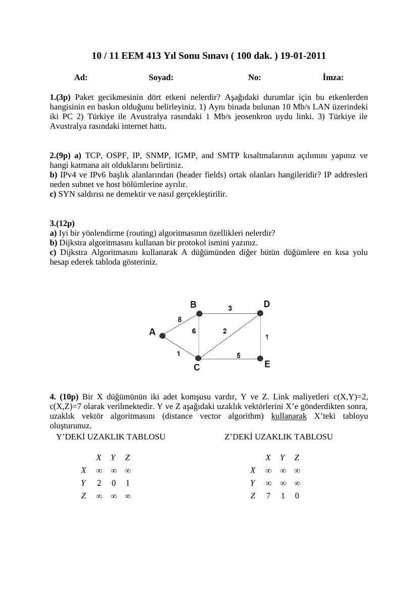
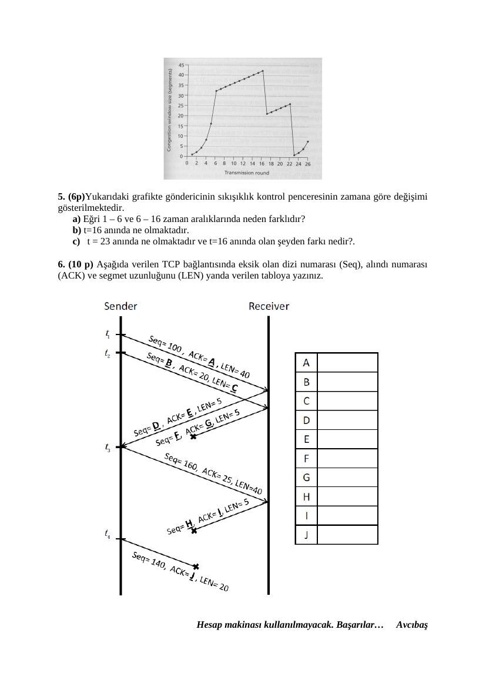

Başkent Üniversitesi, Avcıbaş imzalı 19 Ocak 2011 finali, ayrıntılı ve kısa cevap anahtarı sürümleriyle birlikte aktarılmıştır. Belgelerin PDF kopyaları yazının sonunda indirilebilir.

## EEM413 Final 2011

10 / 11 EEM 413 Yıl Sonu Sınavı ( 100 dak. ) 19-01-2011

**1.** (3p) Paket gecikmesinin dört etkeni nelerdir? Aşağıdaki durumlar için bu etkenlerden hangisinin en baskın olduğunu belirleyiniz. 1) Aynı binada bulunan 10 Mb/s LAN üzerindeki iki PC 2) Türkiye ile Avustralya rasındaki 1 Mb/s jeosenkron uydu linki. 3) Türkiye ile Avustralya rasındaki internet hattı.

**2.** (9p) a) TCP, OSPF, IP, SNMP, IGMP, and SMTP kısaltmalarının açılımını yapınız ve hangi katmana ait olduklarını belirtiniz. b) IPv4 ve IPv6 başlık alanlarından (header fields) ortak olanları hangileridir? IP addresleri neden subnet ve host bölümlerine ayrılır. c) SYN saldırısı ne demektir ve nasıl gerçekleştirilir.

**3.** (12p) a) Iyi bir yönlendirme (routing) algoritmasının özellikleri nelerdir? b) Dijkstra algoritmasını kullanan bir protokol ismini yazınız. c) Dijkstra Algoritmasını kullanarak A düğümünden diğer bütün düğümlere en kısa yolu hesap ederek tabloda gösteriniz.

**4.** (10p) Bir X düğümünün iki adet komşusu vardır, Y ve Z. Link maliyetleri c(X,Y)=2, c(X,Z)=7 olarak verilmektedir. Y ve Z aşağıdaki uzaklık vektörlerini X’e gönderdikten sonra, uzaklık vektör algoritmasını (distance vector algorithm) kullanarak X’teki tabloyu oluşturunuz. Y’DEKİ UZAKLIK TABLOSU Z’DEKİ UZAKLIK TABLOSU

**5.** (6p)Yukarıdaki grafikte göndericinin sıkışıklık kontrol penceresinin zamana göre değişimi gösterilmektedir. a) Eğri 1 – 6 ve 6 – 16 zaman aralıklarında neden farklıdır? b) t=16 anında ne olmaktadır. c) t = 23 anında ne olmaktadır ve t=16 anında olan şeyden farkı nedir?.

**6.** (10 p) Aşağıda verilen TCP bağlantısında eksik olan dizi numarası (Seq), alındı numarası (ACK) ve segmet uzunluğunu (LEN) yanda verilen tabloya yazınız.

## EEM413 Final 2011 Cevap Anahtar (1)

10 / 11 EEM 413 Yıl Sonu Sınavı ( 100 dak. ) 19-01-2011

**1.** (3p). Paket gecikmesinin dört etkeni nelerdir? Aşağıdaki durumlar için bu etkenlerden hangisinin en baskın olduğunu belirleyiniz. 1) Aynı binada bulunan 10 Mb/s LAN üzerindeki iki PC 2) Türkiye ile Avustralya rasındaki 1 Mb/s jeosenkron uydu linki. 3) Türkiye ile Avustralya rasındaki internet hattı.

The four factors of packet delay are processing, transmission, propagation, and queueing. For (1) the predominant delay will be transmission in the 1 ms range (processing is microseconds, propagation is nanoseconds, and queueing in non-existent), For (2) the propagation will be the largest delay (in the 100s of milliseconds), and for (3) the largest delay will likely be queueing due to the many hops between the Turkey and Australia.

**2.** (9p) a) TCP, OSPF, IP, SNMP, IGMP, and SMTP kısaltmalarının açılımını yapınız ve hangi katmana ait olduklarını belirtiniz. b) IPv4 ve IPv6 başlık alanlarından (header fields) ortak olanları hangileridir? IP addresleri neden subnet ve host bölümlerine ayrılır. c) SYN saldırısı ne demektir ve nasıl gerçekleştirilir.

a) TCP = Transmission Control Protocol (layer 4), OSPF = Open Shortest Path First (layer 3), IP = Internet Protocol (layer 3), SNMP = Simple Network Management Protocol (layer 5), IGMP = Internet Group Management Protocol (layer 3), and SMTP = Simple Mail Transfer Protocol (layer 5).

b) Source address, destination address, data, version, payload ortak. This is to simplify (reduce the size of) router tables; router tables contain only netids. Thus, routers route only to the destination network. Within the network (and using the ARP cache) is the final forwarding of the packet to the destination host.

c) A SYN attack is where one, or more, malicious hosts send a stream of TCP SYN packets to a server, but with no intention to complete the connection. The server will allocate each resources for each received SYN (in anticipation of a connection to be established), send a SYN-ACK, and wait for an ACK (which will never come). Even a rate of a few SYNs per second can cause a server to consume all of its connection resources and thus prevent legitimate clients (users) from connecting to the server. If legitimate users cannot connect, the server has effectively been taken “offline” and service denied.

**3.** (12p) a) Iyi bir yönlendirme (routing) algoritmasının özellikleri nelerdir? b) Dijkstra algoritmasını kullanan bir protokol ismini yazınız. c)Dijkstra Algoritmasını kullanarak A düğümünden diğer bütün düğümlere en kısa yolu hesap ederek tabloda gösteriniz.

3 a)Fast, simple, not generate much traffic, not create loops, stable, converges to an optimum solution

c) Step N’ D(B),p(B) D(C),p(C) D(D),p(D) D(E),p(E) 0 A 8 1, A Inf Inf 1 AC 7, A 3, C 6, C 2 ACD 6, D 4, D 3 ACDE 4 ACDEB

**4.** (10p) Bir X düğümünün iki adet komşusu vardır, Y ve Z. Link maliyetleri c(X,Y)=2, c(X,Z)=7 olarak verilmektedir. Y ve Z aşağıdaki uzaklık vektörlerini X’e gönderdikten sonra, uzaklık vektör algoritmasını (distance vector algorithm) kullanarak X’teki tabloyu oluşturunuz.

Y’DEKİ UZAKLIK TABLOSU Z’DEKİ UZAKLIK TABLOSU

**4.** Dx(y) = min{c(x,y) + Dy(y), c(x,z) + Dz(y)} = min{2+0 , 7+1} = 2 Dx(z) = min{c(x,y) + Dy(z), c(x,z) + Dz(z)} = min{2+1 , 7+0} = 3

X’TE OLUŞTURULAN UZAKLIK TABLOSU

**5.** (6p)Yukarıdaki grafikte göndericinin sıkışıklık kontrol penceresinin zamana göre değişimi gösterilmektedir. a) Eğri 1 – 6 ve 6 – 16 zaman aralıklarında neden farklıdır? b) t=16 anında ne olmaktadır. c) t = 23 anında ne olmaktadır ve t=16 anında olan şeyden farkı nedir?.

**5.** a)1 – 6 Slow start mode, 6 – 16 Congestion avoidance mode b)3 double acknowledgements received at t=16. c) Timeoout event occured at t = 23

**6.** (10 p) Aşağıda verilen TCP bağlantısında eksik olan dizi numarası (Seq), alındı numarası (ACK) ve segmet uzunluğunu (LEN) yanda verilen tabloya yazınız.

, sayfa 2")

, sayfa 5")

## EEM413 Final 2011 Cevap Anahtari Kisa

10 / 11 EEM 413 Yıl Sonu Sınavı ( 100 dak. ) 19-01-2011

ANAHTAR

**1.** (3p). Processing, transmission, propagation, and queueing delays. (1) transmission delay (2) propagation delay (3) queueing delay

**2.** (9p) a) TCP = Transmission Control Protocol (layer 4), OSPF = Open Shortest Path First (layer 3), IP = Internet Protocol (layer 3), SNMP = Simple Network Management Protocol (layer 5), IGMP = Internet Group Management Protocol (layer 3), SMTP = Simple Mail Transfer Protocol (layer 5).

b) Source address, destination address, data, version, payload This is to simplify (reduce the size of) router tables; router tables contain only netids. Thus, routers route only to the destination network. Within the network (and using the ARP cache) is the final forwarding of the packet to the destination host.

c) A SYN attack is where one, or more, malicious hosts send a stream of TCP SYN packets to a server, but with no intention to complete the connection. The server will allocate each resources for each received SYN (in anticipation of a connection to be established), send a SYN-ACK, and wait for an ACK (which will never come). Even a rate of a few SYNs per second can cause a server to consume all of its connection resources and thus prevent legitimate clients (users) from connecting to the server. If legitimate users cannot connect, the server has effectively been taken “offline” and service denied.

**3.** (12p) a)Fast, simple, not generate much traffic, not create loops, stable, converges to an optimum solution b)OSPF, IGR

c) Step N’ D(B),p(B) D(C),p(C) D(D),p(D) D(E),p(E) 0 A 8 1, A Inf Inf 1 AC 7, A 3, C 6, C 2 ACD 6, D 4, D 3 ACDE 4 ACDEB

**4.** (10p)

Dx(y) = min{c(x,y) + Dy(y), c(x,z) + Dz(y)} = min{2+0 , 7+1} = 2 Dx(z) = min{c(x,y) + Dy(z), c(x,z) + Dz(z)} = min{2+1 , 7+0} = 3

X’TE OLUŞTURULAN UZAKLIK TABLOSU

**5.** (6p) a)1 – 6 Slow start mode, 6 – 16 Congestion avoidance mode b)3 double acknowledgements received at t=16. c) Timeoout event occured at t = 23

**6.** (10 p)

*Not: A’dan en kısa yol uzaklıkları C = 1, D = 3, E = 4, B = 6 olarak doğrulanmıştır. TCP şemasının doldurulmuş hâlinde sırasıyla Seq/ACK/LEN değerleri 100/20/40, 140/20/20, 20/140/5, 25/160/5, 160/25/40, 30/200/5 ve 140/25/20’dir. Anahtarın “double acknowledgements” ifadesi korunmuştur; hızlı yeniden iletimin bağlamı yinelenen ACK’lerdir.*

