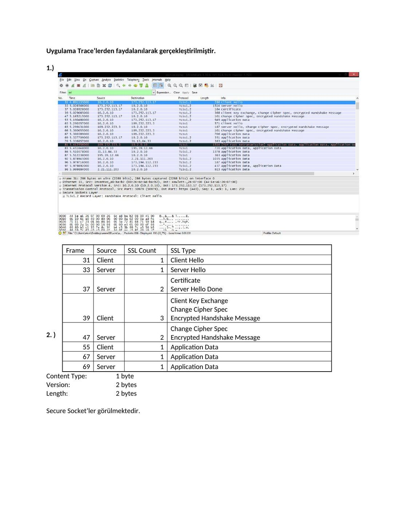
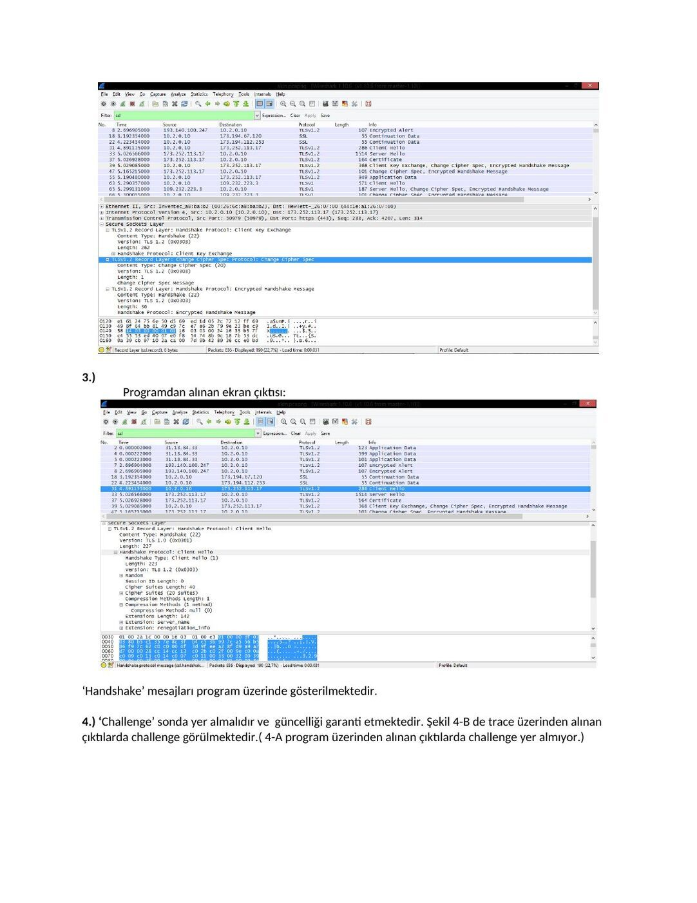
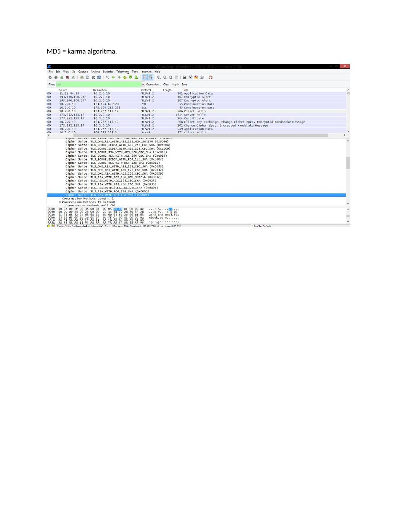
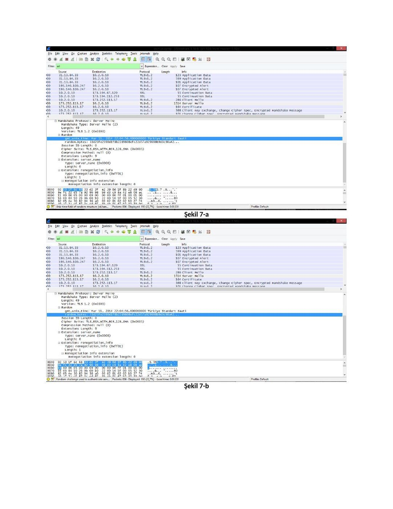
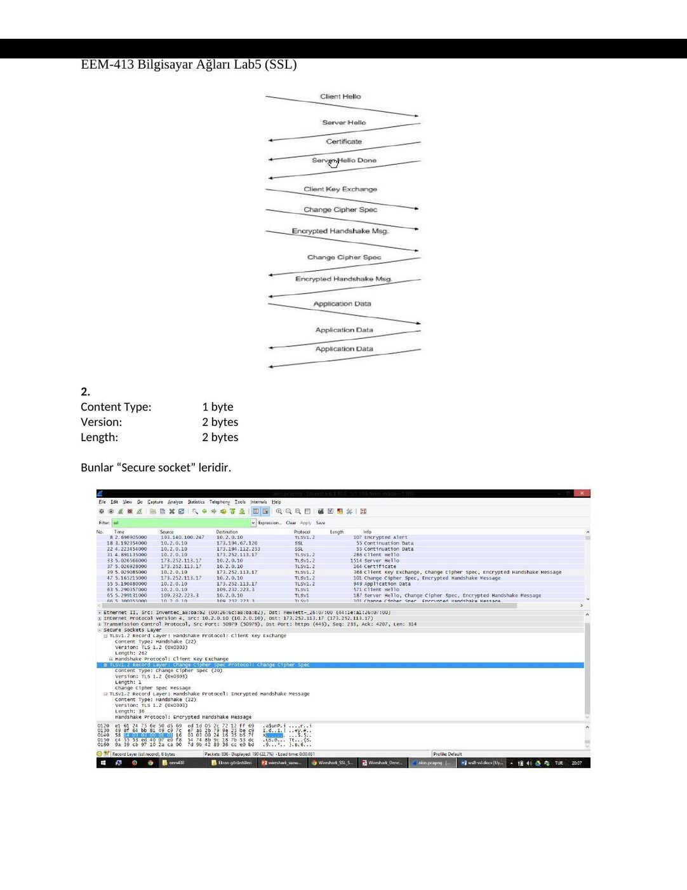
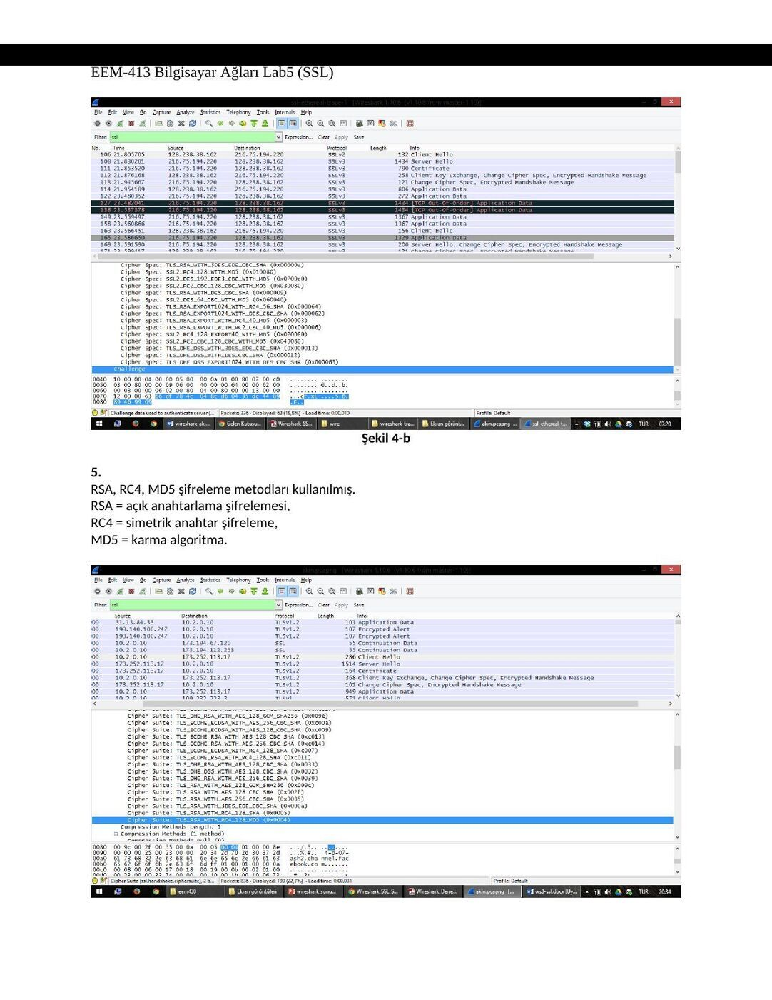
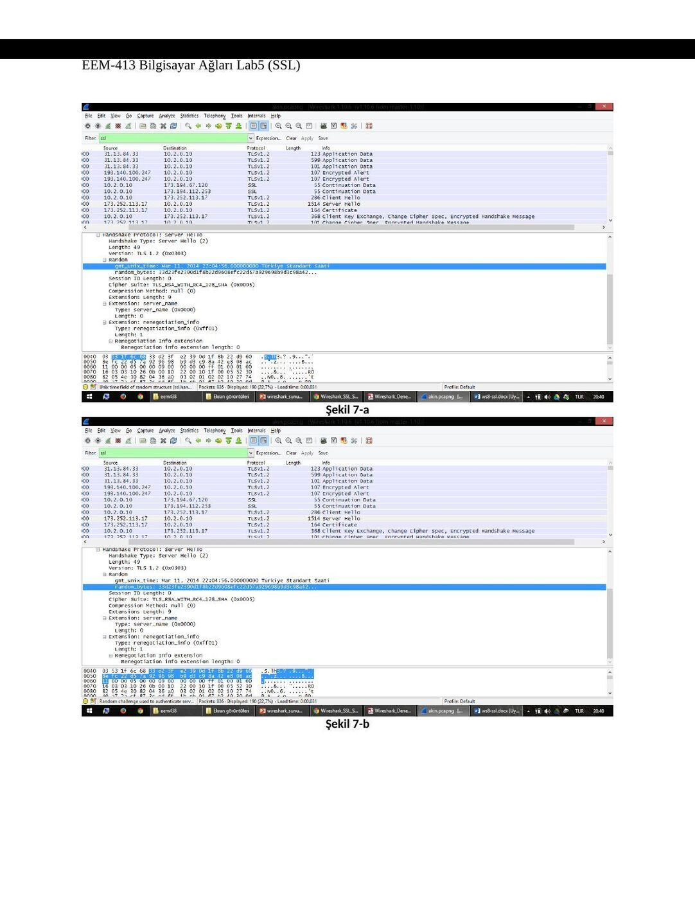

These are student laboratory reports from the course archive; student names, numbers and identity information have been removed. Where a document carried no date, the creation or last-modified date of the source file was used. Archive PDF copies of the documents can be downloaded at the end of the post.

## SSL Report A

EEM 413 COMPUTER NETWORKS EXPERIMENT-5 SSL

The experiment was carried out using the application traces.

**1.** )

Frame Source SSL Count SSL Type 31 Client 1 Client Hello 33 Server 1 Server Hello Certificate 37 Server 2 Server Hello Done Client Key Exchange Change Cipher Spec 39 Client 3 Encrypted Handshake Message Change Cipher Spec

**2.** ) 47 Server 2 Encrypted Handshake Message 55 Client 1 Application Data 67 Server 1 Application Data 69 Server 1 Application Data Content Type: 1 byte Version: 2 bytes Length: 2 bytes

Secure sockets are visible.

**3.** ) Screenshot taken from the program:

The handshake messages are displayed in the program.

**4.** ) The challenge must be at the end and guarantees freshness. In Figure 4-B, the challenge is visible in the output taken from the trace. (In 4-A, the output taken from the program does not contain the challenge.)

Figure 4-a

Figure 4-b

**5.** ) The RSA, RC4 and MD5 encryption methods were used. RSA = public-key encryption, RC4 = symmetric-key encryption,

MD5 = hash algorithm.

**6.** )

RSA, RC4 and MD5 encryption are performed in a single line.

**7.** )

It is included in the record. Their lengths in bytes are:

- > Line 1: 4 bytes (Figure 7-a)

- > Line 2: 28 bytes (Figure 7-b)

Figure 7-a

Figure 7-b

**8.** ) The record contains a session ID. It serves to implement the "Remember Me" feature. When the user logs out, it remembers the password and username.

## SSL Report B

EEM-413 Computer Networks Lab5 (SSL)

NOTE: For the experiment, a membership was obtained at http://www.clubboon.com, and the account was logged into and logged out of.

**1.** 

Frame Source SSL Count SSL Type 31 Client 1 Client Hello 33 Server 1 Server Hello Certificate 37 Server 2 Server Hello Done Client Key Exchange Change Cipher Spec 39 Client 3 Encrypted Handshake Message Change Cipher Spec 47 Server 2 Encrypted Handshake Message 55 Client 1 Application Data 67 Server 1 Application Data 69 Server 1 Application Data

EEM-413 Computer Networks Lab5 (SSL)

**2.**  Content Type: 1 byte Version: 2 bytes Length: 2 bytes

These are the "secure sockets".

EEM-413 Computer Networks Lab5 (SSL)

**3.** 

The handshake messages are displayed as shown on the screen.

**4.** The challenge, which must be at the end, guarantees freshness. However, it does not appear in the output I obtained (Figure 4-a). Therefore, I have included the image of what it should look like (Figure 4-b) from the provided sample trace.

Figure 4-a

EEM-413 Computer Networks Lab5 (SSL)

Figure 4-b

**5.**  The RSA, RC4 and MD5 encryption methods were used. RSA = public-key encryption, RC4 = symmetric-key encryption, MD5 = hash algorithm.

EEM-413 Computer Networks Lab5 (SSL)

**6.** 

RSA, RC4 and MD5 encryption are performed in a single line.

**7.** 

Yes, the two lines inside this random field are present. Their values in bytes are given below.

- > Line 1: 4 bytes (Figure 7-a)

- > Line 2: 28 bytes (Figure 7-b)

EEM-413 Computer Networks Lab5 (SSL)

Figure 7-a

Figure 7-b

EEM-413 Computer Networks Lab5 (SSL)

**8.**  Yes, it does. It serves to implement the "Remember Me" feature. When the user logs out, it remembers the password and username.

**9.** 

It contains the certificate under a separate heading.

EEM-413 Computer Networks Lab5 (SSL)

**10.** 

Yes, it contains the premaster secret. It is used to encrypt the MAC addresses. It is 256 bytes long.

**11.**  Consecutive packets are sent together with the MAC id, and the next id is also included, so that no loss occurs. The packet that follows contains 6 bytes in its encryption. (6 bytes = 1 byte message + 5 bytes header)

EEM-413 Computer Networks Lab5 (SSL)

**12.** 

Encrypted Handshake Message -> sends the preceding handshake messages in encrypted form; the purpose of this is assurance.

**13.** One from the client and one from the server: the Change Cipher Spec record is sent with a single MAC, and the encrypted handshake record is sent encrypted according to all the MAC addresses.

**14.** The application data begins using RC4 encryption, then the pre-master key, and finally the challenge is performed, so that encryption takes place between both the server and the user.

**15.** For data transmission, TLSv1.2 is used for SSL message exchange; some ClientHello messages use TLSv1, while others use TLSv1.2.

*Note: The documents describe fields of SSL and older TLS versions. These records reflect the period in which the course was taught; the key exchange and certificate information are not expected to be the same in every connection.*
