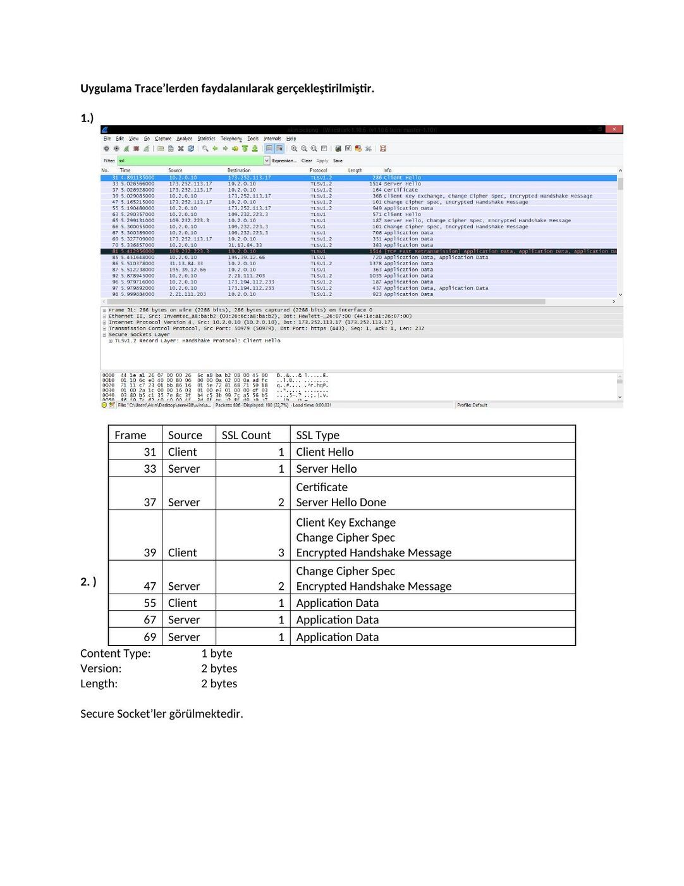
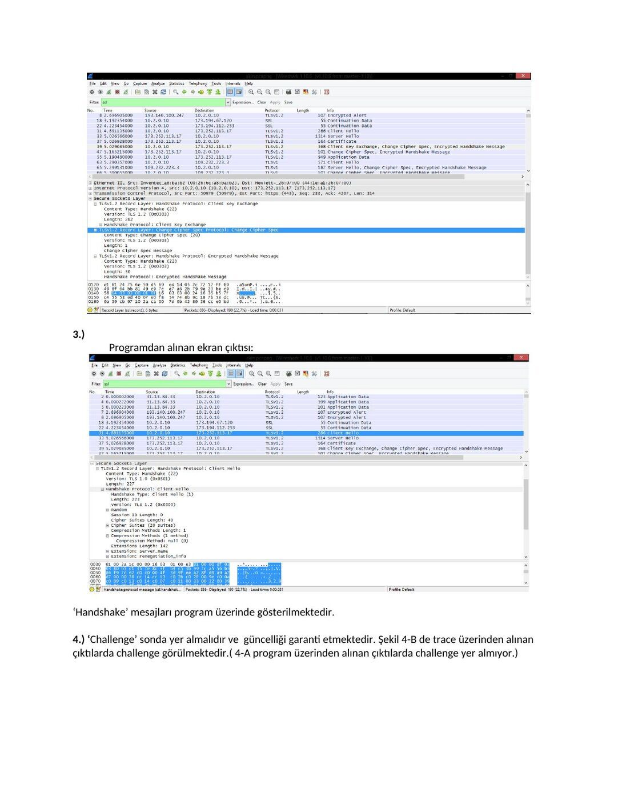
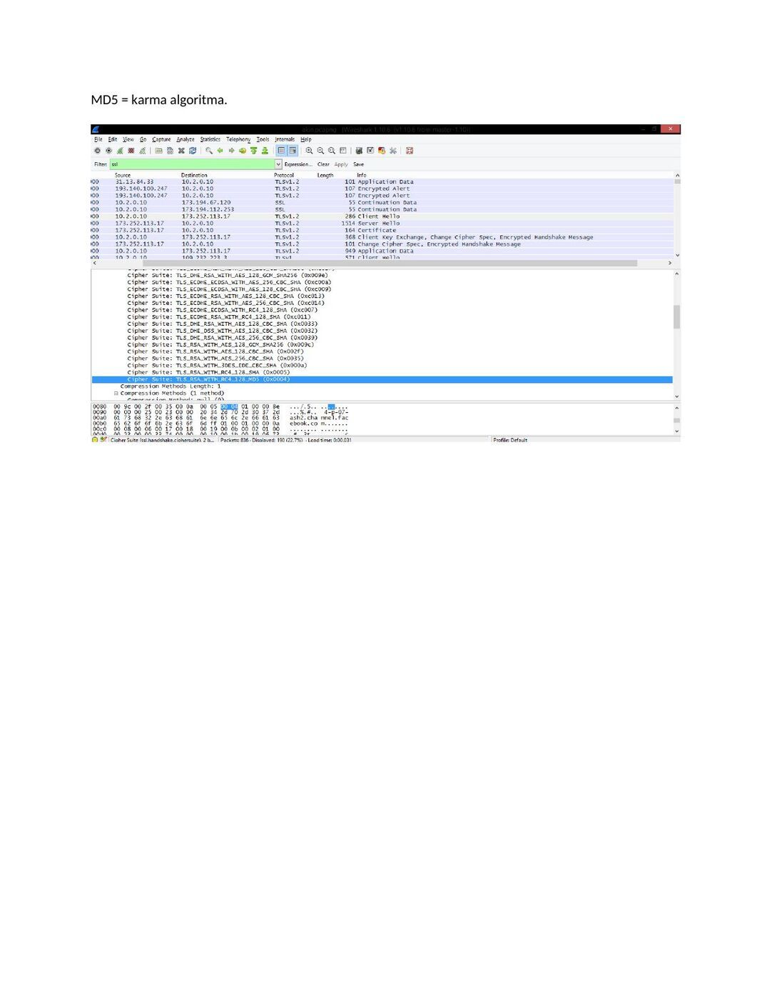
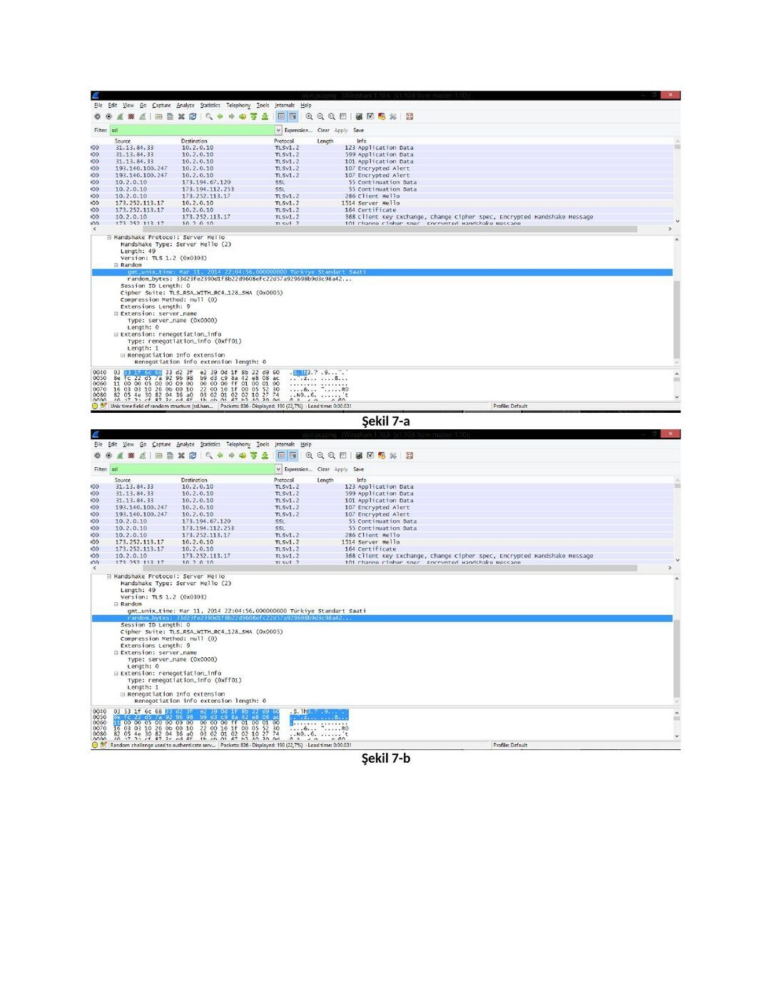
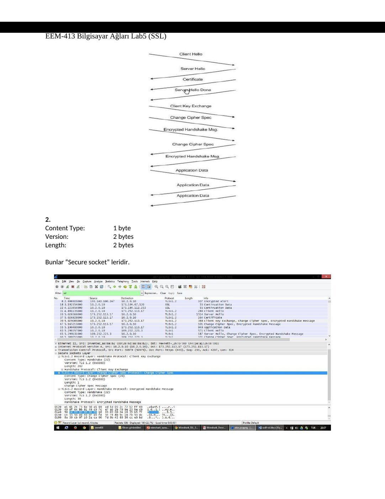
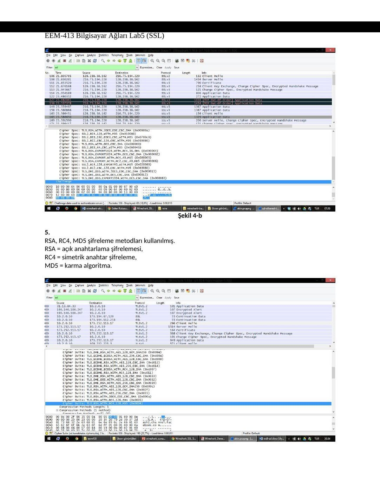
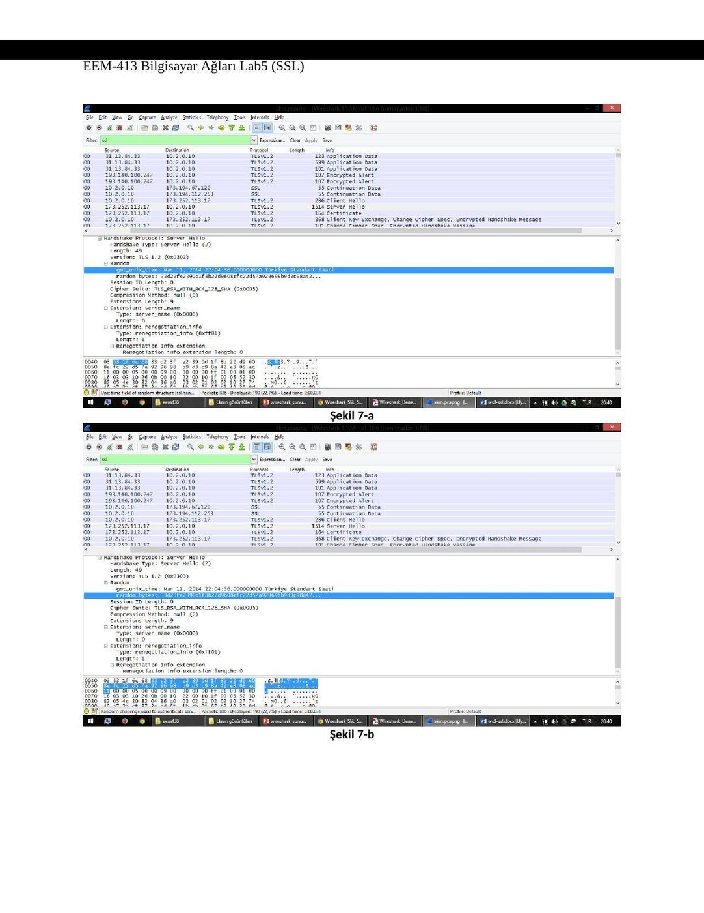

Ders arşivindeki öğrenci laboratuvar raporlarıdır; öğrenci adları, numaraları ve kimlik bilgileri çıkarılmıştır. Belge üzerindeki tarih bulunmadığında kaynak dosyanın oluşturulma ya da son değiştirilme tarihi kullanılmıştır. Belgelerin arşiv için hazırlanmış PDF kopyaları yazının sonunda indirilebilir.

## SSL raporu A

EEM 413 BİLGİSAYAR AĞLARI DENEY-5 SSL

Uygulama Trace’lerden faydalanılarak gerçekleştirilmiştir.

**1.** )

Frame Source SSL Count SSL Type 31 Client 1 Client Hello 33 Server 1 Server Hello Certificate 37 Server 2 Server Hello Done Client Key Exchange Change Cipher Spec 39 Client 3 Encrypted Handshake Message Change Cipher Spec

**2.** ) 47 Server 2 Encrypted Handshake Message 55 Client 1 Application Data 67 Server 1 Application Data 69 Server 1 Application Data Content Type: 1 byte Version: 2 bytes Length: 2 bytes

Secure Socket’ler görülmektedir.

**3.** ) Programdan alınan ekran çıktısı:

‘Handshake’ mesajları program üzerinde gösterilmektedir.

**4.** ) ‘Challenge’ sonda yer almalıdır ve güncelliği garanti etmektedir. Şekil 4-B de trace üzerinden alınan çıktılarda challenge görülmektedir.( 4-A program üzerinden alınan çıktılarda challenge yer almıyor.)

Şekil 4-a

Şekil 4-b

**5.** ) RSA, RC4, MD5 şifreleme metodları kullanılmış. RSA = açık anahtarlama şifrelemesi, RC4 = simetrik anahtar şifreleme,

MD5 = karma algoritma.

**6.** )

Tek satırda RSA, RC4 ve MD5 şifrelemeleri yapılıyor.

**7.** )

Kayıt içerisinde yer almaktadır. Byte cinsinden uzunlukları;

- > 1. Satır 4 byte (şekil 7-a)

- > 2. Satır 28 byte (şekil 7-b)

Şekil 7-a

Şekil 7-b

**8.** ) Kayıt session ID içermektedir. “Remember Me” durumunu gerçekleştirmeye yarıyor. Çıkış yapıldığında şifre ve kullanıcı adını hatırlar.

## SSL raporu B

EEM-413 Bilgisayar Ağları Lab5 (SSL)

NOT: Uygulama için http://www.clubboon.com adresinden üyelik alınmış giriş yaplmış ve çıkış yapılmıştır.

**1.** 

Frame Source SSL Count SSL Type 31 Client 1 Client Hello 33 Server 1 Server Hello Certificate 37 Server 2 Server Hello Done Client Key Exchange Change Cipher Spec 39 Client 3 Encrypted Handshake Message Change Cipher Spec 47 Server 2 Encrypted Handshake Message 55 Client 1 Application Data 67 Server 1 Application Data 69 Server 1 Application Data

EEM-413 Bilgisayar Ağları Lab5 (SSL)

**2.**  Content Type: 1 byte Version: 2 bytes Length: 2 bytes

Bunlar “Secure socket” leridir.

EEM-413 Bilgisayar Ağları Lab5 (SSL)

**3.** 

Handshake mesajları ekranda gözüktüğü üzere gösterilmektedir.

**4.** Sonda yer alması gereken challenge, güncelliği garanti etmektedir. Fakat aldığım çıktılarda (şekil 4-a) yer almamaktadır. Bu yüzden olması gereken resmi (şekil 4-b) verilen örnek trace üzerinden koymuş bulunmaktayım.

Şekil 4-a

EEM-413 Bilgisayar Ağları Lab5 (SSL)

Şekil 4-b

**5.**  RSA, RC4, MD5 şifreleme metodları kullanılmış. RSA = açık anahtarlama şifrelemesi, RC4 = simetrik anahtar şifreleme, MD5 = karma algoritma.

EEM-413 Bilgisayar Ağları Lab5 (SSL)

**6.** 

Tek satırda RSA, RC4 ve MD5 şifrelemeleri yapılıyor.

**7.** 

Evet bu random içindeki iki satır yer almaktadır. Aşağıda byte cinsinden değerleri verilmiştir.

- > 1. Satır 4 byte (şekil 7-a)

- > 2. Satır 28 byte (şekil 7-b)

EEM-413 Bilgisayar Ağları Lab5 (SSL)

Şekil 7-a

Şekil 7-b

EEM-413 Bilgisayar Ağları Lab5 (SSL)

**8.**  Evet içeriyor bu “Beni hatırla” durumunu gerçekleştirmeye yarıor. Çıkış yapıldığında şifre ve kullanıcı adını hatırlar.

**9.** 

Ayrı bir başlık altında certificate içermektedir.

EEM-413 Bilgisayar Ağları Lab5 (SSL)

**10.** 

Evet, premaster secret içermektedir. Bu mac adreslerini şifreleme için kullanılmaktadır. 256 byte uzunluğundadır.

**11.**  Sıralı gelen paket mac id ile hep birlikte gönderiyor bir sonraki id de yer alıyor böylece kayıp olmuyor. Sonra gelen paket şifresinde 6 byte yer alıyor. (6 byte = 1 byte mesaj 5 byte header)

EEM-413 Bilgisayar Ağları Lab5 (SSL)

**12.** 

Encrypted Handshake Message -> kendinden önceki hadshake mesajlarını şifreleyerek gönderiyor, bunun amacı garantilemedir.

**13.** Biri client biri server tarafından Change Cipher Spec record tek mac, encrypted handshake record bütün mac adreslerine göre şifreleyerek gönderiyor.

**14.** Application data RC4 şifrelemesi kullanılarak başlanmış sonrasında pre-master key ve en sonunda ise challence işlemi yapılarak şifreleme hem server hemde kullanıcı arasında gerçekleşmiştir.

**15.** Data gönderiminde SSL mesaj alışverişi için TLSv1.2 kullanmaktadır ve bağzı ClientHello mesajında TLSv1 kullanırken bazılarında TLSv1.2 kullanılmıştır.

*Not: Belgelerde SSL ve eski TLS sürümlerine ait alanlar anlatılır. Bu kayıtlar dersin işlendiği dönemi yansıtır; anahtar değişimi ve sertifika bilgilerinin her bağlantıda aynı olması beklenmez.*

