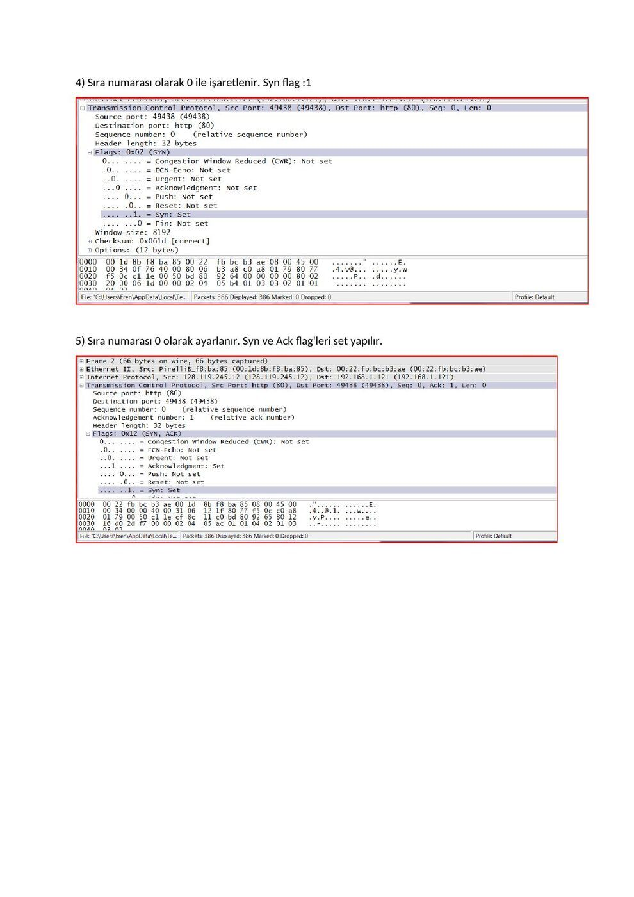
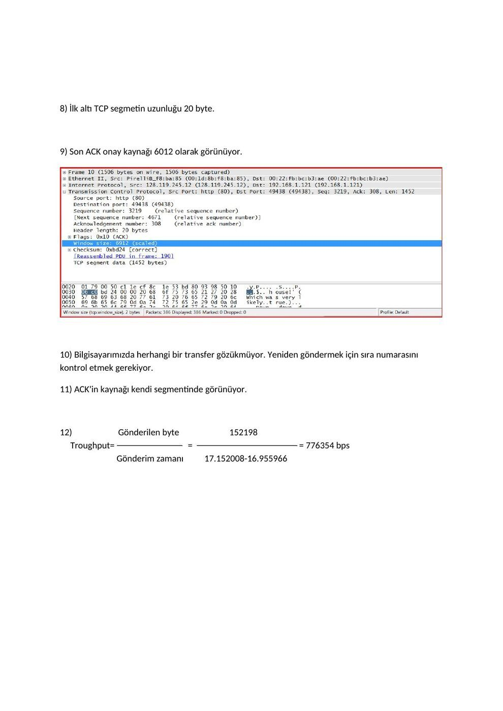
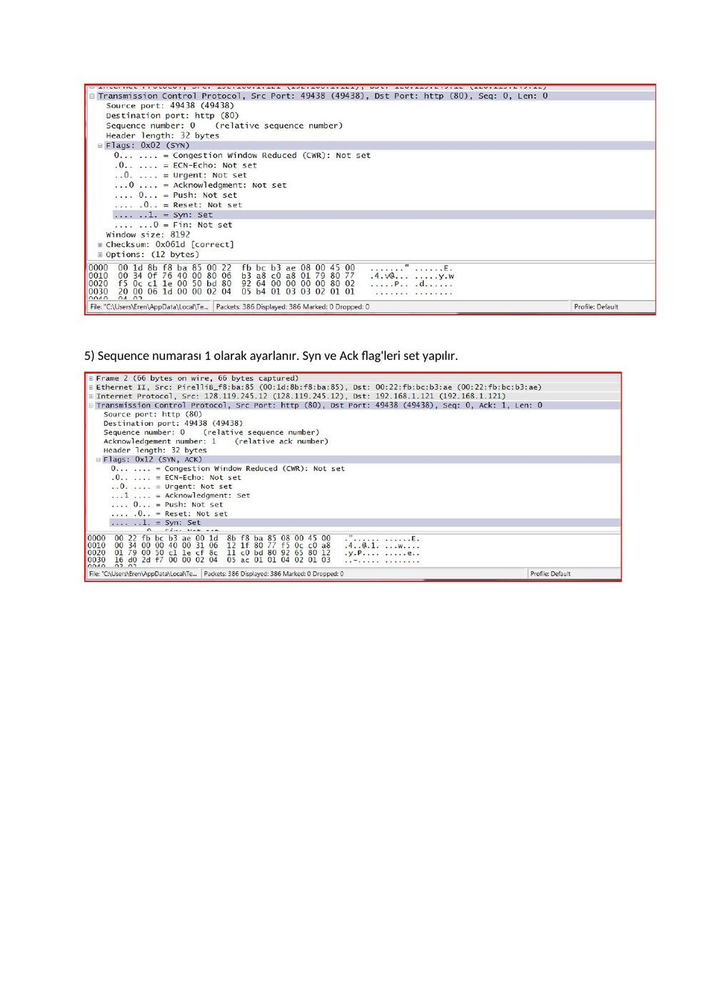
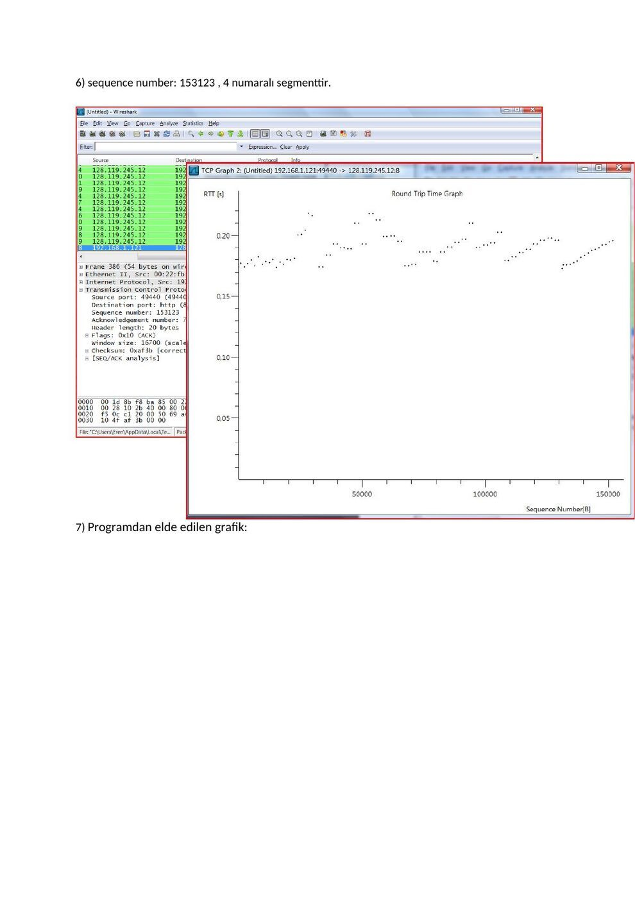
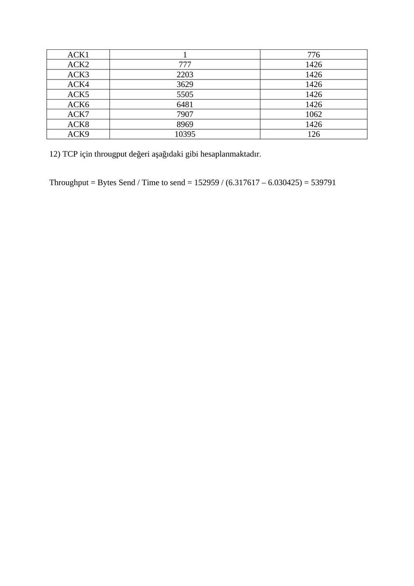
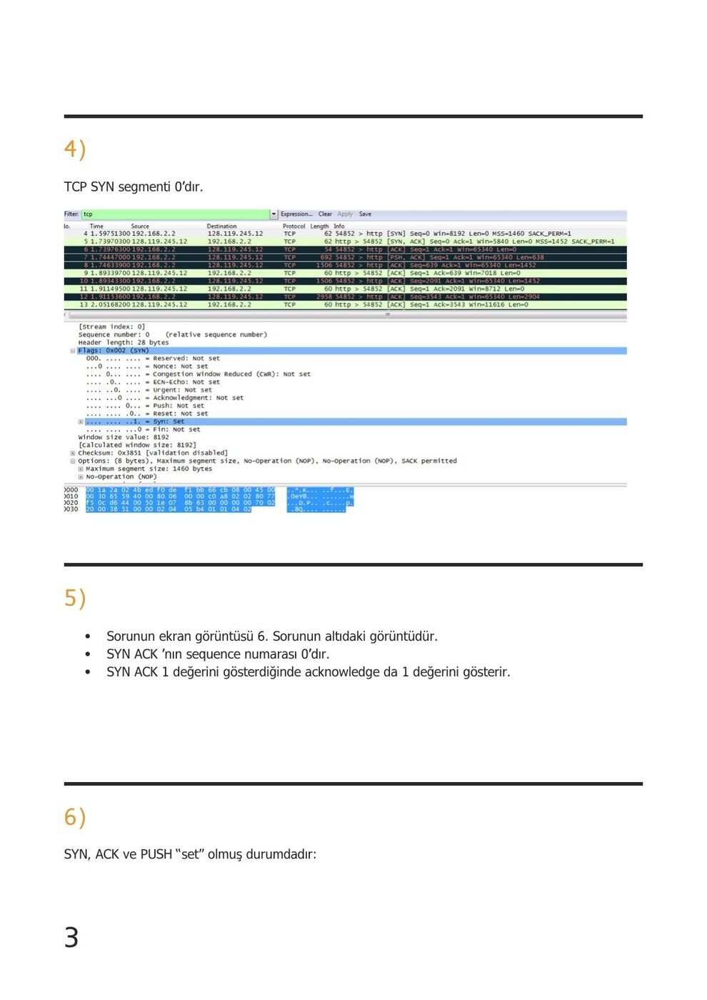
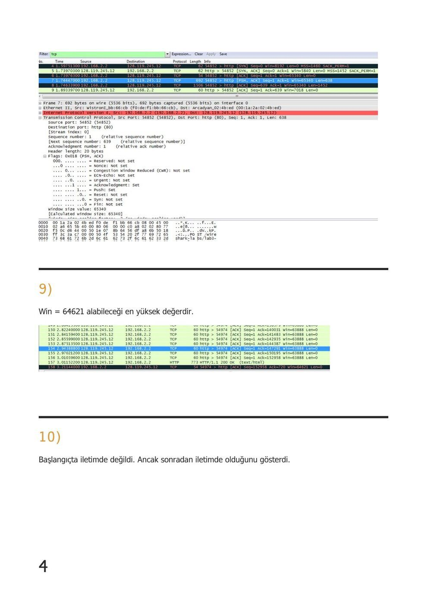
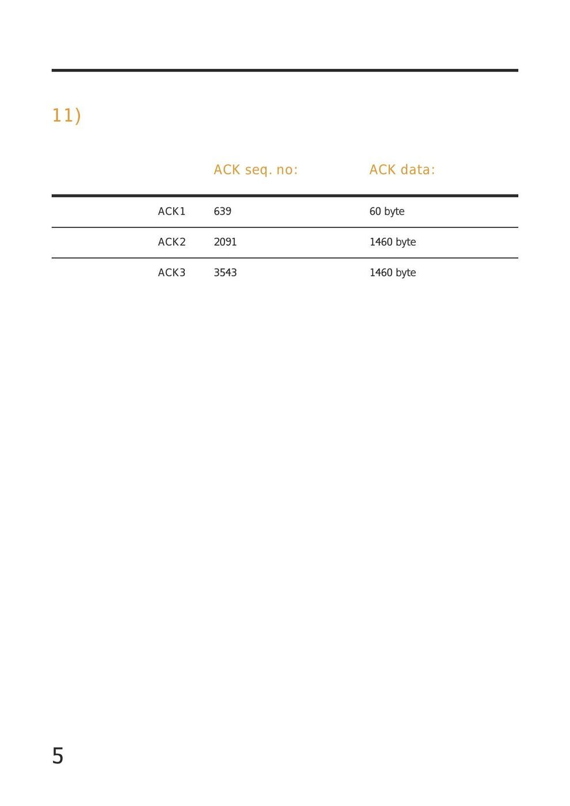
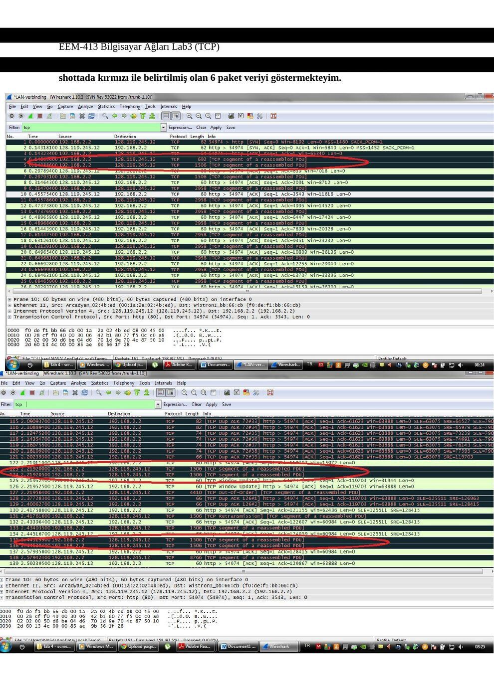
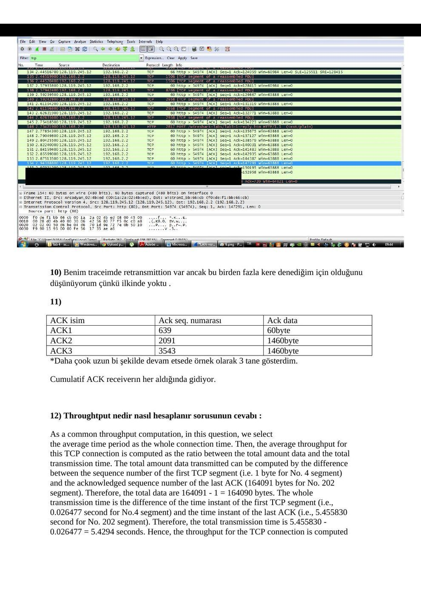

These are student lab reports from the course archive; student names, numbers and identity details have been removed. Where a document carries no date, the creation or last-modified date of the source file has been used. Archive-ready PDF copies of the documents can be downloaded at the end of the post.

## TCP report A

EEM413_Lab5

**1.** Our IP address: 192.168.1.121 Source port number: 49438

**2.** IP address: 128.119.245.12 and port number 80 (HTTP)

**3.** Source IP address: 192.168.1.121 and port number is 49438

**4.** The sequence number is marked as 0. SYN flag: 1

**5.** The sequence number is set to 0. The SYN and ACK flags are set.

**6.** sequence number: 153123

**7.** EstimatedRTT=(1−α)EstimatedRTT+α SampleRTT

**8.** The length of the first six TCP segments is 20 bytes.

**9.** The last ACK acknowledgment number appears as 6012.

**10.** No retransmission is visible on our computer. To check for retransmission, the sequence numbers need to be examined.

**11.** The source of the ACK appears in its own segment.

**12.** Bytes sent: 152198 Throughput= = = 776354 bps Transmission time: 17.152008-16.955966

**13.** We can see that the transfer starts slowly and then speeds up. The congestion that occurred can also be seen on the right side of the graph.

**14.** The transfer started slowly and finished by gradually speeding up. The congestion during the transfer can be seen on the right side of the graph.

## TCP report B

EEM 413

COMPUTER NETWORKS

LAB 3 : TCP

**1.** Source IP address: 192.168.1.121 Source port number: 49438

**2.** Destination IP address: 128.119.245.12 and port number 80 (HTTP)

**3.** Source IP address: 192.168.1.121 and port number is 49438

**4.** The sequence number is marked as 0. The SYN flag is 1.

**5.** The sequence number is set to 1. The SYN and ACK flags are set.

**6.** sequence number: 153123, it is segment number 4.

**7.** Graph obtained from the program:

**8.** The length of the first six TCP segments is 20 bytes.

**9.** The last ACK acknowledgment number appears as 6012.

**10.** No retransmission is visible on our computer. To check for retransmission, the sequence numbers need to be examined.

**11.** The source of the ACK appears in its own segment.

**12.** Bytes sent: 152198 Throughput= = = 776354 bps Transmission time: 17.152008-16.955966

**13.** We can see that the transfer starts slowly and then speeds up. The congestion that occurred can also be seen on the right side of the graph.

**14.** The transfer started slowly and finished by gradually speeding up. The congestion during the transfer can be seen on the right side of the graph.

In this experiment we carried out investigations on TCP. We uploaded a 150 KB ".txt" file to a server on the internet. We examined the sequence and acknowledgment numbers. We also saw TCP's congestion control, slow-start and congestion avoidance mechanisms.

## TCP report, 1 December 2011

EEM-413 Computer Networks Lab4 (TCP)

First, I downloaded the traces from http://gaia.cs.umass.edu/wireshark-labs/wireshark-traces.zip and opened the ethernal-trace-1 file in the Wireshark program.

**1.** The source (client computer) IP address is 192.168.1.102. The source port is also 1161.

**2.** The destination IP address is 128.119.245.12. The exchange took place on port 80, that is, the HTTP port. This can be seen in the screenshot for question 1.

**3.** The answer to this question was given in question 1.

In Wireshark, I went to Analyze -> Enabled Protocols and disabled HTTP.

**4.** The values are as seen below. The SYN flag is 1. The sequence number is 0.

**5.** The values are as seen below. The Acknowledgement flag is set. The sequence number is 1.

**6.** It is segment number 4. It is the TCP segment containing the HTTP POST command. The sequence number of this segment is 1.

**7.** The graph obtained is as follows.

**8.** The size of the first TCP segment is 565 bytes. The size of each of the other 5 TCP segments is 1460 bytes.

**9.** The minimum value is 5840. This value is seen during the final ACK exchange of the handshake.

**10.** One retransmitted packet is seen in the transfers. That is, there is no loss. I determined this by checking the sequence numbers of the TCP segments.

**11.** The requested information is seen in the table below.

Acknowledged Sequence Number Acknowledged Data

ACK1 1 776 ACK2 777 1426 ACK3 2203 1426 ACK4 3629 1426 ACK5 5505 1426 ACK6 6481 1426 ACK7 7907 1062 ACK8 8969 1426 ACK9 10395 126

**12.** The throughput for TCP is calculated as follows.

Throughput = Bytes Send / Time to send = 152959 / (6.317617 – 6.030425) = 539791

**13.** The graph is as follows.

COMMENT

In this experiment we carried out investigations on TCP. We uploaded a 150 KB ".txt" file to a server on the internet. We examined the sequence and acknowledgment numbers. We also saw TCP's congestion control, slow-start and congestion avoidance mechanisms.

## TCP report C

COMPUTER NETWORKS LABORATORY – 3 TCP

**1.** 

- My IP address: 192.168.2.2

- TCP port number: 54582

**2.** 

- Destination IP address: 128.119.254.12

- TCP port number: 80

**3.**  When we deselect HTTP, we see the TCP connections.

**4.**  The TCP SYN segment is 0.

**5.** 

- The screenshot for this question is the image below question 6.

- The sequence number of the SYN ACK is 0.

- When the SYN ACK shows the value 1, the acknowledgment also shows the value 1.

**6.**  SYN, ACK and PUSH are set:

**9.**  Win = 64621 is the highest value it can take.

**10.**  Initially it was not in transmission. However, it later showed that it was in transmission.

**11.** 

ACK seq. no: ACK data:

ACK1 639 60 bytes

ACK2 2091 1460 bytes

ACK3 3543 1460 bytes

## TCP report D

EEM-413 Computer Networks Lab3 (TCP) *First, after performing the necessary steps and the trace, we search for TCP and take our first screenshot.

**1.** 

As can be seen above, the source IP, which is my address, is 192.168.2.2, and the TCP port number is Source port: 54852.

**2.** 

The IP address of gaia.cs.umass.edu, that is, the destination, is 128.119.245.12 and

the TCP port number, as seen above, is:

TCP port number: 80.

EEM-413 Computer Networks Lab3 (TCP)

**3.** 

As mentioned, when the HTTP checkbox is cleared in the Analyze section, we can see only the TCP connections. The screenshot is below.

EEM-413 Computer Networks Lab3 (TCP)

**4.** The TCP SYN segment has the value 0, as shown below. It is shown together with the flags section.

**5.** 

The sequence number of the SYN ACK is Seq=0, as indicated in the 2nd row of the traces.

The ACK=1 in the SYN ACK shows that the acknowledgment value is 1.

The address gaia.cs.umass.edu determined this value according to the state of the SYN and ACK flags being set.

The state of the SYN flag being set and the other flags is indicated in the screenshot above.

EEM-413 Computer Networks Lab3 (TCP)

**6.** 

As seen in the screenshot below, SYN and ACK are set and the PUSH flag is also set. Therefore, the HTTP POST command part is the section marked in blue.

EEM-413 Computer Networks Lab3 (TCP) 7-8) **Since the data packets are not consecutive and other packets are interleaved among them, I show the 6 data packets marked in red in the 2 screenshots.

EEM-413 Computer Networks Lab3 (TCP) The ACK messages received for each pair marked in red above are located beneath those pairs.

**Professor, I am calculating all the values from my own trace, but you can see the ACK times or the normal times of all of them in the two screenshots above. I did not show the segment numbers, but I opened them up and wrote them in.

.

Segment Sending ACK Length (byte) RTT (s) Number Time (s) Time (s) 1 0.143234 0.144592 692 0.001358 639 0.148036 0.297894 1506 0.149858 125511 2.219200 2.195250 1506 0.000325 126963 2.219205 2.219524 1506 0.000474 129867 2.445199 2.592395 1506 0.147196 131319 2.445204 2.611942 1506 0.166738

I will write the EstimatedRTT for each segment below, but I will show the working for only one of them.

EstimatedRTT = 0.875 * EstimatedRTT + 0.125 * SampleRT

For the first, RTT = 0.001358 s

For the second, RTT = 0.875*0.001358 + 0.125*0.149858 = 0.0199205

For the third, RTT = 0.0174710

For the fourth, RTT = 0.0153463

Fifth RTT = 0.0318275

For the sixth, RTT = 0.0486913

**9.** 

For gaia.cs.umass.edu, the first ACK from the server is 5840 bytes, and by the time the last ACK arrives the window size can be at most 64621. It is shown in the Win: field in the screenshot below. In this trace the receiver did not have any problem with its buffer capacity.

EEM-413 Computer Networks Lab3 (TCP)

**10.** There is retransmission in my trace, but I think this is because I tried multiple times, since there was none the first time.

**11.** 

ACK name Ack seq. number Ack data ACK1 639 60 bytes ACK2 2091 1460 bytes ACK3 3543 1460 bytes *Although it continues for much longer, I showed 3 as examples.

The cumulative ACK is sent each time the receiver receives data.

**12.** The answer to the question of what throughput is and how it is calculated:

As a common throughput computation, in this question, we select the average time period as the whole connection time. Then, the average throughput for this TCP connection is computed as the ratio between the total amount data and the total transmission time. The total amount data transmitted can be computed by the difference between the sequence number of the first TCP segment (i.e. 1 byte for No. 4 segment) and the acknowledged sequence number of the last ACK (164091 bytes for No. 202 segment). Therefore, the total data are 164091 - 1 = 164090 bytes. The whole transmission time is the difference of the time instant of the first TCP segment (i.e.,

**0.** 026477 second for No.4 segment) and the time instant of the last ACK (i.e., 5.455830 second for No. 202 segment). Therefore, the total transmission time is 5.455830 -

**0.** 026477 = 5.4294 seconds. Hence, the throughput for the TCP connection is computed

EEM-413 Computer Networks Lab3 (TCP) as 164090/5.4294 = 30.222 KByte/sec.

**13.** ** My graph turned out slightly different from the example shown, but since I did not want to take it from the trace, I included my own.

*We can identify slow start by looking at it. I think this conclusion can also be reached from the HTTP POST transmission and the slope of the graph.

*I think the TCP sender is more aggressive in this structure and can become confused when the network is very busy; also, ACKs sometimes may not arrive in order. Sending small web objects during TCP's slow-start phase can cause a serious loss of time. Also, TCP's behavior depends directly on the application it is used in.

*Note: One report is dated 1 December 2011; the others are samples from different periods. Wireshark's relative sequence number 0 does not mean the actual header field is zero. A TCP payload of 1460 bytes and an IP datagram of 1500 bytes are not the same measure. These are student reports; the answers are not an official answer key.*

*Note: The calculation 152,198 bytes / (17.152008−16.955966) s in the first report gives approximately 776,354 bytes/s, not bit/s. The calculation 152,959 / (6.317617−6.030425) in the 1 December 2011 report gives approximately 532,602 bytes/s; the written value of 539,791 does not match these numbers.*
