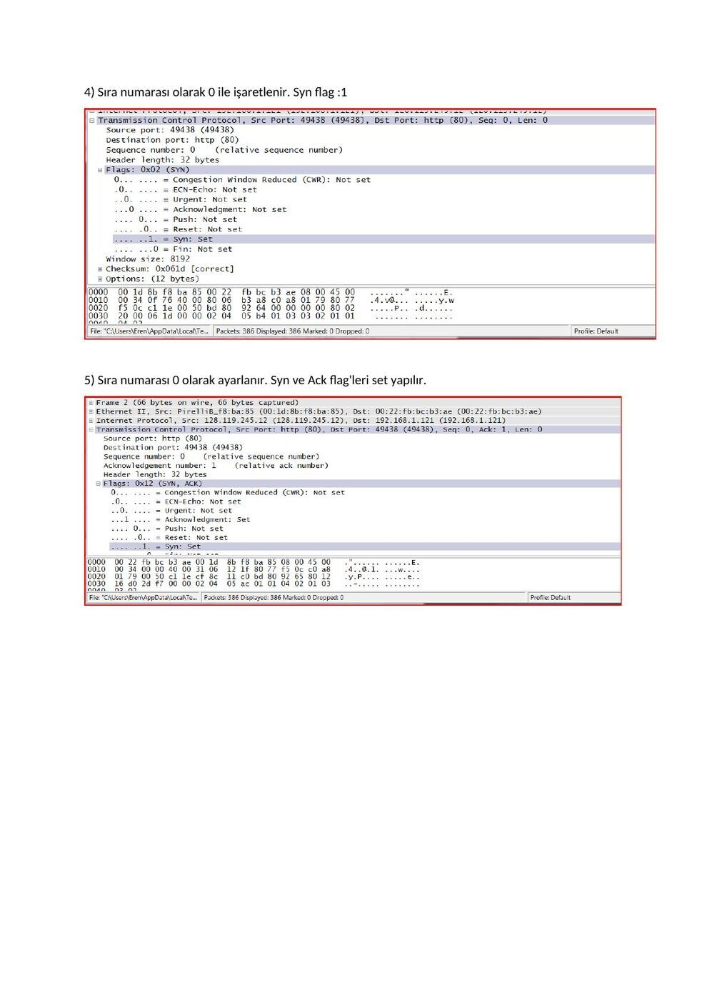
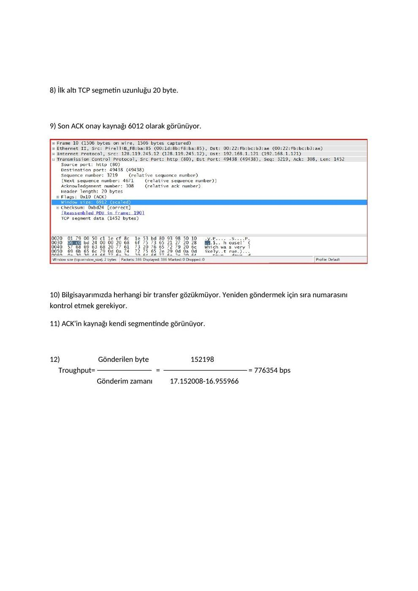
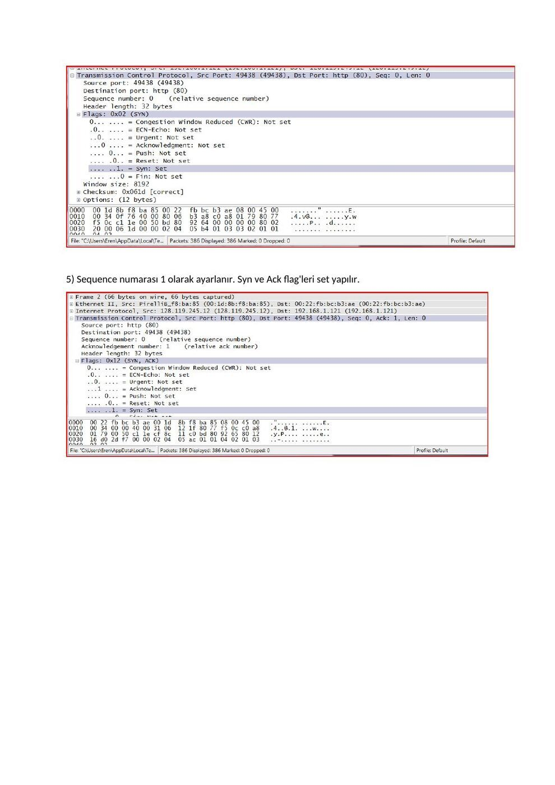
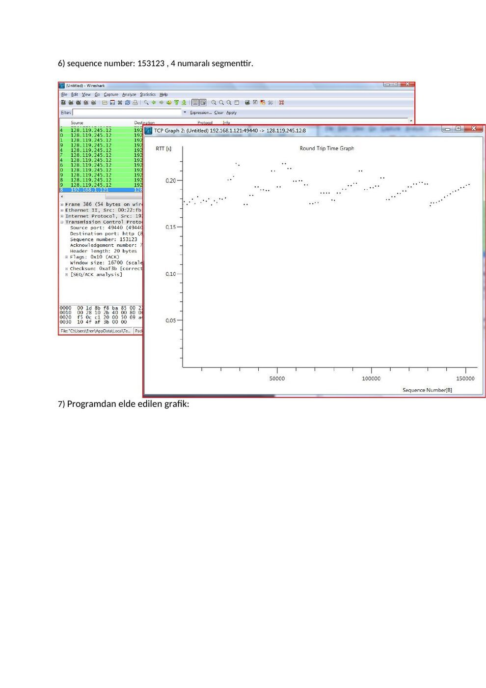
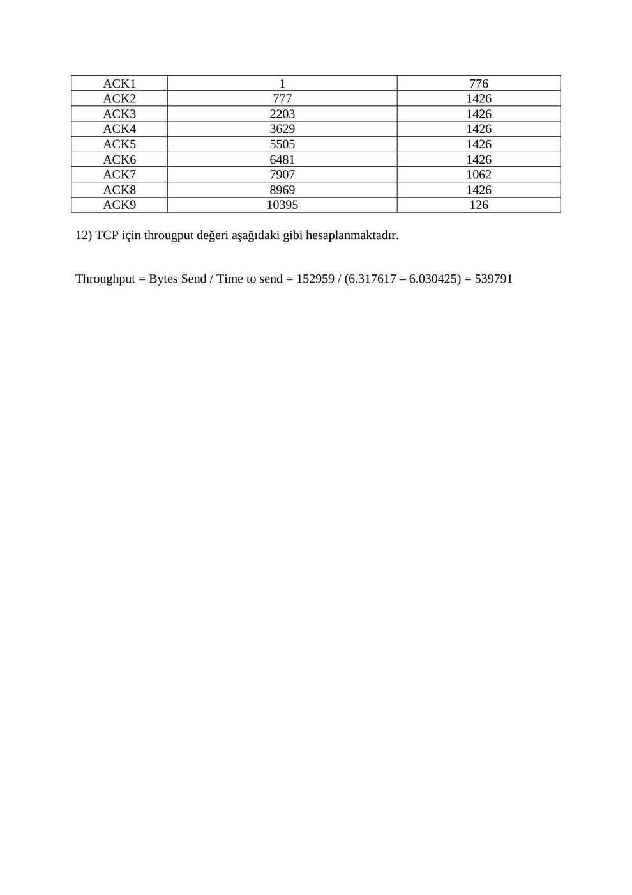
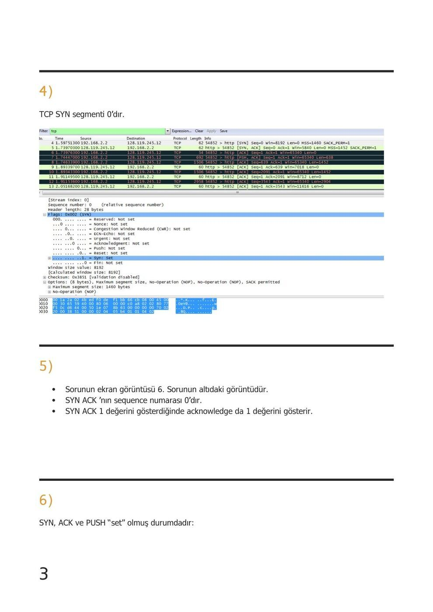
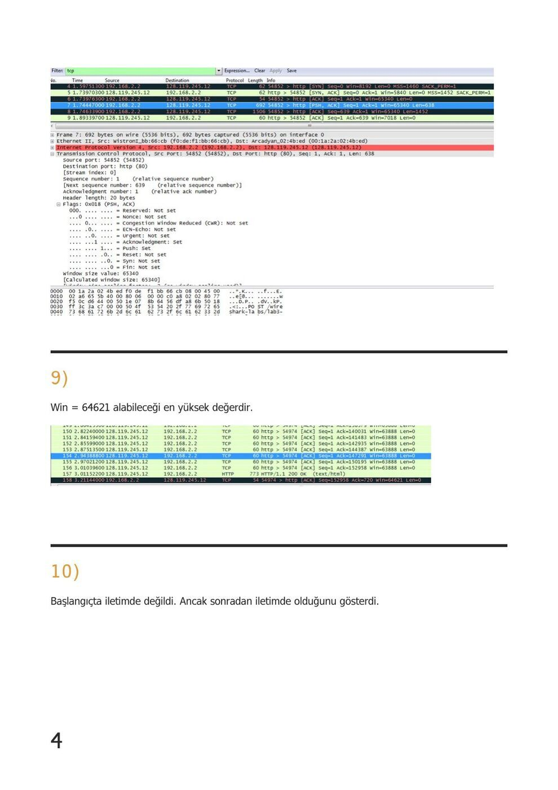
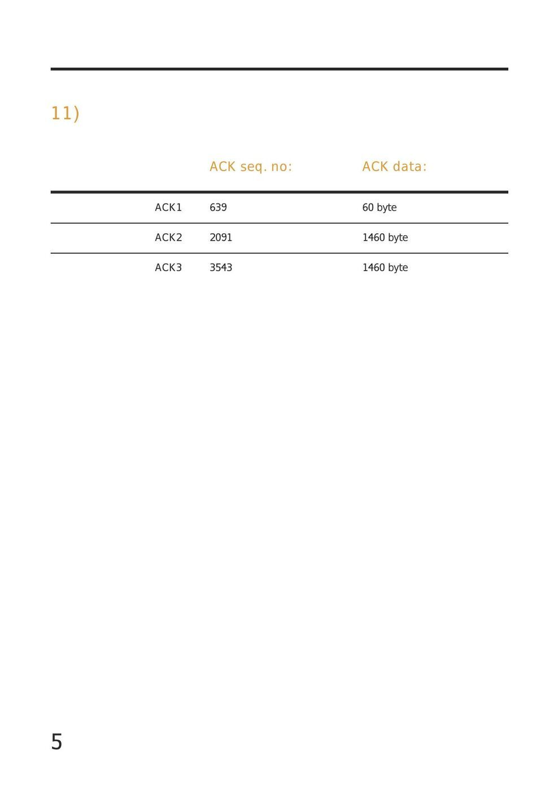
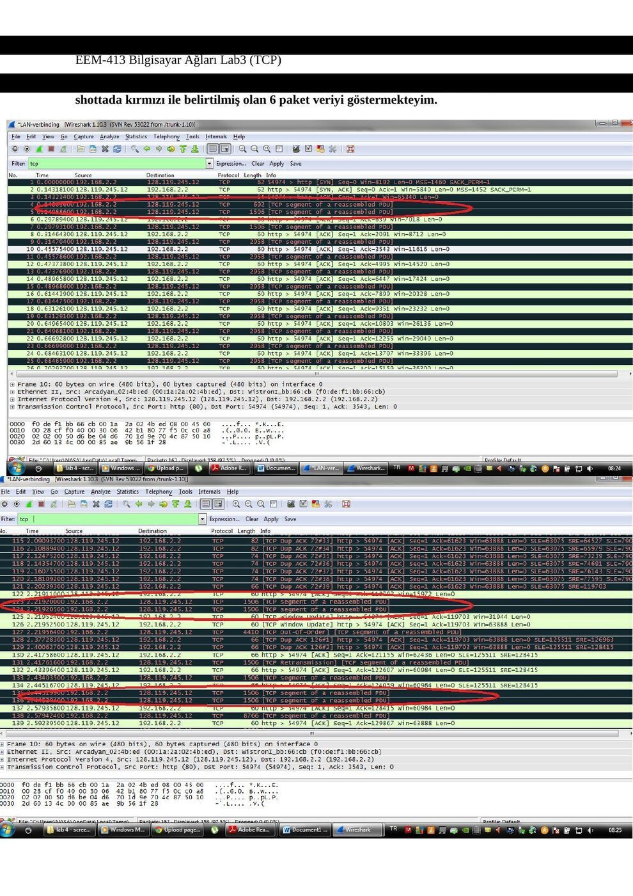
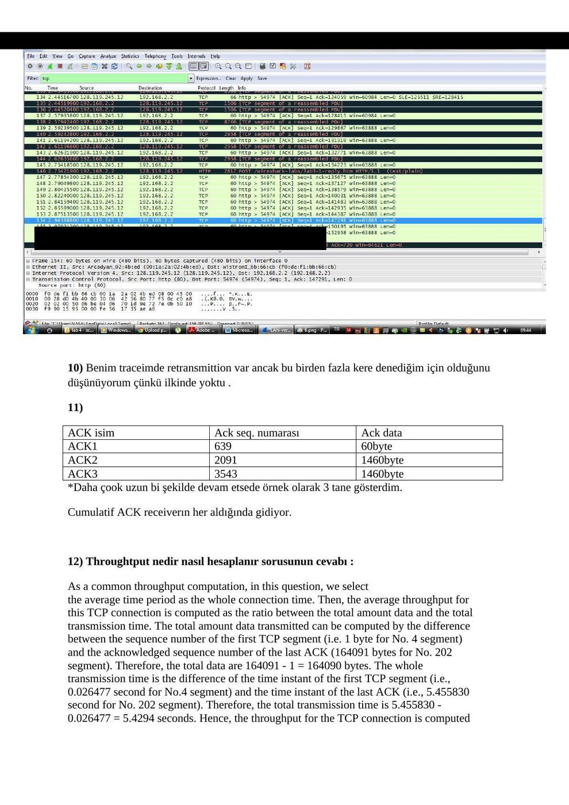

Ders arşivindeki öğrenci laboratuvar raporlarıdır; öğrenci adları, numaraları ve kimlik bilgileri çıkarılmıştır. Belge üzerindeki tarih bulunmadığında kaynak dosyanın oluşturulma ya da son değiştirilme tarihi kullanılmıştır. Belgelerin arşiv için hazırlanmış PDF kopyaları yazının sonunda indirilebilir.

## TCP raporu A

EEM413_Lab5

**1.** IP numaramız: 192.168.1.121 Source port numarası: 49438

**2.** IP adresi: 128.119.245.12 ve port numarası 80 (HTTP)

**3.** Source IP adres: 192.168.1.121 ve port numarası 49438'dir

**4.** Sıra numarası olarak 0 ile işaretlenir. Syn flag :1

**5.** Sıra numarası 0 olarak ayarlanır. Syn ve Ack flag'leri set yapılır.

**6.** sequence number: 153123

**7.** EstimatedRTT=(1−α)EstimatedRTT+α SampleRTT

**8.** İlk altı TCP segmetin uzunluğu 20 byte.

**9.** Son ACK onay kaynağı 6012 olarak görünüyor.

**10.** Bilgisayarımızda herhangi bir transfer gözükmüyor. Yeniden göndermek için sıra numarasını kontrol etmek gerekiyor.

**11.** ACK'in kaynağı kendi segmentinde görünüyor.

**12.** Gönderilen byte 152198 Troughput= = = 776354 bps Gönderim zamanı 17.152008-16.955966

**13.** Aktarımın yavaşça başlayıp, daha sonra hızlandığını görebiliriz. Ayrıca oluşan sıkışıklıkta grafiğin sağ tarafında görülebilmekte.

**14.** Transfer yavaşça başladı ve giderek hızlanarak son buldu. Transfer sırasında ki sıkışıklık grafikte sağ tarata görülebilmekte.

## TCP raporu B

EEM 413

BİLGİSAYAR AĞLARI

LAB 3 : TCP

**1.** Source IP nadresi: 192.168.1.121 Source port numarası: 49438

**2.** Hedef IP adresi: 128.119.245.12 ve port numarası 80 (HTTP)

**3.** Source IP adres: 192.168.1.121 ve port numarası 49438'dir

**4.** Sequence numarası olarak 0 ile işaretlenir. Syn flag :1 olmuştur

**5.** Sequence numarası 1 olarak ayarlanır. Syn ve Ack flag'leri set yapılır.

**6.** sequence number: 153123 , 4 numaralı segmenttir.

**7.** Programdan elde edilen grafik:

**8.** İlk altı TCP segmetin uzunluğu 20 byte.

**9.** Son ACK onay kaynağı 6012 olarak görünüyor.

**10.** Bilgisayarımızda herhangi bir transfer gözükmüyor. Yeniden göndermek için sıra numarasını kontrol etmek gerekiyor.

**11.** ACK'in kaynağı kendi segmentinde görünüyor.

**12.** Gönderilen byte 152198 Troughput= = = 776354 bps Gönderim zamanı 17.152008-16.955966

**13.** Aktarımın yavaşça başlayıp, daha sonra hızlandığını görebiliriz. Ayrıca oluşan sıkışıklıkta grafiğin sağ tarafında görülebilmekte.

**14.** Transfer yavaşça başladı ve giderek hızlanarak son buldu. Transfer sırasında ki sıkışıklık grafikte sağ tarafta görülebilmekte.

Bu deneyde TCP üzerinde incelemelerde bulunduk. 150kb’lık bir “.txt” dosyasını internet üzerinde bir server’a yükledik. Sequence ve acknowledge numaralarını inceledik. Ayrıca TCP’nin congestion control, slow-start ve congestion avoidence yapılarını gördük.

## TCP raporu, 1 Aralık 2011

EEM-413 Bilgisayar Ağları Lab4 (TCP)

İlk olarak http://gaia.cs.umass.edu/wireshark-labs/wireshark-traces.zip adresinden trace’leri yükledim ve ethernal-trace-1 dosyasını Wireshark programında açtım.

**1.** Source(Client computer) IP adresi 192.168.1.102 dir. Ayrıca source port 1161’dir.

**2.** Hedef (destination) IP adresi, 128.119.245.12’dir. Port 80’den alışveriş yapılmıştır. Yani HTTP portu. Bu 1. Sorunun resminde görülmektedir.

**3.** Bu sorunun cevabı 1. Soruda verilmiştir.

Wireshark programında analysis -> enabled protocols’e girip http’yi devredışı bıraktım.

**4.** Değerler aşağıda görüldüğü gibidir. SYN flag 1 olmuştur. Sequence numarası 0’dır.

**5.** Değerler aşağıda görüldüğü gibidir. Acknowledgement bayrağı set olmuştur. Sequence numarası 1’dir.

**6.** 4 numaralı segmenttir. HTTP POST komutu içeren TCP segmentidir. Bu segmentin dizi numarası 1 dir.

**7.** Elde edilen grafik bu şekildedir.

**8.** İlk TCP segmentinin boyutu 565 byte’tır. Diğer 5 TCP segmentinin her birinin boyu ise 1460 byte’tır.

**9.** Minimum miktar 5840’dir. Bu değer handshaking için son ACK alışverişi esnasında görülmektedir.

**10.** Transferlerde tekrar gönderilen bir paket görülmektedir. Yani kayıp söz konusu değildir. Bunu TCP segmentlerinin dizi numaralarını kontrol ederek gördüm.

**11.** Aşağıdaki tabloda istenen bilgiler görülmektedir.

Acknowledged Sequence Number Acknowledged Data

ACK1 1 776 ACK2 777 1426 ACK3 2203 1426 ACK4 3629 1426 ACK5 5505 1426 ACK6 6481 1426 ACK7 7907 1062 ACK8 8969 1426 ACK9 10395 126

**12.** TCP için througput değeri aşağıdaki gibi hesaplanmaktadır.

Throughput = Bytes Send / Time to send = 152959 / (6.317617 – 6.030425) = 539791

**13.** Grafik aşağıdaki gibidir.

YORUM

Bu deneyde TCP üzerinde incelemelerde bulunduk. 150kb’lık bir “.txt” dosyasını internet üzerinde bir server’a yükledik. Sequence ve acknowledge numaralarını inceledik. Ayrıca TCP’nin congestion control, slow-start ve congestion avoidence yapılarını gördük.

## TCP raporu C

BİLGİSAYAR AĞLARI LABORATUVARI – 3 TCP

**1.** 

- IP adresim : 192.168.2.2

- TCP port numarası : 54582

**2.** 

- Destination IP Adres : 128.119.254.12

- TCP port numarası : 80

**3.**  HTTP seçimi kaldırıldığımız zaman TCP bağlantılarını görürüz.

**4.**  TCP SYN segmenti 0’dır.

**5.** 

- Sorunun ekran görüntüsü 6. Sorunun altıdaki görüntüdür.

- SYN ACK ’nın sequence numarası 0’dır.

- SYN ACK 1 değerini gösterdiğinde acknowledge da 1 değerini gösterir.

**6.**  SYN, ACK ve PUSH “set” olmuş durumdadır:

**9.**  Win = 64621 alabileceği en yüksek değerdir.

**10.**  Başlangıçta iletimde değildi. Ancak sonradan iletimde olduğunu gösterdi.

**11.** 

ACK seq. no: ACK data:

ACK1 639 60 byte

ACK2 2091 1460 byte

ACK3 3543 1460 byte

## TCP raporu D

EEM-413 Bilgisayar Ağları Lab3 (TCP) *İlk olarak gerekli işlemleri yapıp yaptığımız trace işleminden sonra TCP araması yaparak ilk screenshotımızı alıyoruz.

**1.** 

Yukarıda da görüldüğü gibi source IP 192.168.2.2 olan benim adresim ve TCP port numarasıda Source port : 54852 dir.

**2.** 

gaia.cs.umass.edu adresinin yani destination ın IP Adresi : 128.119.245.12 ve

TCP port numarası yukarıda da görüldüğü gibi ;

TCP port numarası : 80 dir.

EEM-413 Bilgisayar Ağları Lab3 (TCP)

**3.** 

Bahsedildiği üzere analyse kısmından http işareti kaldırıldığında sadece TCP connectionları görebilmekteyiz. Screenshotı aşağıdadır.

EEM-413 Bilgisayar Ağları Lab3 (TCP)

**4.** TCP SYN segmenti aşağıda da gösterildiği gibi 0 değerine sahiptir. Flag kısmı ile birlikte gösterilmektedir.

**5.** 

SYN ACK nın sequence numarası tracelerdeki 2. Sırada belirtildiği gibi Seq=0 dır.

SYN ACK kısmındaki ACK =1 kısmı acknowlegde değerinin 1 olduğunu göstermektedir.

Gaia.cs.umass.edu adresi bu değeri SYN ve ack flaglarının set olma durumuna göre tanımlamıştır.

Syn flagının set olma durumu ve diğer flagların durumu yukarıdaki screenshotta belirtilmektedir.

EEM-413 Bilgisayar Ağları Lab3 (TCP)

**6.** 

Aşağıdaki screenshottada görüldüğü gibi SYN ve ACK set olmuş durumda ve push flagi set edilmiş durumdadır. Bundan dolayı HTTP POST command kısmıda mavi ile belirtilen kısımdır.

EEM-413 Bilgisayar Ağları Lab3 (TCP) 7-8) **Veri paketleri arka arkaya olmayıp araya başka paketlerde girdiği için 2 screen shottada kırmızı ile belirtilmiş olan 6 paket veriyi göstermekteyim.

EEM-413 Bilgisayar Ağları Lab3 (TCP) Yukarıda kırmızı ile gösterilen her ikili için gelen ACK mesajları bu ikililerin altlarında bulunmaktadır.

**Hocam tüm değerleri kendi traceimden hesaplıyorum ancak hepsinin ACK sürelerini veye normal sürelerini yukarıdaki iki screenshoot da görebilirsiniz. Segment numaralarını göstermedim ama içlerini açıp yazdım .

.

Segment Gönderme ACK Uzunluk(byte) RTT(sn) Numarası Süresi(sn) süresi(sn) 1 0,143234 0.144592 692 0.001358 639 0,148036 0.297894 1506 0.149858 125511 2.219200 2.195250 1506 0.000325 126963 2.219205 2.219524 1506 0.000474 129867 2.445199 2.592395 1506 0.147196 131319 2.445204 2.611942 1506 0.166738

EstimatedRTT leri her segment için aşağıya yazıcam ancak 1 tanesinin çözümünü göstericem.

EstimatedRTT = 0.875 * EstimatedRTT + 0.125 * SampleRT

Birinci için RTT =0.001358 sn

İkinci için RTT = 0.875*0.001358 + 0.125*0.149858 = 0.0199205

Üçüncü için RTT = 0.0174710

Dördüncü için RTT = 0.0153463

Beşinci RTT = 0.0318275

Altıncı için RTT = 0.0486913

**9.** 

gaia.cs.umass.edu bu adres için ilk serverdan gelen ack 5840 byte ve son Ack geldiğinde windows size en çok 64621 olabiliyor. Aşağıdaki screenshoot daka win : kısmında belirtilmiştir. Bu trace de receiver buffer kapasitesiyle ilgili bir sıkıntı çekmemiştir.

EEM-413 Bilgisayar Ağları Lab3 (TCP)

**10.** Benim traceimde retransmittion var ancak bu birden fazla kere denediğim için olduğunu düşünüyorum çünkü ilkinde yoktu .

**11.** 

ACK isim Ack seq. numarası Ack data ACK1 639 60byte ACK2 2091 1460byte ACK3 3543 1460byte *Daha çook uzun bi şekilde devam etsede örnek olarak 3 tane gösterdim.

Cumulatif ACK receiverın her aldığında gidiyor.

**12.** Throughtput nedir nasıl hesaplanır sorusunun cevabı :

As a common throughput computation, in this question, we select the average time period as the whole connection time. Then, the average throughput for this TCP connection is computed as the ratio between the total amount data and the total transmission time. The total amount data transmitted can be computed by the difference between the sequence number of the first TCP segment (i.e. 1 byte for No. 4 segment) and the acknowledged sequence number of the last ACK (164091 bytes for No. 202 segment). Therefore, the total data are 164091 - 1 = 164090 bytes. The whole transmission time is the difference of the time instant of the first TCP segment (i.e.,

**0.** 026477 second for No.4 segment) and the time instant of the last ACK (i.e., 5.455830 second for No. 202 segment). Therefore, the total transmission time is 5.455830 -

**0.** 026477 = 5.4294 seconds. Hence, the throughput for the TCP connection is computed

EEM-413 Bilgisayar Ağları Lab3 (TCP) as 164090/5.4294 = 30.222 KByte/sec.

**13.** ** Benim grafiğim örnek gösterilenden biraz farklı çıktı ama trace den almak istemediğim için kendiminkini koydum .

*Slow startı baktığımızda tanımlayabiliriz. HTTP POST gönderisi ve grafiğin eğimindende bu sonuca varılabiliceğini düşnüyorum.

*Tcp göndericisi bu yapıda daha agresif ve ağ çok yoğun olduğunda karışabiliceğini düşünüyorum ayrıca ACK lar bazen düzenli gelemeyebiliyor.TCP nin slow start fazında küçük web objelerinin gönderilmesi ciddi bi zaman kaybı olabilir.Ayrıca TCP nin davranışı direk kullanıldığı uygulamaya bağlıdır.

*Not: Bir raporda 1 Aralık 2011 tarihi bulunur; diğerleri farklı dönemlerden örneklerdir. Wireshark’ın göreli sıra numarası 0 gerçek başlık alanının sıfır olduğu anlamına gelmez. 1460 bayt TCP yükü ile 1500 bayt IP datagramı aynı ölçü değildir. Bunlar öğrenci raporlarıdır; cevaplar resmî anahtar değildir.*

*Not: İlk rapordaki 152.198 bayt / (17,152008−16,955966) s hesabı yaklaşık 776.354 bayt/s verir; bit/s değildir. 1 Aralık 2011 raporundaki 152.959 / (6,317617−6,030425) işlemi yaklaşık 532.602 bayt/s’dir; yazılan 539.791 değeri bu sayılarla uyuşmaz.*
