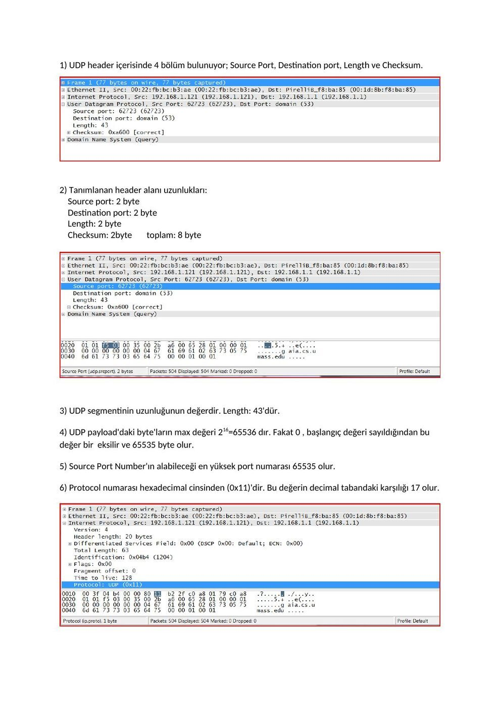
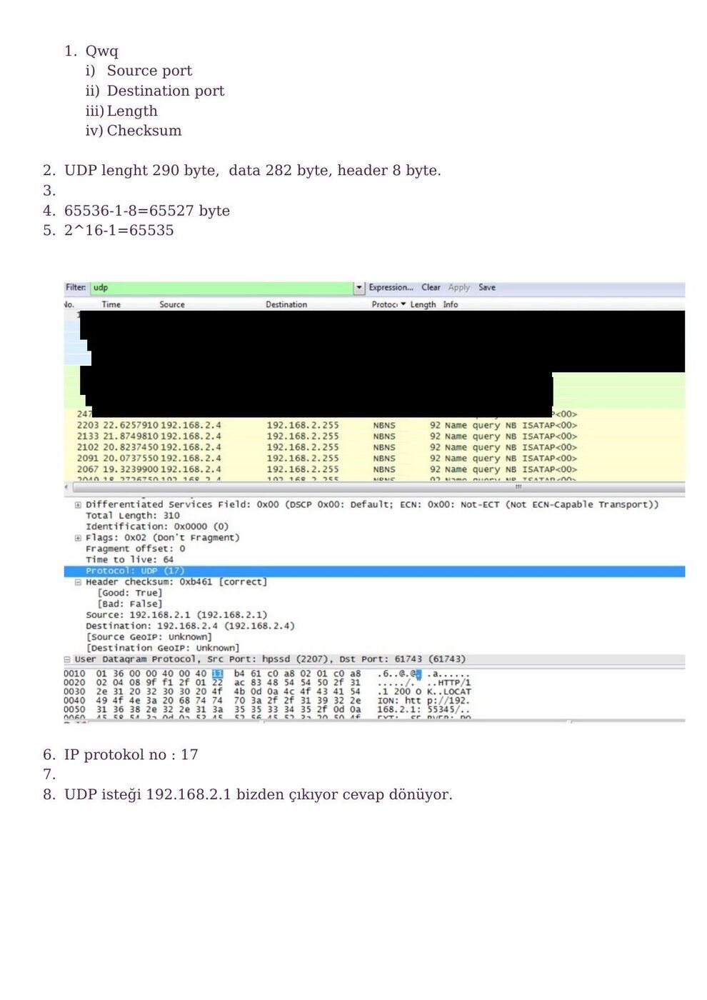
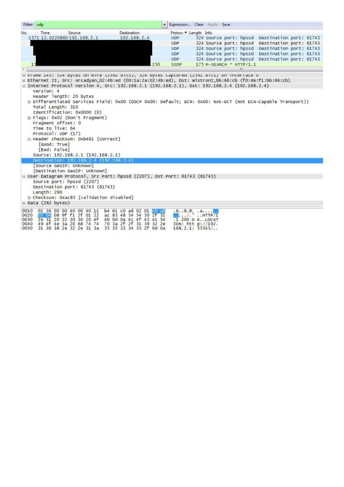
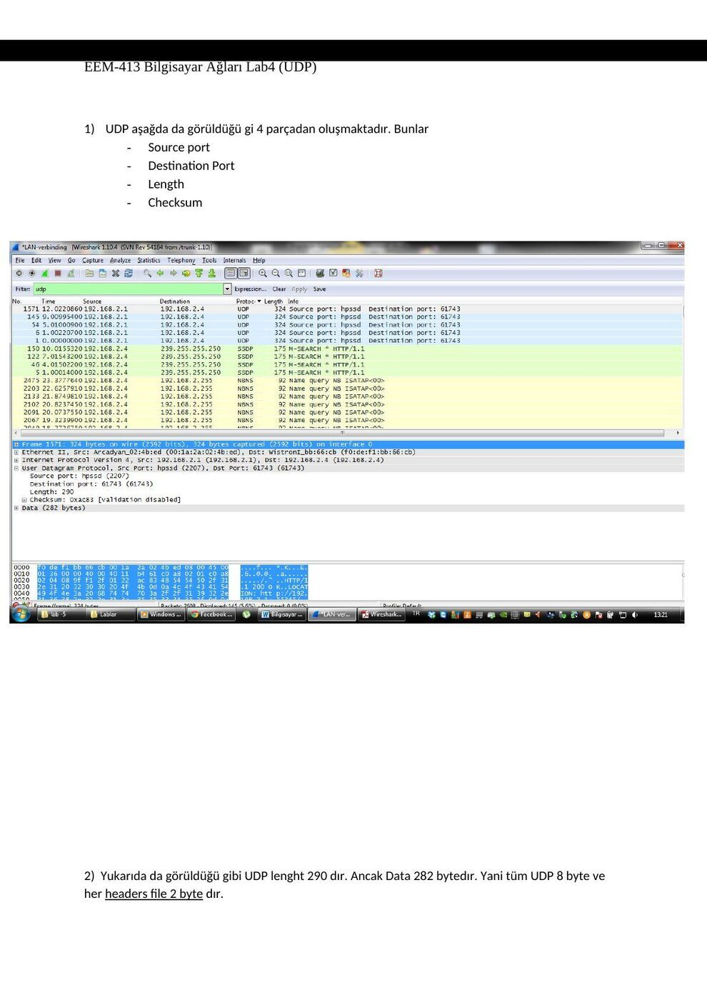
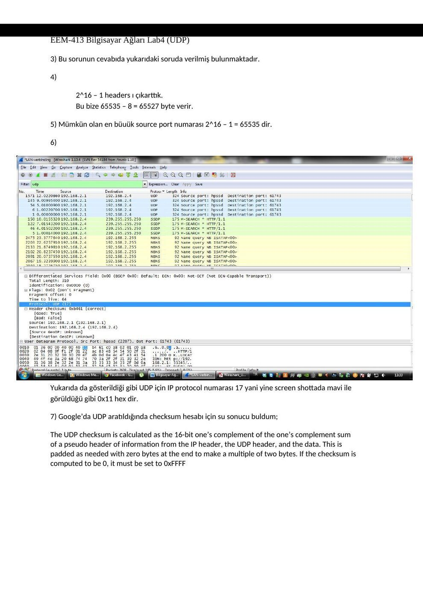

These are student laboratory reports from the course archive; student names, numbers, and identity information have been removed. Where the document carries no date, the creation or last-modified date of the source file has been used. PDF copies of the documents prepared for the archive can be downloaded at the end of the post.

## UDP Report A

EEM 413 COMPUTER NETWORKS EXPERIMENT-4 UDP

**1.** The UDP header contains 4 fields: Source Port, Destination Port, Length, and Checksum.

**2.** The lengths of the defined header fields are: Source port: 2 bytes, Destination port: 2 bytes, Length: 2 bytes, Checksum: 2 bytes, total: 8 bytes.

**3.** It is the value of the length of the UDP segment. Length: 43.

**4.** The maximum value of the bytes in the UDP payload is 216=65536. However, since 0 is counted as the starting value, this value is reduced by one and becomes 65535 bytes.

**5.** The highest port number the Source Port Number can take is 65535.

**6.** The protocol number in hexadecimal is (0x11). Its equivalent in decimal is 17.

**7.** A pseudo header field is used when calculating the UDP checksum. (IP header, UDP header, data) If the checksum result is 0, it is set to 0xFFFF.

**8.** For the first packet: source port :: 62723, destination port :: 53. For the second packet: source port :: 53, destination port :: 62723.

Extra Credit: A UDP packet was captured.

## UDP Report B

Computer Networks Laboratory 4

UDP

**1.** Qwq i) Source port ii) Destination port iii) Length iv) Checksum

**2.** UDP length 290 bytes, data 282 bytes, header 8 bytes.

**3.** 

**4.** 65536-1-8=65527 bytes

**5.** 2^16-1=65535

**6.** IP protocol no: 17

**7.** 

**8.** The UDP request 192.168.2.1 originates from us and a reply comes back.

## UDP Report C

EEM-413 Computer Networks Lab4 (UDP)

NOTE: In general, we connected to the internet and, after a short browsing session, carried out UDP transmit and receive operations, and this screenshot was produced.

EEM-413 Computer Networks Lab4 (UDP)

**1.** As can also be seen below, UDP consists of 4 parts. These are

- Source port

- Destination Port

- Length

- Checksum

**2.** As can also be seen above, the UDP length is 290. However, the data is 282 bytes. That is, the whole UDP header is 8 bytes and each header field is 2 bytes.

EEM-413 Computer Networks Lab4 (UDP)

**3.** The answer to this question is also given in the question above.

**4.** 

2^16 – 1, we subtracted the headers. This gives us 65535 – 8 = 65527 bytes.

**5.** The largest possible source port number is 2^16 – 1 = 65535.

**6.** 

As also shown above, the IP protocol number for UDP is 17, which is also 0x11 in hex, as seen in blue in the screenshot.

**7.** When I searched for UDP on Google, I found the following result for the checksum calculation;

The UDP checksum is calculated as the 16-bit one’s complement of the one’s complement sum of a pseudo header of information from the IP header, the UDP header, and the data. This is padded as needed with zero bytes at the end to make a multiple of two bytes. If the checksum is computed to be 0, it must be set to 0xFFFF

EEM-413 Computer Networks Lab4 (UDP)

**8.** The UDP request is sent by me.

The UDP reply comes back.

*Note: The UDP header is 8 bytes; the UDP Length field is the sum of the header and the payload. The maximum value of the 16-bit field is 65,535. In IPv4, without options, the upper limit of the UDP user payload is 65,535−20−8 = 65,507 bytes; subtracting 8 from the UDP length field alone does not account for the IP limit.*
