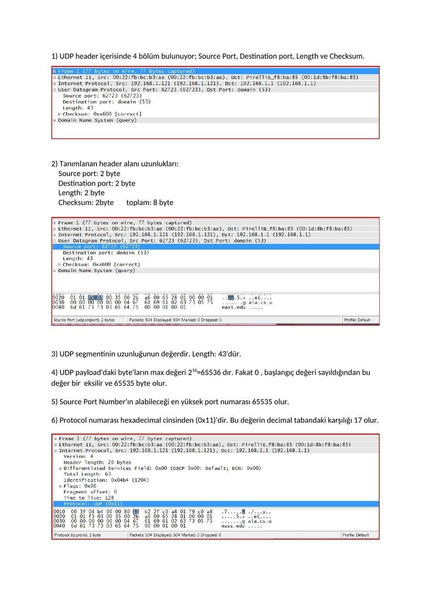
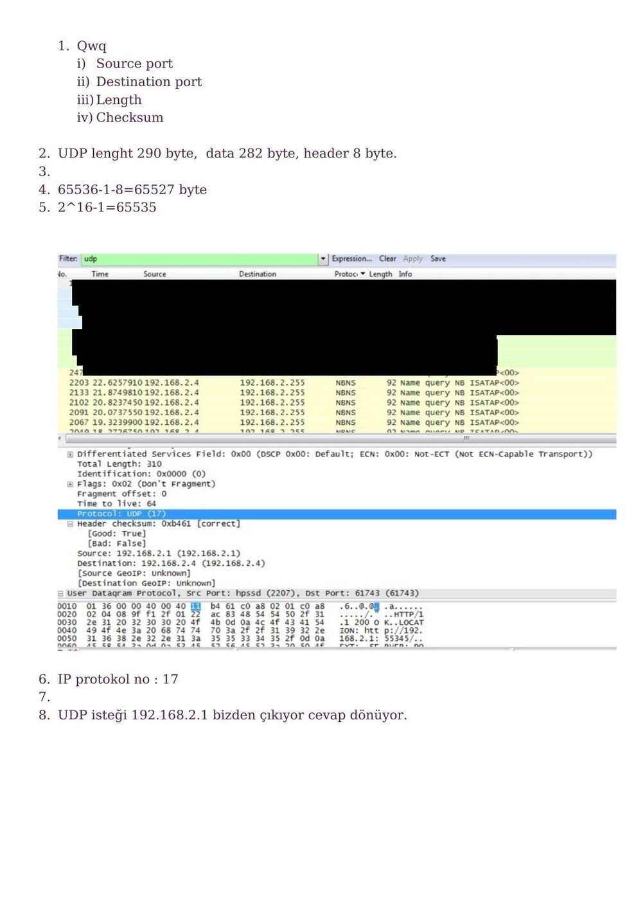
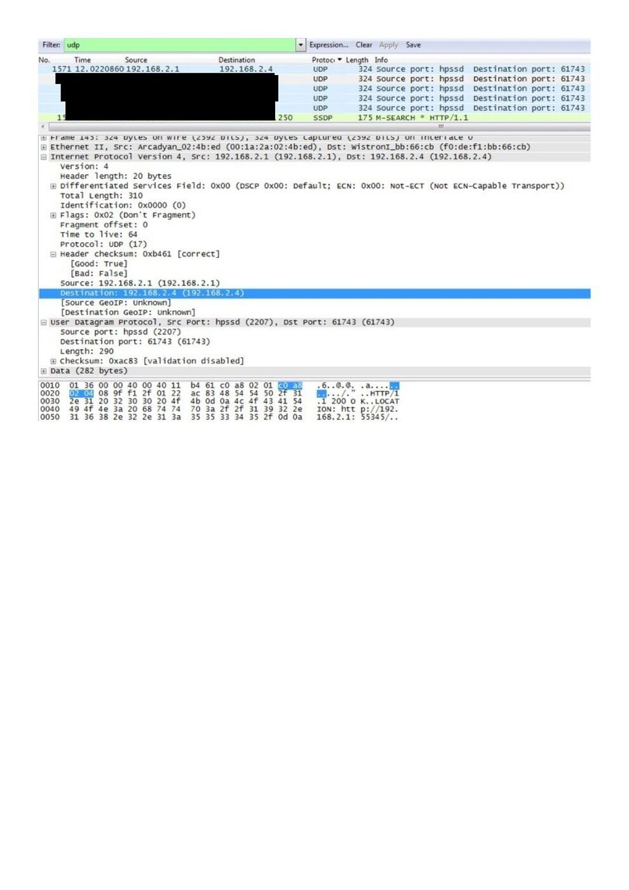
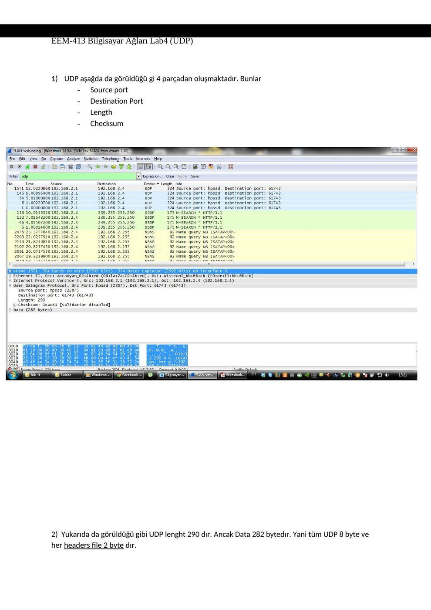
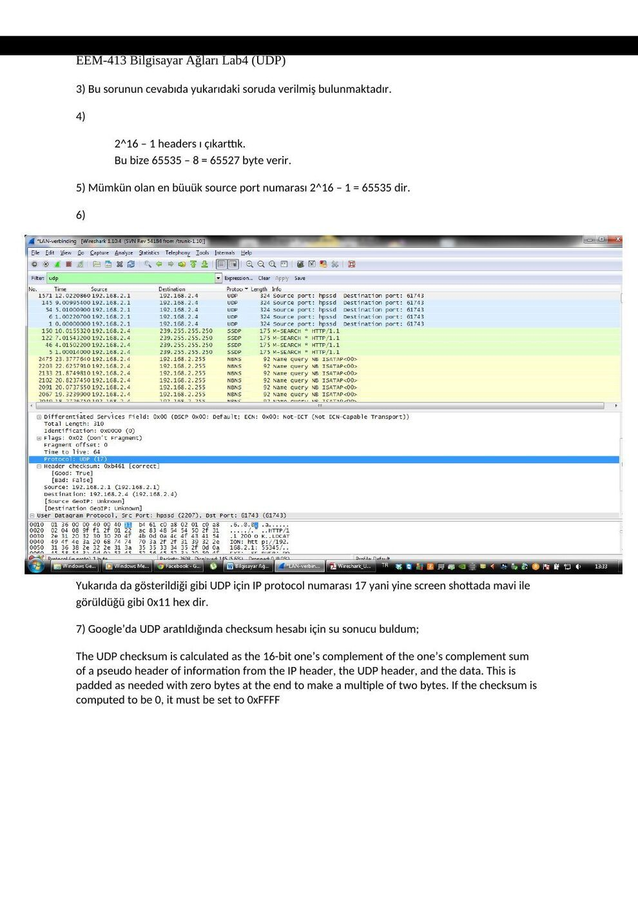

Ders arşivindeki öğrenci laboratuvar raporlarıdır; öğrenci adları, numaraları ve kimlik bilgileri çıkarılmıştır. Belge üzerindeki tarih bulunmadığında kaynak dosyanın oluşturulma ya da son değiştirilme tarihi kullanılmıştır. Belgelerin arşiv için hazırlanmış PDF kopyaları yazının sonunda indirilebilir.

## UDP raporu A

EEM 413 BİLGİSAYAR AĞLARI DENEY-4 UDP

**1.** UDP header içerisinde 4 bölüm bulunuyor; Source Port, Destination port, Length ve Checksum.

**2.** Tanımlanan header alanı uzunlukları: Source port: 2 byte Destination port: 2 byte Length: 2 byte Checksum: 2byte toplam: 8 byte

**3.** UDP segmentinin uzunluğunun değerdir. Length: 43'dür.

**4.** UDP payload'daki byte'ların max değeri 216=65536 dır. Fakat 0 , başlangıç değeri sayıldığından bu değer bir eksilir ve 65535 byte olur.

**5.** Source Port Number'ın alabileceği en yüksek port numarası 65535 olur.

**6.** Protocol numarası hexadecimal cinsinden (0x11)'dir. Bu değerin decimal tabandaki karşılığı 17 olur.

**7.** UDP checksum hesaplanırken Pseudo Header Field kullanılır. (IP header, UDP header, data) Eğer checksum sonucu 0 çıkarsa, 0xFFFF’e set edilir.

**8.** İlk paket için ; source port :: 62723 , Destination port :: 53. İkinci paket için source port :: 53 , Destination port :: 62723.

Extra Credit: Bir UDP paket yakalandı.

## UDP raporu B

Bilgisayar Ağları Laboratuva rı 4

UDP

**1.** Qwq i) Source port ii) Destination port iii) Length iv) Checksum

**2.** UDP lenght 290 byte, data 282 byte, header 8 byte.

**3.** 

**4.** 65536-1-8=65527 byte

**5.** 2^16-1=65535

**6.** IP protokol no : 17

**7.** 

**8.** UDP isteği 192.168.2.1 bizden çıkıyor cevap dönüyor.

## UDP raporu C

EEM-413 Bilgisayar Ağları Lab4 (UDP)

NOT: Genel olarak internete bağlanıp kısa bir gezinti yapıldığında UDP transmit ve receiving işlemlerini gerçekleştirdik ve böyle bir screen shot oluştu.

EEM-413 Bilgisayar Ağları Lab4 (UDP)

**1.** UDP aşağda da görüldüğü gi 4 parçadan oluşmaktadır. Bunlar

- Source port

- Destination Port

- Length

- Checksum

**2.** Yukarıda da görüldüğü gibi UDP lenght 290 dır. Ancak Data 282 bytedır. Yani tüm UDP 8 byte ve her headers file 2 byte dır.

EEM-413 Bilgisayar Ağları Lab4 (UDP)

**3.** Bu sorunun cevabıda yukarıdaki soruda verilmiş bulunmaktadır.

**4.** 

2^16 – 1 headers ı çıkarttık. Bu bize 65535 – 8 = 65527 byte verir.

**5.** Mümkün olan en büuük source port numarası 2^16 – 1 = 65535 dir.

**6.** 

Yukarıda da gösterildiği gibi UDP için IP protocol numarası 17 yani yine screen shottada mavi ile görüldüğü gibi 0x11 hex dir.

**7.** Google’da UDP aratıldığında checksum hesabı için su sonucu buldum;

The UDP checksum is calculated as the 16-bit one’s complement of the one’s complement sum of a pseudo header of information from the IP header, the UDP header, and the data. This is padded as needed with zero bytes at the end to make a multiple of two bytes. If the checksum is computed to be 0, it must be set to 0xFFFF

EEM-413 Bilgisayar Ağları Lab4 (UDP)

**8.** UDP isteği benim tarafımdan yollanıyor.

UDP cevabı dönüyor.

*Not: UDP başlığı 8 bayttır; UDP Length başlık ve yükün toplamıdır. 16 bitlik alanın en büyük değeri 65.535’tir. IPv4’te seçenekler olmadan UDP kullanıcı yükünün üst sınırı 65.535−20−8 = 65.507 bayttır; yalnız UDP uzunluk alanından 8 çıkarmak IP sınırını hesaba katmaz.*

