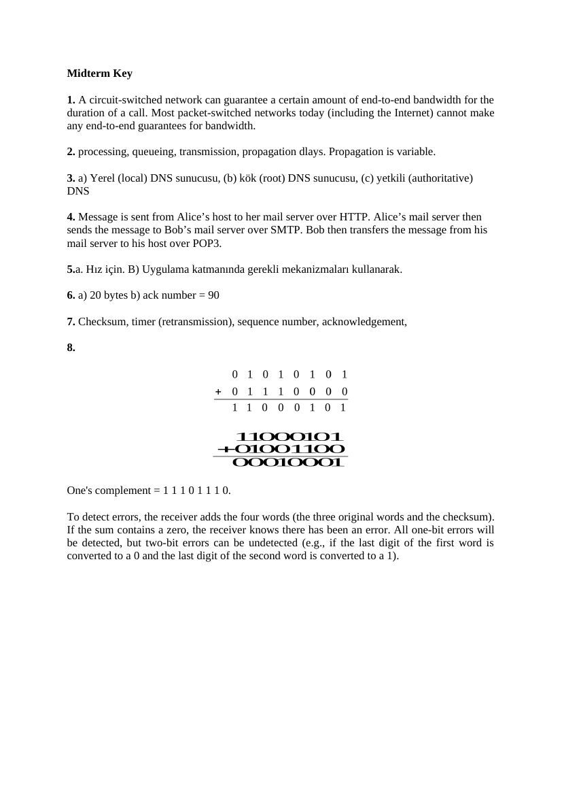

These are the 17 November 2005 solutions, and the 20 November 2006 and 21 November 2007 midterms with answer notes, for EEM413 at Başkent University. PDF copies of the documents can be downloaded at the end of the post.

## mt-2005Guz-nw-sol

EEM413, Midterm, 17.11.2005 Duration: 80 minutes SOLUTIONS

**1.** In the HTTP protocol, explain A) persistent/non-persistent, B) pipelining/without pipelining communication. C) What does it mean to keep user state at the application layer? Give one example each of a stateful and a stateless protocol. A) In connection-oriented protocols, if the TCP connection that is set up is used for the transfer of more than one object, it is a persistent connection; if it is torn down after each transfer, it is a non-persistent connection. HTTP 1.0 always sets up a non-persistent connection. HTTP 1.1 can use both types (3). B) If, in HTTP, a new object is not requested until the response to the previous object request has arrived, this is non-pipelining; if objects are requested back to back without waiting for responses, it is pipelining communication (3). C) If the state of the user and of the connection is stored during a TCP connection, it is called a stateful connection; if it is not stored, it is called a stateless connection (3). FTP keeps track of each FTP session and the user information; HTTP and SMTP do not (3).

**2.** Explain the concept of a "socket" on the Internet. Between which layers, and out of what need, did it arise? What are the types of socket programming in Internet applications? The interface between the application and transport layers within a host is called a socket (4). The programming interface of network applications on the Internet is defined by sockets. Because an IP address or a "process id" alone is not sufficient to identify applications on different hosts so that they can talk to each other, the socket (port) number had to be used together with the IP address (2). With an IP address and a socket number, it is possible to identify any application uniquely in the world (2). Internet applications use two types of socket programming: UDP and TCP socket programming (4).

**3.** A) At which layer does the P2P protocol operate, and what is it used for? B) Explain the "QUERY FLOODING" mechanism. A) P2P is a protocol used at the application layer (layer 5) to transfer files (4). B) In Gnutella, which is a P2P protocol, when one of the members wants to perform a search, it sends the search request (Query) over all of the TCP connections it established initially (the overlay network). The members neighboring the requesting member that receive the request forward it over their own TCP connections (except the connection the request came from) to each of their neighbors. This spreading of the request across the network is called QUERY FLOODING. Those who receive the request, if they find it among their own files, send a "QueryHit" message over the connection the request came from. The requesting member can then, based on these messages reaching it, set up a direct TCP connection with the member(s) it selects and start the file transfer (8).

**4.** Explain in one sentence each the services offered by the TCP layer.

1- Provides end-to-end communication between the sender and receiver "processes" at the transport layer through "multiplexing" and "demultiplexing". (2) 2- Provides reliable data transfer (RDT): it always delivers the packets uncorrupted and in order. (2) 3- Provides "full duplex", two-way communication. (2) uses. (2) 5- Provides congestion control (against congestion in the network). (2) 6- Performs flow control (sending according to the receiver's capacity). (2) 7- Provides a pipelined communication service, sending packets back to back without waiting for acknowledgments. (2)

**5.** What need gave rise to the "GoBackN" and "Selective Repeat" algorithms? What are their advantages and the differences between them?

GBN and SR were designed to remedy the inefficient line utilization of the "stop-and-wait" protocol (4). They use pipelined communication. GBN has a simpler algorithm, since it uses a single timer and immediately discards out-of-order packets that it was not expecting. On the other hand, when the delay is large and the sending window is big, there may be many unacknowledged packets on the line. In such cases, because of the loss of one of the packets in between, retransmitting all the later packets in GBN can create unnecessary traffic that keeps the line busy for nothing (4). SR uses a separate timer for each packet, also stores out-of-order packets, and retransmits only the lost packets; with this property it uses the line more efficiently. On the other hand, managing many timers and storing out-of-order packets make the protocol more complex than GBN (4).

**6.** Explain the differences and similarities between the HTTP and SMTP protocols.

Similarities: they are connection-oriented (TCP), in-band protocols, and use persistent connections (6). Differences: 1) HTTP is defined as a pull protocol, SMTP as a push protocol. 2) SMTP can send messages only in 7-bit ASCII format, whereas HTTP can send messages in any format. 3) HTTP uses a separate HTTP response packet for each object, whereas SMTP can send all objects, such as text and images, in a single message (6).

**7.** A) A packet of 512 bytes is sent over a fiber-optic link between two points 300 km apart. For the "transmission" delay to be shorter than the "propagation" delay in this communication, what must the link speed be at least, in kilobits/second? B) If the processing delay on the sending side is halved, what is the link speed that satisfies the same condition?

A) Signal speed in fiber: 3x10**8 m/s. Propagation delay = distance / signal speed = 3x10**5/3x10**8 = 0.0001 s. Transmission delay = number of bits / link speed, B = 512*8/B = 4096 bits/B s. → 0.0001 > 4096/B → B > 4096/0.0001 → B > 4096 Kbps. (8) B) It stays the same. A change in the "processing delay" does not affect the others (2).

**8.** A) For what purposes is the DNS service used? B) Which protocol does it use at layer 4? C) Explain the functions of the "Local", "Root", and "Authoritative" DNS servers. A) 1- Hostname / IP address translation, 2- Host aliasing, 3- Providing mail server aliasing (5). B) UDP (2). its name is the "default DNS server" (3). Root DNS: There are 13 root DNS servers in total, which hold the records of all the top-level domain (TLD) DNS servers on the Internet. Other DNS servers, for requests they do not know, ask one of the root DNS servers and thereby find the DNS that will give them the answer. Their contents are identical to each other (3). Authoritative DNS: For the domain name owned by every organization on the Internet, at least one authoritative DNS is required. The authoritative DNS holds the records of all hosts in that domain name. This DNS server can be kept inside the organization, at the service provider it is connected to, or on both sides (3).

## EEM413 Midterm 2006

Başkent University 06/07 EEM 413 Midterm (90 min) 20.11.2006

**1.** What is the benefit of a circuit-switched network over a packet-switched network?

**2.** What are the delay components (end-to-end delay) when a computer (host) connected to the Internet sends a packet to another computer? Which of the delay components are constant and which are variable?

**3.** Suppose an HTTP client wants to download a GIF image on the web page at a given URL address. The IP address of the HTTP server is initially unknown. In this scenario, which protocols are needed at the application layer and the transport layer, other than HTTP?

**4.** Why might an application developer prefer to run their application over UDP instead of TCP?

**5.** Can an application both run over UDP and achieve reliable data transfer? If yes, how?

**6.** Let computer A send two segments back to back to computer B over a TCP connection. Let the sequence number of the first segment be 90 and that of the second segment be 110. a) How much data is in the first segment? b) Suppose the first segment is lost but the second segment reaches computer B. In this case, what will the acknowledgment number that computer B sends to computer A be?

**7.** What are the components of reliable data transfer?

**8.** How does TCP detect that there is congestion? What are the basic components of the TCP algorithm for controlling congestion?

**9.** What is the difference between congestion control and flow control?

**10.** What are the duties of a) the local DNS server, (b) the root DNS server, (c) the authoritative DNS servers?

The questions are equally weighted; good luck, Avcıbaş

## EEM413 Midterm 2006 (2)

**4.** Why might an application developer prefer to run their application over UDP instead of TCP?

- faster

- no need to set up a connection

**8.** How does TCP detect that there is congestion? What are the basic components of the TCP algorithm for controlling congestion? -the buffer size control inside the routers does it -it checks the other side's receive buffer,

**9.** What is the difference between congestion control and flow control? -to control congestion, it checks its own buffer -to control flow, it checks the other side's buffer

**3.** Suppose an HTTP client wants to download a GIF image on the web page at a given URL address. The IP address of the HTTP server is initially unknown. In this scenario, which protocols are needed at the application layer and the transport layer, other than HTTP?

**3.** Messaging first determines the recipient's IP address by connecting to a common server. After that, the message is sent directly between the receiver and the sender.

**10.** What are the duties of a) the local DNS server, (b) the root DNS server, (c) the authoritative DNS servers?

a) Local = the DNS that is queried first, e.g.: school, company b) Root = the root DNS works like a consultant c) Authoritative =

## EEM413 Midterm 2007

Başkent University 06/07 EEM 413 Midterm (90 min) 21.11.2007

**1.** What are the advantages of a circuit-switched network over a packet-switched network?

**2.** What are the delay components (end-to-end delay) when a computer (host) connected to the Internet sends a packet to another computer? Which of the delay components are constant and which are variable?

**3.** Classify the DNS servers hierarchically and explain their duties.

**4.** Ali is sending an e-mail to Veli from his web-based account (Hotmail or Gmail). Veli accesses his messages using a POP3 mail server. Explain how the message reaches Veli from Ali, together with the protocols used.

**5.** a) Why might an application developer prefer to run their application over UDP instead of TCP? b) Can an application both run over UDP and achieve reliable data transfer? How?

**6.** Let computer A send two segments back to back to computer B over a TCP connection. Let the sequence number of the first segment be 90 and that of the second segment be 110. a) How much data is in the first segment? b) Suppose the first segment is lost but the second segment reaches computer B. In this case, what will the acknowledgment number that computer B sends to computer A be?

**7.** What are the components of reliable data transfer and the rationale for these components?

**8.** Three eight-bit data words are as follows.

0101 0101 0111 0000 0100 1100

a) Find the one's complement of the three data words. b) Why is the one's complement used in error detection instead of using the sum directly? c) How is error detection performed in UDP? Can the receiver be absolutely sure that there is no error? Why?

The questions are equally weighted; good luck, Avcıbaş

## EEM413 Midterm 2007 Answer Key

Midterm Key

**1.** A circuit-switched network can guarantee a certain amount of end-to-end bandwidth for the duration of a call. Most packet-switched networks today (including the Internet) cannot make any end-to-end guarantees for bandwidth.

**2.** processing, queueing, transmission, propagation dlays. Propagation is variable.

**3.** a) Local DNS server, (b) root DNS server, (c) authoritative DNS

**4.** Message is sent from Alice’s host to her mail server over HTTP. Alice’s mail server then sends the message to Bob’s mail server over SMTP. Bob then transfers the message from his mail server to his host over POP3.

**5.** a. For speed. B) By using the necessary mechanisms at the application layer.

**6.** a) 20 bytes b) ack number = 90

**7.** Checksum, timer (retransmission), sequence number, acknowledgement,

**8.** 

One's complement = 1 1 1 0 1 1 1 0.

To detect errors, the receiver adds the four words (the three original words and the checksum). If the sum contains a zero, the receiver knows there has been an error. All one-bit errors will be detected, but two-bit errors can be undetected (e.g., if the last digit of the first word is converted to a 0 and the last digit of the second word is converted to a 1).

*Note: In the 2005 solution, the calculation 300 km / (3×10⁸ m/s) is written as 0.0001 s; with the given numbers it comes to 0.001 s. Accordingly B > 4,096,000 bit/s = 4096 kbit/s; the result is correct, the intermediate step is wrong. In the 2007 key, the variable delay is given as "propagation"; for a fixed link, the variable one is the queueing delay. For the data 0101 0101, 0111 0000 and 0100 1100 in the question, the end-around-carry sum is 0001 0010 and the one's complement is 1110 1101; the result 1110 1110 in the key does not match these data. The 2006 student answers are not the official key; TCP does not detect congestion by directly reading the router buffer.*

## Marginal notes in the photographs

Additional handwritten notes on the photographed copies of the same exam pages were transcribed into the text. The photographs are kept in a private archive.

- Next to the propagation delay in the 2005 solution, 3×10⁵ / 3×10⁸ = 0.001 s is written. A reminder "1 byte = 8 bits" is included.
- In the 2007 exam, it is noted that the UDP checksum mechanism does not definitively rule out errors at the receiver; it is noted that not all error cases can be detected.

*Note: The UDP checksum cannot catch all possible errors. The phrase "no full RDT in UDP" in the photograph describes a separate property; the absence of reliable transfer and the limited error-detection power of the checksum are not the same justification.*
