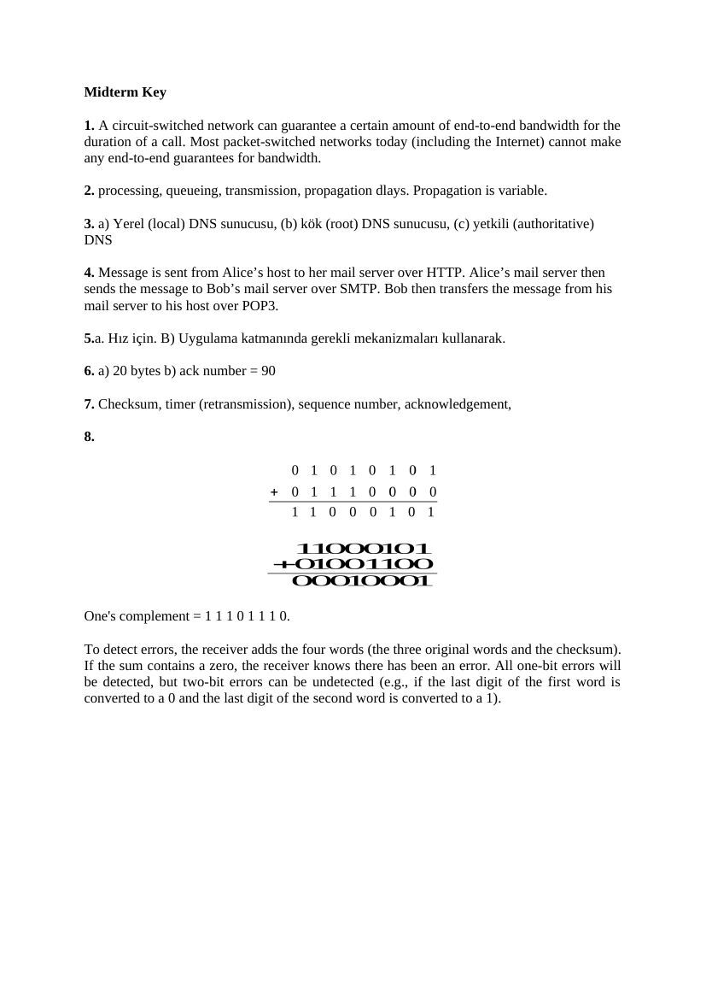

Başkent Üniversitesi EEM413 dersinin 17 Kasım 2005 çözümleri, 20 Kasım 2006 ve 21 Kasım 2007 ara sınavları ile cevap notlarıdır. Belgelerin PDF kopyaları yazının sonunda indirilebilir.

## mt-2005Guz-nw-sol

EEM413, Ara Sınav, 17.11.2005 Süre: 80 dakika ÇÖZÜMLER

**1.** HTTP protokolünde, A) persistent/non-persistent, B) pipelining/without pipelining iletişimi açıklayınız. C) Uygulama katmanında kullanıcı durumunu (state) tutmak ne demektir? Durum tutan ve tutmayan protokollere birer örnek veriniz. A) Connectıon-oriented protokollerde kurulan tcp bağlantısı birden fazla nesne iletiminde kullanılıyorsa persistent, her iletim sonunda kaldırılıyorsa non-persistent connection olur. Http 1.0 herzaman non-persistent bağlantı kurar. Http1.1 her iki tipi kullanabilir(3). B) http de bir nesne isteğinin yanıtı gelmeden yeni nesne istenmiyorsa non-pipelining, nesneler yanıt beklenmeden arka arkaya isteniyorsa pipelining iletişim denir(3). C) Bir TCP bağlantısı esnasında kullanıcının ve bağlantının durumu saklanıyorsa stateful, saklanmıyorsa stateless bağlantı denir(3). FTP her FTP seansını ve kullanıcı bilgisini tutar, http ya da SMTP tutmaz(3).

**2.** Internet’te “Socket” kavramını açıklayınız. Hangi katmanlar arasında hangi gereksinimden çıkmıştır, internet uygulamalarındaki “socket” programlama türleri nelerdir? Bir host içinde uygulama ve transport katmanları arasındaki arayüze soket denir(4). Internette ağ uygulamalarının programlama arayüzü soketlerle tanımlanmıştır. Değişik hostlardaki uygulamaların birbirleri ile konuşabilmeleri için sadece IP adresi ya da “process id” ile yeterli tanımlama yapmak mümkün olmadığı için soket (port) numarası IP adresi ile beraber kullanılmak zorunda kalınmıştır(2). Bir IP adresi ve soket numarası ile herhangi bir uygulamayı dünyada başka eşi olmayan bir biçimde tanımlamak mümkündür.(2) Internet uygulamaları 2 türden soket programlama kullanır: UDP ve TCP soket programlama.(4)

**3.** A) P2P protokolü hangi katmanda çalışır, ne amaçla kullanılır? B) “QUERY FLOODING” mekanizmasını açıklayınız. A) P2P uygulama katmanında (5. katman) dosya aktarımı yapmak için kullanılan bir protokoldür(4). B) Bir P2P protokolü olan Gnutella’da, üyelerden biri arama yapmak istediğinde mevcut başlangıçta kurduğu TCP bağlantılarının hepsinden (overlay network) arama isteğini (Query) gönderir. İsteği alan, istek sahibi üyeye komşu üyeler isteği kendi TCP bağlantılarından (isteğin geldiği bağlantı hariç) herbir komşusuna iletir. Bu biçimde isteğim ağ üzerinde yayılmasına QUERY FLOODING denir. İsteği alanlar kendi dosyaları arasında isteği bulurlarsa isteğin geldiği bağlantıdan “QueryHit” mesajı gönderir. İstek sahibi kendine ulaşan bu mesajlara göre seçtiği üye(ler) ile direk TCP bağlantısı kurup dosya transferini başlatabilir(8).

**4.** TCP katmanının sunduğu hizmetleri birer cümle ile açıklayınız.

1-Gönderici ve alıcı “process” ler arasında uçtan uca transport katmanında “multiplexing” ve “demultiplexing” işlemleri ile iletişim sağlar. (2) 2-Güvenli veri aktarımı (RDT) sağlar: Paketleri bozulmadan ve sırayla muhakkak teslim eder. (2) 3-“Full dublex”, iki yölü iletişim sağlar. (2) kullanır. (2) 5-Sıkışıklık denetimi (congestion control, ağdaki sıkışmalara karşı) sağlar. (2) 6-Akış denetimi (flow control, alıcının kapasitesine göre gönderme) yapar. (2) 7-Pipelined iletişim servisi ile yanıt almadan artarda paket gönderme hizmeti verir. (2)

**5.** “GoBackN” ve “Selective Repeat” algoritmaları hangi gereksinimden doğmuştur? Avantajları ve aralarındaki farklar nelerdir?

GBN ve SR “stop-and-wait” protokolünün hat kullanımındaki verimsizliğini iyileştirme amacı ile yapılmışlardır(4). Pipelined iletişim kullanırlar. GBN tek bir zamanlayıcı (timer) kullanması, ve beklemediği sıra-dışı paketleri hemen silmesi özellikleri ile daha basit bir algoritmaya sahiptir. Buna karşılık, gecikmenin fazla olduğu, gönderme penceresinin büyük olduğu durumlarda hat üzerinde pek çok yanıtlanmamış paket bulunabilir. Bu durumlarda GBN protokolünde aradaki paketlerden birinin kaybı yüzünden daha sonraki tüm paketlerin tekrar gönderilmesi hattı boşuna meşgul edecek gereksiz bir trafik yaratabilir(4). SR her paket için ayrı zamanlayıcı kullanarak sıra-dışı paketleri de saklayarak sadece kaybolan paketleri yeniden gönderir, bu özelliği ile hattı daha verimli kullanır. Buna karşılık pek çok zamanlayıcının yönetimi ve sıra-dışı paketlerin saklanması işlemleri protokolü GBN e göre daha karmaşık hale getirir(4).

**6.** HTTP ve SMTP protokolleri arasındaki fark ve benzerlikleri açıklayınız.

Benzerlikler: connection-oriented (TCP), in-band protokol ve persistent connection kullanırlar(6). Farklar: 1) HTTP pull, smtp push protokol olarak tanımlanır. 2) SMTP mesajları sadece 7 bit ascii formatta gönderebilirken HTTP her formatta mesaj gönderebilir. 3) HTTP her object için ayrı bir HTTP response paketi kullanırken SMTP metin, resim gibi bütün objeleri tek bir mesajda gönderebilir(6).

**7.** A) Aralarındaki uzaklık 300 km olan 2 nokta arasındaki fiber optik hat üzerinden 512 Byte büyüklüğünde bir paket gönderilmektedir. Bu iletişim sırasında “transmisson” gecikmesinin “propagation” gecikmesinden daha kısa olması için hat hızının en az kaç kilobit/saniye olması gerekir? B) Gönderen taraftaki işlem gecikmesi (processing delay) yarıya düşürülürse aynı şartı sağlayan hat hızı ne olur?

A) Fiberde sinyal hızı: 3x10**8 m/sn Propogation delay=mesafe/sinyal hızı=3x10**5/3x10**8=0.0001 sn Transmission delay= bit sayısı/hat hızı, B=512*8/B=4096 bit/B sn. → 0.0001>4096/B → B>4096/0.0001 → B>4096 Kbps. (8) B) Aynı kalır. “Proccessing delay” deki değişme diğerlerini etkilemez (2).

**8.** A) DNS servisi hangi amaçlar için kullanılır? B) 4. Katmanda kullandığu protokol hangisidir? C) “Local”, “Root”, ve “Authoritative” DNS sunucularının işlevlerini açıklayınız. A) 1- Hostname / ip adresi çevirmesi, 2- Takma host isimleri, 3- Takma mail sunucusu sağlaması (5). B) UDP(2). adı “default DNS server”(3). Root DNS: Internetteki tüm top level domain (TLD) DNS sunucuların kayıtlarını tutan, toplam 13 adet root DNS vardır. Diğer DNS ler bilmedikleri istekleri root DNS lerden birine sorarak yanıt alacakları DNS i bulurlar. İçerikleri birbirinin aynıdır(3). Authoritative DNS: Internette yer alan her organizasyonun sahip olduğu alan adı için en az bir autharitative DNS gerekir. Authoritative DNS o alan adında yer alan tüm host kayıtlarını tutar. Bu DNS sunucu organizasyon içinde ya da bağlı olduğu servis sağlayıcıda ya da her iki tarafta tutulabilir(3).

## EEM413 Midterm 2006

Başkent Üniversitesi 06/07 EEM 413 Ara Sınav (90 dak) 20.11.2006

**1.** Devre anahtarlamalı ağın (circuit-switched network) paket anahtarlamalı ağa (packet- switched network) göre faydası nedir?

**2.** İnternete bağlı bir bilgisayarın (host) diğer bir bilgisayara paket gönderirken gecikme bileşenleri (end-to-end delay) nelerdir? Gecikme bileşenlerinden hangileri sabit, hangileri değişkendir?

**3.** Bir HTTP istemcisi verilen bir URL adresindeki web sayfasında bulunan bir GIF resmi indirmek istesin. HTTP sunucusunun IP adresi ilk önce bilinmemektedir. Bu senaryoda uygulama (application) katmanı ve taşıma (transport) katmanında hangi protokollere gereksinim vardır, HTTP dışında?

**4.** Bir uygulama geliştirici, uygulamasının TCP yerine UDP üzerinde çalışmasını neden tercih edebilir?

**5.** Bir uygulama hem UDP üzerinde çalışıp hem de güvenilir veri iletimi (reliable data trasfer) gerçekleştirebilir mi? Evetse nasıl?

**6.** A bilgisayarı TCP bağlantısı üzerinden B bilgisayarına arka arkaya iki adet bölüt (segment) gondersin. İlk bölütün dizi numarası (sequence number) 90, ikinci bölütün dizi numarası ise 110 olsun. a) Birinci bölütte ne kadar veri vardır? b) İlk bölüt kaybolsun fakat ikinci bölüt B bilgisayarına ulaşsın. Bu durumda B bilgisayarının A bilgisayarına göndereceği alındı (acknowledgment) numarası ne olacaktır?

**7.** Güvenilir veri iletiminin (reliable data transfer) bileşenleri nelerdir?

**8.** TCP, sıkışıklık olduğunu nasıl algılar? Sıkışıklığı denetlemek için TCP algoritmasının temel bileşenleri nelerdir?

**9.** Sıkışıklığı denetleme (congestion control) ve akışı denetleme (flow control) arasında ne fark vardır?

**10.** a) Yerel (local) DNS sunucusu, (b) kök (root) DNS sunucusu, (c) yetkili (authoritative) DNS sunucularının görevleri nelerdir?

Sorular eşit ağırlıklı; başarılar, Avcıbaş

## EEM413 Midterm 2006 (2)

**4.** Bir uygulama geliştirici, uygulamasının TCP yerine UDP üzerinde çalışmasını neden tercih edebilir?

- daha hızlı

- bağlantı kurmaya gerek yok

**8.** TCP, sıkışıklık olduğunu nasıl algılar? Sıkışıklığı denetlemek için TCP algoritmasının temel bileşenleri nelerdir? -rooterların içindeki baffur size kontrolü yapar -karşı tarafın alıcı buffer kontrolünü yapıyor,

**9.** Sıkışıklığı denetleme (congestion control) ve akışı denetleme (flow control) arasında ne fark vardır? -sıkışıklığı denetlemek için kendi bufferını kontrol eder -akışı denetlemek için karşı tarafın bufferını kontrol eder

**3.** Bir HTTP istemcisi verilen bir URL adresindeki web sayfasında bulunan bir GIF resmi indirmek istesin. HTTP sunucusunun IP adresi ilk önce bilinmemektedir. Bu senaryoda uygulama (application) katmanı ve taşıma (transport) katmanında hangi protokollere gereksinim vardır, HTTP dışında?

**3.** Mesajlaşma ilk olarak ortak servera bağlanarak alıcının IP adresini belirler. Daha sonra mesaj alcı ve verici arasında direk yollanır.

**10.** a) Yerel (local) DNS sunucusu, (b) kök (root) DNS sunucusu, (c) yetkili (authoritative) DNS sunucularının görevleri nelerdir?

a) Yerel = ilk sorgu yapılan dns’tir ör: okul, şirket b) Root = root dns danışman gibi çalışır c) Authoratative =

## EEM413 Midterm 2007

Başkent Üniversitesi 06/07 EEM 413 Ara Sınav (90 dak) 21.11.2007

**1.** Devre anahtarlamalı ağın (circuit-switched network) paket anahtarlamalı ağa (packet- switched network) göre avantaları nelerdir?

**2.** İnternete bağlı bir bilgisayarın (host) diğer bir bilgisayara paket gönderirken gecikme bileşenleri (end-to-end delay) nelerdir? Gecikme bileşenlerinden hangileri sabit, hangileri değişkendir?

**3.** DNS sunucularını hiyerarşik olarak sınıflandırınız ve görevlerini açıklayınız.

**4.** Ali, web tabanlı hesabından (Hotmail veya gmail) Veli’ye e-posta göndermektedir. Veli mesajlarına POP3 posta sunucusunu kullanarak erişmektedir. Mesajın Ali’den Veli’ye nasıl ulaştığını, kullanılan protokollerle birlikte açıklayınız.

**5.** a) Bir uygulama geliştirici, uygulamasının TCP yerine UDP üzerinde çalışmasını neden tercih edebilir? b) Bir uygulama hem UDP üzerinde çalışıp hem de güvenilir veri iletimi (reliable data trasfer) gerçekleştirebilir mi? Nasıl?

**6.** A bilgisayarı TCP bağlantısı üzerinden B bilgisayarına arka arkaya iki adet bölüt (segment) göndersin. İlk bölütün dizi numarası (sequence number) 90, ikinci bölütün dizi numarası ise 110 olsun. a) Birinci bölütte ne kadar veri vardır? b) İlk bölüt kaybolsun fakat ikinci bölüt B bilgisayarına ulaşsın. Bu durumda B bilgisayarının A bilgisayarına göndereceği alındı (acknowledgment) numarası ne olacaktır?

**7.** Güvenilir veri iletiminin (reliable data transfer) bileşenleri ve bu bileşenlerin gerekçeleri nelerdir?

**8.** Üç adet sekiz bitlik veri aşağıdaki gibidir.

0101 0101 0111 0000 0100 1100

a) Üç adet verinin bire tümleyenini (one’s complement) bulunuz. b) Hata denetiminde doğrudan toplam kullanımı yerine neden bire tümleyen kullanılır? c) UDP’de hata denetimi nasıl yapılır? Alıcı hata olmadığından kesin olarak emin olabilir mi? Neden?

Sorular eşit ağırlıklı; başarılar, Avcıbaş

## EEM413 Midterm 2007 Cevap Anahtar

Midterm Key

**1.** A circuit-switched network can guarantee a certain amount of end-to-end bandwidth for the duration of a call. Most packet-switched networks today (including the Internet) cannot make any end-to-end guarantees for bandwidth.

**2.** processing, queueing, transmission, propagation dlays. Propagation is variable.

**3.** a) Yerel (local) DNS sunucusu, (b) kök (root) DNS sunucusu, (c) yetkili (authoritative) DNS

**4.** Message is sent from Alice’s host to her mail server over HTTP. Alice’s mail server then sends the message to Bob’s mail server over SMTP. Bob then transfers the message from his mail server to his host over POP3.

**5.** a. Hız için. B) Uygulama katmanında gerekli mekanizmaları kullanarak.

**6.** a) 20 bytes b) ack number = 90

**7.** Checksum, timer (retransmission), sequence number, acknowledgement,

**8.** 

One's complement = 1 1 1 0 1 1 1 0.

To detect errors, the receiver adds the four words (the three original words and the checksum). If the sum contains a zero, the receiver knows there has been an error. All one-bit errors will be detected, but two-bit errors can be undetected (e.g., if the last digit of the first word is converted to a 0 and the last digit of the second word is converted to a 1).

*Not: 2005 çözümünde 300 km / (3×10⁸ m/s) işlemi 0,0001 s yazılmıştır; verilen sayılarla 0,001 s bulunur. Buna göre B > 4.096.000 bit/s = 4096 kbit/s; sonuç doğru, ara işlem hatalıdır. 2007 anahtarındaki değişken gecikme “propagation” diye yazılmıştır; sabit bir hat için değişken olan kuyruk gecikmesidir. Sorudaki 0101 0101, 0111 0000 ve 0100 1100 için uç taşımalı toplam 0001 0010, bire tümleyen 1110 1101’dir; anahtardaki 1110 1110 sonucu bu verilerle uyuşmaz. 2006 öğrenci cevapları resmî anahtar değildir; TCP sıkışıklığı yönlendirici tamponunu doğrudan okuyarak ölçmez.*

## Fotoğraflardaki kenar notları

Aynı sınav sayfalarının fotoğraflanmış kopyalarındaki ek yazılar metne aktarıldı. Fotoğraflar özel arşivde tutulur.

- 2005 çözümündeki yayılım gecikmesinin yanına 3×10⁵ / 3×10⁸ = 0,001 s yazılmıştır. “1 byte = 8 bit” hatırlatması bulunur.
- 2007 sınavında UDP checksum mekanizmasının alıcıda hatayı kesin olarak dışlamadığı belirtilmiş; bütün hata durumlarının saptanamayacağı not edilmiştir.

*Not: UDP checksum bütün olası hataları yakalayamaz. Fotoğraftaki “UDP’de tam RDT yok” ifadesi ayrı bir özelliği anlatır; güvenilir aktarımın bulunmaması ile checksum’un sınırlı hata saptama gücü aynı gerekçe değildir.*
