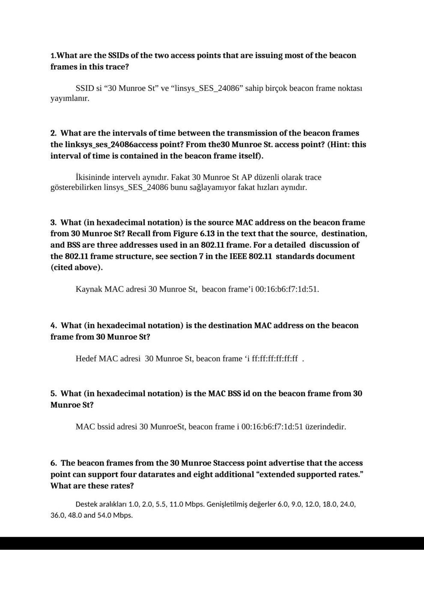
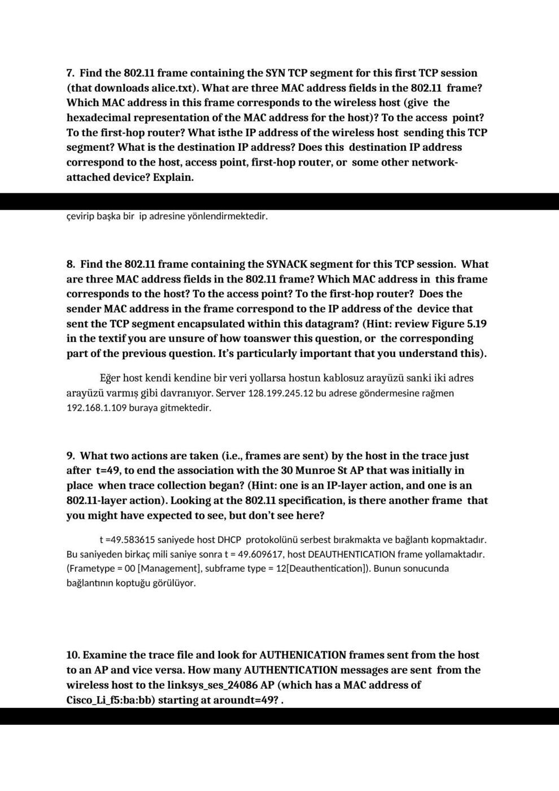

These are student laboratory reports from the course archive; student names, numbers and identity information have been removed. Where the document carries no date, the creation or last-modification date of the source file has been used. PDF copies of the documents prepared for the archive can be downloaded at the end of the post.

## 802.11 report

Başkent University, Department of Electrical and Electronics Engineering

EEM 438

Experiment No: 6

**1.** What are the SSIDs of the two access points that are issuing most of the beacon frames in this trace?

Many beacon frames are broadcast with the SSIDs "30 Munroe St" and "linsys_SES_24086".

**2.** What are the intervals of time between the transmission of the beacon frames the linksys_ses_24086access point? From the30 Munroe St. access point? (Hint: this interval of time is contained in the beacon frame itself).

The interval is the same for both. However, the 30 Munroe St AP appears regularly in the trace, whereas linsys_SES_24086 cannot do so, but their rates are the same.

**3.** What (in hexadecimal notation) is the source MAC address on the beacon frame from 30 Munroe St? Recall from Figure 6.13 in the text that the source, destination, and BSS are three addresses used in an 802.11 frame. For a detailed discussion of the 802.11 frame structure, see section 7 in the IEEE 802.11 standards document (cited above).

The source MAC address of the beacon frame from 30 Munroe St is 00:16:b6:f7:1d:51.

**4.** What (in hexadecimal notation) is the destination MAC address on the beacon frame from 30 Munroe St?

The destination MAC address of the beacon frame from 30 Munroe St is ff:ff:ff:ff:ff:ff.

**5.** What (in hexadecimal notation) is the MAC BSS id on the beacon frame from 30 Munroe St?

The MAC BSSID of the beacon frame from 30 Munroe St is 00:16:b6:f7:1d:51.

**6.** The beacon frames from the 30 Munroe Staccess point advertise that the access point can support four datarates and eight additional "extended supported rates." What are these rates?

The supported rates are 1.0, 2.0, 5.5, 11.0 Mbps. The extended rates are 6.0, 9.0, 12.0, 18.0, 24.0,

**36.** 0, 48.0 and 54.0 Mbps.

**7.** Find the 802.11 frame containing the SYN TCP segment for this first TCP session (that downloads alice.txt). What are three MAC address fields in the 802.11 frame? Which MAC address in this frame corresponds to the wireless host (give the hexadecimal representation of the MAC address for the host)? To the access point? To the first-hop router? What isthe IP address of the wireless host sending this TCP segment? What is the destination IP address? Does this destination IP address correspond to the host, access point, first-hop router, or some other network- attached device? Explain.

Here, the machine performing the address forwarding translates the IP address it forwards using the mask address and redirects it to another IP address.

**8.** Find the 802.11 frame containing the SYNACK segment for this TCP session. What are three MAC address fields in the 802.11 frame? Which MAC address in this frame corresponds to the host? To the access point? To the first-hop router? Does the sender MAC address in the frame correspond to the IP address of the device that sent the TCP segment encapsulated within this datagram? (Hint: review Figure 5.19 in the textif you are unsure of how toanswer this question, or the corresponding part of the previous question. It's particularly important that you understand this).

If the host sends data to itself, the host's wireless interface behaves as if it had two address interfaces. Although the server 128.199.245.12 sends to this address,

**192.** 168.1.109 is where it goes.

**9.** What two actions are taken (i.e., frames are sent) by the host in the trace just after t=49, to end the association with the 30 Munroe St AP that was initially in place when trace collection began? (Hint: one is an IP-layer action, and one is an

**802.** 11-layer action). Looking at the 802.11 specification, is there another frame that you might have expected to see, but don't see here?

At t = 49.583615 seconds, the host releases DHCP and the connection is dropped. A few milliseconds after this, at t = 49.609617, the host sends a DEAUTHENTICATION frame (Frame type = 00 [Management], subframe type = 12 [Deauthentication]). As a result, the connection is seen to be dropped.

**10.** Examine the trace file and look for AUTHENICATION frames sent from the host to an AP and vice versa. How many AUTHENTICATION messages are sent from the wireless host to the linksys_ses_24086 AP (which has a MAC address of Cisco_Li_f5:ba:bb) starting at aroundt=49? .

The first authentication from the host to the AP is at t = 49.638857.

**11.** Does the host want the authentication to require a key or be open?

The host makes a request in order to open the association. (Authentication algorithm: Open System)

**12.** Do you see a reply AUTHENTICATION from the linksys_ses_24086 AP in the trace?

I do not receive any reply from the AP. This is probably because the AP may have been configured to require a password for association. That is, this AP rejects open access requests.

**13.** Now let's consider what happens as the host gives up trying to associate with the linksys_ses_24086 AP and now tries to associate with the 30 Munroe St AP. Look for AUTHENICATION frames sent from the host to and AP and vice versa. At what times are there an AUTHENTICATION frame from the host to the 30 Munroe St.AP, and when is there a reply AUTHENTICATION sent from that AP to the host in reply? (Note that you can use the filter expression "wlan.fc.subtype ==11and wlan.fc.type ==0 and wlan.addr ==IntelCor_d1:b6:4f" to display only the AUTHENTICATION frames in this trace for this wireless host.)

The authentication frame at t = 63.168087 is sent from 00:13:02:d1:b6:4f to 00:16:b7:f7:1d:51. At t = 63.169071, an authentication frame is sent in the opposite direction, from the BSS to the wireless host.

**14.** An ASSOCIATE REQUEST from host toAP, and a corresponding ASSOCIATE RESPONSE frame from AP to host are used for the host to associated with an AP. At what time is there an ASSOCIATE REQUEST from host to the30 Munroe St AP? When is the corresponding ASSOCIATE REPLY sent? (Note that you can use the filter expression "wlan.fc.subtype < 2 and wlan.fc.type ==0 and wlan.addr

==IntelCor_d1:b6:4f" to display only the ASSOCIATE REQUEST and ASSOCIATE RESPONSE frames for this trace.)

The association request frame at t = 63.169910 is sent from 00:13:02:d1:b6:4f to 00:16:b7:f7:1d:51. At t = 63.192101, the association response is sent in the opposite direction, from the BSS to the wireless host.

**15.** What transmission rates is the host willing to use? The AP? To answer this question, you will need to look into the parameters fields of the 802.11 wireless LAN management frame.

The rates supported in the association request frame are 1, 2, 5.5, 11, 6, 9, 12, 18, 24, 32, 48, and 54 Mbps. The same values are advertised in the association response.

**16.** What are the sender, receiver and BSS IDMAC addresses in these frames? What is the purpose of these two types of frames? (To answer this last question, you'll need to dig into the online references cited earlier in this lab).

The probe request at t = 2.297613 is sent with source 00:12:f0:1f:57:13, destination ff:ff:ff:ff:ff:ff and BSSID ff:ff:ff:ff:ff:ff. At t = 2.300697, the probe response is sent with source 00:16:b6:f7:1d:51, and destination and BSSID 00:16:b6:f7:1d:51. A probe request is used by a host for active scanning to find an AP. A probe response is used by an AP to send a reply to the host's request.

*Note: "30 Munroe St" and "linksys_SES_24086" are SSID names in the sample capture. Some answers in the record are incomplete; it is not presented as a completed answer key.*
