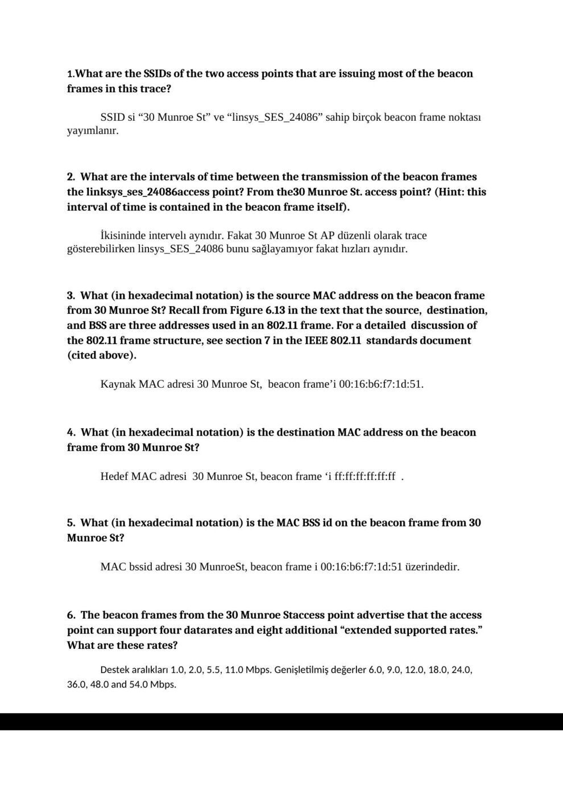
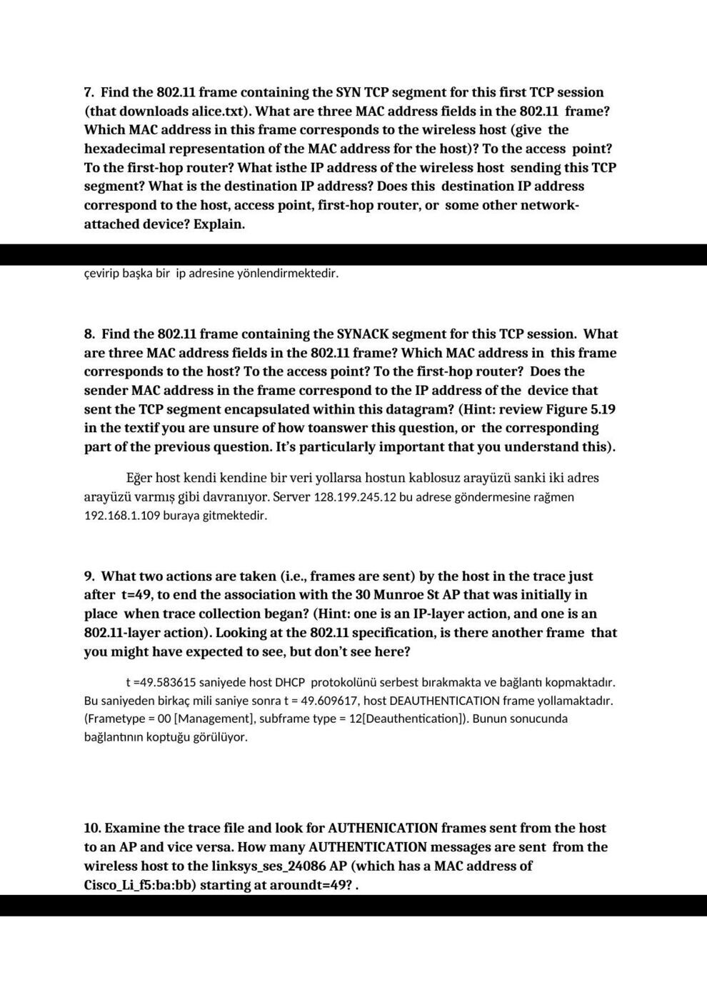

Ders arşivindeki öğrenci laboratuvar raporlarıdır; öğrenci adları, numaraları ve kimlik bilgileri çıkarılmıştır. Belge üzerindeki tarih bulunmadığında kaynak dosyanın oluşturulma ya da son değiştirilme tarihi kullanılmıştır. Belgelerin arşiv için hazırlanmış PDF kopyaları yazının sonunda indirilebilir.

## 802.11 raporu

Başkent Üniversitesi Elektrik - Elektronik Mühendisliği Bölümü

EEM 438

Deney No: 6

**1.** What are the SSIDs of the two access points that are issuing most of the beacon frames in this trace?

SSID si “30 Munroe St” ve “linsys_SES_24086” sahip birçok beacon frame noktası yayımlanır.

**2.** What are the intervals of time between the transmission of the beacon frames the linksys_ses_24086access point? From the30 Munroe St. access point? (Hint: this interval of time is contained in the beacon frame itself).

İkisininde intervelı aynıdır. Fakat 30 Munroe St AP düzenli olarak trace gösterebilirken linsys_SES_24086 bunu sağlayamıyor fakat hızları aynıdır.

**3.** What (in hexadecimal notation) is the source MAC address on the beacon frame from 30 Munroe St? Recall from Figure 6.13 in the text that the source, destination, and BSS are three addresses used in an 802.11 frame. For a detailed discussion of the 802.11 frame structure, see section 7 in the IEEE 802.11 standards document (cited above).

Kaynak MAC adresi 30 Munroe St, beacon frame’i 00:16:b6:f7:1d:51.

**4.** What (in hexadecimal notation) is the destination MAC address on the beacon frame from 30 Munroe St?

Hedef MAC adresi 30 Munroe St, beacon frame ‘i ff:ff:ff:ff:ff:ff .

**5.** What (in hexadecimal notation) is the MAC BSS id on the beacon frame from 30 Munroe St?

MAC bssid adresi 30 MunroeSt, beacon frame i 00:16:b6:f7:1d:51 üzerindedir.

**6.** The beacon frames from the 30 Munroe Staccess point advertise that the access point can support four datarates and eight additional “extended supported rates.” What are these rates?

Destek aralıkları 1.0, 2.0, 5.5, 11.0 Mbps. Genişletilmiş değerler 6.0, 9.0, 12.0, 18.0, 24.0,

**36.** 0, 48.0 and 54.0 Mbps.

**7.** Find the 802.11 frame containing the SYN TCP segment for this first TCP session (that downloads alice.txt). What are three MAC address fields in the 802.11 frame? Which MAC address in this frame corresponds to the wireless host (give the hexadecimal representation of the MAC address for the host)? To the access point? To the first-hop router? What isthe IP address of the wireless host sending this TCP segment? What is the destination IP address? Does this destination IP address correspond to the host, access point, first-hop router, or some other network- attached device? Explain.

Burada adres yönlendirmesi yapılmış makinanın yönlendirdiği ip aresini maske adresi ile çevirip başka bir ip adresine yönlendirmektedir.

**8.** Find the 802.11 frame containing the SYNACK segment for this TCP session. What are three MAC address fields in the 802.11 frame? Which MAC address in this frame corresponds to the host? To the access point? To the first-hop router? Does the sender MAC address in the frame correspond to the IP address of the device that sent the TCP segment encapsulated within this datagram? (Hint: review Figure 5.19 in the textif you are unsure of how toanswer this question, or the corresponding part of the previous question. It’s particularly important that you understand this).

Eğer host kendi kendine bir veri yollarsa hostun kablosuz arayüzü sanki iki adres arayüzü varmış gibi davranıyor. Server 128.199.245.12 bu adrese göndermesine rağmen

**192.** 168.1.109 buraya gitmektedir.

**9.** What two actions are taken (i.e., frames are sent) by the host in the trace just after t=49, to end the association with the 30 Munroe St AP that was initially in place when trace collection began? (Hint: one is an IP-layer action, and one is an

**802.** 11-layer action). Looking at the 802.11 specification, is there another frame that you might have expected to see, but don’t see here?

t =49.583615 saniyede host DHCP protokolünü serbest bırakmakta ve bağlantı kopmaktadır. Bu saniyeden birkaç mili saniye sonra t = 49.609617, host DEAUTHENTICATION frame yollamaktadır. (Frametype = 00 [Management], subframe type = 12[Deauthentication]). Bunun sonucunda bağlantının koptuğu görülüyor.

**10.** Examine the trace file and look for AUTHENICATION frames sent from the host to an AP and vice versa. How many AUTHENTICATION messages are sent from the wireless host to the linksys_ses_24086 AP (which has a MAC address of Cisco_Li_f5:ba:bb) starting at aroundt=49? .

İlk kimlik host AP si t= 49.638857 den .

**11.** Does the host want the authentication to require a key or be open?

Birleşmeyi açabilmek için host istekte bulunur. (Kimlik Algoriması :Open System)

**12.** Do you see a reply AUTHENTICATION from the linksys_ses_24086 AP in the trace?

AP tan herhangi bir cevap alamıyorum. Bu muhtemeldir çünkü bu AP ile ilişkilendirilirken AP bir şifre gerektirecek şekilde konfigüre edilmiş olabilir. Yani bu AP açık giriş isteklerini reddeder.

**13.** Now let’s consider what happens as the host gives up trying to associate with the linksys_ses_24086 AP and now tries to associate with the 30 Munroe St AP. Look for AUTHENICATION frames sent from the host to and AP and vice versa. At what times are there an AUTHENTICATION frame from the host to the 30 Munroe St.AP, and when is there a reply AUTHENTICATION sent from that AP to the host in reply? (Note that you can use the filter expression “wlan.fc.subtype ==11and wlan.fc.type ==0 and wlan.addr ==IntelCor_d1:b6:4f” to display only the AUTHENTICATION frames in this trace for this wireless host.)

t = 63.168087 de bulunan kimlik frame 00:13:02:d1:b6:4f dan 00:16:b7:f7:1d:51 e yollar. t = 63.169071 de bir kimlik ters yönde BSS den kablosuz hotsa yollar.

**14.** An ASSOCIATE REQUEST from host toAP, and a corresponding ASSOCIATE RESPONSE frame from AP to host are used for the host to associated with an AP. At what time is there an ASSOCIATE REQUEST from host to the30 Munroe St AP? When is the corresponding ASSOCIATE REPLY sent? (Note that you can use the filter expression “wlan.fc.subtype < 2 and wlan.fc.type ==0 and wlan.addr

==IntelCor_d1:b6:4f” to display only the ASSOCIATE REQUEST and ASSOCIATE RESPONSE frames for this trace.)

t = 63.169910 de bulunan ortak istek frame i 00:13:02:d1:b6:4f dan, 00:16:b7:f7:1d:51 a yollar. t = 63.192101 ortak cevap ters yönde BSS den kablosuz hosta yollar.

**15.** What transmission rates is the host willing to use? The AP? To answer this question, you will need to look into the parameters fields of the 802.11 wireless LAN management frame.

Ortak istek frame i destekleyen aralıklar 1, 2, 5.5, 11, 6, 9, 12, 18, 24, 32, 48, ve 54 Mbps. Aynı değerler ortak istekte ilan edilir.

**16.** What are the sender, receiver and BSS IDMAC addresses in these frames? What is the purpose of these two types of frames? (To answer this last question, you’ll need to dig into the online references cited earlier in this lab).

t = 2.297613 de bulunan giriş isteği 00:12:f0:1f:57:13 kaynağıyla, hedef: ff:ff:ff:ff:ff:ff ve BSSID : ff:ff:ff:ff:ff:ff ile yollar. t = 2.300697 giriş cevabı kaynak: 00:16:b6:f7:1d:51, hedefi ve BSSID: 00:16:b6:f7:1d:51 yollar. Giriş cevabı AP bulmak için aktif tarama bir host tarafından kullanılır. Bir giriş cevabı AP tarafından hosta istek yollamak için kullanılır.

*Not: “30 Munroe St” ve “linksys_SES_24086” örnek yakalama içindeki SSID adlarıdır. Kayıttaki bazı soruların cevabı eksiktir; tamamlanmış cevap anahtarı olarak sunulmamıştır.*

