This is the second-year internship seminar report of the Ege University Faculty of Engineering, Department of Computer Engineering, for the 1995–1996 academic year; the cover reads 18 September 1996. Student names, numbers, and group information have been removed. Archive-ready PDF copies of the documents can be downloaded at the end of the post.

*This content belongs to a third-party source; it is shared for archival and nostalgic purposes with the source credited. It will be removed at the request of the rights holder.*

## Summary

**1.** SUMMARY

The purpose of this document is to describe today's telecommunications infrastructure and how it has evolved in line with needs. ATM technology within the scope of B-ISDN is addressed as the structure that can respond to these new needs. The ATM protocol includes its own layer structure and switching technology. In ATM data communication, packets with a special structure called cells are used. In addition to its own topology, ATM is also compatible with existing systems.

## Introduction

**2.** INTRODUCTION

As a result of the rapid development of computer technology, and consequently of computer networks, the purposes for which computers are used and the services they undertake have spread over a much wider area than before. In parallel with this development, new areas of use have emerged, but after a while the existing infrastructures became unable to meet these new demands. Many of the services needed today (voice, video, classical data transmission, interactive services, etc.) require high-speed transmission capacity. Advances in data communication (developments in VLSI - Very Large Scale Integration, fiber optics, and switching technologies) have made possible the emergence of the B-ISDN structure, which can respond to these needs. ITU-T (International Telecommunication Union) has proposed ATM as the transfer mode for B-ISDN. ATM and B-ISDN technology are also advantageous in that they can be adapted to existing systems.

## Telecommunications infrastructure and B-ISDN

**3.** TODAY'S TELECOMMUNICATIONS INFRASTRUCTURE AND B-ISDN

Today's telecommunications networks are each designed to provide specific services. This means that there is at least one network for each telecommunications service, and because these networks are designed and operated to provide the specific service they target, they are mostly unsuitable for other purposes. For example, X.25 data communication networks are not suitable for real-time voice communication because end-to-end delay and jitter cannot be controlled. Moreover, some resources within a network that sit idle at certain times cannot be used for other purposes. (For example, because existing telephone networks are unsuitable for TV broadcasting, they cannot be used for cable TV broadcasting in the late hours of the day even though the need for voice transmission is low.) As a result, many independent and different communication networks have emerged, and this has reduced the flexibility and efficiency of use of the networks. In parallel, the design, maintenance, and production costs of such networks have also risen. Examples of these networks are:

- Telex networks, which provide information transfer at low speeds (300 kb/s),

- Networks designed for two-way voice communication provided over the PSTN (Public Switched Telephone Network), also known as POTS (Plain Old Telephone Service),

- Packet-switched data networks such as X.25 and similar PSDNs (Public Switched Data Networks),

- CATV (Community Antenna TV), cable television networks,

- LAN (Local Area Networks), local communication networks. Considering the telecommunications networks given above as examples and the existing needs, it is clear that this infrastructure will be inadequate. Especially if we consider video telephone, video conference, video library, and similar services envisaged for future use, it emerges that the communication networks that will meet such needs must be a single broadband network independent of service type. Work in this area began in the early eighties and was called ISDN (Integrated Switched Digital Networks) (it is now referred to as N-ISDN, Narrowband ISDN). By increasing the bandwidth of these networks, the integration of every kind of voice, data, moving video, and high-resolution TV transmission was achieved, and the resulting structure was called B-ISDN (Broadband ISDN). The factors that made the B-ISDN structure possible can be cited as the development of fiber-optic technology, leading to its widespread use in communication lines, and advances in semiconductor technology. Thus, in the newly developed structure, a more efficient and lower-cost new form of transfer could be used, as the transmission medium was more reliable and the need to perform error control within the network was eliminated. This new technology is called ATM (Asynchronous Transfer Mode).

As a result of research also carried out by ITU-T (formerly CCITT), it was determined in 1988 that ATM was the most suitable transfer protocol for B-ISDN. The services envisaged to be provided with the B-ISDN structure by ITU-T can be listed as follows:

- HDTV (High Definition TV) services,

- Videoconference services,

- Video on Demand services,

- Interactive services,

- Messaging services,

- Data transfer services.

Figure 1 gives, as an example, the speed and time relationships required by some of these services:

Figure 1

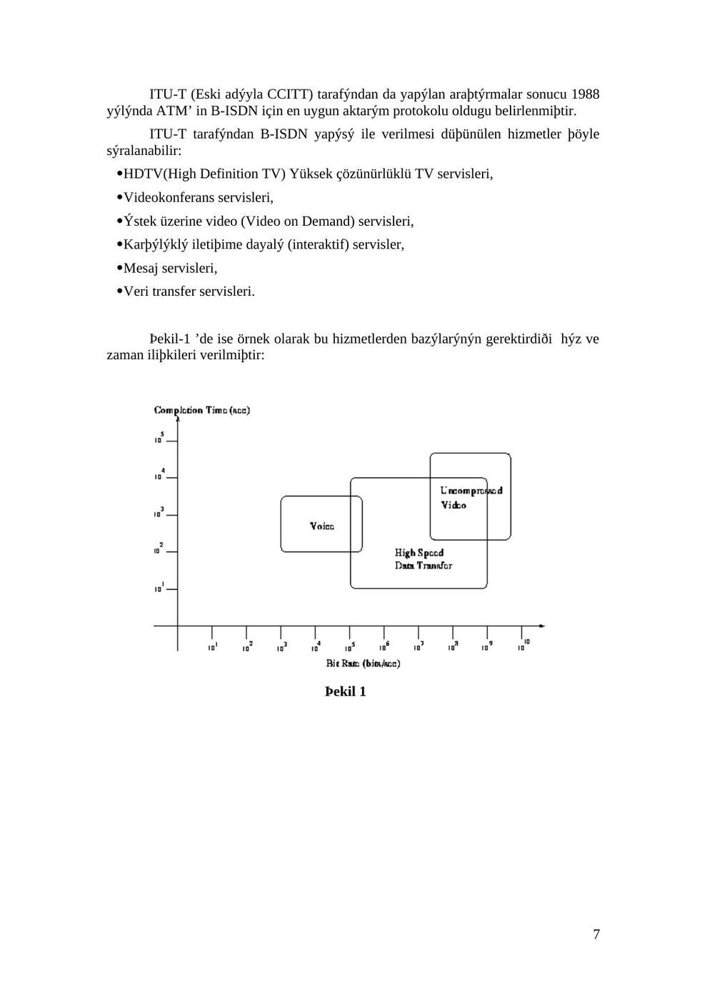

## ATM and transfer modes

**4.** WHAT IS ATM? It is a switched, cell-based transfer protocol that can carry every type of data at high speeds. ATM transmits every type of network traffic (data, voice, video, and TV signals) in 53-byte cells.

**4.1** History of ATM Switching The development of ATM since its beginning is seen in Figure 2:

[7]

Figure 2

**4.2** Transfer Modes Transfer mode is the name given to the sum of the transmission, multiplexing, and switching techniques used in a telecommunications network. In the networking world there are basically two poles on the subject of transfer mode. These are circuit switching and packet switching (they are also called, respectively, the capitalist and communist approaches). Circuit and packet switching are, as stated, two extremes, and each has advantages and disadvantages relative to the other. Over time, variations of these two opposing methods that use the advantages of the other method have emerged. Some of them are listed in the diagram in Figure 3 according to the relationships between them. Below the figure you can find explanations of the main ones among these methods. [1]

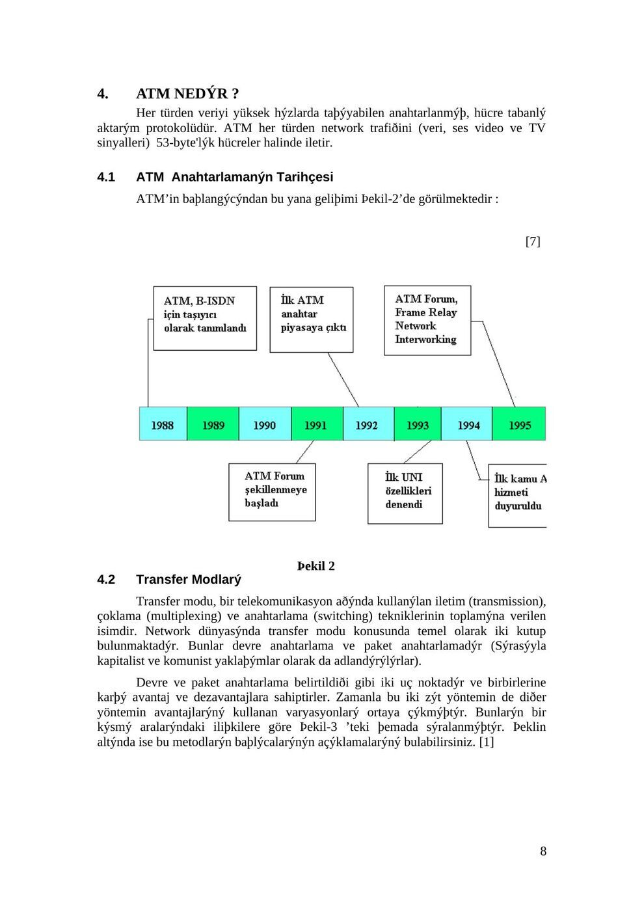

Fixed Rate Variable

Simple Complex

Circuit Multirate Frame Frame Packet ATM C. Sw. Relay Sw. Sw.

Figure 3

**4.2.1** Circuit Switching: This transfer mode is used especially in telephone networks. This method is also used in N-ISDN. The basis of circuit switching is to create a dedicated fixed-capacity channel that can be used only by the relevant connection during a transmission. Fixed-length groups of bits (such as 8 bits or 1000 bits) are sent at specific time intervals (such as 125 µs). Each of these groups is called a 'time slot', and they are combined to form frames. (Frames are also repeated at specific intervals. Each time slot within these frames is dedicated to a specific connection for as long as it continues. However, when the connection is closed, the relevant slot can be made available for use by another application.) In pure circuit-switched systems, the number of bits each time slot can hold is the same and fixed. That is, there is a fixed bit rate for each service. Since in circuit-switched systems a line is dedicated to one application for the duration of the connection, the delays that arise in the system depend only on the propagation delay in the transmission line. [1]

**4.2.2** Multirate Circuit Switching: In this method, designed to eliminate the limitations of circuit switching, more than one time slot can be used for a connection. However, if more than one time slot is used, the necessity of synchronizing them arises. Another problem lies in choosing the 'basic rate'. If this value is chosen large (for example 2 Mbit/s), services requiring small line bandwidth (voice, 64 kbit/s) will consume resources unnecessarily. If this value is chosen small (1 kbit/s),

a very large number of channels will have to be controlled for services requiring large bandwidth (HDTV, 144 Mbit/s); this makes things very complicated. The solution devised for this problem is to divide a frame into slots with different bit rates. In such a system, a special type of switch must be used for each different time slot (because of the different bit rates). The subscriber's incoming/outgoing information must be passed through multiplexing/demultiplexing before being routed to/from the switches (this is done to route channels with different bit rates to the relevant switch). Although different bit rates can be used, since these are fixed values, the system cannot be expected to be flexible against changes in the needs of services (an increase in bandwidth need, a decrease in need due to developments in compression technology, etc.). Naturally, these systems also contain the disadvantages of circuit switching (occupying resources beyond need, etc.). [1]

**4.2.3** Packet Switching: In this transfer mode, the user's information is carried in packets. In addition to the user's information, these packets also contain a field called the header, which holds information used for routing, error control, and flow control. Since older links have low reliability, advanced error control is performed in this type of system (at every node passed through, the packet content is checked for errors…). At each node a retransmission request is made for erroneous packets (ARQ - Automatic Repeat Request). Packet sizes are variable. Therefore they require complex flow control. However, since the communication speed is low, this does not pose much of a problem. Because of the complexity of the protocols and the retransmission process, they are not widely used in services requiring high speed and in real-time applications. [1]

**4.2.4** Frame Relaying: Because of the reliability of transmission lines, frame relaying has less functionality within the network compared with packet-switched systems (X.25) (more limited error control and correction is performed). This allows faster information processing at the switching points within the network. Retransmission of packets is done only between the end points (that is, the intermediate nodes do not request retransmission of packets). However, packets are still checked for errors at the nodes. The reason for this is that there is no point in continuing to transmit erroneous packets. [1]

**4.2.5** Cell Relaying (Fast Packet Switching-ATM): Fast Packet Switching (ATM) is a concept that includes many variations. However, their basic characteristic is the same: packet switching with minimum functionality in the network. There is no synchronization between sender and receiver. Synchronization can be achieved, when necessary, by inserting and removing empty packets.

## ATM cell structure

In ATM there are no error control functions of the CRC or ARQ type within the network. As in circuit switching, correction of errors is left to the protocols at the end points. [1] The most important difference of ATM from Frame Relay is that in ATM data are transmitted in fixed-size, small packets (cells). In Frame Relay, on the other hand, the packet length is variable. [2]

**5.** ATM CELL STRUCTURE The basic unit used for information transfer in ATM is a special type of packet, called a cell, of fixed length of 53 bytes. The first 5 bytes of the cell are called the header and carry the basic information necessary for the cell to travel through the network. (The fields found in the packet switching method that provide advanced functionality have been reduced as much as possible in cell headers.) Keeping the functionality of the header at a low level also allows ATM switches to operate at high speed. The remaining 48 bytes contain the information to be transmitted.

GFC VPI VPI VCI VCI User-Network VCI PT C Interface HEC 8 7 6 5 4 3 2 1

VPI VPI VCI VCI Network Network Interface VCI PT C HEC

Figure 4 General Structure of a Cell Header

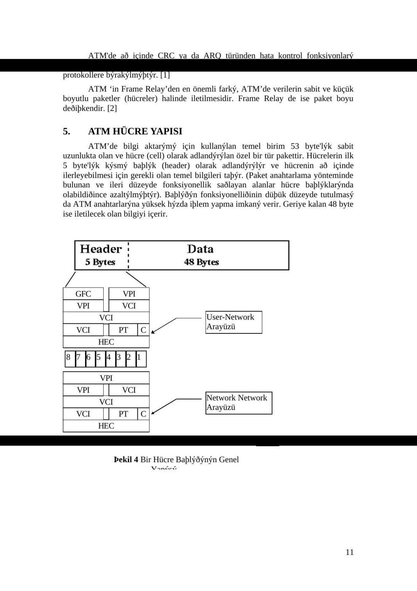

The expansions and functions of the header fields are as follows: VPI (Virtual Path Identifier) - VCI (Virtual Channel Identifier): In ATM, information transfer between nodes is carried out through virtual connections called VCs (Virtual Channels). For ease of management, the VCs between the same two end points are also grouped within VPs (Virtual Paths). The VPI and VCI in the header determine which of these many connections between nodes will be used. The values of these identifiers are local in nature; that is, as a cell travels between nodes, it may have different VPI and VCI values at different nodes. HEC (Header Error Check): Errors occurring in cell headers can cause the entire cell to be lost due to misrouting (a 1-bit error would cause the loss of 48 bytes of information). To prevent this, this error control field has been placed in cell headers. It is 8 bits long. It contains a CRC value. CLP (Cell Loss Priority): This 1-bit field determines the loss priority of the cell. A value of 1 indicates that this cell can be discarded if necessary when there is congestion in the network. At a moment of congestion, cells with a CLP value of 0 are not touched until all cells with a CLP value of 1 have been discarded. PLT (Payload Type): This field determines the type of traffic in the cell. The ATM Forum has also extended the function of this field so that it provides information about traffic congestion. The length of this field is 3 bits. [1]

**5.1** Cell Types in ATM Unassigned Cells: These are empty packets sent by the ATM layer when there is no traffic. They are used to fill bandwidth or for synchronization purposes. There are also IDLE cells. The characteristic of these cells is that they are created by the physical layer. They do not reach the ATM layer; they are used for synchronization between physical layers. Meta-Signaling Cells: They are used to establish a session with the network and to determine session services. General Broadcast Cells: They identify packets sent to all stations on the UNI. Point-to-Point Signaling Cells: They identify the cells of the UNI or NNI interface providing point-to-point connection in the ATM layer. F4 and F5 Cells: They identify VP and VC maintenance cells, respectively. Resource Management Cells: They are reserved for fast resource management on a VC. ILMI (Interim Local Management Interface) Cells: They carry information about the status of ATM user devices and the VP and VC configuration at the UNI.

The bit structures that identify these cell types are given in the table in 15.1.5 (APPENDIX 1). [1]

**5.2** Why Fixed Length? When fixed-length cells are used in a system, efficiency varies according to the length of the information to be sent. If the information to be sent is in small amounts and, when divided into cells, a large amount of space (30-40 bytes) remains empty in the last cell, the ratio

Useful Information Sent

(Number of cells sent) * 53 in this communication will not be very high. However, if the information to be sent is an exact multiple of 48 bytes, that is, if all cells are completely full, maximum efficiency (90.5%) can be reached. (The reason the maximum efficiency is 90.5% is that 5 bytes of each 53-byte cell sent are reserved for the header. 48/53=0.905...) When variable-length cells are used, nearly 100% efficiency is reached in the system. However, it is quite difficult to store packets of different lengths efficiently in buffers for queuing, and it requires complicated algorithms. These complex buffer operations also require high speed. For such practical reasons, the use of variable-length cells has been ruled out. The gaps left in fixed-length cells adversely affect system efficiency, but the fact that the services to be offered in B-ISDN already require the transmission of large amounts of information eliminates this drawback. [1]

**5.3** Why 53 Bytes? Different factors played a role in choosing the cell length. Long information fields increase transmission efficiency, because the amount of information sent with each header increases and thus the proportion of overhead caused by headers decreases. However, as the length of the information field increases, the delay during packetization (packetization delay) also increases. When long cells are used, it also becomes easier for the delay within the network to exceed certain limits (for example, this delay limit is 25 ms for telephone conversations). This makes it mandatory to use echo cancelers in voice transmission. In addition, long cells require the temporary storage areas used in switches to be large. (To prevent cell losses, queues must have the capacity to store a certain number of cells regardless of cell size.) Taking all these factors into account, the size of the information field in the cell was envisaged to be around 32 or 64 bytes (Europe insisted on 32 because of its convenience for voice transmission, while the United States and Japan insisted on 64-byte sizes because of efficiency). In the end, a cell size of 53 bytes, consisting of 48 bytes of information + 5 bytes of header, was accepted. [1]

## ATM layers

**6.** ATM LAYERS

The physical layer structure on which ATM is built can be SONET/SDH, DS3, or FDDI. ATM is independent of the physical medium, but as a broad-based common carrier, SONET (Synchronous Optical Network), a synchronous transmission structure, is preferred. SONET was produced by Bellcore and standardized by ANSI (American National Standards Institute). SONET is designed to provide high-speed digital signal transmission over fiber cable. It uses a standard multiplexing format to carry data at

**51.84** Mbps. It also uses an optical signal standard for interconnection from different sources. It has extensive processing, management, and maintenance features. With its flexible structure, it can keep up with new technologies that will emerge in the future. Above the physical layer there are two layers: ATM and AAL (ATM Adaptation Layer). AAL acts as the interface between ATM and the other layers. AAL consists of CS (Convergence Sublayer) and SAR (Segmentation and Reassembly Sublayer). SAR divides PDUs (Protocol Data Units) (that is, the data packets to be transmitted) of different lengths and formats into 48-octet pieces. The functions of CS vary according to the type of traffic processed by AAL. In the ATM layer on the sender side, the 5-byte cell header is added to the 48 octets of information coming from SAR. The ATM layers in the switches within the network carry out routing using the VPI and VCI information. The ATM layer at the receiver removes the 5-byte header information and passes it to AAL. [3]

**6.1** Traffic Classes Supported by the AAL Layer The ATM AAL layer has 5 different traffic classes to support different traffic types. These are briefly described in Figure 5. The table also indicates, for each traffic type, whether a timing relationship between source and destination is required, the characteristic of the bit rate, and whether it is connection-oriented.

Class A Class B Class C Class D Class X DESTINATION-SOURCE Required Required Not required Not required User TIMING or RELATIONSHIP Dependent BIT RATE CBR VBR VBR VBR User Dependent or CONNECTION Yes Yes Yes No User Dependent Figure 5 - Traffic for Service Types

**6.2** AAL Types AAL has different protocols in order to support traffic types.

**6.2.1** AAL-1 It supports Class A traffic and the PDU structure consists of 48 octets. The payload (user data) can be 46 or 47 octets.

SN SNP Pointer Payload (Optional) 4 Bits 4 Bits 8 Bits 46 or 47 Octets

Figure 6 - AAL-1 PDU Structure

SN (Sequence Number): 3 bits are used to hold the sequence number, and 1 bit is the CSI (Convergence Sublayer Indication), which indicates whether the pointer field will be used. A CSI of zero indicates that the pointer is not used and that the user data is 47 octets. The pointer holds the placement of the data within the cell. SNP (Sequence Number Protection) performs error control on the SN. The SNP field can correct only 1-bit errors.

**6.2.2** AAL-2 It is the protocol that supports Class B traffic.

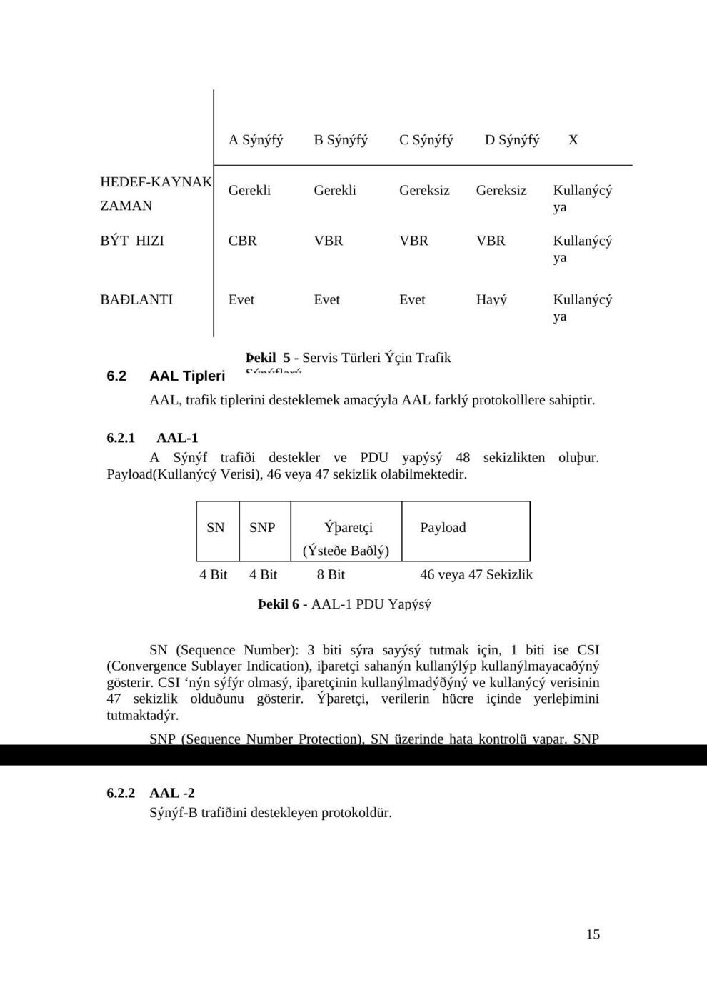

HEADER TRAILER

SN IT PAYLOAD LI CRC

Figure 7 - AAL-2 PDU Structure

The header part contains the SN (Sequence Number) and IT (Information Type). The IT field consists of the BOM (Beginning Of Message), COM (Continuation of Message), and EOM (End Of Message) fields. In the trailer part, the LI (Length Indicator) field holds the number of octets in the Payload field, and the CRC is used for error control.

**6.2.3** AAL-3/4 First, AAL-3, supporting connection-oriented VBR traffic, and AAL-4, for connectionless VBR traffic, were defined. Later these two types were merged, and the AAL-3/4 protocol was defined.

SN IT MID PAYLOAD LI CRC

2 Bits 4 Bits 10 Bits 44 Octets 6 Bits 10 Bits Figure 8 - AAL-3/4 PDU Structure The SN, IT, LI, and CRC fields are the same as the structure used in the AAL-2 protocol, but in AAL-3/4 the lengths of these fields are fixed. The MID (Message IDentification) field is used in reassembling the traffic coming from a given connection.

**6.2.4** AAL-5 It is a protocol defined by the ATM Forum that serves connection-oriented, high-speed service users, has low overhead, and has a high error detection rate. It is suitable for Frame Relay traffic.

**6.2.5** AAL-6 It is to be defined by the ATM Forum for MPEG-coded video. [3]

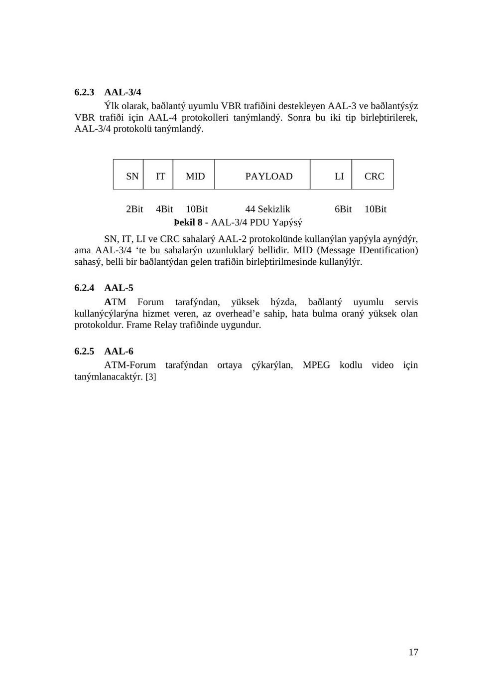

## Connection structure in ATM

Figure 9 - B-ISDN Layers

Figure 9 shows the B-ISDN protocol layers and the tasks they undertake.

**7.** CONNECTION STRUCTURE IN ATM Logical connections in ATM are called virtual channel connections (VCC - Virtual Channel Connection). The VCC is the most basic unit of B-ISDN. A VCC is established between two end users through the network. Fixed-size cells are carried over the connection at variable rates in full-duplex (two-way) flow. VCCs are also used for user-network exchange (control signaling) and network-network exchange (network management and routing).

Figure 11 shows a cross-section of a virtual ATM connection.

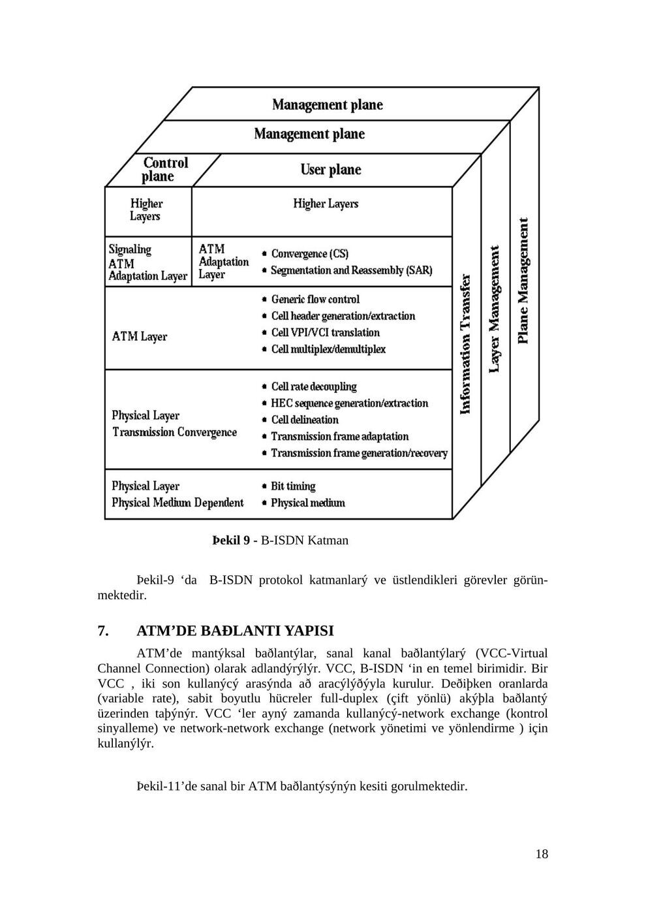

 Figure 10

[5] The virtual path (VP - Virtual Path) concept was developed as a result of the percentage of control costs in high-speed networks rising to high percentages of total network costs. The virtual path technique serves to reduce control costs by grouping connections that share common paths within the network (VPC - Virtual Path Connection). Network management operations can then be applied to a small number of connection groups instead of a large number of individual channels. The advantages arising from the use of VPCs:  Simplified network architecture (because functions in the network environment are classified according to the VPC and VCC concepts, operations become simpler),  Increased network performance and reliability (the network deals with fewer communication units),  Reduced processing and short connection setup time (most of the connection operations are done when the VPC is first established. Adding VCCs to an existing VPC requires very little processing),  Improved network services. [2]

After data connections in ATM are identified by VCI and VPI, the virtual paths going in any given direction are multiplexed onto the physical line. Virtual channel connections are meaningful between end users. But these connection identifiers may change as cells travel within the ATM network. Therefore, a particular VCI value has no significance for the user. The responsibility lies with the ATM network. The connection structure formed by VC and VP is as follows: For two users, the control operation can be performed only on a VP basis instead of on all virtual channels one by one. That is, only one path is examined instead of all channels. The entire resulting connection between two points is shown in Figure 10. [4]

## ATM switching

Figure 11 [1]

**8.** ATM SWITCHING The basic idea in ATM switching is that information entering the switch from a logical channel is routed to another ATM channel in order to be forwarded to the next point on the path. Since there are generally many logical ATM channels leaving a switch, the relevant output channel must be selected before routing. This selection is made depending on the number of the input port and the VPI and VCI values of the cell. [3]

**8.1** ATM Switches An example ATM switch structure is given in Figure 12.

IPC-1 1 1 OPC-1 ……… 2 ATM 2 ……… ……… … SWITCH … ……… …….. … … ……… IPC-n n n OPC-n Switch

Figure 12

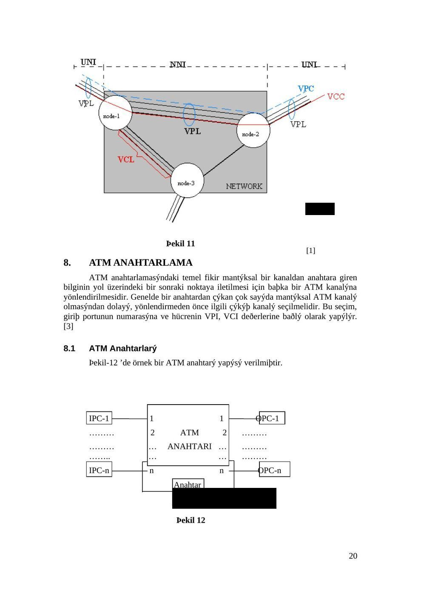

As seen in Figure 12, each port has either an IPC (Input Port Controller) or an OPC (Output Port Controller), depending on its position. There is also a switch controller that updates the routing tables inside the switch. For each cell reaching the switch, the input port number and the VPI and VCI values are examined. Then, using these values, the cell's output port and new VPI and VCI values are found from the routing table. The newly found VPI and VCI values are placed in the positions of the old values in the header before the cell leaves the switch. Finally, the cell is routed to the output port found from the table. Since cells generally enter a switch from more than one port, the output ports of these cells may conflict. In such a case, some cells must be temporarily stored in a buffer area until the relevant output port becomes free. The process of lining these cells up is called queuing. ATM switches are divided into two among themselves: virtual path (VP) switches and virtual channel (VC) switches. Virtual path switches renew only the VPI value in the header during routing. Virtual channel switches, on the other hand, renew both the VPI and VCI values in the header. The reason for making such a distinction among switches is to speed up switching by reducing the work done at intermediate points within the network. At intermediate points the virtual paths change, but the channels they contain remain the same. In such cases, using a switch that examines only the VPI values is a more efficient way. Figure 13 shows examples of virtual path and virtual channel switches.

Figure 13

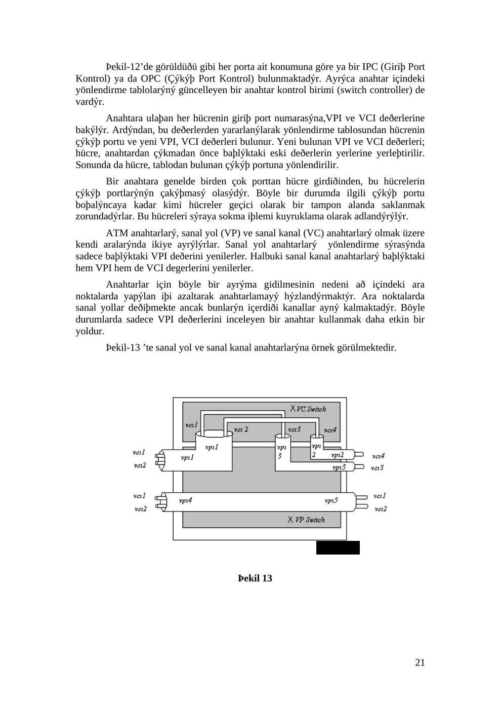

In conclusion, the basic tasks of an ATM switch can be summarized in the following three items:

**1.** Routing the cells,

**2.** Queuing the cells when necessary,

**3.** Replacing the VPI and VCI values in the headers of incoming cells with their counterparts in the routing table. [3]

**8.2** Factors Affecting the Performance of ATM Switches Connection Blocking The connection blocking property means that a connection is rejected when information coming from an input port cannot be routed to an output port because the number of connections and the load in the switch are too high. Cell Loss If cells arrive in the queues inside the switch too quickly and in too large numbers, the queues will overflow and this will cause some cells to be lost. ATM switch designers try to keep the cell loss probability between 10-8 and 10-11. Cell Insertion Some cells inside an ATM switch may go to another logical connection as a result of misrouting. Thus, unnecessary cell accumulation may occur at some output ports. The probability of such an event is also tried to be kept between 10 -11 and 10-14. Switching Delay Cells must pass through the switch as quickly as possible. Otherwise, problems will be encountered in the transmission of delay-sensitive real-time data. These delays can take values between 10 and 1000 s. These values can also be given together with certain probabilities. For example, a promise of 100 s delay at a value of 10-10 means "the probability that the delay in the switch exceeds 100 s is less than 10-10". [3]

## ATM topology

**9.** ATM TOPOLOGY ATM has a flexible topology in terms of structure and development. In addition, it can be applied to existing network topologies and an efficient structure can be formed. Two kinds of interfaces are mentioned in ATM's topology structure. The first of these is the Public UNI (Public User-to-Network Interface), and the other is called the Private UNI. Figure 15 gives the general structural logic of the ATM network topology: [5]

R SB TB UB

B-TE1/ B-TA B-NT2 B-NTI B-L/ET B-TE2 ATM public network UNI private ATM public ATM ATM switch switch endpoint TA private UNI ATM endpoint

CPE NETWORK

B-TE1-2: Broadband Terminal Equipment B-NT1-2: Broadband Network Termination B-TA : Broadband Terminal Adapter

Figure 15 Figure 16 shows an example Local Area Network (LAN) built on the basis of ATM's topology structure:

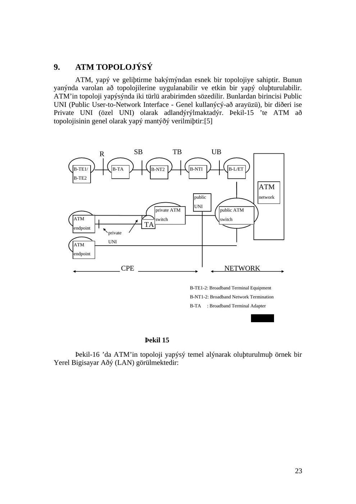

Figure 16

**9.1** ATM Local Area Networks (ATM LANs) and ATM LAN Emulation ATM is a technology that will support future broadband multimedia services. However, IEEE 802-based local area networks and the applications used on these networks are quite widespread in communication today. Therefore, in the initial stage ATM, as a LAN technology, must be compatible with IEEE 802 networks. To ensure this compatibility, ATM is regarded as a data link layer, and the existing network layers are being developed to support this new link layer. In this way IP and similar other protocols can run over ATM. Another solution for supporting existing LAN applications on ATM networks is ATM LAN Emulation. LAN Emulation focuses on how connectionless IEEE 802 network services can be realized over connection-oriented ATM networks. In other words, it aims to make the ATM switch, which provides point-to-point connection, give the appearance of a virtual shared transmission medium. LAN Emulation is realized below the network layer in ATM end systems and ATM-LAN bridges. [3]

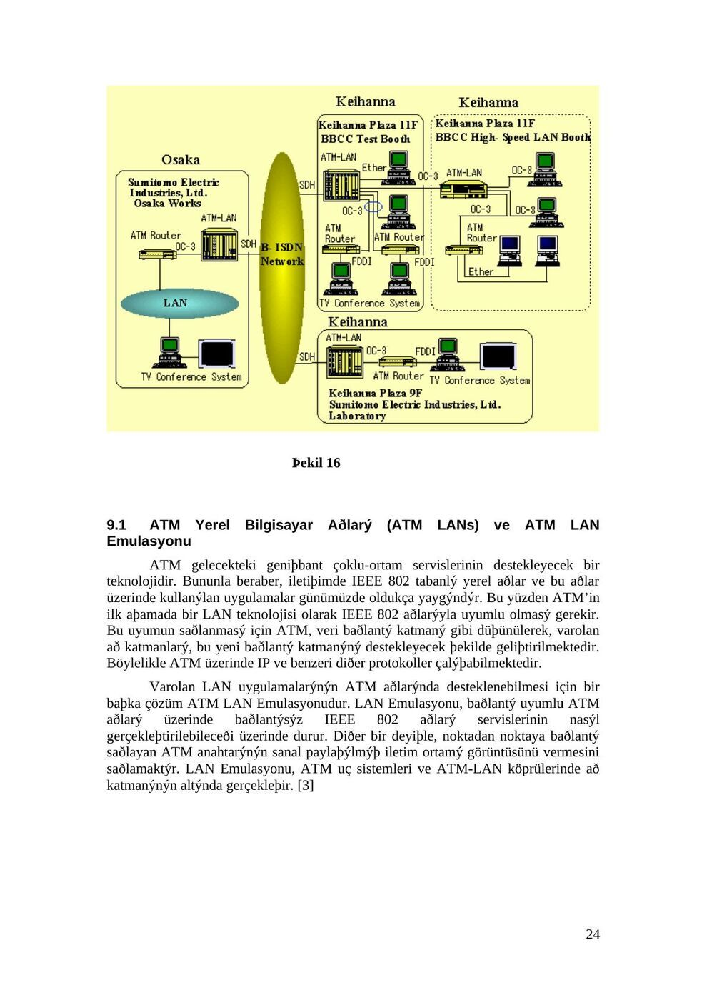

## LAN emulation and disadvantages

**9.1.1** LAN Emulation Architecture The LAN emulation service consists of the following components: LAN Emulation Client (LEC) This unit is the bridge between the LAN and the ATM network. It accepts messages coming from the LANs connected to it. If a message is a "broadcast" or "multicast", it sends the message to the unit called the "BUS", described below. BUS (Broadcast and Unknown Server) This unit is connected to all LECs attached to the ATM network. When the BUS receives a "broadcast" message, it sends this message to all the LECs connected to it. The LECs then deliver the message to the relevant addresses on the LANs connected to them. "Multicast" messages, on the other hand, are sent by the BUS only to a specific group of LECs. LAN Emulation Server (LES) The purpose of the LES is to support LE-ARP (LAN Emulation Address Resolution Protocol). The LE-ARP protocol allows a LEC to find the ATM address of another LEC that holds a given MAC (Media Access Control) address. When a LEC encounters an unknown frame (a MAC address whose corresponding ATM address is unknown), it sends an LE-ARP query to the LES. The LES in turn forwards this query to the other LECs. All LECs that receive the query check whether the specified MAC address belongs to them; if it does, they reply to the LES, including their own ATM address. The LES then notifies the relevant LEC, completing the address resolution. The LAN emulation architecture is shown in Figure 17: [3]

802 LAN

LEC ATM TERMINAL BUS ATM ATM Switches TERMINAL LES

LEC

802 LAN

Figure 17 · ATM is an expensive technology. List prices of ATM switches vary widely, starting from $9,000 for a basic configuration and reaching $350,000 for a fully equipped system.

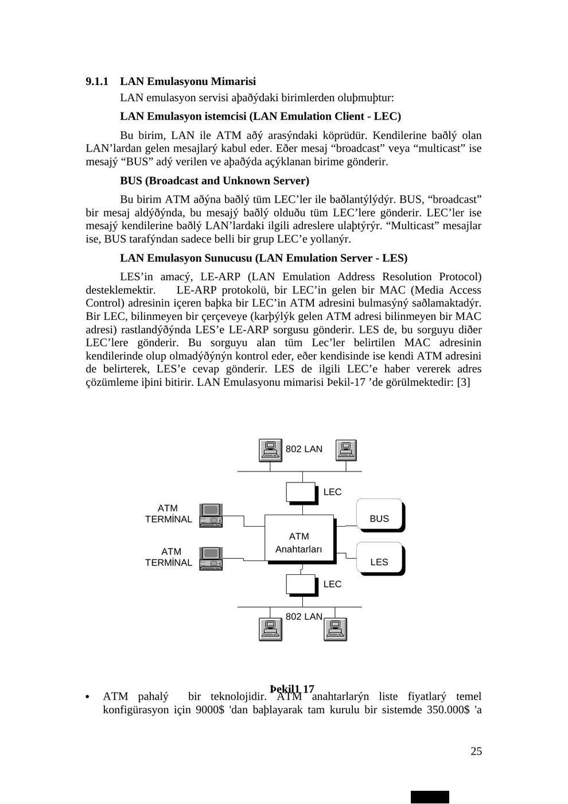

However, this technology is expected to become cheaper and more widespread in the near future. · Since ATM is a new technology, the necessary hardware and software support is not yet sufficient. The most important factor in this is the lack of established standards. There are particularly large gaps in software. "ATM technology is still in its maturation phase. Industry experts estimate that it will take two or three years to mature." [6] · ATM switches offer users many of the service classes provided by routers within their own structure. However, because standards have not yet been established, switches cannot yet perform the following functions that a router can.

**1.** Secure WAN Access: For now, routers are regarded as the only reliable devices for connecting to other networks.

**2.** Firewalls: Routers have the ability to restrict user access outside certain areas of the network. This prevents a problem that arises from spreading to another part of the network.

**3.** Multiprotocol Support: Routers can run all the protocols found in a typical heterogeneous network (such as IP, IPX, SNA, and AppleTalk). [6]

## Advantages of ATM

**11.** ADVANTAGES OF ATM

**1.** ATM is a rapidly developing technology. ITU-T and the ATM Forum are engaged in standardization work. Demands expected to emerge in the future have already led many large companies to begin research in this area. Large companies are accelerating their work by acquiring small companies working in this field. Large network companies such as Bay Networks, Cisco, and 3Com are fighting to capture a bigger share of this pie. [6]

**2.** With ATM it is possible to carry data at very high speeds. To increase speed, error control is kept to a minimum. In this case, error control is left to the responsibility of the user.

**3.** ATM was chosen by ITU-T as the switching model for B-ISDN, which supports all kinds of data types such as video, voice, TV, and text, and will provide the basis for the integration of all networks in a single environment.

**4.** ATM is independent of the physical (transmission) medium. The cables can be coaxial cable as well as fiber. SONET is recommended as the physical layer.

**5.** ATM is compatible with existing systems. This allows it to communicate with every kind of network environment without problems.

**6.** ATM is flexible in data transmission. It is capable of supporting variable bit rates. The communication rate is determined according to the user's request. "Some switches can even offer users dedicated bandwidth." [6] In an ATM network, a certain quality of service can be obtained by specifying the error rate and delay value. This information is communicated by the user to the network environment when connecting to the network. If speed is what is wanted, the error rate may be disregarded; if the error rate is important, then speed will have to be sacrificed.

**7.** Since ATM switches small, fixed-size cells, it can use network resources optimally. "Unlike in circuit switching, the circuit is not held for the entire connection. Using the packet switching technique, the circuit is used only while information is being transferred." [1] Moreover, by establishing connections only between the nodes where communication is required, the switches ensure efficient use of network bandwidth. [6]

**8.** The ATM network structure is suitable for growth.

**9.** ATM may have some variations depending on the company implementing it. As long as they meet certain conditions, different ATM LANs can communicate with each other.

**10.** ATM uses the statistical multiplexing technique to combine the data traffic of many users on a single network. It does this in the most efficient way.

**11.** ATM switching is an easier-to-understand, easier-to-implement, and more economical solution than routers. The level, complexity, architecture, and price of the routers' existing software cause them to be put out of play against switches. [6]

**12.** ATM switches can be added to the network with no changes, or only very small changes, to existing network equipment. [6]

## Conclusion

**12.** CONCLUSION Considering the flexibility of B-ISDN technology in meeting existing communication needs as well as needs that may arise in the future, it is clear that it will be the communication technology of the future. However, because of disadvantages in the ATM infrastructure that makes this structure possible, such as cost and the lack of full standardization, a complete transition to this technology has not yet been achieved. Work on eliminating these disadvantages of ATM continues, particularly on platforms such as ITU-T and the ATM Forum.

## References

**13.** REFERENCES [1] DE PRYCKER, MARTIN; "Asynchronous Transfer Mode, Solution For Broadband ISDN", Ellis Harwood, 1993 [2] STALLINGS, William; "Networking Standards A Guide to OSI, ISDN, LAN and MAN Standards" [3] ERDUR, Cenk; "Advanced Computer Networks ATM Seminar Report", 20.5.96 [4] ATEŞ, Ahmet Feyzi; "B-ISDN, ATM and Other Emerging Technologies", 27.5.96 [5] ÇIMENSEL, Ahmet; "ATM Networks Seminar (Part 1)", 13.5.96 [6] STEPHEN, P. Klett Jr.; ComputerWorld Magazine Issue 298, Pages 43-48, 1995 [7] GAGE, Beth; ComputerWorld Magazine Issue 305, Pages 27-37, 1995 [8] Various Internet Sources (Starting Point - "http://www.yahoo.com") [9] EBRAHIM, Zahir; "A Brief Tutorial on ATM"

## Appendix 1: TCP/IP and B-ISDN

**14.** APPENDICES

**14.1** APPENDIX-1

**14.1.1** Implementation of the TCP/IP Protocol over ATM

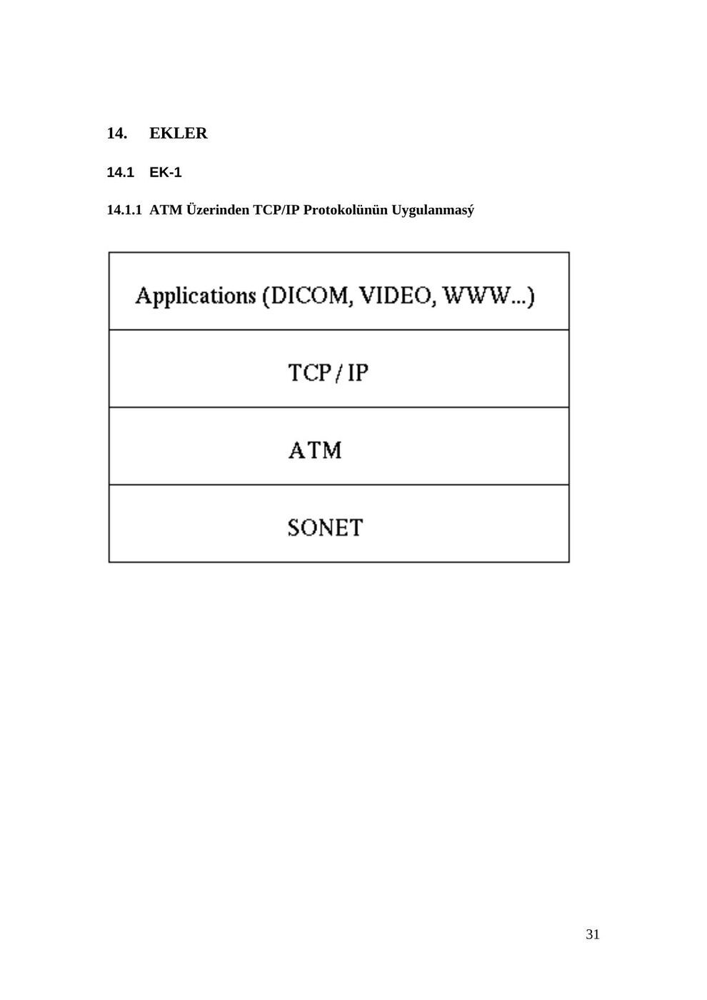

**14.1.2** Protocol Structure and Functions of B-ISDN

**14.1.3**

ATM Principle and the Structure of a Cell:

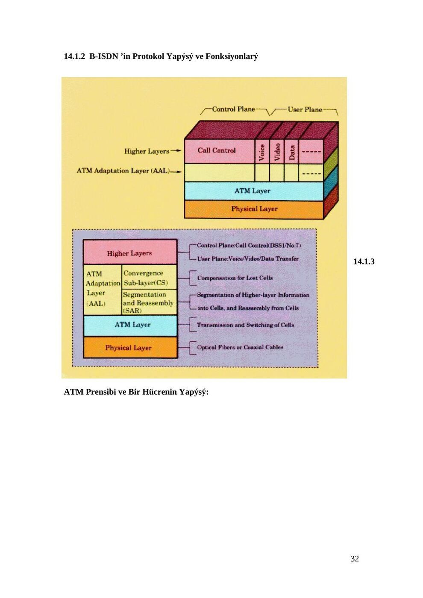

**14.1.4**

ATM Topology

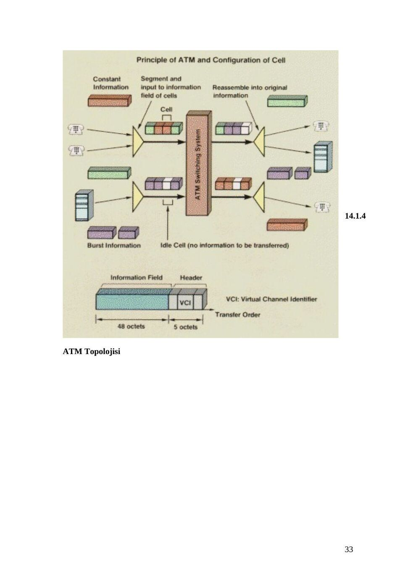

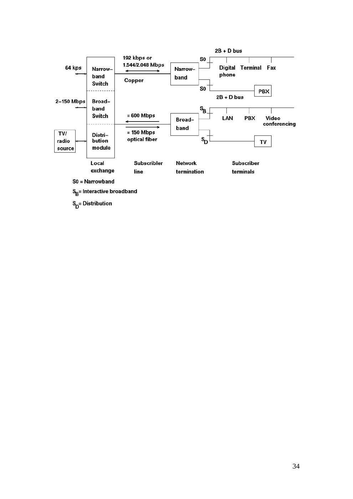

**14.1.5** Cell Types and Their Bit Structures (Patterns):

**14.1.6** The Future of ATM

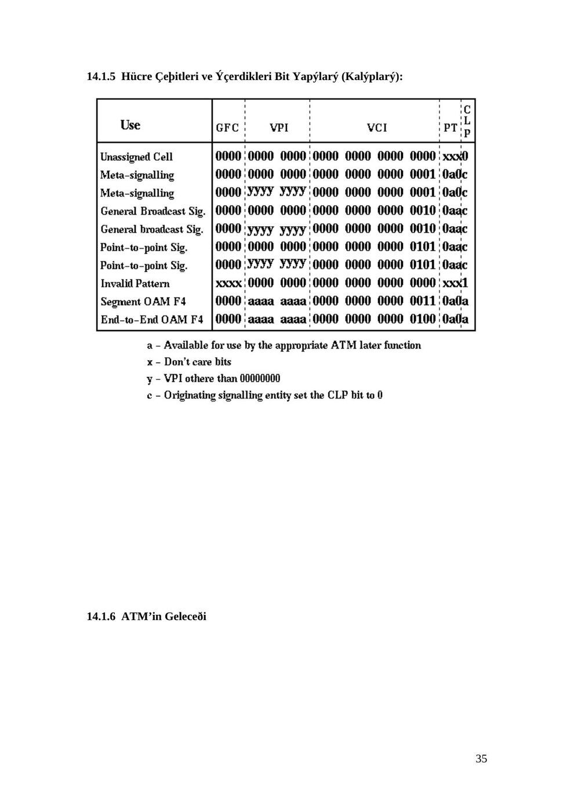

## Appendix 2: An ATM connection example

**14.2** APPENDIX-2 An Example of an ATM Connection

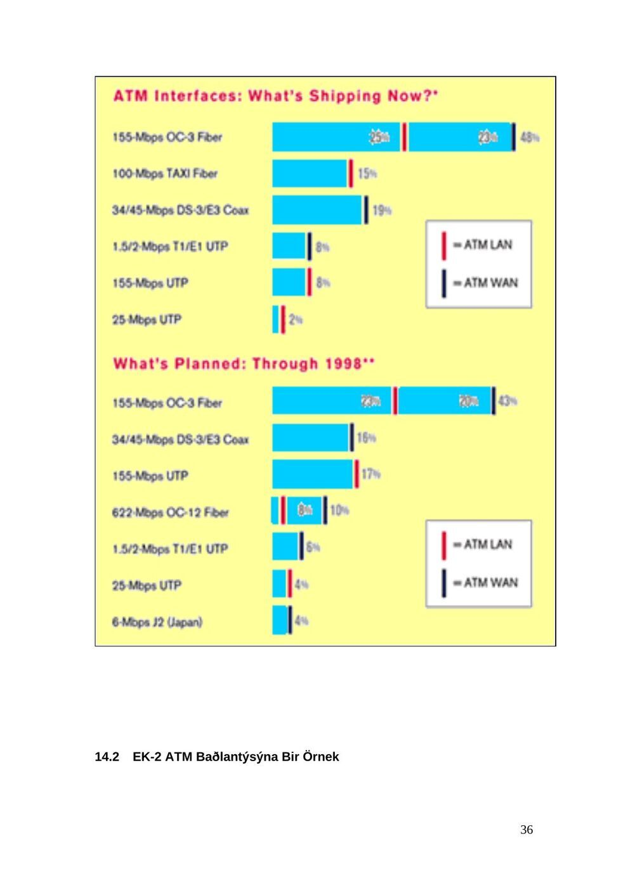

Let us assume a network with end points in İzmir, Ankara, İstanbul, and Trabzon. User-A in İzmir wants to reach User-B in Trabzon via video conference. Let us assume that the ATM cells interface with the UNIs in İZMİR and TRABZON. The connection is established as follows:

User-A's laptop requests a connection through the UNI in İZMİR. Connection parameters are exchanged between User-A's laptop and the network. These may include information such as distance, traffic type, peak and average bandwidth requirements, delay and cell loss requirements, and how much money is left to spend.

The UNI then forwards the request to the network. The software running in the network calculates a route according to the cost function specified by User-A, and determines which links along this route will best support the requested service and bandwidth. It then sends a connection setup request to all nodes along this path (the entire path up to Trabzon). Let the selected path be İZMir-ANKara-İSTanbul-TRabzon. Each of these four nodes obtains an unused VCI label and holds it at its own node for the duration of the connection.

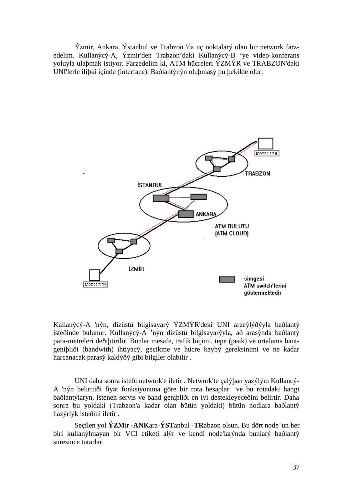

Suppose İzmir takes VC5 as its outgoing label. It will notify İstanbul of this. İstanbul will take VC2 and associate it with VC5 in the connection table. In this table, VC5 will be held as the incoming value. Ankara will take VC4 and associate it with VC2 in the connection table, and will notify Trabzon of VC4. Trabzon will take VC3 and associate it with VC4 in the connection table. It will then ping the addressed UNI to find out whether it accepts this connection.

If the UNI finds User-B, it will return its confirmation. In that case, Trabzon will accept VC4 for the connection as a connection identifier for the UNI and User-B.

This time, processing proceeds backward starting from VC4, and the UNI will accept User-A's laptop as VC5. Thus the connection is established. User-A identifies the connection by the label VC5, and User-B by the label VC3. Other scenarios are also possible and depend on how the vendor has set up its ATM network. [9]

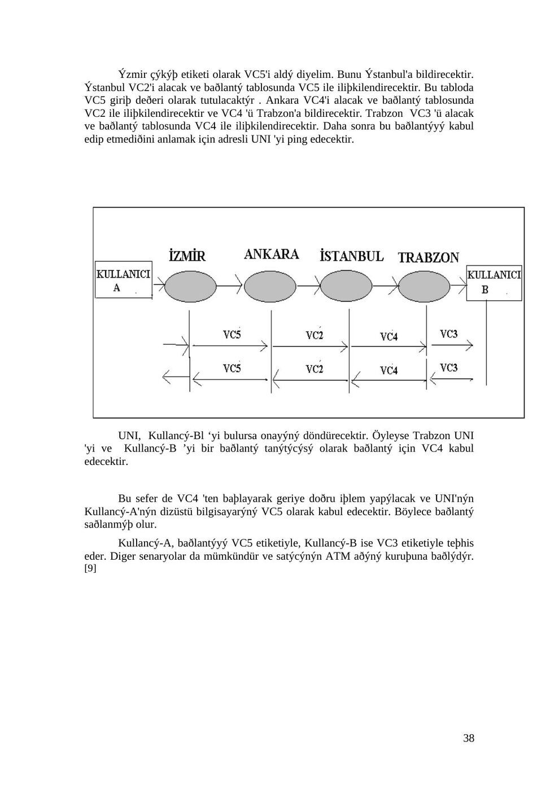

## Appendix 3: Mini glossary

**14.3** APPENDIX-3 Mini Glossary * AAL: ATM Adaptation Layer * ANSA: Advanced Networked Systems Architecture * ASIC: Application Specific Integrated Circuit * ATM: Asynchronous Transfer Mode * AUU: ATM User User indication, "the bit", end of AAL5 block marker * AVA: ATM Video Adaptor * B-ISDN: Broadband Integrated Services Digital Network * CAC: Connection Admission Control * CBR: Constant Bit Rate * CCITT: Comitée Consultatif International Télégraphique et Téléphonique (now the ITU-TS) * CLP: Cell Loss Priority (a bit in a B-ISDN cell header) * CRC: Cyclical Redundancy Check * DAN: Desk Area Network * E1: 2 Mbit/sec * E2: 8 Mbit/sec * E3: 34 Mbit/sec * EATM: EISA ATM (an adaptor) * EDL: Ethernet Data Link * FDDI: Fiber Distributed Data Interface * FAS: Framing and Sequencing * FIFO: First In First Out * GFC: Generic Flow Control (a 4 bit field in a B-ISDN cell header) * H.261: A constant bit rate video compression standard. * HEC: Header Error Check (an 8 bit CRC in a B-ISDN cell) * IOC: Input Output Controller * IP: Internet Protocol * ISDN: Integrated Services Digital Network * ISO: International Standards Organisation * ITU: International Telecommunication Union * LAN: Local Area Network * MAC: Media Access Control * MAN: Metropolitan Area Network * MPEG: Motion Picture Experts Group (a video compression standard)

* NOSSDAV: Network and Operating System Support for Digital Audio and Video ("nose dive") * NNI: Network Network Interface * OC3: 155 Mbit/sec * OC12: 622 Mbit/sec * OSI: Open Systems Interconnection * PDU: Protocol Data Unit (a packet) * PLT: Payload Type (a 3 bit field in a B-ISDN cell header) * PTM: Packet Transfer Mode * Q.93B: The Standard (i.e. awful) ATM signalling protocol * QOS: Quality of Service * SAR: Segmentation and Reassembly * SDH: Synchronous Digital Hierarchy * SDU: Service Data Unit (a packet) * SOC: Start of Cell * SONET: Synchronous Optical Network * SPROING:To Break * STM: Synchronous Transfer Mode * STS1: 155 Mbit/sec * STS4: 622 Mbit/sec * T1: 1.5 Mbit/sec * T3: 45 Mbit/sec * TDM: Time Division Multiplexing * UNI: User Network Interface * VC: Virtual Channel or Virtual Circuit * VCI: Virtual Circuit Identifier (also Virtual Channel Identifier) * VP: Virtual Path * VPI: Virtual Path Identifier * WAN: Wide Area Network

*Note: Some Turkish characters were corrupted in the source Office document; the legible ones have been corrected in the text. Historical ATM prices and expectations for 1998 are not current data. The empty frame on page 14 is also empty in the source.*
