Ege Üniversitesi Mühendislik Fakültesi Bilgisayar Mühendisliği Bölümünün 1995–1996 öğretim yılı ikinci sınıf staj seminer raporudur; kapakta 18 Eylül 1996 yazmaktadır. Öğrenci isimleri, numaraları ve grup bilgisi çıkarılmıştır. Belgelerin arşiv için hazırlanmış PDF kopyaları yazının sonunda indirilebilir.

*Bu içerik üçüncü taraf bir kaynağa aittir; arşiv ve nostalji amacıyla kaynak belirtilerek paylaşılmıştır. Hak sahibinin talebi hâlinde kaldırılır.*

## Özet

**1.** ÖZET

Bu dökümanın amacı günümüz telekominikasyon yapısını ve ihtiyaçlar doğrultusunda bu yapının gelişmesini anlatmaktır. Bu yeni ihtiyaçlara cevap verebilecek yapı olarak B-ISDN kapsamında ATM teknolojisi ele alınmıştır. ATM protokolü kendine has katman yapısı ve anahtarlama teknolojisini içermektedir. ATM'de veri iletişiminde hücre adında özel bir yapıya sahip paketler kullanılmaktadır. ATM, kendine has topolojisinin yanında varolan sistemlerle de uyumludur.

## Giriş

**2.** GİRİŞ

Bilgisayar teknolojisinin ve dolayısıyla bilgisayar ağlarının büyük bir hızla gelişmesi sonucu, bilgisayarların kullanım amaçları ve üstlendikleri hizmetler eskisine oranla çok daha geniş bir alana yayılmıştır. Bu gelişime paralel olarak da yeni kullanım alanları doğmuş ancak bir süre sonra varolan yapılar bu yeni taleplere karşılık veremez hale gelmişlerdir. Şu anda ihtiyaç duyulan pek çok servis (ses, görüntü, klasik veri iletimi, interaktif servisler vb.) yüksek hızlarda iletim kapasitesi gerektirmektedir. Veri iletişiminde ortaya çıkan ilerlemeler (VLSI-Very Large Scale Integration, fiber optik ve anahtarlama teknolojilerindeki gelişmeler) bu ihtiyaçlara cevap verebilecek B-ISDN yapısının oluşmasına imkan sağlamıştır. ITU-T (International Telecommunication Union), B-ISDN için transfer modu olarak ATM'i önermiştir. ATM ve B-ISDN teknolojisi aynı zamanda varolan sistemlere de adapte edilebilir olması açısından da avantajlıdır.

## Telekomünikasyon altyapısı ve B-ISDN

**3.** GÜNÜMÜZ TELEKOMUNİKASYON ALTYAPISI ve B- ISDN

Bugünün telekomunikasyon ağlarının herbiri spesifik hizmetler vermek üzere tasarlanmıştır. Bunun anlamı, herbir telekomunikasyon hizmeti için en az bir ağın olması ve bu ağların hedeflediği spesifik servisi sağlamak amacıyla tasarlanıp çalıştırıldıklarından dolayı, çoğunlukla başka amaçlar için kullanılmaya uygun olmamalarıdır. Örneğin, X.25 veri iletişimi ağları uçtan uca gecikme ve kayma değerlerinin kontrol edilememesi nedeniyle, gerçek zamanlı ses iletişimi için uygun değildirler. Ayrıca, bir ağ içinde, belli zamanlarda boş duran birtakım kaynaklar da başka amaçlar için kullanılamamaktadır. (Örneğin, varolan telefon ağlarının TV yayını için uygun olmamaları sebebiyle günün geç saatlerinde ses iletim ihtiyacının düşük olmasına rağmen, kablolu TV yayını için kullanılamaması.) Sonuçta birbirinden bağımsız ve farklı birçok iletişim ağı ortaya çıkmış ve bu durum, ağların kullanım esnekliğini ve etkinliğini düşürmüştür. Buna paralel olarak da bu tür ağların tasarım, bakım, üretim maliyetleri de yükselmiştir. Bu ağlara örnek verecek olursak :

- Düşük hızlarda (300 kb/sn) bilgi transferi sağlayan teleks ağları,

- POTS (Plain Old Telepnone Service) adıyla da bilinen ve PSTN (Public Switched Telephone Network - Anahtarlamalı Telefon Ağı ) üzerinden sağlanan iki yönlü ses iletişimi için tasarlanan ağlar,

- X.25 ve benzeri PSDN (Public Switched Data Networks ) paket anahtarlamalı veri ağları,

- CATV (Community Antenna TV), kablolu televizyon ağları,

- LAN (Local Area Networks ), yerel iletişim ağları Yukarıda örnek verdiğimiz telekomunikasyon ağları ve varolan ihtiyaçlar gözönüne alındığında, bu altyapının yetersiz kalacağı açıktır. Özellikle gelecekte kullanılması düşünülen video-telefon, video-konferans, video-kütüphane ve benzeri servisleri düşünürsek, bu tür ihtiyaçları karşılayacak iletişim ağlarının servis türünden bağımsız, genişbantlı tek bir ağ olması gerektiği ortaya çıkmaktadır. Bu alandaki çalışmalar seksenli yılların başlarında başlatılmış ve ISDN (Integrated Switched Digital Networks) olarak adlandırılmıştır (Şu anda N-ISDN Narrowband ISDN olarak anılmaktadır). Bu ağların bant genişliğinin arttırılmasıyla hertürlü ses, veri, hareketli video ve yüksek çözünürlükte TV iletiminin entegre edilmesi sağlanmış ve gelişen yapı B-ISDN (Broadband ISDN) olarak adlandırılmıştır. B-ISDN yapısını olanaklı kılan faktörler, fiber-optik teknolojisinin gelişerek iletişim hatlarında geniş çapta kullanılır olması ve yarı iletken teknolojisinde sağlanan ilerlemeler olarak gösterilebilir. Böylelikle, yeni geliştirilen yapıda, iletim ortamının daha güvenilir olması ve hata kontrolunun ağ içinde yapılması gerekliliğinin ortadan kalkması ile daha etkin ve maliyeti düşük yeni bir aktarım biçimi kullanılabilmiştir. İşte bu yeni teknoloji ATM (Asynchronous Transfer Mode) olarak adlandırılmaktadır.

ITU-T (Eski adıyla CCITT) tarafından da yapılan araştırmalar sonucu 1988 yılında ATM’ in B-ISDN için en uygun aktarım protokolu oldugu belirlenmiştir. ITU-T tarafından B-ISDN yapısı ile verilmesi düşünülen hizmetler şöyle sıralanabilir:

- HDTV(High Definition TV) Yüksek çözünürlüklü TV servisleri,

- Videokonferans servisleri,

- İstek üzerine video (Video on Demand) servisleri,

- Karşılıklı iletişime dayalı (interaktif) servisler,

- Mesaj servisleri,

- Veri transfer servisleri.

Şekil-1 ’de ise örnek olarak bu hizmetlerden bazılarının gerektirdiği hız ve zaman ilişkileri verilmiştir:

Şekil 1

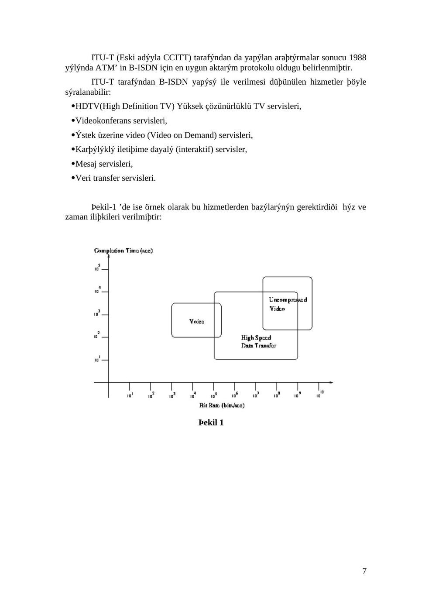

## ATM ve transfer modları

**4.** ATM NEDİR ? Her türden veriyi yüksek hızlarda taşıyabilen anahtarlanmış, hücre tabanlı aktarım protokolüdür. ATM her türden network trafiğini (veri, ses video ve TV sinyalleri) 53-byte'lık hücreler halinde iletir.

**4.1** ATM Anahtarlamanın Tarihçesi ATM’in başlangıcından bu yana gelişimi Şekil-2’de görülmektedir :

[7]

Şekil 2

**4.2** Transfer Modları Transfer modu, bir telekomunikasyon ağında kullanılan iletim (transmission), çoklama (multiplexing) ve anahtarlama (switching) tekniklerinin toplamına verilen isimdir. Network dünyasında transfer modu konusunda temel olarak iki kutup bulunmaktadır. Bunlar devre anahtarlama ve paket anahtarlamadır (Sırasıyla kapitalist ve komunist yaklaşımlar olarak da adlandırılırlar). Devre ve paket anahtarlama belirtildiği gibi iki uç noktadır ve birbirlerine karşı avantaj ve dezavantajlara sahiptirler. Zamanla bu iki zıt yöntemin de diğer yöntemin avantajlarını kullanan varyasyonları ortaya çıkmıştır. Bunların bir kısmı aralarındaki ilişkilere göre Şekil-3 ’teki şemada sıralanmıştır. Şeklin altında ise bu metodların başlıcalarının açıklamalarını bulabilirsiniz. [1]

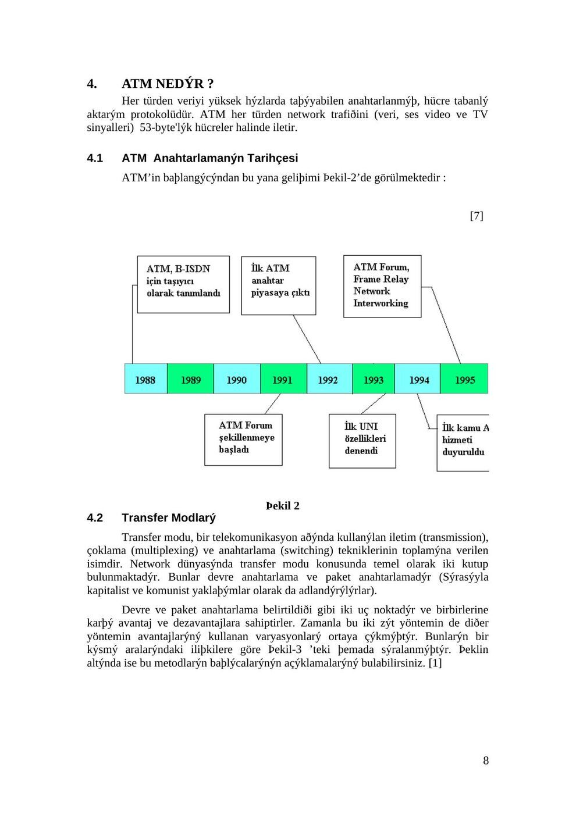

Sabit Hız Değişken

Basit Karmaşık

Circuit Multirate Frame Frame Packet ATM C. Sw. Relay Sw. Sw.

Şekil 3

**4.2.1** Devre Anahtarlama (Circuit Switching): Bu transfer modu özellikle telefon ağlarında kullanılır. N-ISDN 'de de bu yöntem kullanılmaktadır. Devre anahtarlamanın temeli, bir iletim sırasında sadece ilgili bağlantı tarafından kullanılabilen adanmış sabit kapasiteli bir kanal oluşturmaktır. Belirli zaman aralıklarında (125 µs gibi) sabit uzunlukta bit kümeleri gönderilir (8 bit, 1000 bit gibi). Bu kümelerin her birine 'time slot' denir ve bunlar birleştirilerek çerçeveleri (frame) oluştururlar. (Çerçeveler de belirli aralıklarda tekrarlanır. Bu çerçevelerin içindeki her time slot, devam ettiği sürece belirli bir bağlantıya adanır. Ancak bağlantı kapatıldığında ilgili slot başka bir uygulamanın kullanımına sunulabilir.) Pür hat anahtarlamalı sistemlerde her time slot'un barındırabileceği bit miktarı aynıdır ve sabittir. Yani her servis için sabit bir bit hızı vardır. Devre anahtarlamalı sistemlerde bir hat, bağlantı boyunca bir uygulamaya adandığından dolayı sistemde oluşacak gecikmeler ancak iletim hattındaki yayılma gecikmesine bağlıdır.[1]

**4.2.2** Multirate Circuit Switching: Devre anahtarlamasının kısıtlamalarını ortadan kaldırmak için tasarlanan bu yöntemde, bir bağlantı için birden fazla time slot kullanılabilmektedir. Ancak birden fazla time slot kullanılırsa bunların senkronize edilmesi zorunluluğu ortaya çıkar. Başka bir problem de 'basic rate'in seçilmesindedir. Eğer bu değer büyük seçilirse (örneğin 2 Mbit/s) küçük hat genişliği gerektiren servisler (ses 64 kbit/s) gereksiz yere kaynak tüketmiş olacaklardır. Bu değer küçük seçilirse de (1 kbit/s)

büyük bant genişliği gerektiren servisler (HDTV 144 Mbit/s) için çok fazla miktarda kanalın kontrol edilmesi gerekecektir; bu da işleri çok karmaşık hale getirir. Bu soruna üretilen çözüm ise bir çerçeveyi farklı bit oranları olan slotlara bölmektir. Böyle bir sistemde her farklı time slot için özel bir tür anahtar kullanılmalıdır (farklı bit rate'lerden dolayı). Abonenin gelen/giden bilgisi anahtarlara/anahtarlardan yönlendirilmeden önce multiplex/demultiplex işleminden geçirilmelidirler (Bu işlem farklı bit rate'deki kanalların ilgili anahtara yönlendirilmesi için yapılır). Farklı bit rate'ler kullanılabilmesine karşın bunların sabit değerler olmasından dolayı, servislerin ihtiyaçlarında oluşacak değişikliklere karşı esnek olması beklenemez (Bant genişliği ihtiyacının artması, sıkıştırma teknolojisindeki gelişmelerden dolayı ihtiyacın azalması vb.). Bu sistemler doğal olarak hat anahtarlamanın dezavantajlarını da içerirler (Kaynakların ihtiyaç dışında meşkul edilmesi vb.). [1]

**4.2.3** Paket Anahtarlama (Packet Switching): Bu transfer modunda kullanıcının bilgileri paketler halinde taşınır. Bu paketlerde kullanıcının bilgisine ek olarak başlık (header) denen ve yönlendirme (routing), hata kontrol ve akış kontrol için kullanılan bilgileri içeren saha da bulunur. Eski bağlantıların güvenliği düşük olduğundan dolayı bu tip sistemlerde ileri düzeyde hata kontrolü yapılır (İçinden geçilen her node'da paket içeriği, hatalara karşı kontrol edilir…). Her node ‘da hatalı paketler için tekrar gönderim isteği yapılır.(ARQ -Automatic Repeat Request) Paket boyutları değişkendir. Dolayısıyla kompleks akış kontrolü gerektirirler. Ancak iletişim hızı düşük olduğundan bu pek sorun yaratmamaktadır.Protokollerin karmaşıklığından ve tekrar gönderme işleminden dolayı yüksek hız gerektiren servislerde ve gerçek zamanlı uygulamalarda pek kullanılmazlar. [1]

**4.2.4** Frame Relaying: Frame Relaying, iletim hatlarının güvenilirliği nedeniyle, ağ içinde paket anahtarlamalı sistemlere (X.25) oranla daha az fonksiyonelliğe sahiptir (Daha kısıtlı hata kontrol ve düzeltme yapılır). Bu da ağ içi anahtarlama noktalarında daha hızlı bilgi işleme imkanı sağlar. Paketlerin tekrar gönderimi ancak uç noktalar arasında yapılır (yani aradaki node'lar paketlerin tekrar gönderimini istemez). Buna karşın node'larda paketler hala hatalara karşı kontrol edilirler. Bunun nedeni hatalı paketlerin iletimine devam edilmesinin bir anlamının olmamasıdır. [1]

**4.2.5** Cell Relaying(Fast Packet Switching-ATM): Fast Packet Switching (ATM), birçok varyasyonu içeren bir kavramdır. Ancak bunların temel karakteristiği aynıdır: Ağda minimum fonksiyonellikle paket anahtarlama. Gönderici ve alıcı arasında bir senkronizasyon yoktur. Senkronizasyon, gerektiğinde boş paketlerin eklenip çıkarılmasıyla sağlanabilir.

## ATM hücre yapısı

ATM'de ağ içinde CRC ya da ARQ türünden hata kontrol fonksiyonları yoktur. Hat anahtarlamada olduğu gibi hataların düzeltilmesi uç noktalardaki protokollere bırakılmıştır. [1] ATM ‘in Frame Relay’den en önemli farkı, ATM’de verilerin sabit ve küçük boyutlu paketler (hücreler) halinde iletilmesidir. Frame Relay de ise paket boyu değişkendir. [2]

**5.** ATM HÜCRE YAPISI ATM’de bilgi aktarımı için kullanılan temel birim 53 byte'lık sabit uzunlukta olan ve hücre (cell) olarak adlandırılan özel bir tür pakettir. Hücrelerin ilk 5 byte'lık kısmı başlık (header) olarak adlandırılır ve hücrenin ağ içinde ilerleyebilmesi için gerekli olan temel bilgileri taşır. (Paket anahtarlama yönteminde bulunan ve ileri düzeyde fonksiyonellik sağlayan alanlar hücre başlıklarında olabildiğince azaltılmıştır). Başlığın fonksiyonelliğinin düşük düzeyde tutulması da ATM anahtarlarına yüksek hızda işlem yapma imkanı verir. Geriye kalan 48 byte ise iletilecek olan bilgiyi içerir.

GFC VPI VPI VCI VCI User-Network VCI PT C Arayüzü HEC 8 7 6 5 4 3 2 1

VPI VPI VCI VCI Network Network Arayüzü VCI PT C HEC

Şekil 4 Bir Hücre Başlığının Genel Yapısı

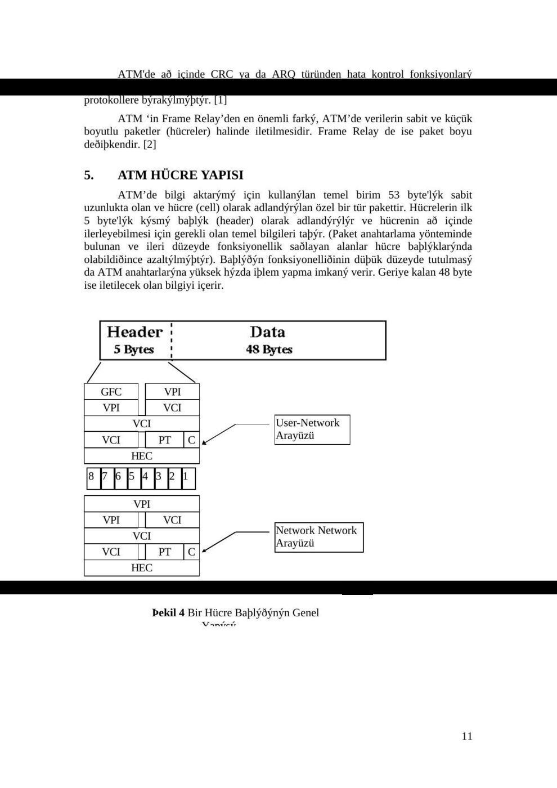

Başlık alanlarının açılımları ve işlevleri aşağıdaki gibidir : VPI (Virtual Path Identifier-Sanal Yol Belirteci) - VCI ( Virtual Chanel Identifier-Sanal Kanal Belirteci): ATM'de node'lar arası bilgi aktarımı VC (Virtual Channel) denen sanal bağlantılar aracılığı ile sağlanır. Aynı iki son nokta arasındaki VC'ler de yönetim kolaylığı amacıyla VP'ler (Virtual Path) içinde gruplandırılırlar. Başlık içindeki VPI ve VCI ise node'lar arsında cok sayıda bulunan bu baglantılardan hangilerinin kullanılacağını belirlerler. Bu tanımlayıcıların degerleri lokal özelliğe sahiptirler yani bir hücre node'lar arasında ilerlerken farklı nodelarda farklı VPI ve VCI degerlerine sahip olabilirler. HEC (Header Error Check) - Başlık Hata Kontrolü : Hücrelerin başlıklarında oluşacak hatalar yalnış yönlendirmeden dolayı hücrenin tamamının kaybolmasına neden olabilir ( 1 bitlik hata 48 byte'lık bilginin kaybolmasına neden olacaktır). Bunu önlemek için hücre başlıklarına bu hata kontrol sahası konulmuştur. 8 bit uzunluğundadır. CRC değeri içerir. CLP (Cell Loss Priority) - Hücre Kayıp Önceliği : 1 bit uzunluğundaki bu saha hücrenin kayıp önceliğini belirler. Değerinin 1 olması ağ içinde bir sıkışıklık olduğunda bu hücrenin gerekirse yok edilebileceğini gösterir. Bir sıkışıklık anında CLP değeri 1 olan bütün hücreler iptal edilmeden CLP değeri 0 olan hücrelere dokunulmaz. PLT (Payload Type) - Taşınan Veri Tipi : Bu saha hücredeki trafiğin tipini belirler. ATM Forum bu sahanın işlevini geliştirerek trafik tıkanıklığı hakkında bilgi vermesini de sağlamaktadır. Bu alanın uzunluğu 3 bit'tir. [1]

**5.1** ATM’deki Hücre Tipleri Unassigned Cells: Trafik olmadığı durumda, ATM tabakası tarafından gönderilen boş paketlerdir. Bantgenişliğini doldurmak veya senkronizasyon amaçlı kullanılırlar. Aynı zamanda IDLE hücreleri vardır. Bu hücrelerin özelliği fiziksel tabaka tarafından yaratılmalarıdır. ATM tabakasına çıkmazlar, fiziksel katmanlar arasındaki senkronizasyonda kullanılırlar. Meta-Signaling Cells: Ağ ile bir oturum kurmakta ve oturum servislerini saptamada kullanılırlar. General Broadcast Cells: UNI’deki tüm istasyonlara gönderilen paketleri belirlerler. Point-to-Point Signaling Cells: ATM tabakasında noktadan noktaya bağlantı sağlayan UNI veya NNI arayüzü hücrelerini belirlerler. F4 ve F5 Hüceleri: Sırasıyla VP ve VC bakım hücrelerini belirlerler. Resource Management Cells: VC üzerinde hızlı kaynak yönetimi için ayrılmışlardır. ILMI (Interim Local Management Interface) Cells: ATM kullanıcı aygıtlarının durumlarını ve UNI’deki VP ile VC konfigürasyonu ile ilgili bilgileri taşırlar.

Bu hücre tiplerini belirleyen bit yapıları 15.1.5 teki (EK 1) tabloda verilmiştir. [1]

**5.2** Neden Sabit Uzunluk ? Bir sistemde sabit uzunlukta hücreler kullanıldığında etkinlik, gönderilecek bilginin uzunluğuna göre değişir. Eğer gönderilecek bilgi küçük miktarlardaysa ve hücrelere bölündüğünde son hücrede büyük oranda (30-40 byte) boşluk kalıyorsa bu iletişimdeki

Gönderilen Yararlı Bilgi

(Gönderilen hücre sayısı) * 53 oranı pek yüksek olmaz. Ancak gönderilecek bilgi 48 byte'ın tam katıysa yani hücrelerin hepsi tamamen doluysa maximum etkinliğe (%90.5) ulaşılabilir. (Maximum etkinliğin %90.5 olmasının sebebi gönderilen 53 bytelik her hücrenin 5 byte'ının başlığa ayrılmış olmasıdır. 48/53=0.905...) Değişken uzunlukta hücreler kullanılınca sistemde neredeyse %100 ’lük etkinliğe ulaşılır. Ancak, farklı uzunluktaki paketlerin kuyruklama için buffer'da etkin olarak saklanması oldukça zordur ve komplike algoritmalar gerektirir. Bu kompleks buffer işlemleri de yüksek hız gerektirir. Bu tür pratik nedenlerden dolayı degişken uzunlukta hücre kullanımı engellenmiştir. Sabit uzunluktaki hücrelerde kalan boşluklar sistem etkinliğine olumsuz yönde etki eder, ancak B-ISDN'de sunulacak servislerin zaten yüksek miktarda bilgi iletimine ihtiyaç duyması bu olumsuzluğu ortadan kaldırır. [1]

**5.3** Neden 53 Byte ? Hücre boyunun seçilmesinde farklı faktörler rol oynamıştır. Uzun bilgi alanları iletimin etkinliğini artırır. Çünkü her başlıkla beraber gönderilen bilginin miktarı artar ve böylece başlıklardan kaynaklanan overhead'ın oranı azalır.Ancak bilgi alanının boyu arttıkça paketleme sırasındaki gecikme de (packetization delay) artar. Uzun hücreler kullanıldığında ağ içindeki gecikmenin de belirli limitleri aşması daha kolay olur (Örneğin telefon görüşmeleri için bu gecikme sınırı 25 ms'dir). Bu da ses iletiminde yankı önleyicilerin kullanılmasını zorunlu kılar. Ayrıca uzun hücreler anahtarlarda kullanılan geçici depolama alanlarının büyük olmasını gerektirir. (Hücre kayıplarını önlemek için kuyruklar hücre boyutundan bağımsız olarak belli miktarda hücreyi saklayabilecek kapasitede olmalıdırlar) Bütün bu etkenler göz önüne alınarak hücredeki bilgi sahasının boyunun 32 ya da 64 byte civarında olması öngörülmüştür (Avrupa ses iletimindeki kolaylığından dolayı 32, Amerika ve Japonya ise etkinliğinden dolayı 64 byte'lık boyutlarda ısrar etmişlerdir). Sonuçta 48 byte bilgi + 5 byte başlık olmak üzere 53 byte hücre boyutu olarak kabul edilmiştir. [1]

## ATM katmanları

**6.** ATM KATMANLARI

ATM ‘in üzerinde kurulduğu fiziksel tabaka yapısı SONET/SDH, DS3 veya FDDI olabilir. ATM, fiziksel ortamdan bağımsızdır ancak geniş tabanlı genel taşıyıcı olarak, eş zamanlı bir iletim yapısı olan SONET (Synchronous Optical Network) tercih edilir. SONET Bellcore tarafından üretilmiş ve ANSI (American National Standards Institue) tarafından standartlaştırılmıştır. SONET, fiber kablo üzerinde yüksek hızda dijital sinyal iletimini sağlamak için tasarlanmıştır. Verileri

**51.84** Mbps hızda taşımak için standart çoklama biçimini kullanır. Ayrıca optik sinyal standardını, farklı kaynaklardan karşılıklı bağlantı için kullanır. Geniş işlem yapma, yönetim ve bakım özelllikleri vardır. Esnek yapısıyla, gelecekte varolacak yeni teknolojilere ayak uydurabilir. Fiziksel tabakanın üzerinde ise ATM ve AAL (ATM Adaptation Layer) olmak üzere iki tabaka bulunur. AAL, ATM ile diğer katmanlar arasında arayüz görevini yürütür. AAL, CS (Convergence Sublayer) ve SAR (Segmentation and Reassembly Sublayer) den oluşur. SAR farklı uzunluk ve formattaki PDU (Protocol Data Unit) ‘ları (yani iletilecek veri paketlerini) 48 okteklik (sekizlik) parçalara ayırır. CS’nin fonksiyonları AAL tarafından işlenen trafiğin tipine göre değişir. Gönderici taraftaki ATM tabakasında, SAR’dan gelen 48 sekizlik bilgiye 5 byte’lık hücre başlığını ekler. Ağ içindeki anahtarlardaki ATM tabakaları VPI ve VCI bilgilerini kullanarak yönlendirme işlemlerini gerçekleştirir. Alıcıdaki ATM tabakası 5 byte’lık başlık bilgisini çıkarır ve AAL’ e iletir. [3]

**6.1** AAL Katmanı Tarafından Desteklenen Trafik Sınıfları ATM AAL katmanı, değişik trafik tiplerini desteklemek için 5 tane değişik trafik sınıfına sahiptir. Bunlar Şekil-5 ‘te kısaca açıklanmıştır. Tabloda her trafik tipi için kaynak ve varış noktaları arasında herhangi bir zaman ilişkisi olmasının gerekip gerekmediği, bit hızının karakteristiği ve bağlantı uyumlu olup olmadığı da belirtilmiştir.

A Sınıfı B Sınıfı C Sınıfı D Sınıfı X Sınıfı HEDEF-KAYNAK Gerekli Gerekli Gereksiz Gereksiz Kullanıcı ZAMAN ya İLİŞKİSİ Bağlı BİT HIZI CBR VBR VBR VBR Kullanıcı ya Bağlı BAĞLANTI Evet Evet Evet Hayı Kullanıcı ya Bağlı Şekil 5 - Servis Türleri İçin Trafik

**6.2** AAL Tipleri Sınıfları AAL, trafik tiplerini desteklemek amacıyla AAL farklı protokolllere sahiptir.

**6.2.1** AAL-1 A Sınıf trafiği destekler ve PDU yapısı 48 sekizlikten oluşur. Payload(Kullanıcı Verisi), 46 veya 47 sekizlik olabilmektedir.

SN SNP İşaretçi Payload (İsteğe Bağlı) 4 Bit 4 Bit 8 Bit 46 veya 47 Sekizlik

Şekil 6 - AAL-1 PDU Yapısı

SN (Sequence Number): 3 biti sıra sayısı tutmak için, 1 biti ise CSI (Convergence Sublayer Indication), işaretçi sahanın kullanılıp kullanılmayacağını gösterir. CSI ‘nın sıfır olması, işaretçinin kullanılmadığını ve kullanıcı verisinin 47 sekizlik olduğunu gösterir. İşaretçi, verilerin hücre içinde yerleşimini tutmaktadır. SNP (Sequence Number Protection), SN üzerinde hata kontrolü yapar. SNP sahası, ancak 1 bitlik hataları düzeltebilmektedir.

**6.2.2** AAL -2 Sınıf-B trafiğini destekleyen protokoldür.

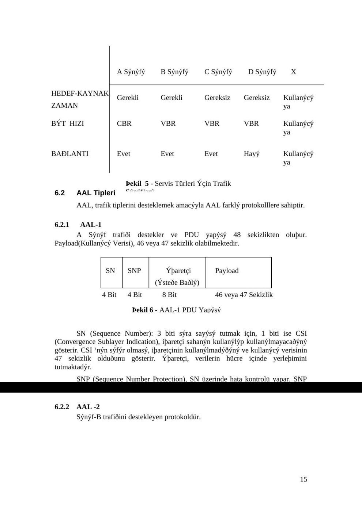

HEADER TRAILER

SN IT PAYLOAD LI CRC

Şekil -7 AAL-2 PDU yapısı

Başlık kısmında SN (Sequence Number) ve IT (Information Type) bulunur. IT sahası, BOM (Beginning Of Message), COM (Continuation of Message) ve EOM (End Of Message) sahalarından oluşur. Kuyruk kısmında, LI (Length Indicator) sahası Payload sahasındaki sekizlik sayısını tutar, CRC de hata kontrolünde kullanılır.

**6.2.3** AAL-3/4 İlk olarak, bağlantı uyumlu VBR trafiğini destekleyen AAL-3 ve bağlantısız VBR trafiği için AAL-4 protokolleri tanımlandı. Sonra bu iki tip birleştirilerek, AAL-3/4 protokolü tanımlandı.

SN IT MID PAYLOAD LI CRC

2Bit 4Bit 10Bit 44 Sekizlik 6Bit 10Bit Şekil 8 - AAL-3/4 PDU Yapısı SN, IT, LI ve CRC sahaları AAL-2 protokolünde kullanılan yapıyla aynıdır, ama AAL-3/4 ‘te bu sahaların uzunlukları bellidir. MID (Message IDentification) sahası, belli bir bağlantıdan gelen trafiğin birleştirilmesinde kullanılır.

**6.2.4** AAL-5 ATM Forum tarafından, yüksek hızda, bağlantı uyumlu servis kullanıcılarına hizmet veren, az overhead’e sahip, hata bulma oranı yüksek olan protokoldur. Frame Relay trafiğinde uygundur.

**6.2.5** AAL-6 ATM-Forum tarafından ortaya çıkarılan, MPEG kodlu video için tanımlanacaktır. [3]

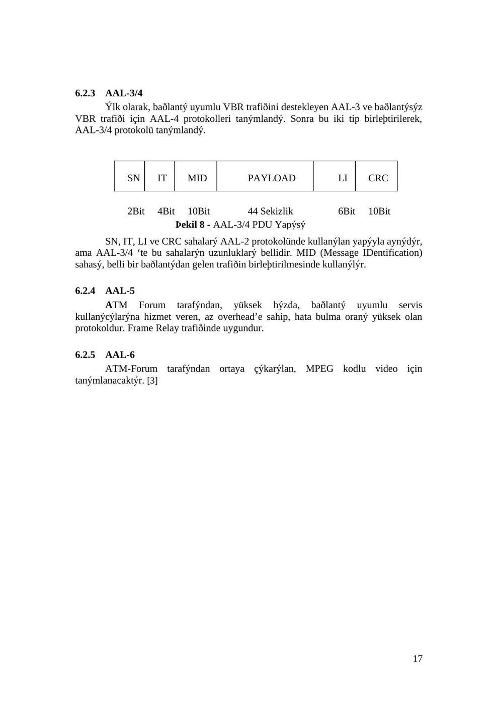

## ATM’de bağlantı yapısı

Şekil 9 - B-ISDN Katman

Şekil-9 ‘da B-ISDN protokol katmanları ve üstlendikleri görevler görün- mektedir.

**7.** ATM’DE BAĞLANTI YAPISI ATM’de mantıksal bağlantılar, sanal kanal bağlantıları (VCC-Virtual Channel Connection) olarak adlandırılır. VCC, B-ISDN ‘in en temel birimidir. Bir VCC , iki son kullanıcı arasında ağ aracılığıyla kurulur. Değişken oranlarda (variable rate), sabit boyutlu hücreler full-duplex (çift yönlü) akışla bağlantı üzerinden taşınır. VCC ‘ler aynı zamanda kullanıcı-network exchange (kontrol sinyalleme) ve network-network exchange (network yönetimi ve yönlendirme ) için kullanılır.

Şekil-11’de sanal bir ATM bağlantısının kesiti gorulmektedir.

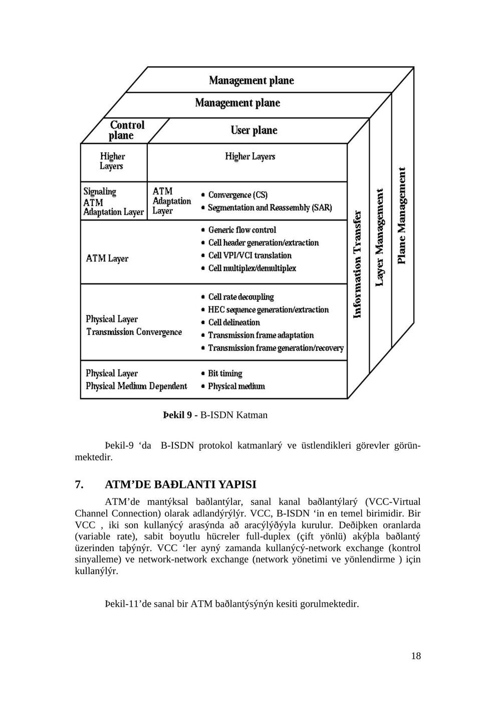

 Şekil 10

[5] Sanal yol (VP-Virtual Path) kavramı, yüksek hızlı ağlarda kontrol harcama- larının yüzdesi1nin bütün network harcamaları içinde yüksek yüzdelere artması sonucu geliştirilmiştir. Sanal yol tekniği, network içinde ortak yolları paylaşan bağlantıları gruplayarak (VPC-Virtual Path Connection) kontrol masraflarını azaltmaya yarar. Network yönetim işlemleri bundan sonra çok sayıdaki bireysel kanallar yerine az sayıdaki bağlantı gruplarına uygulanabilir. VPC ’lerin kulanımından doğan avantajlar :  Basitleştirlmiş network mimarisi (Ağ ortamındaki fonksiyonların VPC ve VCC kavramlarına göre sınıflandırılmalarından dolayı işlemler daha basitleşir),  Artırılmış network performansı ve güvenilirlik (Ağ daha az iletişim birimiyle uğraşır),  Azaltılmış işlem ve kısa bağlantı kurulma zamanı (Bağlantı işlemlerinin büyük kısmı VPC ilk kez oluşturulurken yapılır. Var olan bir VPC’ye VCC’ler eklemek çok az bir işlem gerektirir),  Geliştirilmiş ağ servisleri. [2]

ATM'de veri bağlantıları VCI ve VPI ile tanımlandıktan sonra, verilen herhangi bir yöne giden sanal yollar çoklanarak fiziksel hatta verilir. Sanal kanal bağlantıları son kullanıcılar arasında anlamlıdır. Fakat bu bağlantı tanımlayıcıları, hücreler ATM ağı içinde ilerlerken değişebilir. Bu yüzden belli bir VCI değerinin kullanıcı açısından bir önemi yoktur. Sorumluluk ATM ağındadır. VC ve VP ile oluşan bağlantı yapısı şöyledir: İki kullanıcı için kontrol işlemi tek tek bütün sanal kanallar yerine sadece VP bazında yapılabilir. Yani, bütün kanallar yerine sadece bir yol (path) incelenir. İki nokta arasında sonuçta oluşan bağlantının tümü Şekil-10 ‘da ifade edimiştir.

## ATM anahtarlama

Şekil 11 [1]

**8.** ATM ANAHTARLAMA ATM anahtarlamasındaki temel fikir mantıksal bir kanaldan anahtara giren bilginin yol üzerindeki bir sonraki noktaya iletilmesi için başka bir ATM kanalına yönlendirilmesidir. Genelde bir anahtardan çıkan çok sayıda mantıksal ATM kanalı olmasından dolayı, yönlendirmeden önce ilgili çıkış kanalı seçilmelidir. Bu seçim, giriş portunun numarasına ve hücrenin VPI, VCI değerlerine bağlı olarak yapılır. [3]

**8.1** ATM Anahtarları Şekil-12 ’de örnek bir ATM anahtarı yapısı verilmiştir.

IPC-1 1 1 OPC-1 ……… 2 ATM 2 ……… ……… … ANAHTARI … ……… …….. … … ……… IPC-n n n OPC-n Anahtar

Şekil 12

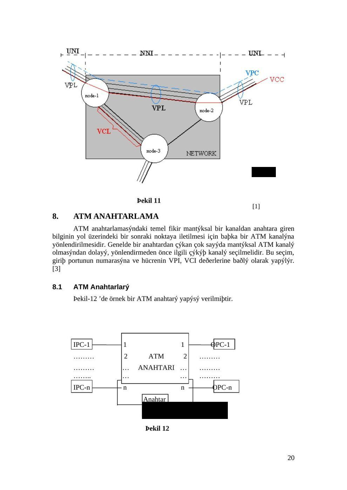

Şekil-12’de görüldüğü gibi her porta ait konumuna göre ya bir IPC (Giriş Port Kontrol) ya da OPC (Çıkış Port Kontrol) bulunmaktadır. Ayrıca anahtar içindeki yönlendirme tablolarını güncelleyen bir anahtar kontrol birimi (switch controller) de vardır. Anahtara ulaşan her hücrenin giriş port numarasına,VPI ve VCI değerlerine bakılır. Ardından, bu değerlerden yararlanılarak yönlendirme tablosundan hücrenin çıkış portu ve yeni VPI, VCI değerleri bulunur. Yeni bulunan VPI ve VCI değerleri; hücre, anahtardan çıkmadan önce başlıktaki eski değerlerin yerlerine yerleştirilir. Sonunda da hücre, tablodan bulunan çıkış portuna yönlendirilir. Bir anahtara genelde birden çok porttan hücre girdiğinden, bu hücrelerin çıkış portlarının çakışması olasıdır. Böyle bir durumda ilgili çıkış portu boşalıncaya kadar kimi hücreler geçici olarak bir tampon alanda saklanmak zorundadırlar. Bu hücreleri sıraya sokma işlemi kuyruklama olarak adlandırılır. ATM anahtarları, sanal yol (VP) ve sanal kanal (VC) anahtarları olmak üzere kendi aralarında ikiye ayrılırlar. Sanal yol anahtarları yönlendirme sırasında sadece başlıktaki VPI değerini yenilerler. Halbuki sanal kanal anahtarları başlıktaki hem VPI hem de VCI degerlerini yenilerler. Anahtarlar için böyle bir ayrıma gidilmesinin nedeni ağ içindeki ara noktalarda yapılan işi azaltarak anahtarlamayı hızlandırmaktır. Ara noktalarda sanal yollar değişmekte ancak bunların içerdiği kanallar aynı kalmaktadır. Böyle durumlarda sadece VPI değerlerini inceleyen bir anahtar kullanmak daha etkin bir yoldur. Şekil-13 ’te sanal yol ve sanal kanal anahtarlarına örnek görülmektedir.

Şekil 13

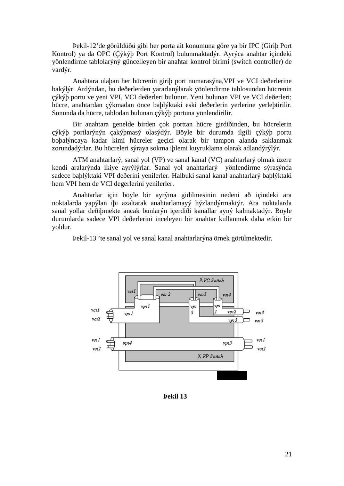

Sonuç olarak bir ATM anahtarının temel görevleri aşağıdaki üç maddede toplanabilir:

**1.** Hücreleri yönlendirmek (routing),

**2.** Gerektiğinde hücreleri kuyruklamak (queing),

**3.** Gelen hücrelerin başlıklarındaki VPI ve VCI değerlerini yönlendirme tablosundaki karşılıkları ile değiştirmek. [3]

**8.2** ATM Anahtarlarının Performansını Etkileyen Faktörler Bağlantı Bloklama (Connection Blocking) Bağlantı bloklama özelliği, anahtardaki bağlantı sayısının ve yükün çok fazla olmasından dolayı giriş portundan gelen bilgilerin bir çıkış portuna yönlendirilememesi durumunda bağlantının reddedilmesi anlamına gelir. Hücre Kayıpları (Cell Loss) Eğer anahtar içindeki kuyruklara hücreler çok hızlı ve çok sayıda gelirse, kuyruklarda taşma olacak ve bu da bazı hücrelerin kaybolmasına neden olacaktır. ATM anahtarları tasarımcıları, hücre kaybolma olasılığını 10-8 ile 10-11 arasında tutmaya çalışmaktadır. Hücre Eklenmeleri (Cell Insertion) ATM anahtarı içinde bazı hücreler yanlış yönlendirme sonucunda, başka bir mantıksal bağlantıya gidebilirler. Böylece bazı çıkış portlarında gereksiz hücre birikmesi olabilir. Bu tip bir olayın olması olasılığı da 10 -11 ile 10-14 arasın tutulmaya çalışılmaktadır. Anahtarlama Gecikmesi (Switching Delay) Hücrelerin anahtar içinden geçerken mümkün olduğunca hızlı geçmesi gerekmektedir. Aksi halde, gecikme duyarlı gerçek zamanlı verilerin iletiminde sorunlarla karşılaşılacaktır. Bu gecikmeler, 10 ve 1000 s arasında değerler alabilmektedir. Bu değerler birtakım olasılıklarla birlikte de verilebilmektedir. Örneğin, 10-10 değerinde 100 s gecikme sözü, “anahtardaki gecikmenin 100 s’den fazla olması olasılığı 10-10 dan azdır” anlamına gelmektedir. [3]

## ATM topolojisi

**9.** ATM TOPOLOJİSİ ATM, yapı ve geliştirme bakımından esnek bir topolojiye sahiptir. Bunun yanında varolan ağ topolojilerine uygulanabilir ve etkin bir yapı oluşturulabilir. ATM’in topoloji yapısında iki türlü arabirimden sözedilir. Bunlardan birincisi Public UNI (Public User-to-Network Interface - Genel kullanıcı-ağ arayüzü), bir diğeri ise Private UNI (özel UNI) olarak adlandırılmaktadır. Şekil-15 ’te ATM ağ topolojisinin genel olarak yapı mantığı verilmiştir:[5]

R SB TB UB

B-TE1/ B-TA B-NT2 B-NTI B-L/ET B-TE2 ATM public network UNI private ATM public ATM ATM switch switch endpoint TA private UNI ATM endpoint

CPE NETWORK

B-TE1-2: Broadband Terminal Equipment B-NT1-2: Broadband Network Termination B-TA : Broadband Terminal Adapter

Şekil 15 Şekil-16 ’da ATM’in topoloji yapısı temel alınarak oluşturulmuş örnek bir Yerel Bigisayar Ağı (LAN) görülmektedir:

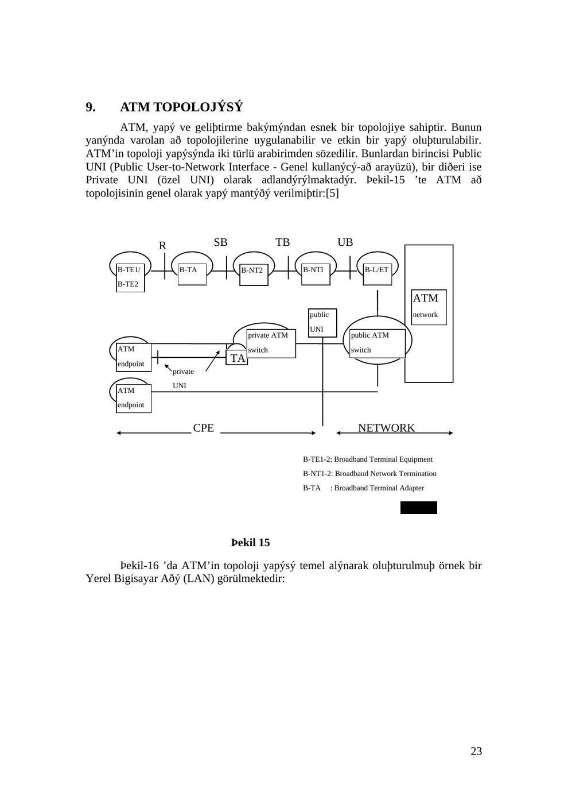

Şekil 16

**9.1** ATM Yerel Bilgisayar Ağları (ATM LANs) ve ATM LAN Emulasyonu ATM gelecekteki genişbant çoklu-ortam servislerinin destekleyecek bir teknolojidir. Bununla beraber, iletişimde IEEE 802 tabanlı yerel ağlar ve bu ağlar üzerinde kullanılan uygulamalar günümüzde oldukça yaygındır. Bu yüzden ATM’in ilk aşamada bir LAN teknolojisi olarak IEEE 802 ağlarıyla uyumlu olması gerekir. Bu uyumun sağlanması için ATM, veri bağlantı katmanı gibi düşünülerek, varolan ağ katmanları, bu yeni bağlantı katmanını destekleyecek şekilde geliştirilmektedir. Böylelikle ATM üzerinde IP ve benzeri diğer protokoller çalışabilmektedir. Varolan LAN uygulamalarının ATM ağlarında desteklenebilmesi için bir başka çözüm ATM LAN Emulasyonudur. LAN Emulasyonu, bağlantı uyumlu ATM ağları üzerinde bağlantısız IEEE 802 ağları servislerinin nasıl gerçekleştirilebileceği üzerinde durur. Diğer bir deyişle, noktadan noktaya bağlantı sağlayan ATM anahtarının sanal paylaşılmış iletim ortamı görüntüsünü vermesini sağlamaktır. LAN Emulasyonu, ATM uç sistemleri ve ATM-LAN köprülerinde ağ katmanının altında gerçekleşir. [3]

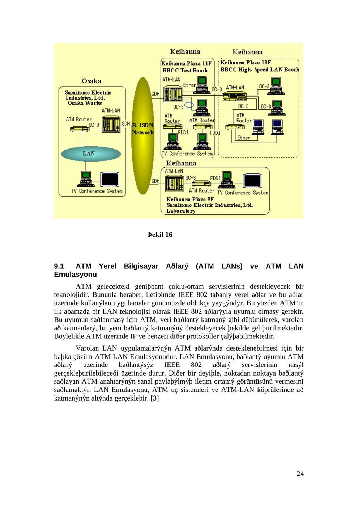

## LAN emülasyonu ve dezavantajlar

**9.1.1** LAN Emulasyonu Mimarisi LAN emulasyon servisi aşağıdaki birimlerden oluşmuştur: LAN Emulasyon istemcisi (LAN Emulation Client - LEC) Bu birim, LAN ile ATM ağı arasındaki köprüdür. Kendilerine bağlı olan LAN’lardan gelen mesajları kabul eder. Eğer mesaj “broadcast” veya “multicast” ise mesajı “BUS” adı verilen ve aşağıda açıklanan birime gönderir. BUS (Broadcast and Unknown Server) Bu birim ATM ağına bağlı tüm LEC’ler ile bağlantılıdır. BUS, “broadcast” bir mesaj aldığında, bu mesajı bağlı olduğu tüm LEC’lere gönderir. LEC’ler ise mesajı kendilerine bağlı LAN’lardaki ilgili adreslere ulaştırır. “Multicast” mesajlar ise, BUS tarafından sadece belli bir grup LEC’e yollanır. LAN Emulasyon Sunucusu (LAN Emulation Server - LES) LES’in amacı, LE-ARP (LAN Emulation Address Resolution Protocol) desteklemektir. LE-ARP protokolü, bir LEC’in gelen bir MAC (Media Access Control) adresinin içeren başka bir LEC’in ATM adresini bulmasını sağlamaktadır. Bir LEC, bilinmeyen bir çerçeveye (karşılık gelen ATM adresi bilinmeyen bir MAC adresi) rastlandığında LES’e LE-ARP sorgusu gönderir. LES de, bu sorguyu diğer LEC’lere gönderir. Bu sorguyu alan tüm Lec’ler belirtilen MAC adresinin kendilerinde olup olmadığının kontrol eder, eğer kendisinde ise kendi ATM adresini de belirterek, LES’e cevap gönderir. LES de ilgili LEC’e haber vererek adres çözümleme işini bitirir. LAN Emulasyonu mimarisi Şekil-17 ’de görülmektedir: [3]

802 LAN

LEC ATM TERMİNAL BUS ATM ATM Anahtarları TERMİNAL LES

LEC

802 LAN

Şekil1 17 · ATM pahalı bir teknolojidir. ATM anahtarların liste fiyatları temel konfigürasyon için 9000$ 'dan başlayarak tam kurulu bir sistemde 350.000$ 'a

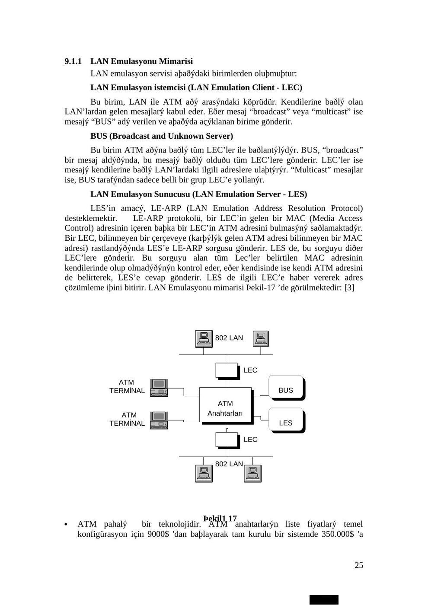

kadar çıkan bir çeşitlilik göstermektedir. Fakat yakın bir zamanda bu teknolojinin ucuzlaması ve yaygınlaşması beklenmektedir . · ATM, yeni bir teknoloji olduğundan henüz gerekli donanım ve yazılım desteği yeterli değildir. Bunda en önemli etken standartların oluşmamasıdır. Özellikle yazılım konusunda büyük eksiklikler bulunmaktadır. "ATM teknolojisi henüz olgunlaşma evresindedir. Endüstri uzmanları, olgunlaşması için iki ya da üç yıllık bir süre olduğunu tahmin etmektedir. " [6] · ATM anahtarları, router(Yönlendirici) tarafından verilmekte olan hizmet sınıflarının pek çoğunu kendi yapısı içinde kullanıcılara sunmaktadır. Fakat henüz standartların oluşmaması yüzünden aşağıda sıralanan, router 'ın yapabildiği fonksiyonları anahtarlar henüz yapamamaktadır .

**1.** Güvenli WAN Erişimi: Yönlendiriciler diğer ağlara bağlanma konusunda şimdilik tek güvenilir cihazlar olarak kabul edilmektedir.

**2.** Güvenlik Duvarları(Firewall): Yönlendiriciler network'ün belirli alanları dışında kullanıcı erişimini sınırlama özelliğine sahiptir. Bu, ortaya çıkan bir sorunun ağın başka bir bölümüne intikal etmesini engellemektedir.

**3.** Çoklu Protokol Desteği: Yönlendiriciler, tipik bir heterojen network'lerde bulunan bütün protokolleri ( IP, IPX, SNA ve Apple Talk gibi) çalıştırabilmektedir. [6]

## ATM’in avantajları

**11.** ATM 'İN AVANTAJLARI

**1.** ATM hızla gelişen bir teknolojidir. ITU-T ve ATM Forum, standartlaşma çalışmalarında bulunmaktadır . Gelecekte belirecek talepler şimdiden birçok büyük firmanın bu konuda araştırmalara başlamasına yol açmaktadır. Büyük firmalar bu konuda iş yapan küçük firmaları kendi bünyelerine katarak bu konuda çalışmalarını hızlandırmaktadır. Bay Networks, Cisco ve 3Com gibi büyük Network Firmaları bu pastadan daha büyük bir pay kapabilmek için savaşmaktadır. [6]

**2.** ATM ile verileri çok büyük hızlarda taşımamız mümkündür. Hızı artırıcı amaçlı olarak hata kontrolü minimum düzeyde tutulur. Bu durumda, hata kontrolü kullanıcının sorumluluğuna bırakılmaktadır.

**3.** Video, ses, TV, text gibi türlü veri tiplerinin hepsini destekleyen ve bütün ağların bir ortamda entegrasyonu için taban sağlayacak BISDN için ITU-T tarafından switching (anahtarlama) modeli olarak ATM seçilmiştir.

**4.** ATM, fiziksel (taşıma) ortamından bağımsızdır. Kablolar koaksiyel kablo olabileceği gibi fiber de olabilmektedi. Fiziksel katman olarak SONET tavsiye edilmektedir.

**5.** ATM var olan sistemlerle uyumludur. Bu, onun her tür ağ ortamıyla sorun olmadan konuşabilmesini sağlamaktadır.

**6.** ATM, veri iletiminde esnektir. Değişken bit hızlarını destekler niteliktedir.Kullanıcı isteğine göre iletişim hızı belirlenir. "Hatta bazı anahtarlar, kullanıcılara ait bant genişliği de sunabilirler". [6] ATM ağında hata oranı ve gecikme değeri bildirilerek belli bir kalitede hizmet alınabilir. Bu bilgiler, ağa bağlanıldığında kullanıcı tarafından ağ ortamına bildirilir. İstenilen şey hız ise hata oranı göz önüne alınmayabilir, hata oranı önemliyse o zaman hızdan ödün vermek gerekecektir .

**7.** ATM, sabit boyutlarda ve küçük hücreleri anahtarladığından ağ kaynaklarını optimum kullanabilir. "Devre anahtarlamadaki gibi devre bütün bağlantı için kapatılmaz. Paket anahtarlama tekniği kullanılarak sadece bilgi transfer edilirken devre kullanılır" [1]. Diğer taraftan anahtarlar, yalnızca iletişimin gerekli olduğu düğümler (nodes) arasında kurduğu bağlantılarla, ağ bant genişliğinin etkin kullanımını sağlamaktadır. [6]

**8.** ATM ağ yapısı büyümeye elverişlidir.

**9.** ATM onu yorumlayan firmaya göre bazı değişiklikler taşıyabilir. Belirli şartları sağladıkları sürece değişik ATM -lan'lar birbirleriyle iletişim yapabilirler.

**10.** ATM istatistiki çoklama tekniğini kullanarak çok kullanıcının veri trafiğini tek bir ağ üzerinde birleştirir. Bunu da en etkin şekilde yapar.

**11.** ATM anahtarlama, yönlendiricilere göre daha kolay anlaşılır, uygulaması kolay ve daha ekonomik bir çözümdür. Yönlendiricilerin mevcut yazılımlarının düzeyi, karmaşılığı, mimarisi ve fiyatı anahtarlar karşısında devre dışı kalmalarına yol açmaktadır. [6]

**12.** ATM anahtarları , mevcut ağ ekipmanı üzerinde hiç değişiklik yapmadan ya da çok küçük bazı değişiklikler yaparak ağa eklenebilir.[6]

## Sonuç

**12.** SONUÇ B-ISDN teknolojisinin, varolan iletişim ihtiyaçlarının karşılanması ve gelecekte varolabilecek ihtiyaçların karşılanmasına yönelik esnekliği düşünüldüğünde geleceğin iletişim teknolojisi olacağı açıktır. Ancak, bu yapıyı olanaklı kılan ATM altyapısındaki maliyet ve tam standartlaşamama gibi dezavantajlardan dolayı henüz bu teknolojiye tam olarak bir geçiş sağlanamamıştır. Özellikle ITU-T ve ATM Forum gibi platformlarda ATM ‘in bu dezavan- tajlarını giderme konusundaki çalışmalara devam edilmektedir.

## Kaynakça

**13.** KAYNAKÇA [1] DE PRYCKER, MARTIN ;“Asynchronous Transfer Mode, Solution For Broadband ISDN”, Ellis Harwood, 1993 [2] STALLINGS, William ;“Networking Standards A Guide to OSI, ISDN, LAN and MAN Standards” [3] ERDUR, Cenk ; “İleri Bilgisayar Ağları ATM Semineri Raporu” , 20.5.96 [4] ATEŞ, Ahmet Feyzi ; “B-ISDN, ATM ve Diğer Gelişen Teknolojiler “, 27.5.96 [5] ÇIMENSEL, Ahmet ; “ATM Networks Semineri (Bölüm1)” , 13.5.96 [6] STEPHEN, P. Klett Jr. ; ComputerWorld Dergisi Sayı 298 , Sayfa 43-48 , 1995 [7] GAGE, Beth ; ComputerWorld Dergisi Sayı 305 , Sayfa 27-37 , 1995 [8] Çeşitli Internet Kaynakları (Başlangıç Noktası -“http://www.yahoo.com”) [9] EBRAHIM, Zahir ; “A Brief Tutorial on ATM“

## Ek 1: TCP/IP ve B-ISDN

**14.** EKLER

**14.1** EK-1

**14.1.1** ATM Üzerinden TCP/IP Protokolünün Uygulanması

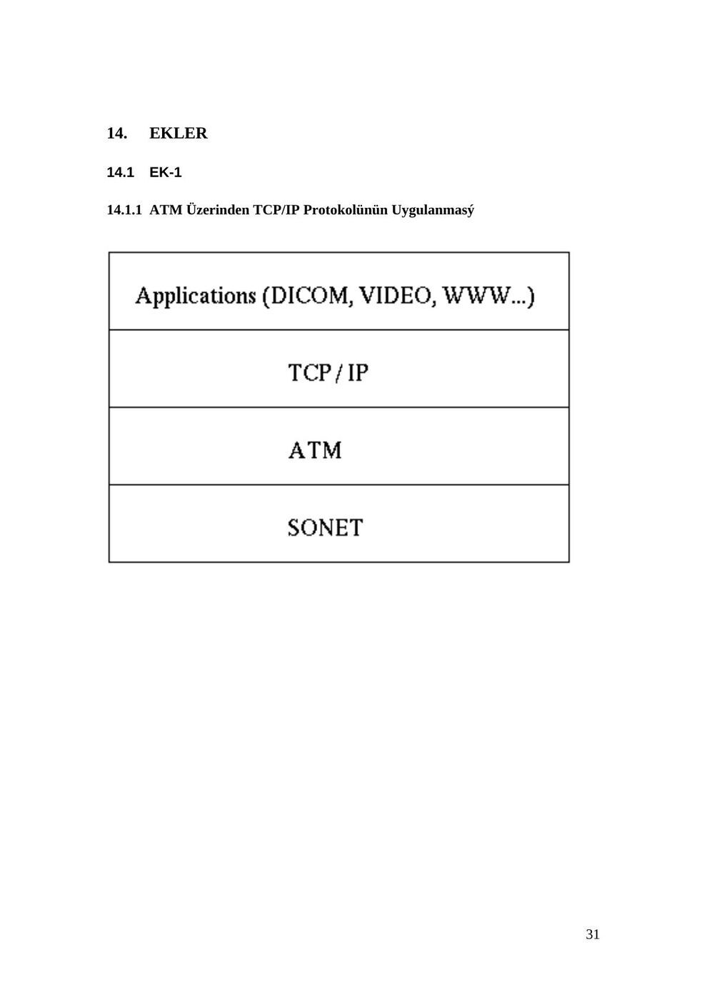

**14.1.2** B-ISDN ’in Protokol Yapısı ve Fonksiyonları

**14.1.3**

ATM Prensibi ve Bir Hücrenin Yapısı:

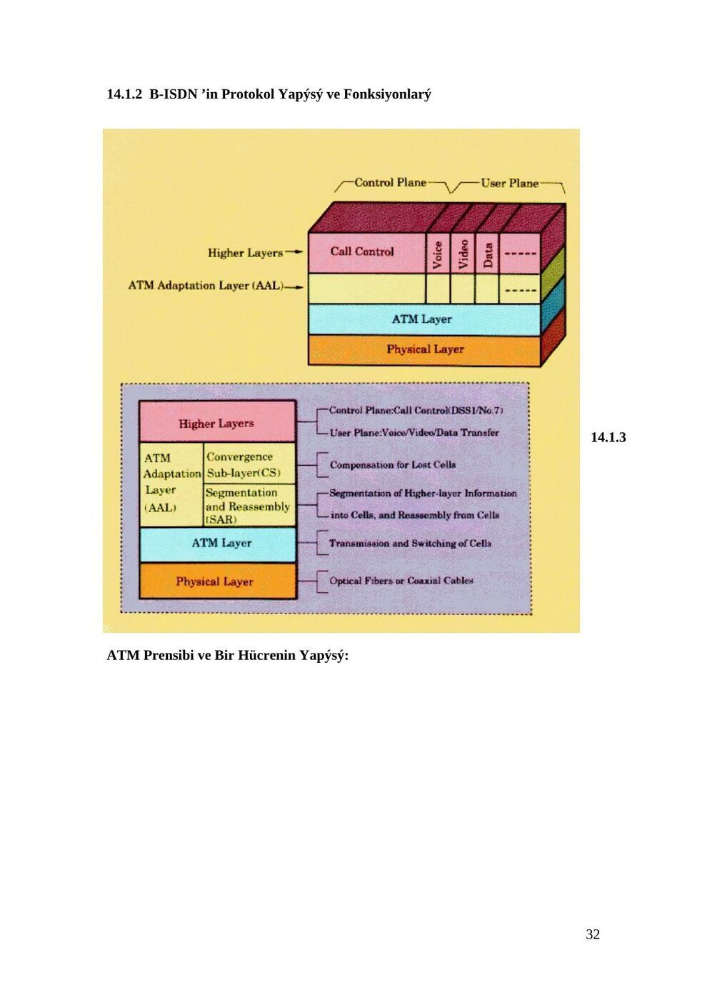

**14.1.4**

ATM Topolojisi

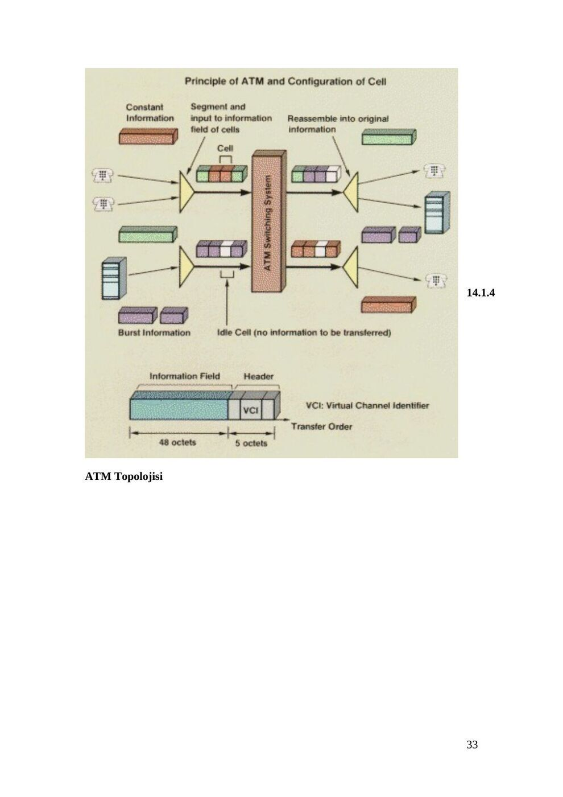

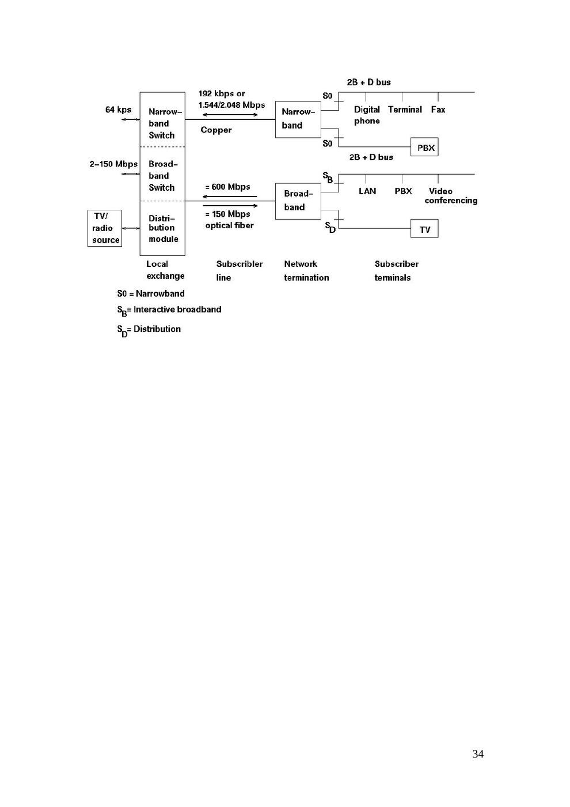

**14.1.5** Hücre Çeşitleri ve İçerdikleri Bit Yapıları (Kalıpları):

**14.1.6** ATM’in Geleceği

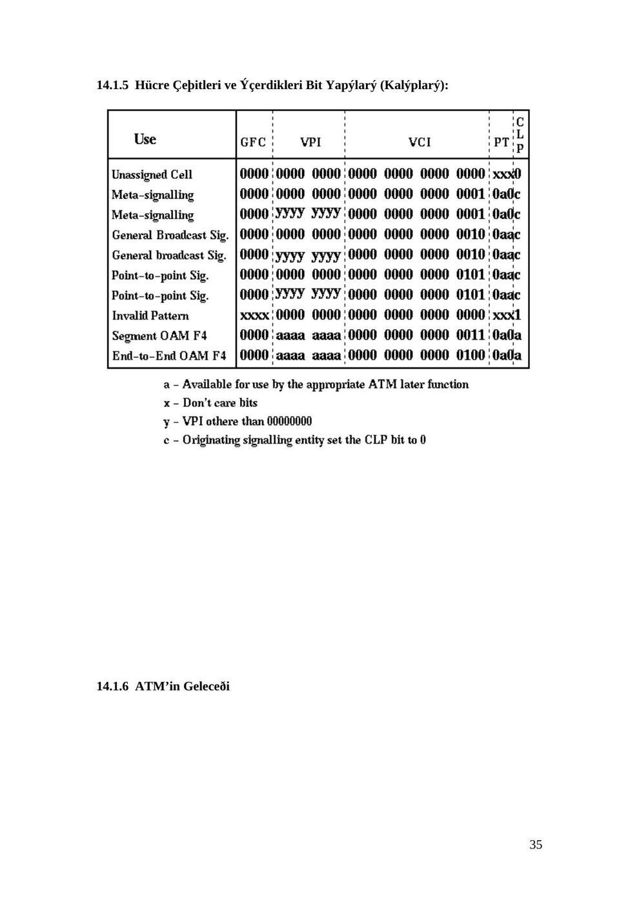

## Ek 2: ATM bağlantısı örneği

**14.2** EK-2 ATM Bağlantısına Bir Örnek

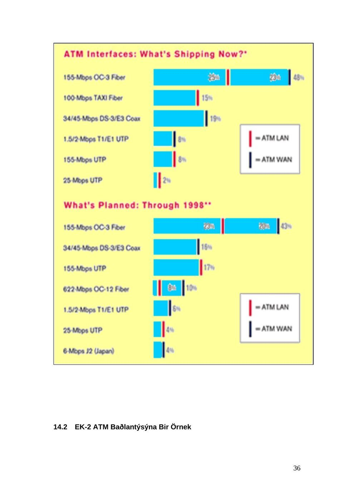

İzmir, Ankara, İstanbul ve Trabzon 'da uç noktaları olan bir network farz- edelim. Kullanıcı-A, İzmir'den Trabzon’daki Kullanıcı-B ’ye video-konferans yoluyla ulaşmak istiyor. Farzedelim ki, ATM hücreleri İZMİR ve TRABZON'daki UNI'lerle ilişki içinde (interface). Bağlantının oluşması şu şekilde olur:

Kullanıcı-A 'nın, dizüstü bilgisayarı İZMİR'deki UNI aracılığıyla bağlantı isteğinde bulunur. Kullanıcı-A ’nın dizüstü bilgisayarıyla, ağ arasında bağlantı para-metreleri değiştirilir. Bunlar mesafe, trafik biçimi, tepe (peak) ve ortalama bant- genişliği (bandwith) ihtiyacı, gecikme ve hücre kaybı gereksinimi ve ne kadar harcanacak parası kaldığı gibi bilgiler olabilir .

UNI daha sonra isteği network'e iletir . Network'te çalışan yazılım Kullancı- A 'nın belirttiği fiyat fonksiyonuna göre bir rota hesaplar ve bu rotadaki hangi bağlantıların, istenen servis ve band genişliği en iyi destekleyeceğini belirtir. Daha sonra bu yoldaki (Trabzon'a kadar olan bütün yoldaki) bütün nodlara bağlantı hazırlık isteğini iletir . Seçilen yol İZMir -ANKara-İSTanbul -TRabzon olsun. Bu dört node 'un her biri kullanılmayan bir VCI etiketi alır ve kendi node'larında bunları bağlantı süresince tutarlar.

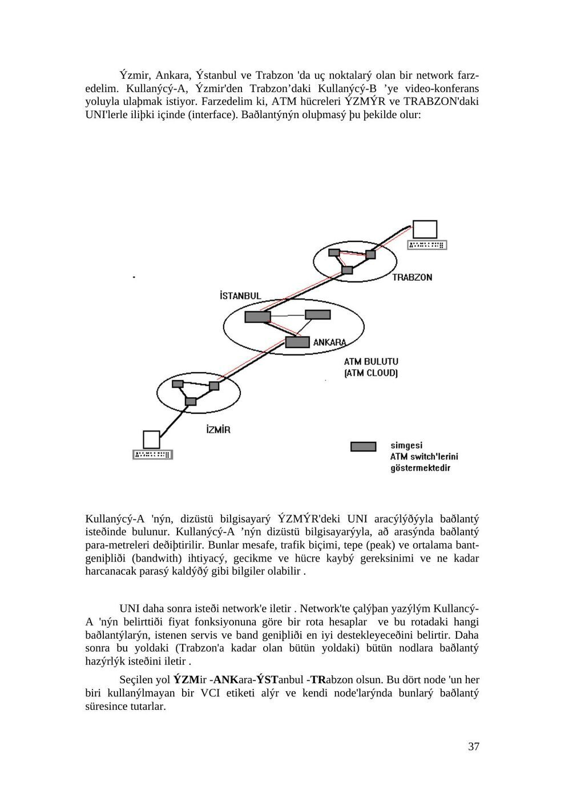

İzmir çıkış etiketi olarak VC5'i aldı diyelim. Bunu İstanbul'a bildirecektir. İstanbul VC2'i alacak ve bağlantı tablosunda VC5 ile ilişkilendirecektir. Bu tabloda VC5 giriş değeri olarak tutulacaktır . Ankara VC4'i alacak ve bağlantı tablosunda VC2 ile ilişkilendirecektir ve VC4 'ü Trabzon'a bildirecektir. Trabzon VC3 'ü alacak ve bağlantı tablosunda VC4 ile ilişkilendirecektir. Daha sonra bu bağlantıyı kabul edip etmediğini anlamak için adresli UNI 'yi ping edecektir.

UNI, Kullancı-Bl ‘yi bulursa onayını döndürecektir. Öyleyse Trabzon UNI 'yi ve Kullancı-B ’yi bir bağlantı tanıtıcısı olarak bağlantı için VC4 kabul edecektir.

Bu sefer de VC4 'ten başlayarak geriye doğru işlem yapılacak ve UNI'nın Kullancı-A'nın dizüstü bilgisayarını VC5 olarak kabul edecektir. Böylece bağlantı sağlanmış olur. Kullancı-A, bağlantıyı VC5 etiketiyle, Kullancı-B ise VC3 etiketiyle teşhis eder. Diger senaryolar da mümkündür ve satıcının ATM ağını kuruşuna bağlıdır. [9]

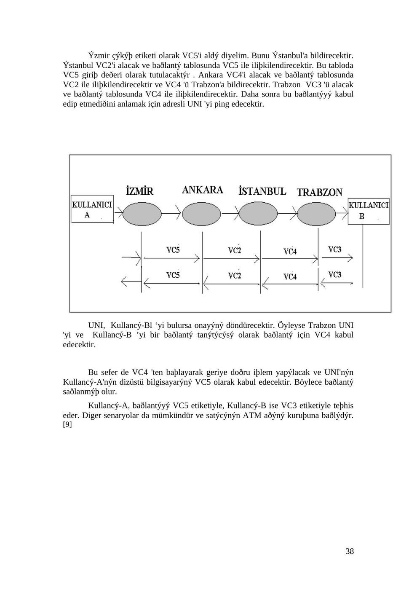

## Ek 3: Mini sözlük

**14.3** EK-3 Mini Sözlük * AAL: ATM Adaptation Layer * ANSA: Advanced Networked Systems Architecture * ASIC: Application Specific Integrated Circuit * ATM: Asynchronous Transfer Mode * AUU: ATM User User indication, "the bit", end of AAL5 block marker * AVA: ATM Video Adaptor * B-ISDN: Broadband Integrated Services Digital Network * CAC: Connection Admission Control * CBR: Constant Bit Rate * CCITT: Comitée Consultatif International Télégraphique et Téléphonique (now the ITU-TS) * CLP: Cell Loss Priority (a bit in a B-ISDN cell header) * CRC: Cyclical Redundancy Check * DAN: Desk Area Network * E1: 2 Mbit/sec * E2: 8 Mbit/sec * E3: 34 Mbit/sec * EATM: EISA ATM (an adaptor) * EDL: Ethernet Data Link * FDDI: Fiber Distributed Data Interface * FAS: Framing and Sequencing * FIFO: First In First Out * GFC: Generic Flow Control (a 4 bit field in a B-ISDN cell header) * H.261: A constant bit rate video compression standard. * HEC: Header Error Check (an 8 bit CRC in a B-ISDN cell) * IOC: Input Output Controller * IP: Internet Protocol * ISDN: Integrated Services Digital Network * ISO: International Standards Organisation * ITU: International Telecommunication Union * LAN: Local Area Network * MAC: Media Access Control * MAN: Metropolitan Area Network * MPEG: Motion Picture Experts Group (a video compression standard)

* NOSSDAV: Network and Operating System Support for Digital Audio and Video ("nose dive") * NNI: Network Network Interface * OC3: 155 Mbit/sec * OC12: 622 Mbit/sec * OSI: Open Systems Interconnection * PDU: Protocol Data Unit (a packet) * PLT: Payload Type (a 3 bit field in a B-ISDN cell header) * PTM: Packet Transfer Mode * Q.93B: The Standard (i.e. awful) ATM signalling protocol * QOS: Quality of Service * SAR: Segmentation and Reassembly * SDH: Synchronous Digital Hierarchy * SDU: Service Data Unit (a packet) * SOC: Start of Cell * SONET: Synchronous Optical Network * SPROING:To Break * STM: Synchronous Transfer Mode * STS1: 155 Mbit/sec * STS4: 622 Mbit/sec * T1: 1.5 Mbit/sec * T3: 45 Mbit/sec * TDM: Time Division Multiplexing * UNI: User Network Interface * VC: Virtual Channel or Virtual Circuit * VCI: Virtual Circuit Identifier (also Virtual Channel Identifier) * VP: Virtual Path * VPI: Virtual Path Identifier * WAN: Wide Area Network

*Not: Bazı Türkçe karakterler kaynak Office belgesinde bozulmuştur; okunabilenler metinde düzeltildi. Tarihsel ATM fiyatları ve 1998’e yönelik beklentiler güncel veri değildir. 14. sayfadaki boş çerçeve kaynakta da boştur.*
