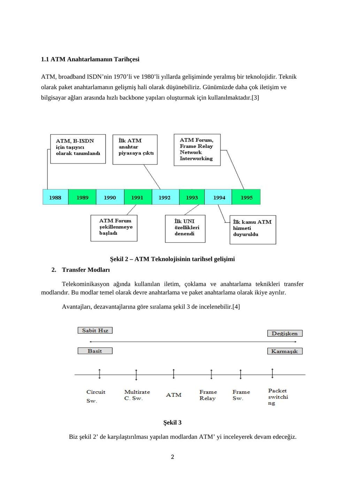
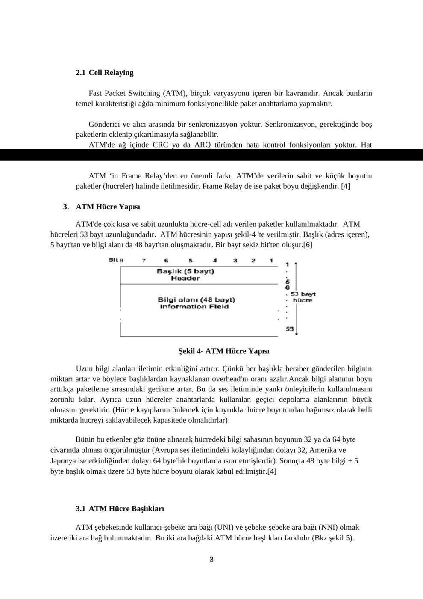
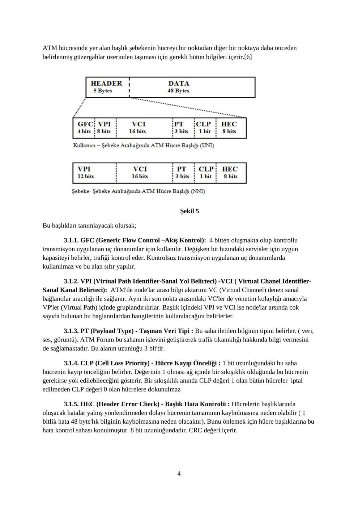
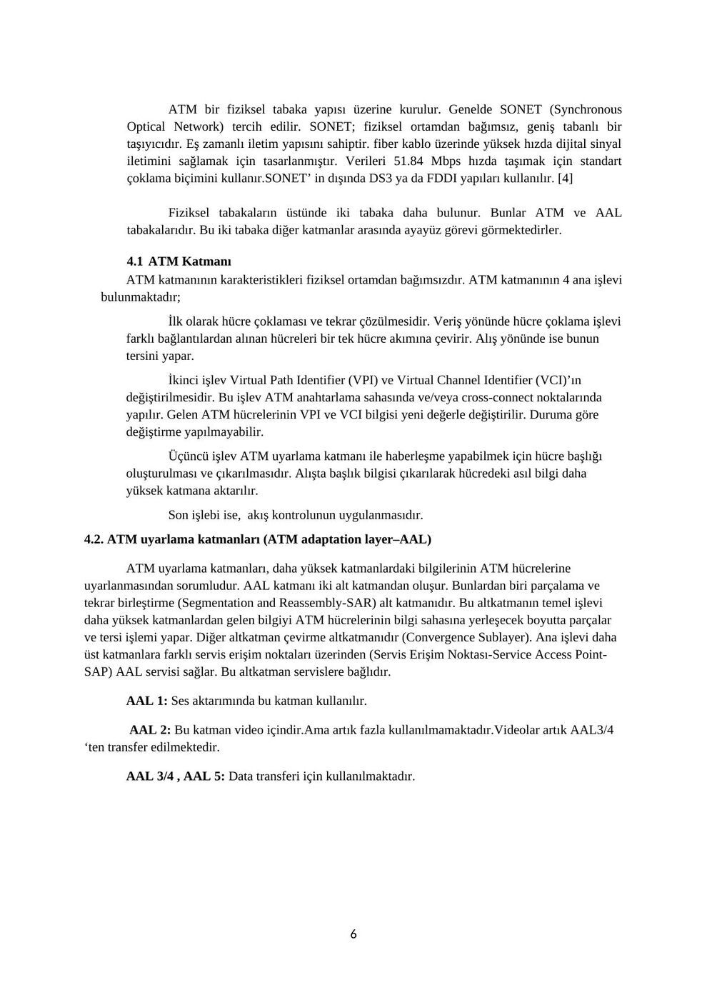
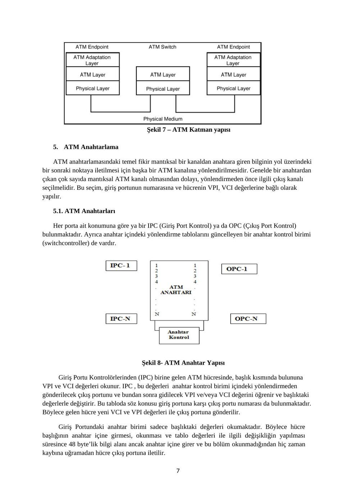

This is an ATM research assignment prepared by a student for the Başkent University Data Communications course. The file name contains the year 2011; since no day information is available, the source file date was used for archive ordering. Personal information has been removed. Archive-ready PDF copies of the documents can be downloaded at the end of the post.

## ATM networks assignment

**1.** What is ATM?

ATM (asynchronous transfer mode) is a switched, cell-based transfer protocol that can carry all kinds of data at high speeds. ATM transmits all types of network traffic (data, voice, video, and TV signals) in 53-byte cells. [1]

ATM is mostly hardware-based and reaches high data processing and forwarding rates. The most commonly used standard rates are 155 Mbps and 622 Mbps. As of the end of 1996, rates of up to 10 Gbps had been reached.[2]

The ATM system, which is packet-switched at its core, uses bandwidth efficiently through statistical multiplexing on the trunks between switches. Since it also performs transparent transport, it is extremely well suited to voice and video transmission.[5]

- It unifies Local Area and Wide Area communication networks into a single type of communication network.

- As the load on the system increases, it can increase and scale its ability to handle that load, that is, its performance.

- It enables the implementation of Virtual LANs (VLANs).

- With guaranteed Quality of Service (QoS), it allows the network to adapt itself to the nature of the traffic being carried (data, voice, or video) and to provide the service best suited to the needs of that traffic.

- It enables voice, video, and data traffic to be carried over the same network at high speeds.

- With the cell-based communication method, created by dividing data into equal and small pieces, it ensures that network capacity is distributed equally among users.

- Thanks to its cell-based structure, ATM cells are sent over many different cable types (fiber optic, copper, etc.) at widely varying rates.

- It performs these functions not through proprietary methods monopolized by a particular group of manufacturers, but on the basis of international standards defined on common platforms.

Figure 1 ATM

**1.** 1 History of ATM Switching

ATM is a technology that took part in the development of broadband ISDN in the 1970s and 1980s. Technically, we can think of it as an advanced form of packet switching. Today it is mostly used to build fast backbone structures between communication and computer networks.[3]

Figure 2 – Historical development of ATM technology

**2.** Transfer Modes

Transfer modes are the transmission, multiplexing, and switching techniques used in the telecommunications network. These modes are basically divided into two: circuit switching and packet switching.

The ranking according to advantages and disadvantages can be examined in Figure 3.[4]

Figure 3

We will continue by examining ATM, one of the modes compared in Figure 2.

**2.** 1 Cell Relaying

Fast Packet Switching (ATM) is a concept that includes many variations. However, their basic characteristic is performing packet switching in the network with minimal functionality.

There is no synchronization between sender and receiver. Synchronization can be achieved by inserting and removing empty packets when necessary. In ATM, there are no error control functions such as CRC or ARQ inside the network. As in circuit switching, error correction is left to the protocols at the end points.

The most important difference of ATM from Frame Relay is that in ATM, data is transmitted in fixed-size, small packets (cells). In Frame Relay, on the other hand, the packet length is variable. [4]

**3.** ATM Cell Structure

ATM uses very short, fixed-length packets called cells. ATM cells are 53 bytes long. The structure of the ATM cell is given in Figure 4. The header (containing the address) consists of 5 bytes and the information field consists of 48 bytes. A byte consists of eight bits.[6]

Figure 4 – ATM Cell Structure

Long information fields increase transmission efficiency, because the amount of information sent with each header increases and thus the proportion of overhead caused by headers decreases. However, as the length of the information field increases, the delay during packetization increases. This makes it necessary to use echo cancellers in voice transmission. In addition, long cells require the temporary storage areas used in switches to be large. (To prevent cell loss, the queues must be able to hold a certain number of cells regardless of cell size.)

Taking all these factors into account, the length of the information field in the cell was envisaged to be around 32 or 64 bytes (Europe insisted on 32 bytes because of its convenience for voice transmission, while the USA and Japan insisted on 64 bytes because of its efficiency). In the end, a cell size of 53 bytes, consisting of 48 bytes of information + 5 bytes of header, was adopted.[4]

**3.** 1 ATM Cell Headers

The ATM network has two interfaces: the user-network interface (UNI) and the network-network interface (NNI). The ATM cell headers on these two interfaces are different (see Figure 5).

The header in the ATM cell contains all the information necessary for the network to carry the cell from one point to another over predetermined routes.[6]

Figure 5

If we define these headers:

**3.** 1.1. GFC (Generic Flow Control): It consists of 4 bits and is used for end equipment that applies controlled transmission. It determines the appropriate capacity for variable bit rate services and controls traffic. It is not used in end equipment that applies uncontrolled transmission, and this field is set to zero.

**3.** 1.2. VPI (Virtual Path Identifier) - VCI (Virtual Channel Identifier): In ATM, information transfer between nodes is provided through virtual connections called VCs (Virtual Channels). VCs between the same two end points are also grouped within VPs (Virtual Paths) for ease of management. The VPI and VCI in the header determine which of the many such connections between nodes will be used.

**3.** 1.3. PT (Payload Type): This field specifies the type of information carried (data, voice, video). The ATM Forum has extended the function of this field so that it can also provide information about traffic congestion. The length of this field is 3 bits.

**3.** 1.4. CLP (Cell Loss Priority): This 1-bit field determines the loss priority of the cell. A value of 1 indicates that, if there is congestion in the network, this cell can be discarded if necessary. At a moment of congestion, cells with a CLP value of 0 are not touched until all cells with a CLP value of 1 have been discarded.

**3.** 1.5. HEC (Header Error Check): Errors occurring in cell headers can cause the entire cell to be lost due to misrouting (a 1-bit error would cause the loss of 48 bytes of information). To prevent this, this error control field was placed in the cell headers. It is 8 bits long. It contains a CRC value.

**3.** 1.6. PLT (Payload Type): This field specifies the type of traffic in the cell. The ATM Forum has extended the function of this field so that it can also provide information about traffic congestion. The length of this field is 3 bits. [4]

**3.** 2. Cell Types in ATM

**3.** 2.1. Unassigned Cells: These are empty packets sent by the ATM layer when there is no traffic. They are used to fill bandwidth or for synchronization purposes. There are also IDLE cells. The characteristic of these cells is that they are created by the physical layer. They do not reach the ATM layer; they are used for synchronization between physical layers.

**3.** 2.2. Meta-Signaling Cells: They are used to establish a session with the network and to determine session services.

**3.** 2.3. General Broadcast Cells: They identify packets sent to all stations at the UNI.

**3.** 2.4. Point-to-Point Signaling Cells: They identify the cells of the UNI or NNI interface that provide point-to-point connections at the ATM layer.

**3.** 2.5. F4 and F5 Cells: They identify VP and VC maintenance cells, respectively.

**3.** 2.6. Resource Management Cells: They are reserved for fast resource management on a VC.

**3.** 2.7. ILMI (Interim Local Management Interface) Cells: They carry information about the status of ATM user devices and about the VP and VC configuration at the UNI. [4]

Figure 6

**4.** ATM Layers

ATM is built on a physical layer structure. SONET (Synchronous Optical Network) is generally preferred. SONET is a broad-based carrier independent of the physical medium. It has a synchronous transmission structure. It is designed to provide high-speed digital signal transmission over fiber cable. It uses a standard multiplexing format to carry data at 51.84 Mbps. Apart from SONET, DS3 or FDDI structures are used. [4]

Above the physical layers there are two more layers: the ATM and AAL layers. These two layers act as an interface between the other layers.

**4.** 1 ATM Layer The characteristics of the ATM layer are independent of the physical medium. The ATM layer has 4 main functions. The first is cell multiplexing and demultiplexing. In the transmit direction, the cell multiplexing function converts cells received from different connections into a single cell stream. In the receive direction, it does the reverse. The second function is the translation of the Virtual Path Identifier (VPI) and Virtual Channel Identifier (VCI). This function is performed in the ATM switching area and/or at cross-connect points. The VPI and VCI information of incoming ATM cells is replaced with new values. Depending on the case, no translation may be performed. The third function is the generation and removal of the cell header in order to communicate with the ATM adaptation layer. On reception, the header information is removed and the actual information in the cell is passed to the higher layer. The last function is the implementation of flow control.

**4.** 2. ATM adaptation layers (ATM adaptation layer–AAL)

The ATM adaptation layers are responsible for adapting information from higher layers to ATM cells. The AAL layer consists of two sublayers. One of them is the Segmentation and Reassembly (SAR) sublayer. The main function of this sublayer is to segment information coming from higher layers into sizes that fit the information field of ATM cells, and to perform the reverse operation. The other sublayer is the Convergence Sublayer. Its main function is to provide AAL service to higher layers through different service access points (SAP). This sublayer depends on the services.

AAL 1: This layer is used for voice transmission.

AAL 2: This layer is for video. However, it is no longer widely used. Video is now transferred via AAL3/4.

AAL 3/4, AAL 5: Used for data transfer.

Figure 7 – ATM Layer Structure

**5.** ATM Switching

The basic idea in ATM switching is that information entering the switch from one logical channel is redirected to another ATM channel so that it can be forwarded to the next point along the route. Since there are generally many logical ATM channels leaving a switch, the relevant output channel must be selected before routing. This selection is made depending on the input port number and the VPI and VCI values of the cell.

**5.** 1. ATM Switches

Depending on its position, each port has either an IPC (Input Port Controller) or an OPC (Output Port Controller). There is also a switch controller that updates the routing tables inside the switch.

Figure 8 – ATM Switch Structure

For an ATM cell arriving at one of the Input Port Controllers (IPC), the VPI and VCI values in the header are read. From the routing table in the switch controller, the IPC learns the output port to which the cell is to be sent and the VPI and/or VCI value to be used next, and replaces the values in the header with them. This table also contains the output port number corresponding to the input port in question. Thus, the incoming cell is sent to the output port with the new VCI and VPI values.

The switching unit at the input port reads only the values in the header. Thus, while the cell header enters the switch, is read, and the table-related change is made, the 48-byte information field only enters the switch and, since this part is not read, the cell is forwarded to the output port without any loss of time.

However, if data arrives at the switch very heavily, ATM cells arriving at different ports at the same time may sometimes be directed to the same output port. In such a case, some cells have to be temporarily stored in a buffer area until the relevant output port becomes free. The process of ordering these cells is called queuing.

**5.** 2. Factors Affecting the Performance of ATM Switches

Connection Blocking: The connection blocking property means that a connection is rejected when information coming from an input port cannot be routed to an output port because the number of connections and the load on the switch are too high.

Cell Loss: These are losses caused by cells arriving at the queues inside the switch in large numbers and at high speed. ATM switch designers try to keep the probability of cell loss between 10-8 and 10-11.

Cell Insertion: Some cells inside an ATM switch may go to another logical connection as a result of misrouting. Thus, unnecessary cell accumulation may occur at some output ports. The probability of such an event is also tried to be kept between 10-11 and 10-14.

Switching Delay: These are the delays experienced by cells as they pass through the switch. They cause problems in the transmission of real-time data. [7]

**6.** Advantages of ATM Technology

With the use of the international ATM standards defined by the ITU (International Telecommunication Union), the benefits of ATM technology can be summarized as follows;

· High performance through hardware switching, with terabit switches on the horizon. · Dynamic bandwidth for bursty traffic that meets application needs, and high utilization of network resources. (Voice and video transmission, especially LAN-based applications, are also bursty, since the bandwidth required can increase and decrease at any moment during transmission.) · Class-of-service support for multimedia traffic provides the varying bandwidth needs of applications on a single network. · Today, with support for rates from E1/T1 to STM-16 (2.4 Gbps), scalability in network size is offered, and as the supported rates reach the Gbps range, the limits on scalability are quite wide. · A common LAN/WAN architecture allows ATM to be used as a whole from one desktop system to another. Traditionally, Data Communications concepts have been very different in terms of performance and interoperability. · A simple infrastructure is made possible by the switched BC architecture. This is naturally very suitable for LAN-based traffic that is not connection-oriented. The simplicity provided by the ATM VC architecture also enables usage billing, traffic management, security, and configuration management. · International standards compliance offers the ability to operate in multi-vendor structures. [8]

**7.** Disadvantages of ATM

ATM is an expensive technology. List prices of ATM switches vary from $9,000 for a basic configuration up to $350,000 for a fully equipped system. However, this technology is expected to become cheaper and more widespread in the near future.

Since ATM is a new technology, the necessary hardware and software support is not yet sufficient. The most important factor in this is that standards have not yet been established. There are major deficiencies especially in software. "ATM technology is still in its maturation phase. Industry experts estimate that it will take two or three years to mature. " [6]

ATM switches offer users many of the classes of service provided by routers within their own structure. However, because standards have not yet been established, switches cannot yet perform the router functions listed below.

**1.** Secure WAN Access: Routers are currently considered the only reliable devices for connecting to other networks.

**2.** Firewalls: Routers have the ability to restrict user access outside certain areas of the network. This prevents a problem that arises from spreading to another part of the network.

**3.** Multiprotocol Support: Routers can run all the protocols found in a typical heterogeneous network (such as IP, IPX, SNA, and AppleTalk). [9]

**8.** Conclusion

Considering the flexibility of B-ISDN technology in meeting existing communication needs and needs that may arise in the future, it is clear that it will be the communication technology of the future. However, due to disadvantages in the ATM infrastructure that makes this structure possible, such as cost and incomplete standardization, a full transition to this technology has not yet been achieved.

Work continues on platforms such as ITU-T and the ATM Forum to eliminate these disadvantages of ATM.

References

**1.** http://www.electropazar.com.tr/index.php/bilgisayar-ve-teknoloji-bilgi-bankasi/ag-ve- internet/electropazar-bursa-bilgisayar-laptop-tamiri-servisi-tel-452-86-00

**2.** http://www.webmastersitesi.com/webmaster-sozlugu/23609-atm-nedir.htm

**3.** http://tr.wikipedia.org/wiki/ E%C5%9Fzamans%C4%B1z_Aktar%C4%B1m_Modu#Geli.C5.9Fimi Raporu; ATM; 1996

**5.** http://www.turktelekom.com.tr/tt/portal/KurumsalUrun/KOBI/Data-ve-Genis-Bant- Hizmetleri/Noktadan-Noktaya-Erisim-Hizmetleri/ATM/ozellikleri

**6.** http://www.elektrik.gen.tr/icerik/atm-asynchronous-transfer-mode

**7.** http://www.belgeler.com/blg/7s5/atm-proje

**8.** http://www.belgeler.com/blg/a5x/asynchronous-transfer-mode-atm

**9.** STEPHEN, P. Klett Jr. ; ComputerWorld Magazine Issue 298, Pages 43-48, 1995

## ATM assignment cover page and table of contents

BAŞKENT UNIVERSITY

Faculty of Engineering

Department of Electrical and Electronics Engineering

Course: Data Communications

Subject: ATM Networks

Table of Contents Page No

**1.** What Is ATM? ………………………………………………… 1

**1.** 1 History of ATM Switching ……………………… 2

**2.** Transfer Modes …………………………….……………… 2

**2.** 1 Cell Relaying …………………………….……………….. 3

**3.** ATM Cell Structure ………………………….………………. 3

**3.** 1. ATM Cell Headers ………………….………………. 3

**3.** 1.1 GFC …………………………….……………….. 4

**3.** 1.2 VPI ………………………………..……………… 4

**3.** 1.3 PT …………………………………..…………….. 4

**3.** 1.4 CLP ……………………………………………… 4

**3.** 1.5 HEC ……………………………………………… 4

**3.** 1.6 PLT ………………………………………………. 5

**3.** 2. ATM Cell Types ………………………………………. 5

**4.** ATM Layers …………………………………………………… 6

**4.** 1. ATM Layer ……………………………………………. 6

**4.** 2. ATM Adaptation Layers ……………………………… 6

**5.** ATM Switching ………………………………………………… 7

**5.** 1. ATM Switches …………………………………………. 7

**5.** 2. Factors Affecting the Performance of ATM Switches. 8

**6.** Advantages of ATM Technology ………………………………….. 8

**7.** Disadvantages of ATM …………………………………………… 9

**8.** Conclusion ………………………………………………………………… 9

**9.** References ……………………………………………………………. 10

i

*Note: An ATM cell is 5 bytes of header + 48 bytes of payload = 53 bytes. The maximum in-cell payload efficiency is 48/53 ≈ 90.57%. Prices, "new technology" statements, and expectations about the future belong to the period of the document.*
