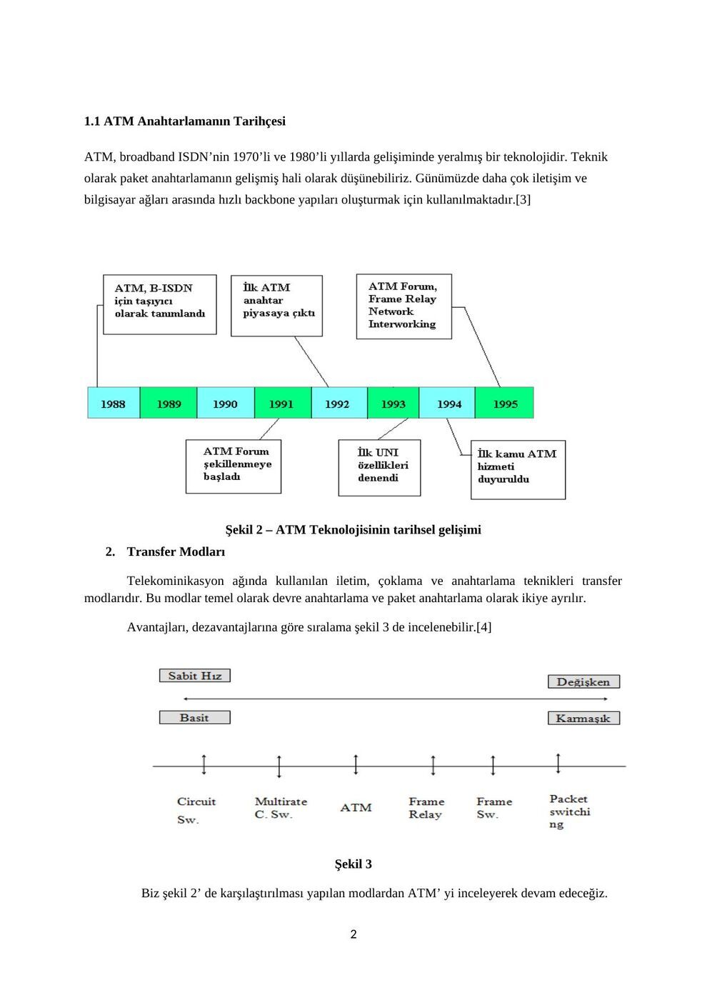
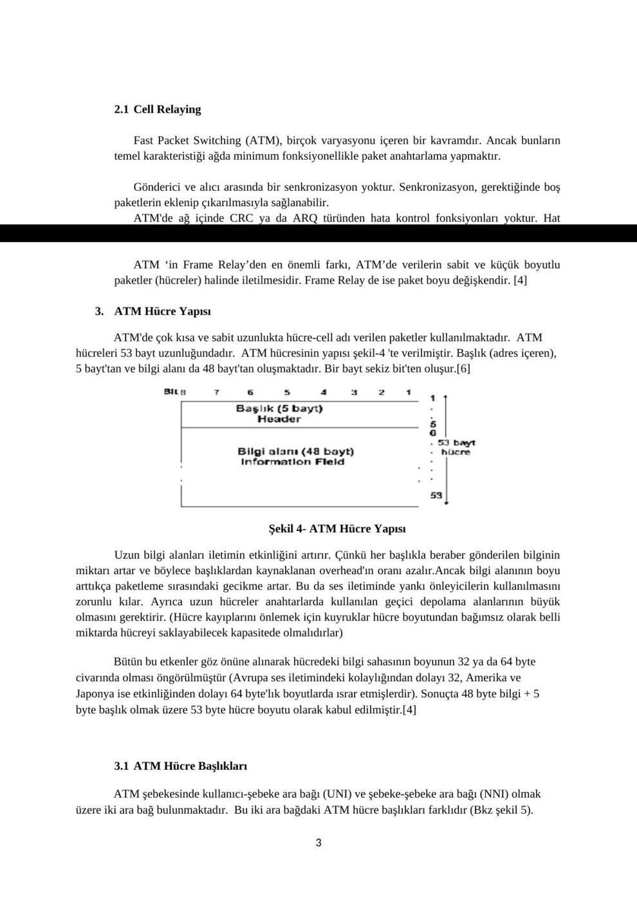
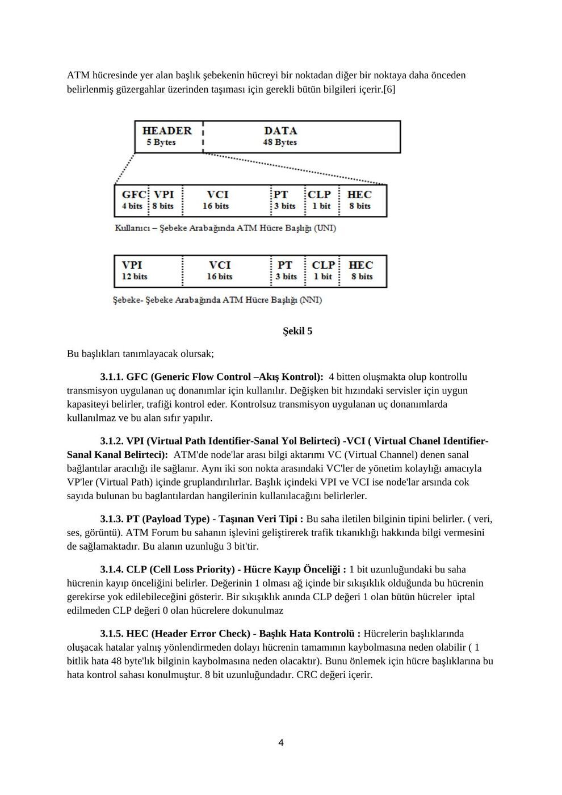
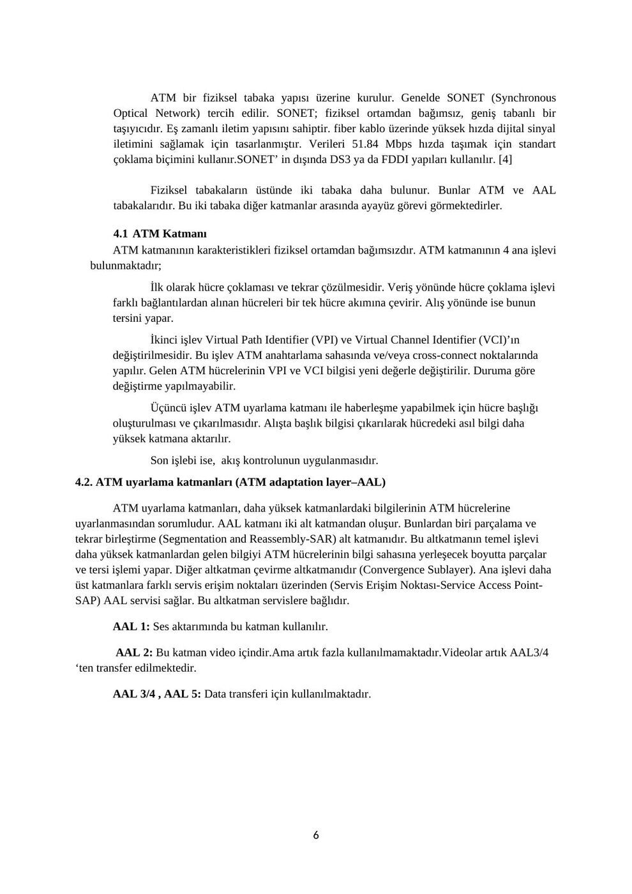
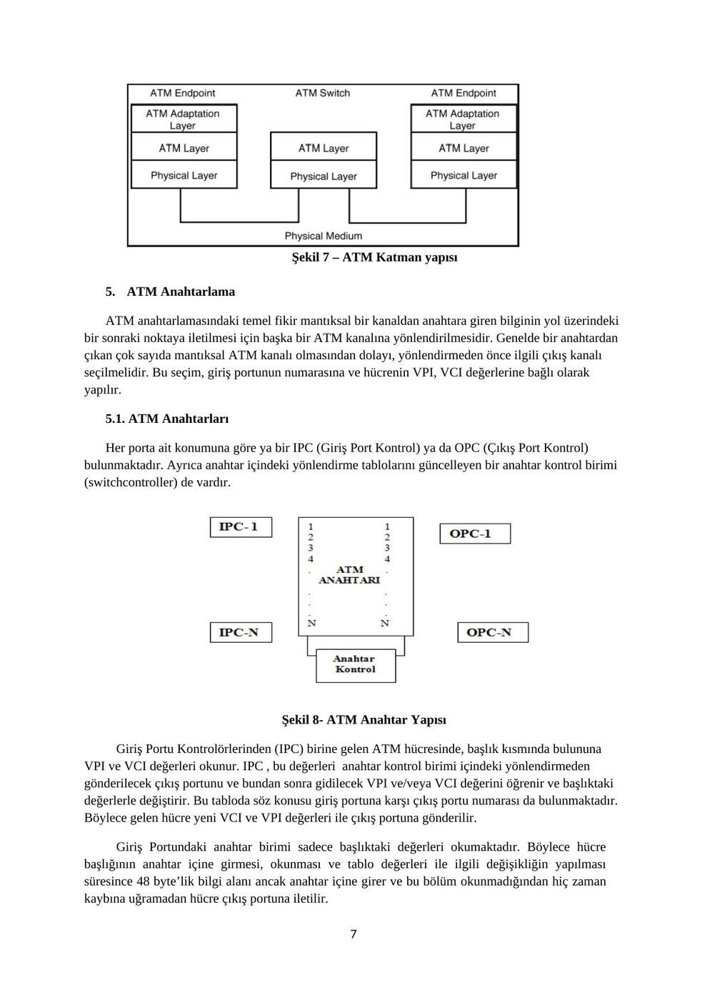

Başkent Üniversitesi Veri İletişimi dersi için bir öğrencinin hazırladığı ATM araştırma ödevidir. Dosya adında 2011 yılı vardır; gün bilgisi bulunmadığı için arşiv sıralamasında kaynak dosya tarihi kullanılmıştır. Kişisel bilgiler çıkarılmıştır. Belgelerin arşiv için hazırlanmış PDF kopyaları yazının sonunda indirilebilir.

## ATM ağları ödevi

**1.** ATM nedir?

ATM(asynchronous transfer mode), her türlü veriyi yüksek hızlarda taşıyabilen, anahtarlanmış, hücre tabanlı aktarım protokolüdür. ATM her türden network trafiğini (veri, ses video ve TV sinyalleri) 53-byte'lık hücreler halinde iletir. [1]

ATM, daha çok donanım tabanlıdır, yüksek veri şleme,iletme hızlarına ulaşır. En çok kullanılan hız satandartlara 155 Mps ve 622 Mps dir. 1996 sonu itibari ile 10 Gbps hızına kadar çıkarılmıştır.[2]

Özünde paket anahtarlamalı olan ATM sistemi, anahtarlar arasındaki trunklarda istatistiksel çoklama yöntemiyle bant genişliğini etkin kullanır. Aynı zamanda transparent taşıma yaptığından dolayı, ses ve video aktarımı için son derece uygundur.[5]

- Yerel ve Geniş Alan iletişim ağlarını tek tip bir iletişim ağında birleştirir.

- Sistemin üzerine binen yük arttıkça sistemin o yükü kaldırma yeteneğini yani performansını arttırabilir ve ölçeklendirebilir.

- Sanal Ağlar (VLANs)'ın gerçekleştirilmesini sağlar.

- Garantili Servis Kalitesi (QoS) ile ağın iletilen trafiğin niteliğine (veri,ses veya video) göre kendisini uyarlamasını ve o trafiğin ihtiyaçlarına en uygun servisi vermesini mümkün kılar.

- Ses, görüntü ve veri trafiğinin aynı ağ üzerinden, yüksek hızlarda aktarımını sağlar.

- Verinin eşit ve küçük parçalara bölünmesi ile oluşturulan hücre temelli iletişim yöntemiyle, ağ kapasitesinin kullanıcılar arasında eşit dağılımını sağlar.

- Hücre temelli yapısı sayesinde, ATM hücreleri çok değişik kablo türlerinde (fiber optik, bakır vs.), çok değişken hızlarda gönderilir.

- Bu işlevleri belli bir üretici grubunun tekelinde kalan özel yöntemlerle değil, ortak platformlarda belirlenen uluslararası standartlar temelinde gerçekleştirir.

Şekil 1 ATM

**1.** 1 ATM Anahtarlamanın Tarihçesi

ATM, broadband ISDN’nin 1970’li ve 1980’li yıllarda gelişiminde yeralmış bir teknolojidir. Teknik olarak paket anahtarlamanın gelişmiş hali olarak düşünebiliriz. Günümüzde daha çok iletişim ve bilgisayar ağları arasında hızlı backbone yapıları oluşturmak için kullanılmaktadır.[3]

Şekil 2 – ATM Teknolojisinin tarihsel gelişimi

**2.** Transfer Modları

Telekominikasyon ağında kullanılan iletim, çoklama ve anahtarlama teknikleri transfer modlarıdır. Bu modlar temel olarak devre anahtarlama ve paket anahtarlama olarak ikiye ayrılır.

Avantajları, dezavantajlarına göre sıralama şekil 3 de incelenebilir.[4]

Şekil 3

Biz şekil 2’ de karşılaştırılması yapılan modlardan ATM’ yi inceleyerek devam edeceğiz.

**2.** 1 Cell Relaying

Fast Packet Switching (ATM), birçok varyasyonu içeren bir kavramdır. Ancak bunların temel karakteristiği ağda minimum fonksiyonellikle paket anahtarlama yapmaktır.

Gönderici ve alıcı arasında bir senkronizasyon yoktur. Senkronizasyon, gerektiğinde boş paketlerin eklenip çıkarılmasıyla sağlanabilir. ATM'de ağ içinde CRC ya da ARQ türünden hata kontrol fonksiyonları yoktur. Hat anahtarlamada olduğu gibi hataların düzeltilmesi uç noktalardaki protokollere bırakılmıştır.

ATM ‘in Frame Relay’den en önemli farkı, ATM’de verilerin sabit ve küçük boyutlu paketler (hücreler) halinde iletilmesidir. Frame Relay de ise paket boyu değişkendir. [4]

**3.** ATM Hücre Yapısı

ATM'de çok kısa ve sabit uzunlukta hücre-cell adı verilen paketler kullanılmaktadır. ATM hücreleri 53 bayt uzunluğundadır. ATM hücresinin yapısı şekil-4 'te verilmiştir. Başlık (adres içeren), 5 bayt'tan ve bilgi alanı da 48 bayt'tan oluşmaktadır. Bir bayt sekiz bit'ten oluşur.[6]

Şekil 4- ATM Hücre Yapısı

Uzun bilgi alanları iletimin etkinliğini artırır. Çünkü her başlıkla beraber gönderilen bilginin miktarı artar ve böylece başlıklardan kaynaklanan overhead'ın oranı azalır.Ancak bilgi alanının boyu arttıkça paketleme sırasındaki gecikme artar. Bu da ses iletiminde yankı önleyicilerin kullanılmasını zorunlu kılar. Ayrıca uzun hücreler anahtarlarda kullanılan geçici depolama alanlarının büyük olmasını gerektirir. (Hücre kayıplarını önlemek için kuyruklar hücre boyutundan bağımsız olarak belli miktarda hücreyi saklayabilecek kapasitede olmalıdırlar)

Bütün bu etkenler göz önüne alınarak hücredeki bilgi sahasının boyunun 32 ya da 64 byte civarında olması öngörülmüştür (Avrupa ses iletimindeki kolaylığından dolayı 32, Amerika ve Japonya ise etkinliğinden dolayı 64 byte'lık boyutlarda ısrar etmişlerdir). Sonuçta 48 byte bilgi + 5 byte başlık olmak üzere 53 byte hücre boyutu olarak kabul edilmiştir.[4]

**3.** 1 ATM Hücre Başlıkları

ATM şebekesinde kullanıcı-şebeke ara bağı (UNI) ve şebeke-şebeke ara bağı (NNI) olmak üzere iki ara bağ bulunmaktadır. Bu iki ara bağdaki ATM hücre başlıkları farklıdır (Bkz şekil 5).

ATM hücresinde yer alan başlık şebekenin hücreyi bir noktadan diğer bir noktaya daha önceden belirlenmiş güzergahlar üzerinden taşıması için gerekli bütün bilgileri içerir.[6]

Şekil 5

Bu başlıkları tanımlayacak olursak;

**3.** 1.1. GFC (Generic Flow Control –Akış Kontrol): 4 bitten oluşmakta olup kontrollu transmisyon uygulanan uç donanımlar için kullanılır. Değişken bit hızındaki servisler için uygun kapasiteyi belirler, trafiği kontrol eder. Kontrolsuz transmisyon uygulanan uç donanımlarda kullanılmaz ve bu alan sıfır yapılır.

**3.** 1.2. VPI (Virtual Path Identifier-Sanal Yol Belirteci) -VCI ( Virtual Chanel Identifier- Sanal Kanal Belirteci): ATM'de node'lar arası bilgi aktarımı VC (Virtual Channel) denen sanal bağlantılar aracılığı ile sağlanır. Aynı iki son nokta arasındaki VC'ler de yönetim kolaylığı amacıyla VP'ler (Virtual Path) içinde gruplandırılırlar. Başlık içindeki VPI ve VCI ise node'lar arsında cok sayıda bulunan bu baglantılardan hangilerinin kullanılacağını belirlerler.

**3.** 1.3. PT (Payload Type) - Taşınan Veri Tipi : Bu saha iletilen bilginin tipini belirler. ( veri, ses, görüntü). ATM Forum bu sahanın işlevini geliştirerek trafik tıkanıklığı hakkında bilgi vermesini de sağlamaktadır. Bu alanın uzunluğu 3 bit'tir.

**3.** 1.4. CLP (Cell Loss Priority) - Hücre Kayıp Önceliği : 1 bit uzunluğundaki bu saha hücrenin kayıp önceliğini belirler. Değerinin 1 olması ağ içinde bir sıkışıklık olduğunda bu hücrenin gerekirse yok edilebileceğini gösterir. Bir sıkışıklık anında CLP değeri 1 olan bütün hücreler iptal edilmeden CLP değeri 0 olan hücrelere dokunulmaz

**3.** 1.5. HEC (Header Error Check) - Başlık Hata Kontrolü : Hücrelerin başlıklarında oluşacak hatalar yalnış yönlendirmeden dolayı hücrenin tamamının kaybolmasına neden olabilir ( 1 bitlik hata 48 byte'lık bilginin kaybolmasına neden olacaktır). Bunu önlemek için hücre başlıklarına bu hata kontrol sahası konulmuştur. 8 bit uzunluğundadır. CRC değeri içerir.

**3.** 1.6. PLT (Payload Type) - Taşınan Veri Tipi : Bu saha hücredeki trafiğin tipini belirler. ATM Forum bu sahanın işlevini geliştirerek trafik tıkanıklığı hakkında bilgi vermesini de sağlamaktadır. Bu alanın uzunluğu 3 bit'tir. [4]

**3.** 2. ATM’ deki Hücre Tipleri

**3.** 2.1. Unassigned Cells: Trafik olmadığı durumda, ATM tabakası tarafından gönderilen boş paketlerdir. Bantgenişliğini doldurmak veya senkronizasyon amaçlı kullanılırlar. Aynı zamanda IDLE hücreleri vardır. Bu hücrelerin özelliği fiziksel tabaka tarafından yaratılmalarıdır. ATM tabakasına çıkmazlar, fiziksel katmanlar arasındaki senkronizasyonda kullanılırlar.

**3.** 2.2. Meta-Signaling Cells: Ağ ile bir oturum kurmakta ve oturum servislerini saptamada kullanılırlar.

**3.** 2.3. General Broadcast Cells: UNI’deki tüm istasyonlara gönderilen paketleri belirlerler.

**3.** 2.4. Point-to-Point Signaling Cells: ATM tabakasında noktadan noktaya bağlantı sağlayan UNI veya NNI arayüzü hücrelerini belirlerler.

**3.** 2.5. F4 ve F5 Hüceleri: Sırasıyla VP ve VC bakım hücrelerini belirlerler.

**3.** 2.6. Resource Management Cells: VC üzerinde hızlı kaynak yönetimi için ayrılmışlardır.

**3.** 2.7. ILMI (Interim Local Management Interface) Cells: ATM kullanıcı aygıtlarının durumlarını ve UNI’deki VP ile VC konfigürasyonu ile ilgili bilgileri taşırlar. [4]

Şekil 6

**4.** ATM Katmanları

ATM bir fiziksel tabaka yapısı üzerine kurulur. Genelde SONET (Synchronous Optical Network) tercih edilir. SONET; fiziksel ortamdan bağımsız, geniş tabanlı bir taşıyıcıdır. Eş zamanlı iletim yapısını sahiptir. fiber kablo üzerinde yüksek hızda dijital sinyal iletimini sağlamak için tasarlanmıştır. Verileri 51.84 Mbps hızda taşımak için standart çoklama biçimini kullanır.SONET’ in dışında DS3 ya da FDDI yapıları kullanılır. [4]

Fiziksel tabakaların üstünde iki tabaka daha bulunur. Bunlar ATM ve AAL tabakalarıdır. Bu iki tabaka diğer katmanlar arasında ayayüz görevi görmektedirler.

**4.** 1 ATM Katmanı ATM katmanının karakteristikleri fiziksel ortamdan bağımsızdır. ATM katmanının 4 ana işlevi bulunmaktadır; İlk olarak hücre çoklaması ve tekrar çözülmesidir. Veriş yönünde hücre çoklama işlevi farklı bağlantılardan alınan hücreleri bir tek hücre akımına çevirir. Alış yönünde ise bunun tersini yapar. İkinci işlev Virtual Path Identifier (VPI) ve Virtual Channel Identifier (VCI)’ın değiştirilmesidir. Bu işlev ATM anahtarlama sahasında ve/veya cross-connect noktalarında yapılır. Gelen ATM hücrelerinin VPI ve VCI bilgisi yeni değerle değiştirilir. Duruma göre değiştirme yapılmayabilir. Üçüncü işlev ATM uyarlama katmanı ile haberleşme yapabilmek için hücre başlığı oluşturulması ve çıkarılmasıdır. Alışta başlık bilgisi çıkarılarak hücredeki asıl bilgi daha yüksek katmana aktarılır. Son işlebi ise, akış kontrolunun uygulanmasıdır.

**4.** 2. ATM uyarlama katmanları (ATM adaptation layer–AAL)

ATM uyarlama katmanları, daha yüksek katmanlardaki bilgilerinin ATM hücrelerine uyarlanmasından sorumludur. AAL katmanı iki alt katmandan oluşur. Bunlardan biri parçalama ve tekrar birleştirme (Segmentation and Reassembly-SAR) alt katmanıdır. Bu altkatmanın temel işlevi daha yüksek katmanlardan gelen bilgiyi ATM hücrelerinin bilgi sahasına yerleşecek boyutta parçalar ve tersi işlemi yapar. Diğer altkatman çevirme altkatmanıdır (Convergence Sublayer). Ana işlevi daha üst katmanlara farklı servis erişim noktaları üzerinden (Servis Erişim Noktası-Service Access Point- SAP) AAL servisi sağlar. Bu altkatman servislere bağlıdır.

AAL 1: Ses aktarımında bu katman kullanılır.

AAL 2: Bu katman video içindir.Ama artık fazla kullanılmamaktadır.Videolar artık AAL3/4 ‘ten transfer edilmektedir.

AAL 3/4 , AAL 5: Data transferi için kullanılmaktadır.

Şekil 7 – ATM Katman yapısı

**5.** ATM Anahtarlama

ATM anahtarlamasındaki temel fikir mantıksal bir kanaldan anahtara giren bilginin yol üzerindeki bir sonraki noktaya iletilmesi için başka bir ATM kanalına yönlendirilmesidir. Genelde bir anahtardan çıkan çok sayıda mantıksal ATM kanalı olmasından dolayı, yönlendirmeden önce ilgili çıkış kanalı seçilmelidir. Bu seçim, giriş portunun numarasına ve hücrenin VPI, VCI değerlerine bağlı olarak yapılır.

**5.** 1. ATM Anahtarları

Her porta ait konumuna göre ya bir IPC (Giriş Port Kontrol) ya da OPC (Çıkış Port Kontrol) bulunmaktadır. Ayrıca anahtar içindeki yönlendirme tablolarını güncelleyen bir anahtar kontrol birimi (switchcontroller) de vardır.

Şekil 8- ATM Anahtar Yapısı

Giriş Portu Kontrolörlerinden (IPC) birine gelen ATM hücresinde, başlık kısmında bulununa VPI ve VCI değerleri okunur. IPC , bu değerleri anahtar kontrol birimi içindeki yönlendirmeden gönderilecek çıkış portunu ve bundan sonra gidilecek VPI ve/veya VCI değerini öğrenir ve başlıktaki değerlerle değiştirir. Bu tabloda söz konusu giriş portuna karşı çıkış portu numarası da bulunmaktadır. Böylece gelen hücre yeni VCI ve VPI değerleri ile çıkış portuna gönderilir.

Giriş Portundaki anahtar birimi sadece başlıktaki değerleri okumaktadır. Böylece hücre başlığının anahtar içine girmesi, okunması ve tablo değerleri ile ilgili değişikliğin yapılması süresince 48 byte’lik bilgi alanı ancak anahtar içine girer ve bu bölüm okunmadığından hiç zaman kaybına uğramadan hücre çıkış portuna iletilir.

Ancak verilerin çok yoğun bir şekilde anahtara gelmesi halinde bazen ayni anda farklı portlara gelen ATM hücreleri ayni çıkış portuna yönlendirilebilir. Böyle bir durumda ilgili çıkış portu boşalıncaya kadar kimi hücreler geçici olarak bir tampon(buffer) alanda saklanmak zorundadırlar. Bu hücreleri sıraya sokma işlemi kuyruklama olarak adlandırılır.

**5.** 2. ATM Anahtarlarının Performansını Etkileyen Faktörler

Bağlantı Bloklama (Connection Blocking): Bağlantı bloklama özelliği, anahtardaki bağlantı sayısının ve yükün çok fazla olmasından dolayı giriş portundan gelen bilgilerin bir çıkış portuna yönlendirilememesi durumunda bağlantının reddedilmesi anlamına gelir.

Hücre Kayıpları (Cell Loss): Anahtar içindeki kuyruklara hücrelern çok sayıda ve hızlı bir şekilde gelmesiyle oluşan kayıplardır. ATM anahtarları tasarımcıları, hücre kaybolma olasılığını 10-8 ile 10- 11 arasında tutmaya çalışmaktadır.

Hücre Eklenmeleri (Cell Insertion): ATM anahtarı içinde bazı hücreler yanlış yönlendirme sonucunda, başka birmantıksal bağlantıya gidebilirler. Böylece bazı çıkış portlarında gereksiz hücre birikmesi olabilir. Bu tip bir olayın olması olasılığı da 10-11 ile 10-14 arasın tutulmaya çalışılmaktadır.

Anahtarlama Gecikmesi (Switching Delay): Hücrelerin anahtar içi geçişlerde yaşanan gecikmelerdir. Gerçek zaman verilerinin iletiminde sorun çıkartır. [7]

**6.** ATM Teknolojisinin Avantajları

ITU (Internatiomal Telecomunication Union) tarafından belirlenen uluslararası ATM standartlarının kullanımıyla, ATM teknolojisi’nin faydalarını aşağıdaki gibi özetlenebiliriz;

· Ufuktaki terabit anahtarları ile donanım anahtarlama aracılığı ile yüksek performans. · Uygulama ihtiyaçlarını karşılayan patlamalı trafik için dinamik bant genişliği ve ağ kaynaklarının yüksek oranda kullanımının sağlanması. (LAN tabanlı uygulamalar başta olmak üzere, ses ve görüntü iletimi de, iletim zamanı içerisinde ihtiyaç duyulan bant genişliği her an artıp azalabileceğinden patlamalıdır.) ·Çoklu ortam trafiği için hizmet sınıf desteği uygulamaların ihtiyaç duyduğu değişik bant genişliği ihtiyaçlarını tek bir ağ üzerinde sağlar. · Günümüzde E1/T1'den STM-16'ya (2.4 Gbps) hızların desteklenmesi ile ağ boyutlarında ölçeklenebilirlik sunulurken, desteklenen hızların Gbps mertebesine ulaşması ile ölçeklenebilirlik konusunda sınırlar oldukça geniş olmaktadır. · Ortak LAN/WAN mimarisi ATM' in bir bütün olarak bir masaüstü sistemden diğerine kullanılabilmesini sağlamaktadır. Geleneksel olarak Veri Haberleşmesi Kavramları performans anlamında ve beraber çalışma konusunda çok farklı olmuşlardır. · Basit bir altyapı olanağı anahtarlamalı BC mimarisi sayesinde olmaktadır. Bu, doğal olarak bağlantı eğilimli olmayan LAN bazlı trafik için çok uygundur. ATM VC mimarisi sayesindeki basitlik, kullanımı ücretlendirme, trafik yönetimi, güvenlik ve yapılandırma yönetimini de olanak sağlamaktadır. · Uluslararası standart uyumluluğu, çok üreticili yapılara işletim imkanı sunmaktadır. [8]

**7.** ATM’nin Dezavantajları

ATM pahalı bir teknolojidir. ATM anahtarların liste fiyatları temel konfigürasyon için 9000$ 'dan başlayarak tam kurulu bir sistemde 350.000$ 'a kadar çıkan bir çeşitlilik göstermektedir. Fakat yakın bir zamanda bu teknolojinin ucuzlaması ve yaygınlaşması beklenmektedir .

ATM, yeni bir teknoloji olduğundan henüz gerekli donanım ve yazılım desteği yeterli değildir. Bunda en önemli etken standartların oluşmamasıdır. Özellikle yazılım konusunda büyük eksiklikler bulunmaktadır. "ATM teknolojisi henüz olgunlaşma evresindedir. Endüstri uzmanları, olgunlaşması için iki ya da üç yıllık bir süre olduğunu tahmin etmektedir. " [6]

ATM anahtarları, router(Yönlendirici) tarafından verilmekte olan hizmet sınıflarının pek çoğunu kendi yapısı içinde kullanıcılara sunmaktadır. Fakat henüz standartların oluşmaması yüzünden aşağıda sıralanan, router 'ın yapabildiği fonksiyonları anahtarlar henüz yapamamaktadır .

**1.** Güvenli WAN Erişimi: Yönlendiriciler diğer ağlara bağlanma konusunda şimdilik tek güvenilir cihazlar olarak kabul edilmektedir.

**2.** Güvenlik Duvarları(Firewall): Yönlendiriciler network'ün belirli alanları dışında kullanıcı erişimini sınırlama özelliğine sahiptir. Bu, ortaya çıkan bir sorunun ağın başka bir bölümüne intikal etmesini engellemektedir.

**3.** Çoklu Protokol Desteği: Yönlendiriciler, tipik bir heterojen network'lerde bulunan bütün protokolleri ( IP, IPX, SNA ve Apple Talk gibi) çalıştırabilmektedir. [9]

**8.** Sonuç

B-ISDN teknolojisinin, varolan iletişim ihtiyaçlarının karşılanması ve gelecekte varolabilecek ihtiyaçların karşılanmasına yönelik esnekliği düşünüldüğünde geleceğin iletişim teknolojisi olacağı açıktır. Ancak, bu yapıyı olanaklı kılan ATM altyapısındaki maliyet ve tam standartlaşamama gibi dezavantajlardan dolayı henüz bu teknolojiye tam olarak bir geçiş sağlanamamıştır.

Özellikle ITU-T ve ATM Forum gibi platformlarda ATM ‘in bu dezavantajlarını giderme konusundaki çalışmalara devam edilmektedir.

Kaynakça

**1.** http://www.electropazar.com.tr/index.php/bilgisayar-ve-teknoloji-bilgi-bankasi/ag-ve- internet/electropazar-bursa-bilgisayar-laptop-tamiri-servisi-tel-452-86-00

**2.** http://www.webmastersitesi.com/webmaster-sozlugu/23609-atm-nedir.htm

**3.** http://tr.wikipedia.org/wiki/ E%C5%9Fzamans%C4%B1z_Aktar%C4%B1m_Modu#Geli.C5.9Fimi Raporu; ATM; 1996

**5.** http://www.turktelekom.com.tr/tt/portal/KurumsalUrun/KOBI/Data-ve-Genis-Bant- Hizmetleri/Noktadan-Noktaya-Erisim-Hizmetleri/ATM/ozellikleri

**6.** http://www.elektrik.gen.tr/icerik/atm-asynchronous-transfer-mode

**7.** http://www.belgeler.com/blg/7s5/atm-proje

**8.** http://www.belgeler.com/blg/a5x/asynchronous-transfer-mode-atm

**9.** STEPHEN, P. Klett Jr. ; ComputerWorld Dergisi Sayı 298 , Sayfa 43-48 , 1995

## ATM ödevi kapak ve içindekiler

BAŞKENT ÜNİVERSİTESİ

Mühendislik Fakültesi

Elektrik Elektronik Mühendisliği Bölümü

Ders: Veri İletişimi

Konu: ATM Ağları

İçindekiler Sayfa No

**1.** ATM Nedir? ………………………………………………… 1

**1.** 1 ATM Anahtarlamanın Tarihçesi ……………………… 2

**2.** Transfer Modları …………………………….……………… 2

**2.** 1 Cell Relaying …………………………….……………….. 3

**3.** ATM Hücre Yapısı ………………………….………………. 3

**3.** 1. ATM Hücre Başlıkları ………………….………………. 3

**3.** 1.1 GFC …………………………….……………….. 4

**3.** 1.2 VPI ………………………………..……………… 4

**3.** 1.3 PT …………………………………..…………….. 4

**3.** 1.4 CLP ……………………………………………… 4

**3.** 1.5 HEC ……………………………………………… 4

**3.** 1.6 PLT ………………………………………………. 5

**3.** 2. ATM Hücre Tipleri ………………………………………. 5

**4.** ATM Katmanları …………………………………………………… 6

**4.** 1. ATM Katmanı ……………………………………………. 6

**4.** 2. ATM Uyarlama Katmanları ……………………………… 6

**5.** ATM Anahtarlama ………………………………………………… 7

**5.** 1. ATM Anahtaları …………………………………………. 7

**5.** 2. ATM Anahtarlarının Performansını Etkileyen Faktörler. 8

**6.** ATM Teknolojisinin Avantajları ………………………………….. 8

**7.** ATM’nin Dezavantajları …………………………………………… 9

**8.** Sonuç ………………………………………………………………… 9

**9.** Kaynakça ……………………………………………………………. 10

i

*Not: ATM hücresi 5 bayt başlık + 48 bayt yük = 53 bayttır. En yüksek hücre içi yük verimi 48/53 ≈ %90,57’dir. Fiyatlar, “yeni teknoloji” ifadeleri ve geleceğe ilişkin beklentiler belgenin dönemine aittir.*

