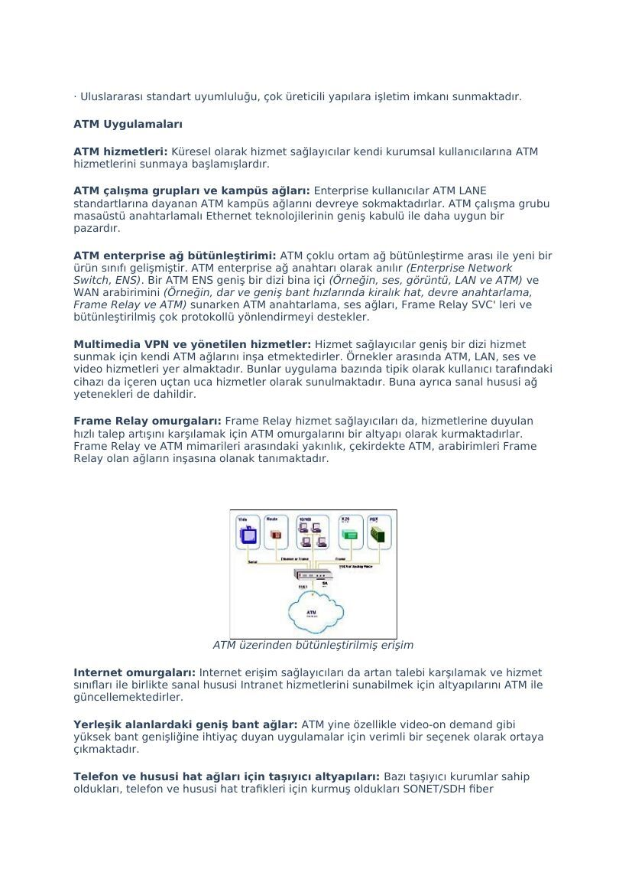
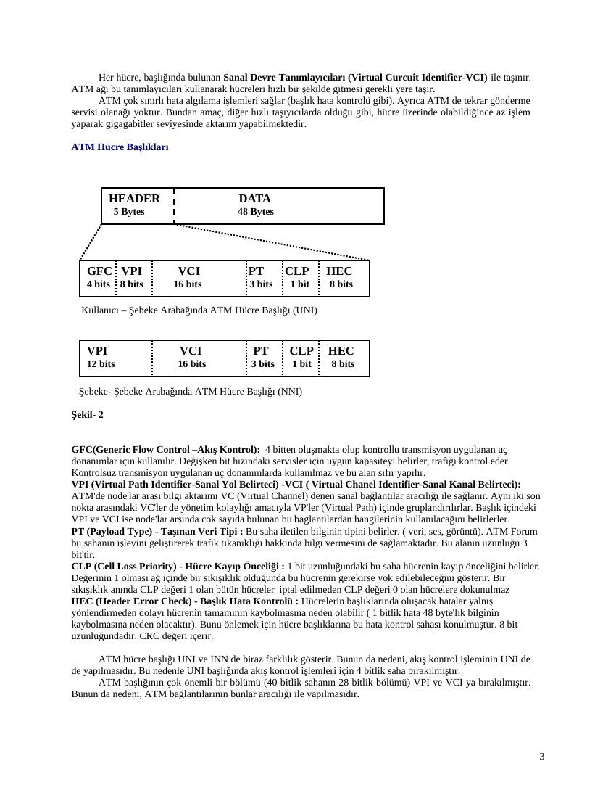
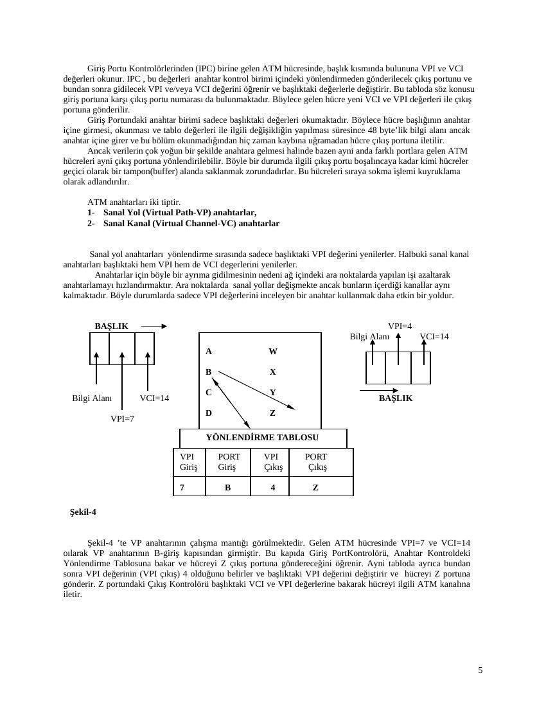
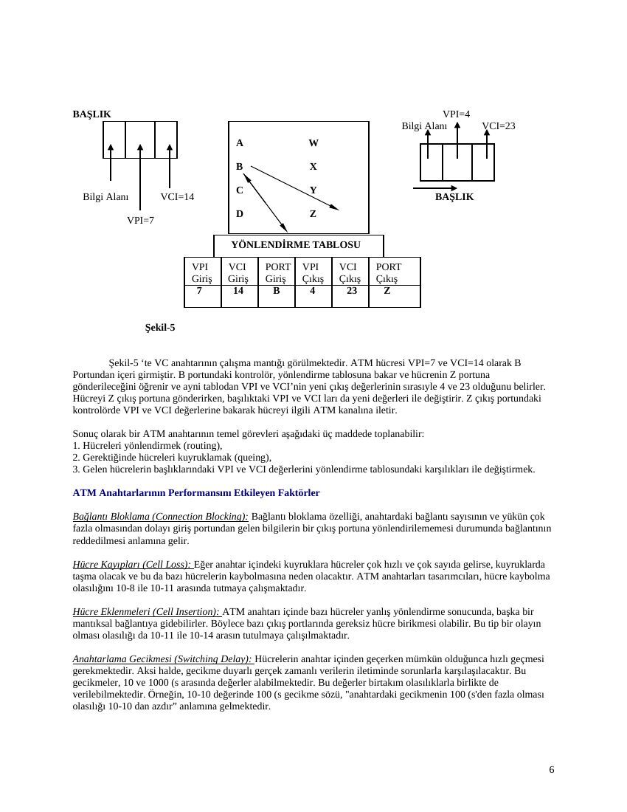
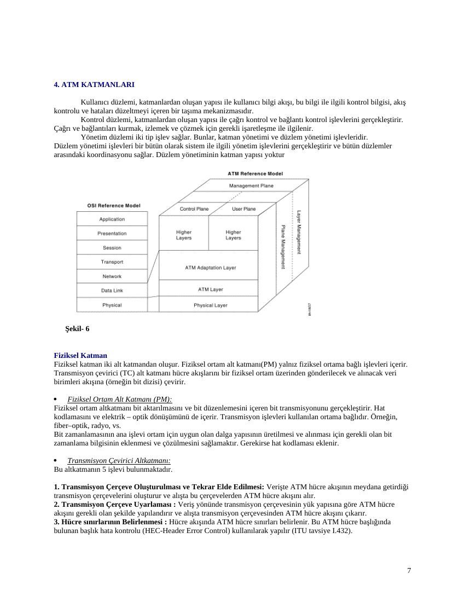
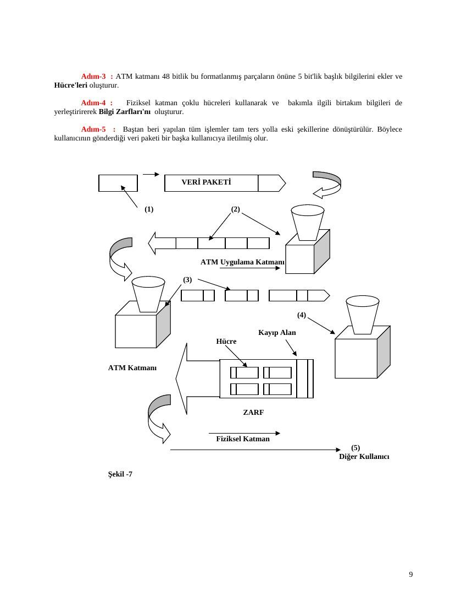

These are two Turkish technical compilations on ATM and B-ISDN. The first cites www.kotonline.net/yardim/arsiv/atm.htm; the second cites Cisco, ATM Forum, and university pages as sources. Neither document gives an author name or document date; the source file date has been used. Archive-ready PDF copies of the documents are available for download at the end of the post.

*Note: This content belongs to a third-party source; it is shared for archival and nostalgic purposes with the source credited. It will be removed at the request of the rights holder.*

## ATM technologies compilation

ATM Technologies

Asynchronous Transfer Mode (ATM) is a technology whose history began in the 1970s and 80s with the development of broadband ISDN. Technically, it can be viewed as the current state of the art in packet switching. As in packet switching for data (for example, X.25, Frame Relay, TCP/IP), ATM integrates multiplexing and switching functions, is well suited to bursty traffic (unlike circuit switching), and allows devices operating at different speeds to communicate. Unlike packet switching, however, ATM is designed for high-performance multimedia networks. ATM technology has been adopted in a very wide range of network devices:

· PC, workstation, and server network interface cards · Switched Ethernet and Token Ring workgroup hubs · Workgroup and campus ATM switches · ATM enterprise network switches · ATM multiplexers · ATM edge switches · ATM backbone switches

ATM can be offered as an end-user service on a tariff basis, and it can also be used as an infrastructure for other network services. The most basic service building block is the ATM virtual circuit. Virtual circuits define end-to-end points and routes, while bandwidth is assigned according to requests made by the network when there is user traffic. ATM also defines service classes to meet the needs of a wide range of applications.

Advantages of ATM over other technologies:

· High performance through hardware switching · Dynamic bandwidth for bursty traffic · Service class support for multimedia · Scalability in speed and network size · Common LAN/WAN architecture · Opportunities for simplification through the VC architecture · International standards compliance

The high-level benefits of deploying ATM technology using the international ATM standards set by the ITU (International Telecommunication Union) can be summarized as follows:

· High performance through hardware switching, with terabit switches on the horizon. · Dynamic bandwidth for bursty traffic that meets application needs, and a high degree of utilization of network resources. (Voice and video transmission, as well as LAN-based applications in particular, are bursty, since the bandwidth required can rise and fall at any moment during transmission.) · Service class support for multimedia traffic provides the differing bandwidth needs of applications over a single network. · Scalability in network size is offered today by support for speeds from E1/T1 up to STM-16 (2.4 Gbps), and with the supported speeds reaching the Gbps range, the limits of scalability are quite wide. · A common LAN/WAN architecture allows ATM to be used as a whole, from one desktop system to another. Traditionally, data communications concepts have differed greatly in terms of performance and interoperability. · A simple infrastructure is made possible by the switched VC architecture. This is naturally well suited to connectionless LAN-based traffic. The simplicity afforded by the ATM VC architecture also enables billing, traffic management, security, and configuration management.

· International standards compliance allows operation in multi-vendor environments.

ATM Applications

ATM services: Service providers worldwide have begun to offer ATM services to their corporate customers.

ATM workgroups and campus networks: Enterprise users are deploying ATM campus networks based on ATM LANE standards. The ATM workgroup is a more suitable market given the wide acceptance of desktop switched Ethernet technologies.

ATM enterprise network integration: With ATM multimedia network integration, a new product class has emerged. It is called the ATM enterprise network switch (Enterprise Network Switch, ENS). An ATM ENS offers a wide range of in-building (for example, voice, video, LAN, and ATM) and WAN interfaces (for example, leased lines at narrowband and wideband rates, circuit switching, Frame Relay, and ATM), while supporting ATM switching, voice networks, Frame Relay SVCs, and integrated multiprotocol routing.

Multimedia VPN and managed services: Service providers are building their own ATM networks to offer a wide range of services. Examples include ATM, LAN, voice, and video services. These are typically offered on an application basis as end-to-end services that also include the customer premises equipment. This also includes virtual private network capabilities.

Frame Relay backbones: Frame Relay service providers are also deploying ATM backbones as an infrastructure to meet the rapid growth in demand for their services. The affinity between the Frame Relay and ATM architectures makes it possible to build networks with an ATM core and Frame Relay interfaces.

Integrated access over ATM

Internet backbones: Internet service providers are also upgrading their infrastructures with ATM to meet growing demand and to offer virtual private Intranet services along with service classes.

Broadband networks in residential areas: ATM is again emerging as an efficient option, especially for applications that require high bandwidth, such as video-on-demand.

Carrier infrastructures for telephone and private line networks: Some carriers have found that they can use the SONET/SDH fiber

infrastructures they own, built for telephone and private line traffic, more efficiently with the help of ATM.

http://www.bnet.net.tr/arge/arastirma_atm.htm

## ATM and B-ISDN Compilation

INTRODUCTION

As a result of the rapid development of computer technology, and therefore of computer networks, the purposes for which computers are used and the services they provide have spread over a much wider area than before. In parallel with this development, new areas of use have emerged, but after a while the existing structures became unable to meet these new demands. Many of the services needed today (voice, video, classical data transmission, interactive services, etc.) require high-speed transmission capacity. Advances in data communications have made it possible to build a B-ISDN structure that can meet these needs. ITU-T (International Telecommunication Union) has proposed ATM as the transfer mode for B-ISDN. ATM and B-ISDN technology is also advantageous in that it can be adapted to existing systems. If we consider video-telephone, video-conference, video-library and similar services envisaged for future use, it becomes clear that the communication networks that will meet such needs must be a single broadband network independent of service type. Work in this area began in the early 1980s and was called ISDN (Integrated Switched Digital Networks). By increasing the bandwidth of these networks, the integration of every kind of voice, data, moving video and high-resolution TV transmission was achieved, and the resulting structure was called B-ISDN (Broadband ISDN). The factors that made the B-ISDN structure possible can be given as the development of fiber-optic technology and its wide use in communication lines, and the advances made in semiconductor technology. Thus, in the newly developed structure, a more efficient and lower-cost new transfer format could be used, since the transmission medium was more reliable and the need to perform error control inside the network was eliminated. This new technology is called ATM (Asynchronous Transfer Mode). As a result of research carried out by ITU-T, ATM was determined in 1988 to be the most suitable transfer protocol for B-ISDN. The services envisaged to be provided by ITU-T with the B-ISDN structure can be listed as follows: * HDTV (High Definition TV) services, * Videoconference services, * Video on Demand services, * Interactive services, * Messaging services, * Data transfer services.

**1.** WHAT IS ATM?

ATM forms the basis of B-ISDN and is a transport and switching technology. It carries information efficiently and reliably from one place to another. ATM uses cell technology. Cell technology means carrying information in fixed-size containers. This kind of transport can be likened to the cargo containers we see on trains, roads and seaways. Just as the same containers are used regardless of the type of transport, ATM uses fixed-size cells between various types of telecommunication networks to provide seamless transport across the network. Designed to carry large volumes of information at high speed, ATM carries a wide variety of telecommunication traffic consisting of voice, data, video and multimedia. ATM can perform real-time transmission in voice and multimedia communication. ATM is a transfer mode in which information is placed into cells. The cells belonging to a user are not transmitted periodically. Incoming cells try to fit into slots in the outgoing cell stream. There is no fixed timing relationship. If there is no slot available, the cell waits in a queue inside the ATM switch. This produces a variable cell delay through the ATM switch depending on traffic. Because of this variable cell delay, ATM cells are said to be transferred asynchronously through the ATM switch.

Transfer Modes: A transfer mode is the name given to the sum of the transmission, multiplexing and switching techniques used in a telecommunication network. In the networking world there are basically two poles regarding transfer mode: circuit switching and packet switching.

Circuit Switching: This transfer mode is used especially in telephone networks. The basis of circuit switching is to establish a dedicated fixed-capacity channel that can be used only by the relevant connection during a transmission. Fixed-length groups of bits (such as 8 bits or 1000 bits) are sent at certain time intervals (such as 125 µs). Each of these groups is called a 'time slot', and they are combined to form frames. (Frames are also repeated at certain intervals. Each time slot within these frames is dedicated to a particular connection for as long as it continues. However, when the connection is closed, the relevant slot can be made available to another application.) In pure circuit-switched systems, the number of bits that each time slot can hold is the same and fixed. That is, there is a fixed bit rate for each service. Since in circuit-switched systems a line is dedicated to one application for the duration of the connection, the delays occurring in the system depend only on the propagation delay in the transmission line.

Packet Switching: In this transfer mode, the user's information is carried in packets. In addition to the user's information, these packets also contain a field called the header, which holds information used for routing, error control and flow control. Since older links had low reliability, advanced error control is performed in such systems (at every node passed through, the packet content is checked for errors...). A retransmission request is made at each node for erroneous packets (ARQ - Automatic Repeat Request). Packet sizes are variable. Therefore they require complex flow control. However, since the communication rate is low, this does not cause much of a problem. Because of the complexity of the protocols and the retransmission process, they are rarely used in services requiring high speed and in real-time applications.

Frame Relaying: Owing to the reliability of transmission lines, Frame Relaying has less functionality inside the network than packet-switched systems (X.25) (more limited error control and correction is performed). This allows faster information processing at the switching points inside the network. Retransmission of packets is done only between end points (that is, the intermediate nodes do not request retransmission of packets). However, packets are still checked for errors at the nodes. The reason for this is that there is no point in continuing to transmit erroneous packets.

Cell Relaying (Fast Packet Switching-ATM): Fast Packet Switching (ATM) is a concept that includes many variations. However, their basic characteristic is the same: packet switching with minimum functionality in the network. There is no synchronization between sender and receiver. Synchronization can be achieved, when needed, by inserting and removing empty packets. In ATM there are no error control functions such as CRC or ARQ inside the network. As in circuit switching, correction of errors is left to the protocols at the end points. The most important difference of ATM from Frame Relay is that in ATM data is transmitted in fixed-size, small packets (cells). In Frame Relay, the packet length is variable.

**2.** ATM CELL STRUCTURE

The basic unit used for information transfer in ATM is a special type of packet with a fixed length of 53 bytes, called a cell. The first 5 bytes of the cell are called the header and carry the basic information needed for the cell to travel through the network. (The fields found in the packet-switching method that provide advanced functionality are reduced as much as possible in the cell headers.) Keeping the functionality of the header at a low level also allows ATM switches to operate at high speed. The remaining 48 bytes contain the information to be transmitted.

Figure 1

Each cell is carried by means of the Virtual Circuit Identifiers (VCI) in its header. The ATM network uses these identifiers to quickly carry cells to where they need to go. ATM provides very limited error detection (such as header error control). Moreover, ATM has no retransmission service. The aim of this, as in other fast carriers, is to be able to transfer at gigabit levels by performing as little processing as possible on the cell.

ATM Cell Headers

HEADER DATA 5 Bytes 48 Bytes

GFC VPI VCI PT CLP HEC 4 bits 8 bits 16 bits 3 bits 1 bit 8 bits

ATM Cell Header at the User–Network Interface (UNI)

VPI VCI PT CLP HEC 12 bits 16 bits 3 bits 1 bit 8 bits

ATM Cell Header at the Network–Network Interface (NNI)

Figure 2

GFC (Generic Flow Control): It consists of 4 bits and is used for terminal equipment that applies controlled transmission. It determines the appropriate capacity for variable bit rate services and controls traffic. It is not used in terminal equipment that applies uncontrolled transmission, and this field is set to zero. VPI (Virtual Path Identifier) - VCI (Virtual Channel Identifier): In ATM, information transfer between nodes is carried out through virtual connections called VCs (Virtual Channels). VCs between the same two end points are grouped within VPs (Virtual Paths) for ease of management. The VPI and VCI in the header determine which of the many such connections between nodes will be used. PT (Payload Type): This field determines the type of the information carried (data, voice, video). The ATM Forum has extended the function of this field so that it also provides information about traffic congestion. The length of this field is 3 bits. CLP (Cell Loss Priority): This 1-bit field determines the loss priority of the cell. A value of 1 indicates that this cell may be discarded if necessary when there is congestion in the network. At a moment of congestion, cells with a CLP value of 0 are not touched until all cells with a CLP value of 1 have been discarded. HEC (Header Error Check): Errors occurring in cell headers can cause the loss of the entire cell due to misrouting (a 1-bit error would cause the loss of 48 bytes of information). To prevent this, this error control field has been placed in the cell headers. It is 8 bits long. It contains a CRC value.

The ATM cell header differs slightly between UNI and NNI. The reason is that flow control is also performed at the UNI. For this reason, a 4-bit field is reserved in the UNI header for flow control. A very important part of the ATM header (28 bits of the 40-bit field) is devoted to the VPI and VCI. The reason is that ATM connections are made by means of these.

Why Fixed Length? When fixed-length cells are used in a system, the efficiency varies with the length of the information to be sent. If the information to be sent is small in quantity and, when divided into cells, a large amount of space (30-40 bytes) is left empty in the last cell, the efficiency of this communication is not very high. However, if the information to be sent is an exact multiple of 48 bytes, that is, if all cells are completely full, maximum efficiency (90.5%) can be reached. (The reason the maximum efficiency is 90.5% is that 5 bytes of each 53-byte cell sent are reserved for the header. 48/53=0.905...) When variable-length cells are used, almost 100% efficiency is reached in the system. However, it is quite difficult to store packets of different lengths efficiently in the buffer for queuing, and it requires complicated algorithms. These complex buffer operations also require high speed. For such practical reasons, the use of variable-length cells has been ruled out. The empty spaces remaining in fixed-length cells affect system efficiency negatively, but the fact that the services to be offered in B-ISDN already require the transmission of large amounts of information eliminates this drawback.

Why 53 Bytes? Different factors played a role in choosing the cell size. Long information fields increase transmission efficiency, because the amount of information sent with each header increases and thus the proportion of overhead caused by headers decreases. However, as the length of the information field increases, the delay during packetization (packetization delay) also increases. When long cells are used, it is also easier for the delay inside the network to exceed certain limits. This makes the use of echo cancellers mandatory in voice transmission. In addition, long cells require the temporary storage areas used in switches to be large. (To prevent cell losses, the queues must be able to store a certain number of cells regardless of cell size.) Taking all these factors into account, it was foreseen that the size of the information field in the cell should be around 32 or 64 bytes. In the end, 48 bytes of information + 5 bytes of header, that is 53 bytes, was adopted as the cell size.

**3.** ATM SWITCHING

The basic idea in ATM switching is that information entering the switch from a logical channel is routed to another ATM channel so that it can be forwarded to the next point on the path. Since there are generally many logical ATM channels leaving a switch, the relevant output channel must be selected before routing. This selection is made depending on the number of the input port and the VPI and VCI values of the cell.

ATM Switches: Each port has either an IPC (Input Port Controller) or an OPC (Output Port Controller), depending on its position. There is also a switch controller that updates the routing tables inside the switch.

IPC- 1 1 1 2 2 OPC-1 . ATM .

SWITCH . . . . . . IPC-N N N OPC-N

Switch Controller Figure 3

For an ATM cell arriving at one of the Input Port Controllers (IPC), the VPI and VCI values in the header are read. The IPC learns from the routing table in the switch controller the output port to which the cell is to be sent and the VPI and/or VCI value to be used next, and replaces the values in the header with these. This table also contains the output port number corresponding to the input port in question. Thus the incoming cell is sent to the output port with the new VCI and VPI values. The switching unit at the input port reads only the values in the header. Thus, while the cell header enters the switch, is read, and the change is made according to the table values, only the 48-byte information field enters the switch, and since this part is not read, the cell is forwarded to the output port without any loss of time. However, if data arrive at the switch very heavily, ATM cells arriving at different ports at the same time may sometimes be routed to the same output port. In such a case, some cells have to be stored temporarily in a buffer area until the relevant output port becomes free. The process of placing these cells in order is called queuing.

There are two types of ATM switches: 1- Virtual Path (VP) switches, 2- Virtual Channel (VC) switches

Virtual path switches renew only the VPI value in the header during routing. Virtual channel switches, on the other hand, renew both the VPI and VCI values in the header. The reason for making such a distinction between switches is to speed up switching by reducing the work done at intermediate points in the network. At intermediate points the virtual paths change, but the channels they contain remain the same. In such cases it is more efficient to use a switch that examines only the VPI values.

HEADER VPI=4 Information Field VCI=14 A W

B X

C Y Information Field VCI=14 HEADER D Z VPI=7

ROUTING TABLE

VPI PORT VPI PORT Input Input Output Output

7 B 4 Z

Figure 4

Figure 4 shows the operating logic of the VP switch. The incoming ATM cell, with VPI=7 and VCI=14, entered through input port B of the VP switch. At this port, the Input Port Controller looks at the Routing Table in the Switch Controller and learns that it will send the cell to output port Z. The same table also determines that the VPI value from now on (output VPI) is 4; it changes the VPI value in the header and sends the cell to port Z. The Output Controller at port Z looks at the VCI and VPI values in the header and forwards the cell to the relevant ATM channel.

HEADER VPI=4 Information Field VCI=23 A W

B X

C Y Information Field VCI=14 HEADER D Z VPI=7

ROUTING TABLE

VPI VCI PORT VPI VCI PORT Input Input Input Output Output Output 7 14 B 4 23 Z

Figure 5

Figure 5 shows the operating logic of the VC switch. The ATM cell entered through port B with VPI=7 and VCI=14. The controller at port B looks at the routing table, learns that the cell will be sent to port Z, and determines from the same table that the new output values of VPI and VCI are 4 and 23 respectively. While sending the cell to output port Z, it also replaces the VPI and VCI in the header with their new values. The controller at output port Z looks at the VPI and VCI values and forwards the cell to the relevant ATM channel.

As a result, the basic tasks of an ATM switch can be summarized in the following three items:

**1.** Routing the cells,

**2.** Queuing the cells when necessary,

**3.** Replacing the VPI and VCI values in the headers of incoming cells with their counterparts in the routing table.

Factors Affecting the Performance of ATM Switches

Connection Blocking: The connection blocking property means that a connection is rejected when the information coming from an input port cannot be routed to an output port because the number of connections and the load in the switch are too high.

Cell Loss: If cells arrive at the queues inside the switch too quickly and in large numbers, the queues will overflow and this will cause some cells to be lost. ATM switch designers try to keep the cell loss probability between 10-8 and 10-11.

Cell Insertion: Some cells inside the ATM switch may go to another logical connection as a result of misrouting. Thus unnecessary cell accumulation may occur at some output ports. The probability of such an event is also kept between 10-11 and 10-14.

Switching Delay: Cells must pass through the switch as fast as possible. Otherwise, problems will be encountered in the transmission of delay-sensitive real-time data. These delays can take values between 10 and 1000 µs. These values can also be given together with certain probabilities. For example, a promise of 100 µs delay at 10-10 means "the probability that the delay in the switch exceeds 100 µs is less than 10-10".

**4.** ATM LAYERS

The user plane, with its layered structure, is a transport mechanism that includes the user information flow, the control information related to this information, flow control, and error correction. The control plane, with its layered structure, performs call control and connection control functions. It deals with the signaling required to set up, monitor and release calls and connections. The management plane provides two types of functions: layer management and plane management functions. Plane management functions perform management functions related to the system as a whole and provide coordination among all planes. Plane management has no layered structure.

Figure 6

Physical Layer: The physical layer consists of two sublayers. The Physical Medium (PM) sublayer includes only the functions that depend on the physical medium. The Transmission Convergence (TC) sublayer converts cell flows into the flow of data units (for example, a bit stream) to be sent and received over a physical medium.

- Physical Medium Sublayer (PM): The physical medium sublayer performs bit transmission, including bit transfer and bit alignment. It also includes line coding and electrical–optical conversion. Transmission functions depend on the medium used, for example fiber-optic, radio, etc. The main function of bit timing is to insert and extract the bit timing information needed to generate and receive the waveform appropriate for the medium. Line coding is added if necessary.

- Transmission Convergence Sublayer: This sublayer has 5 functions.

**1.** Transmission Frame Generation and Recovery: In the transmit direction, it generates the transmission frames formed by the ATM cell stream, and in the receive direction it extracts the ATM cell stream from these frames.

**2.** Transmission Frame Adaptation: In the transmit direction, it structures the ATM cell stream as required according to the payload structure of the transmission frame, and in the receive direction it extracts the ATM cell stream from the transmission frame.

**3.** Cell Delineation: ATM cell boundaries are determined in the cell stream. This is done using the Header Error Control (HEC) found in the ATM cell header (ITU recommendation I.432).

**4.** HEC Signal Generation and Verification: In the transmit direction, the HEC is generated for the first 4 bytes of the ATM cell header and

**5.** is placed in the fifth byte. In the receive direction, the cell headers are checked for errors and, where possible, errors are corrected. Cells whose headers are determined to be erroneous and cannot be corrected are discarded.

**5.** Cell Rate Adaptation: Empty ATM cells are inserted to adapt the rate of valid ATM cells to the payload capacity of the transmission system, and in the receive direction these are discarded.

ATM Layer: The characteristics of the ATM layer are independent of the physical medium. The ATM layer has 4 main functions. The first function is cell multiplexing and demultiplexing. In the transmit direction, the cell multiplexing function converts cells received from different connections into a single cell stream. In the receive direction it does the reverse. The second function is the translation of the Virtual Path Identifier (VPI) and Virtual Channel Identifier (VCI). This function is performed in the ATM switching field and/or at cross-connect points. The VPI and VCI information of incoming ATM cells is replaced with new values. Depending on the case, no translation may be performed. The third function is the generation and extraction of the cell header in order to communicate with the ATM adaptation layer. In the receive direction, the header information is removed and the actual information in the cell is passed to the higher layer. The fourth function is the implementation of flow control.

ATM Adaptation Layers (AAL): The ATM adaptation layers are responsible for adapting information from higher layers to ATM cells. The AAL layer consists of two sublayers. One of them is the Segmentation and Reassembly (SAR) sublayer. The basic function of this sublayer is to segment the information coming from higher layers into pieces of a size that fits into the information field of ATM cells, and to perform the reverse process. The other sublayer is the Convergence Sublayer. Its main function is to provide the AAL service to higher layers through different Service Access Points (SAP). This sublayer depends on the services. AAL 1: This layer is used for voice transmission. AAL 2: This layer is for video, but it is no longer widely used. Video is now transferred through AAL 3/4. AAL 3/4, AAL 5: These are used for data transfer.

**5.** ATM TOPOLOGY: ATM has a flexible topology in terms of structure and development. In addition, it can be applied to existing network topologies and an efficient structure can be created. Two kinds of interfaces are mentioned in the ATM topology structure. The first is called the Public UNI (Public User-to-Network Interface), and the other is called the Private UNI.

ATM Local Area Networks (ATM LANs) and ATM LAN Emulation: ATM is a technology that will support future broadband multimedia services. However, IEEE 802-based local area networks and the applications used on these networks are quite widespread in communications today. Therefore, in the first stage ATM must be compatible with IEEE 802 networks as a LAN technology. To achieve this compatibility, ATM is treated as a data link layer, and the existing network layers are being developed to support this new link layer. In this way, IP and other similar protocols can run over ATM. Another solution for supporting existing LAN applications on ATM networks is ATM LAN Emulation. LAN Emulation deals with how connectionless IEEE 802 network services can be realized over connection-oriented ATM networks. In other words, it aims to make the ATM switch, which provides point-to-point connections, present the appearance of a virtual shared transmission medium. LAN Emulation is implemented below the network layer in ATM end systems and ATM-LAN bridges.

**6.** HOW DOES ATM WORK?

The figure below shows that the process takes place in five steps. Let us briefly introduce these steps:

Step 1: A user initiates the process and sends a data packet to another user.

Step 2: The data packet enters processing in the ATM adaptation layer. In this layer the data is formatted and divided into 48-bit groups.

Step 3: The ATM layer adds 5-bit header information in front of these formatted 48-bit pieces and forms the Cells.

Step 4: The physical layer forms the Information Envelopes (frames) using multiple cells and inserting some maintenance-related information.

Step 5: All the operations performed from the beginning are converted back to their original forms in exactly the reverse way. Thus the data packet sent by the user is delivered to another user.

DATA PACKET

(1) (2)

ATM Adaptation Layer

(3)

(4)

Lost Field Cell

ATM Layer

ENVELOPE

Physical Layer (5) Other User

Figure 7

**7.** DISADVANTAGES OF ATM

ATM is an expensive technology. List prices of ATM switches vary from $9,000 for a basic configuration up to $350,000 for a fully installed system. However, this technology is expected to become cheaper and more widespread in the near future. Since ATM is a new technology, the necessary hardware and software support is not yet sufficient. The most important factor in this is that standards have not yet been established. There are major shortcomings especially in software. "ATM technology is still in its maturing phase. Industry experts estimate that it will take two or three years to mature." ATM switches offer users within their own structure many of the service classes provided by routers. However, because standards have not yet been established, switches cannot yet perform the following functions that a router can.

**1.** Secure WAN Access: Routers are for now regarded as the only reliable devices for connecting to other networks.

**2.** Firewalls: Routers have the ability to restrict user access outside certain areas of the network. This prevents a problem that arises from spreading to another part of the network.

**3.** Multiprotocol Support: Routers can run all the protocols (such as IP, IPX, SNA and AppleTalk) found in a typical heterogeneous network.

**8.** ADVANTAGES OF ATM

- ATM is a rapidly developing technology. ITU-T and the ATM Forum are engaged in standardization work. The demands that will emerge in the future are already leading many large companies to begin research in this area. Large companies are accelerating their work by acquiring small companies working in this field. Large network companies such as Bay Networks, Cisco and 3Com are fighting to capture a bigger share of this pie.

- With ATM it is possible to carry data at very high speeds. To increase speed, error control is kept to a minimum. In this case, error control is left to the responsibility of the user.

- ATM was chosen by ITU-T as the switching model for B-ISDN, which supports all kinds of data types such as video, voice, TV and text and will provide the basis for the integration of all networks in a single environment.

- ATM is independent of the physical (transport) medium. The cables may be coaxial cable as well as fiber. SONET is recommended as the physical layer.

- ATM is compatible with existing systems. This allows it to communicate with every kind of network environment without problems.

- ATM is flexible in data transmission. It supports variable bit rates. The communication rate is determined according to user demand. "Some switches can even offer users dedicated bandwidth." In an ATM network, a certain quality of service can be obtained by specifying the error rate and delay value. This information is communicated by the user to the network when connecting to it. If speed is what is wanted, the error rate may be disregarded; if the error rate is important, then speed will have to be sacrificed.

- Because ATM switches fixed-size, small cells, it can use network resources optimally. "Unlike circuit switching, the circuit is not held closed for the whole connection. Using the packet switching technique, the circuit is used only while information is being transferred." On the other hand, switches ensure efficient use of network bandwidth with connections established only between the nodes where communication is required.

- The ATM network structure is suitable for growth.

- ATM may have some variations depending on the company implementing it. As long as they meet certain conditions, different ATM LANs can communicate with each other.

- ATM combines the data traffic of many users on a single network using the statistical multiplexing technique. It does this in the most efficient way.

- ATM switching is easier to understand, easier to implement and a more economical solution than routers. The level of existing router software, its complexity, architecture and price cause routers to be sidelined in the face of switches.

- ATM switches can be added to the network with no changes, or only very small changes, to existing network equipment.

REFERENCES

- http://www.cisco.com/univercd/cc/td/doc/cisintwk/ito_doc/atm.htm

- http://www.npac.syr.edu/users/mahesh/homepage/atm_tutorial/

- http://www.atmforum.com/

- http://www.pcc.qub.ac.uk/tec/courses/network/ATM/ATM.html

- http://tezbankasi.virtualave.net/atm/atm2.htm

- http://www.bilisimrehber.com.tr/document/bk7-ATM-2.doc

*Note: The product, speed, price and technology forecasts in these texts are preserved in their historical context. Of the 53-byte cell, 48 bytes are payload.*
