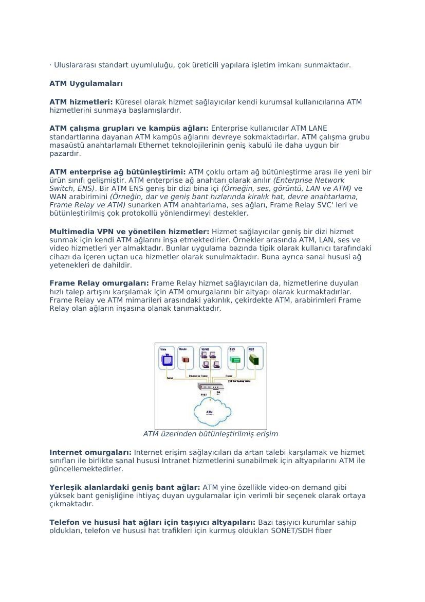
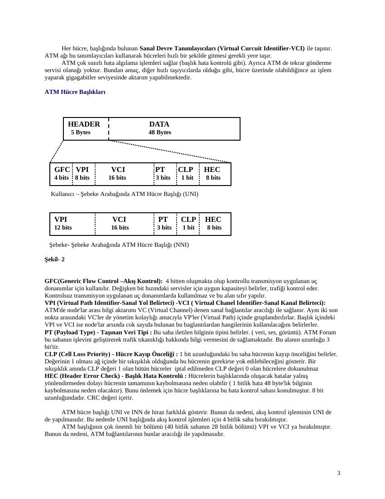
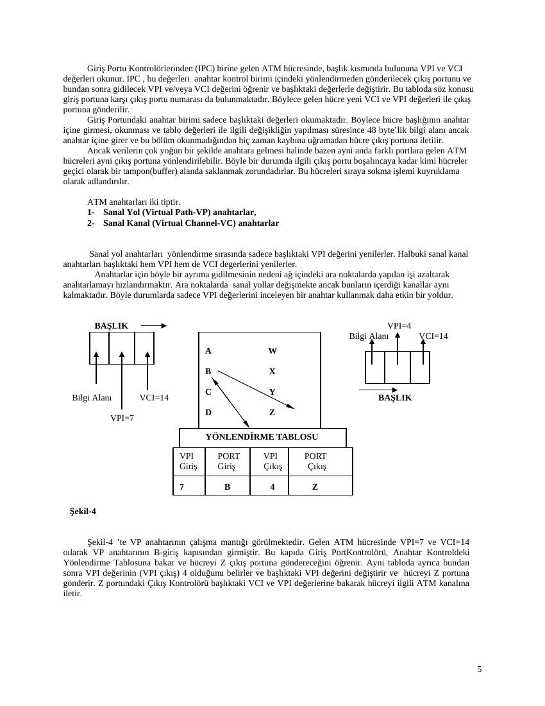
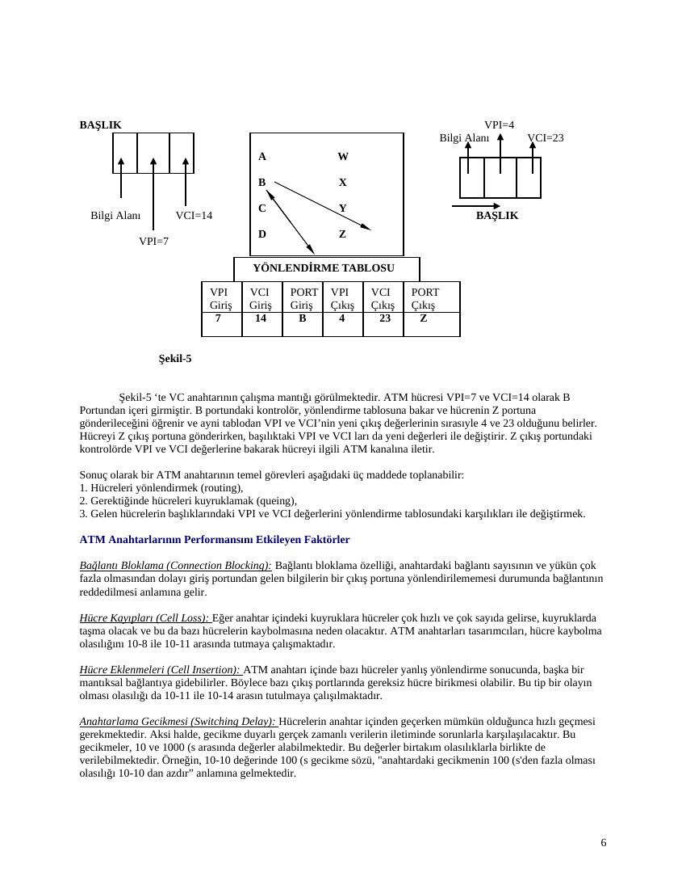
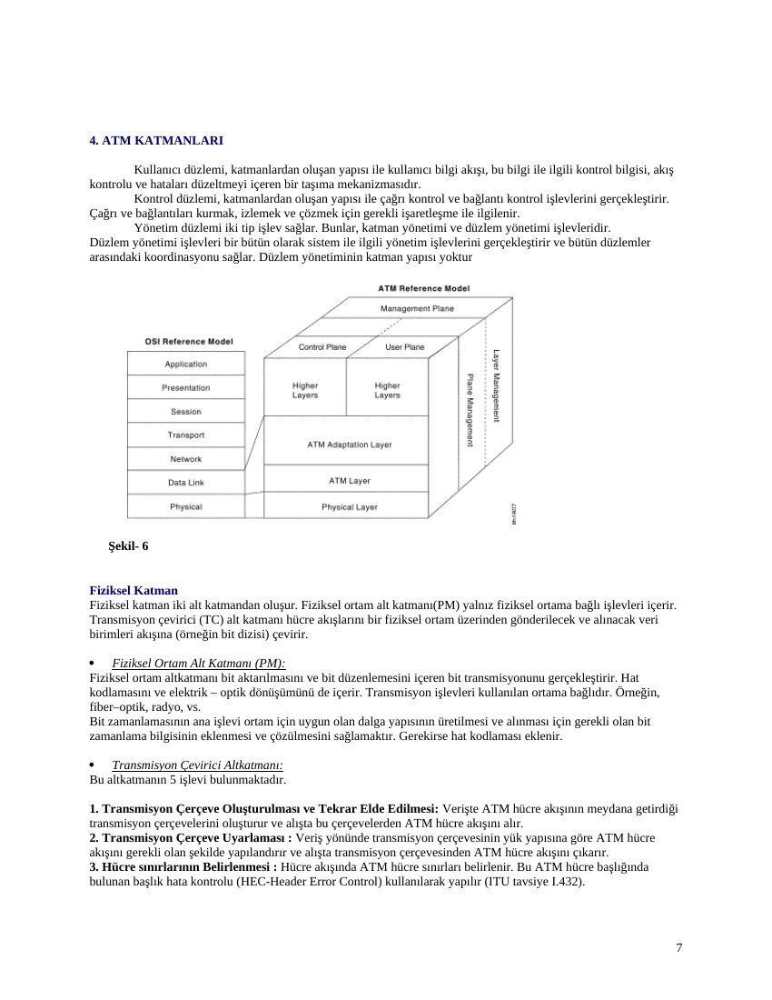
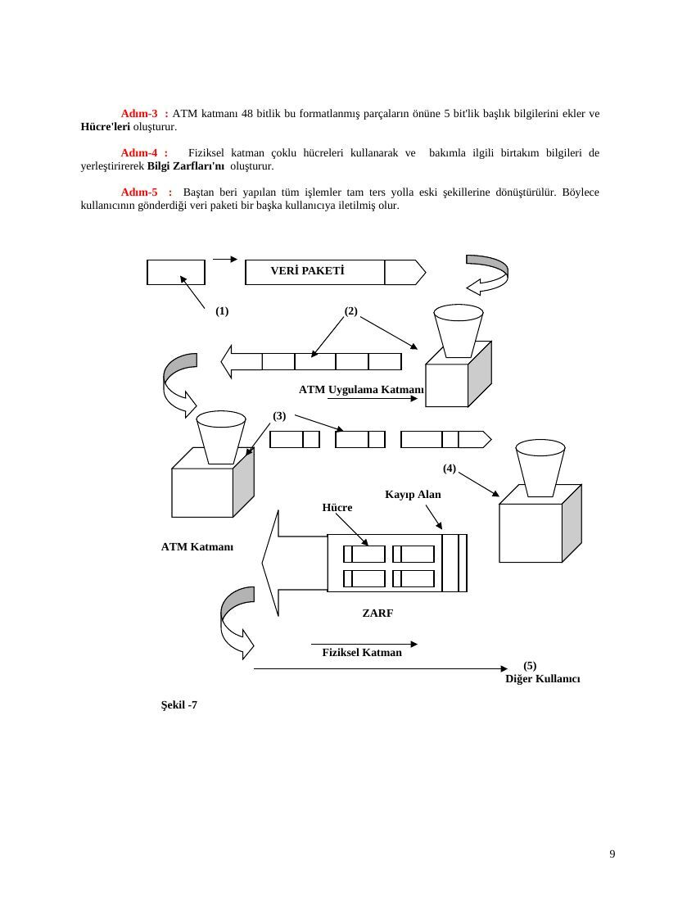

ATM ve B-ISDN konusunda iki Türkçe teknik derlemedir. İlkinde www.kotonline.net/yardim/arsiv/atm.htm adresi; diğerinde Cisco, ATM Forum ve üniversite sayfaları kaynak olarak belirtilmiştir. Hazırlayan adı ve belge tarihi bulunmaz; kaynak dosya tarihi kullanılmıştır. Belgelerin arşiv için hazırlanmış PDF kopyaları yazının sonunda indirilebilir.

*Bu içerik üçüncü taraf bir kaynağa aittir; arşiv ve nostalji amacıyla kaynak belirtilerek paylaşılmıştır. Hak sahibinin talebi hâlinde kaldırılır.*

## ATM teknolojileri derlemesi

ATM Teknolojileri

Asynchronous Transfer Mode (ATM), tarihçesi 70 ve 80'lerde broadband ISDN'in geliştirilmesiyle başlayan bir teknolojidir. Teknik olarak paket anahtarlamada bugün gelinen nokta gözü ile bakılabilir. Veri için paket anahtarlamada olduğu gibi (Örneğin, X. 25, Frame Relay, TCP/IP), ATM çoğullama ve anahtarlama işlevlerini bütünleştirir, patlamalı trafik için uygundur (Devre anahtarlamanın aksine), ve değişik hızlarda çalışan cihazların haberleşmesine izin verir. Ancak paket anahtarlamanın aksine, ATM yüksek performanslı çoklu ortam ağları için tasarlanmıştır. ATM teknolojisi çok geniş bir dizi ağ cihazında uyarlanmıştır:

· PC, işistasyonu ve sunucu ağ arabirim kartları · Anahtarlamalı Ethernet ve Token Ring çalışma grubu hub' ları · Çalışma grubu ve kampüs ATM anahtarları · ATM enterprise ağ anahtarları · ATM çoğullayıcıları · ATM uç anahtarları · ATM omurga anahtarları

ATM, bir tarife baz alınarak bir son kullanıcı hizmeti olarak verilebildiği gibi, verilebilen diğer ağ hizmetleri için bir alt yapı olarak kullanılabilir. En temel hizmet yapıtaşı ATM sanal devresidir. Sanal devreler uçtan uca noktaları ve yönlendirmeleri tanımlar, bant genişliği ise kullanıcı trafiği olduğunda ağ tarafından yapılan talepler doğrultusunda atanır. ATM ayrıca geniş bir dizi uygulama ihtiyaçlarını karşılamak için hizmet sınıflarını tanımlar.

ATM' in Diğer tekonolojilere göre avantajları:

· Donanım anahtarlaması ile yüksek performans · Patlamalı trafik için dinamik bant genişliği · Çokluortam için hizmet sınıfı desteği · Hız ve ağ boyutlarında ölçeklenebilirlik · Ortak LAN/WAN mimarisi · VC mimarisi yoluyla basitleştirme için olanaklar · Uluslarası standart uyumluluğu

ITU (Internatiomal Telecomunication Union) tarafından belirlenen uluslararası ATM standartlarının kullanımıyla ATM teknolojisi üzerinde konuşlandırılan yüksek seviye faydalar aşağıdaki gibi özetlenebilir:

· Ufuktaki terabit anahtarları ile donanım anahtarlama aracılığı ile yüksek performans. · Uygulama ihtiyaçlarını karşılayan patlamalı trafik için dinamik bant genişliği ve ağ kaynaklarının yüksek oranda kullanımının sağlanması. (LAN tabanlı uygulamalar başta olmak üzere, ses ve görüntü iletimi de, iletim zamanı içerisinde ihtiyaç duyulan bant genişliği her an artıp azalabileceğinden patlamalıdır.) ·Çoklu ortam trafiği için hizmet sınıf desteği uygulamaların ihtiyaç duyduğu değişik bant genişliği ihtiyaçlarını tek bir ağ üzerinde sağlar. · Günümüzde E1/T1'den STM-16'ya (2.4 Gbps) hızların desteklenmesi ile ağ boyutlarında ölçeklenebilirlik sunulurken, desteklenen hızların Gbps mertebesine ulaşması ile ölçeklenebilirlik konusunda sınırlar oldukça geniş olmaktadır. · Ortak LAN/WAN mimarisi ATM' in bir bütün olarak bir masaüstü sistemden diğerine kullanılabilmesini sağlamaktadır. Geleneksel olarak Veri Haberleşmesi Kavramları performans anlamında ve beraber çalışma konusunda çok farklı olmuşlardır. · Basit bir altyapı olanağı anahtarlamalı BC mimarisi sayesinde olmaktadır. Bu, doğal olarak bağlantı eğilimli olmayan LAN bazlı trafik için çok uygundur. ATM VC mimarisi sayesindeki basitlik, kullanımı ücretlendirme, trafik yönetimi, güvenlik ve yapılandırma yönetimini de olanak sağlamaktadır.

· Uluslararası standart uyumluluğu, çok üreticili yapılara işletim imkanı sunmaktadır.

ATM Uygulamaları

ATM hizmetleri: Küresel olarak hizmet sağlayıcılar kendi kurumsal kullanıcılarına ATM hizmetlerini sunmaya başlamışlardır.

ATM çalışma grupları ve kampüs ağları: Enterprise kullanıcılar ATM LANE standartlarına dayanan ATM kampüs ağlarını devreye sokmaktadırlar. ATM çalışma grubu masaüstü anahtarlamalı Ethernet teknolojilerinin geniş kabulü ile daha uygun bir pazardır.

ATM enterprise ağ bütünleştirimi: ATM çoklu ortam ağ bütünleştirme arası ile yeni bir ürün sınıfı gelişmiştir. ATM enterprise ağ anahtarı olarak anılır (Enterprise Network Switch, ENS). Bir ATM ENS geniş bir dizi bina içi (Örneğin, ses, görüntü, LAN ve ATM) ve WAN arabirimini (Örneğin, dar ve geniş bant hızlarında kiralık hat, devre anahtarlama, Frame Relay ve ATM) sunarken ATM anahtarlama, ses ağları, Frame Relay SVC' leri ve bütünleştirilmiş çok protokollü yönlendirmeyi destekler.

Multimedia VPN ve yönetilen hizmetler: Hizmet sağlayıcılar geniş bir dizi hizmet sunmak için kendi ATM ağlarını inşa etmektedirler. Örnekler arasında ATM, LAN, ses ve video hizmetleri yer almaktadır. Bunlar uygulama bazında tipik olarak kullanıcı tarafındaki cihazı da içeren uçtan uca hizmetler olarak sunulmaktadır. Buna ayrıca sanal hususi ağ yetenekleri de dahildir.

Frame Relay omurgaları: Frame Relay hizmet sağlayıcıları da, hizmetlerine duyulan hızlı talep artışını karşılamak için ATM omurgalarını bir altyapı olarak kurmaktadırlar. Frame Relay ve ATM mimarileri arasındaki yakınlık, çekirdekte ATM, arabirimleri Frame Relay olan ağların inşasına olanak tanımaktadır.

ATM üzerinden bütünleştirilmiş erişim

Internet omurgaları: Internet erişim sağlayıcıları da artan talebi karşılamak ve hizmet sınıfları ile birlikte sanal hususi Intranet hizmetlerini sunabilmek için altyapılarını ATM ile güncellemektedirler.

Yerleşik alanlardaki geniş bant ağlar: ATM yine özellikle video-on demand gibi yüksek bant genişliğine ihtiyaç duyan uygulamalar için verimli bir seçenek olarak ortaya çıkmaktadır.

Telefon ve hususi hat ağları için taşıyıcı altyapıları: Bazı taşıyıcı kurumlar sahip oldukları, telefon ve hususi hat trafikleri için kurmuş oldukları SONET/SDH fiber

altyapılarını ATM katkısı ile daha verimli olarak kullanabileceklerini görmüşlerdir.

http://www.bnet.net.tr/arge/arastirma_atm.htm

## ATM ve B-ISDN derlemesi

GİRİŞ

Bilgisayar teknolojisinin ve dolayısıyla bilgisayar ağlarının büyük bir hızla gelişmesi sonucu, bilgisayarların kullanım amaçları ve üstlendikleri hizmetler eskisine oranla çok daha geniş bir alana yayılmıştır. Bu gelişime paralel olarak da yeni kullanım alanları doğmuş ancak bir süre sonra varolan yapılar bu yeni taleplere karşılık veremez hale gelmişlerdir. Şu anda ihtiyaç duyulan pek çok servis (ses, görüntü, klasik veri iletimi, interaktif servisler vb.) yüksek hızlarda iletim kapasitesi gerektirmektedir. Veri iletişiminde ortaya çıkan ilerlemeler bu ihtiyaçlara cevap verebilecek B-ISDN yapısının oluşmasına imkan sağlamıştır. ITU-T (International Telecommunication Union), B-ISDN için transfer modu olarak ATM'i önermiştir. ATM ve B-ISDN teknolojisi aynı zamanda varolan sistemlere de adapte edilebilir olması açısından da avantajlıdır. Gelecekte kullanılması düşünülen video-telefon, video-konferans, video-kütüphane ve benzeri servisleri düşünürsek, bu tür ihtiyaçları karşılayacak iletişim ağlarının servis türünden bağımsız, genişbantlı tek bir ağ olması gerektiği ortaya çıkmaktadır. Bu alandaki çalışmalar seksenli yılların başlarında başlatılmış ve ISDN (Integrated Switched Digital Networks) olarak adlandırılmıştır. Bu ağların bant genişliğinin arttırılmasıyla hertürlü ses, veri, hareketli video ve yüksek çözünürlükte TV iletiminin entegre edilmesi sağlanmış ve gelişen yapı B-ISDN (Broadband ISDN) olarak adlandırılmıştır. B-ISDN yapısını olanaklı kılan faktörler, fiber-optik teknolojisinin gelişerek iletişim hatlarında geniş çapta kullanılır olması ve yarı iletken teknolojisinde sağlanan ilerlemeler olarak gösterilebilir. Böylelikle, yeni geliştirilen yapıda, iletim ortamının daha güvenilir olması ve hata kontrolunun ağ içinde yapılması gerekliliğinin ortadan kalkması ile daha etkin ve maliyeti düşük yeni bir aktarım biçimi kullanılabilmiştir. İşte bu yeni teknoloji ATM (Asynchronous Transfer Mode) olarak adlandırılmaktadır. ITU-T tarafından da yapılan araştırmalar sonucu 1988 yılında ATM' in B-ISDN için en uygun aktarım protokolu oldugu belirlenmiştir. ITU-T tarafından B-ISDN yapısı ile verilmesi düşünülen hizmetler şöyle sıralanabilir: * HDTV(High Definition TV) Yüksek çözünürlüklü TV servisleri, * Videokonferans servisleri, * İstek üzerine video (Video on Demand) servisleri, * Karşılıklı iletişime dayalı (interaktif) servisler, * Mesaj servisleri, * Veri transfer servisleri.

**1.** ATM NEDİR ?

ATM, B-ISDN’nin temelini oluşturmakta olup bir taşıma ve anahtarlama teknolojisidir. Bilgiyi verimli ve güvenilir bir şekilde bir yerden diğer bir yere taşır. ATM hücre teknolojisini kullanır. Hücre teknolojisi bilginin sabit boyuttaki kaplar ile taşınması demektir. Bu şekilde taşıma trenlerde, kara ve deniz yollarında gördüğümüz yük konteynerlerine benzetilebilinir. Hangi taşıma çeşidi kullanılırsa kullanılsın aynı konteynerlerin kullanılması gibi, ATM de çeşitli tipteki telekomünikasyon şebekeleri arasında sabit boyutta hücreler kullanarak şebeke boyunca kesintisiz taşımayı sağlar. Yüksek hızda büyük hacimde bilgi taşımak için tasarlanan ATM; ses, veri, video ve multimedia (çoğul ortam) dan oluşan çok çeşitli telekomünikasyon trafiklerini taşır. ATM ses ve multimedia haberleşmesinde gerçek zaman iletimini (real time transmission) gerçekleştirebilir. ATM bir transfer modu olup burada bilgi hücreler içine yerleştirilir. Bir kullanıcıya ait hücreler periyodik olarak iletilmezler. Gelen hücreler giden hücreler akımındaki dilimlere yerleşmeye çalışırlar. Sabit bir zamanlama ilişkisi yoktur. Eğer yerleşecek dilim yoksa, hücre ATM anahtar içinde kuyrukta bekler. Bu durum ATM anahtar boyunca trafiğe bağlı olarak değişken bir hücre gecikmesi meydana getirir. Bu değişken hücre gecikmesinden dolayı ATM hücrelerinin ATM anahtar boyunca asenkron aktarıldığı söylenilir.

Transfer Modları Transfer modu, bir telekomunikasyon ağında kullanılan iletim (transmission), çoklama (multiplexing) ve anahtarlama (switching) tekniklerinin toplamına verilen isimdir. Network dünyasında transfer modu konusunda temel olarak iki kutup bulunmaktadır. Bunlar devre anahtarlama ve paket anahtarlamadır.

Devre Anahtarlama (Circuit Switching): Bu transfer modu özellikle telefon ağlarında kullanılır. Devre anahtarlamanın temeli, bir iletim sırasında sadece ilgili bağlantı tarafından kullanılabilen adanmış sabit kapasiteli bir kanal oluşturmaktır.Belirli zaman aralıklarında (125 (s gibi) sabit uzunlukta bit kümeleri gönderilir (8 bit, 1000 bit gibi). Bu kümelerin her birine 'time slot' denir ve bunlar birleştirilerek çerçeveleri (frame) oluştururlar. (Çerçeveler de belirli aralıklarda tekrarlanır. Bu çerçevelerin içindeki her time slot, devam ettiği sürece belirli bir bağlantıya adanır. Ancak bağlantı kapatıldığında ilgili slot başka bir uygulamanın kullanımına sunulabilir.) Pür hat anahtarlamalı sistemlerde her time slot'un barındırabileceği bit miktarı aynıdır ve sabittir. Yani her servis için sabit bir bit hızı vardır. Devre anahtarlamalı sistemlerde bir hat, bağlantı boyunca bir uygulamaya adandığından dolayı sistemde oluşacak gecikmeler ancak iletim hattındaki yayılma gecikmesine bağlıdır

Paket Anahtarlama (Packet Switching): Bu transfer modunda kullanıcının bilgileri paketler halinde taşınır. Bu paketlerde kullanıcının bilgisine ek olarak başlık (header) denen ve yönlendirme (routing), hata kontrol ve akış kontrol için kullanılan bilgileri içeren saha da bulunur. Eski bağlantıların güvenliği düşük olduğundan dolayı bu tip sistemlerde ileri düzeyde hata kontrolü yapılır (İçinden geçilen her node'da paket içeriği, hatalara karşı kontrol edilir...). Her node 'da hatalı paketler için tekrar gönderim isteği yapılır.(ARQ -Automatic Repeat Request) Paket boyutları değişkendir. Dolayısıyla kompleks akış kontrolü gerektirirler. Ancak iletişim hızı düşük olduğundan bu pek sorun yaratmamaktadır. Protokollerinkarmaşıklığından ve tekrar gönderme işleminden dolayı yüksek hız gerektiren servislerde ve gerçek zamanlı uygulamalarda pek kullanılmazlar

Frame Relaying: Frame Relaying, iletim hatlarının güvenilirliği nedeniyle, ağ içinde paket anahtarlamalı sistemlere (X.25) oranla daha az fonksiyonelliğe sahiptir (Daha kısıtlı hata kontrol ve düzeltme yapılır). Bu da ağ içi anahtarlama noktalarında daha hızlı bilgi işleme imkanı sağlar. Paketlerin tekrar gönderimi ancak uç noktalar arasında yapılır (yani aradaki node'lar paketlerin tekrar gönderimini istemez). Buna karşın node'larda paketler hala hatalara karşı kontrol edilirler. Bunun nedeni hatalı paketlerin iletimine devam edilmesinin bir anlamının olmamasıdır

Cell Relaying(Fast Packet Switching-ATM): Fast Packet Switching (ATM), birçok varyasyonu içeren bir kavramdır. Ancak bunların temel karakteristiği aynıdır: Ağda minimum fonksiyonellikle paket anahtarlama. Gönderici ve alıcı arasında bir senkronizasyon yoktur. Senkronizasyon, gerektiğinde boş paketlerin eklenip çıkarılmasıyla sağlanabilir. ATM'de ağ içinde CRC ya da ARQ türünden hata kontrol fonksiyonları yoktur. Hat anahtarlamada olduğu gibi hataların düzeltilmesi uç noktalardaki protokollere bırakılmıştır. ATM 'in Frame Relay'den en önemli farkı, ATM'de verilerin sabit ve küçük boyutlu paketler (hücreler) halinde iletilmesidir. Frame Relay de ise paket boyu değişkendir.

**2.** ATM HÜCRE YAPISI

ATM'de bilgi aktarımı için kullanılan temel birim 53 byte'lık sabit uzunlukta olan ve hücre (cell) olarak adlandırılan özel bir tür pakettir. Hücrelerin ilk 5 byte'lık kısmı başlık (header) olarak adlandırılır ve hücrenin ağ içinde ilerleyebilmesi için gerekli olan temel bilgileri taşır. (Paket anahtarlama yönteminde bulunan ve ileri düzeyde fonksiyonellik sağlayan alanlar hücre başlıklarında olabildiğince azaltılmıştır). Başlığın fonksiyonelliğinin düşük düzeyde tutulması da ATM anahtarlarına yüksek hızda işlem yapma imkanı verir. Geriye kalan 48 byte ise iletilecek olan bilgiyi içerir.

Şekil -1

Her hücre, başlığında bulunan Sanal Devre Tanımlayıcıları (Virtual Curcuit Identifier-VCI) ile taşınır. ATM ağı bu tanımlayıcıları kullanarak hücreleri hızlı bir şekilde gitmesi gerekli yere taşır. ATM çok sınırlı hata algılama işlemleri sağlar (başlık hata kontrolü gibi). Ayrıca ATM de tekrar gönderme servisi olanağı yoktur. Bundan amaç, diğer hızlı taşıyıcılarda olduğu gibi, hücre üzerinde olabildiğince az işlem yaparak gigagabitler seviyesinde aktarım yapabilmektedir.

ATM Hücre Başlıkları

HEADER DATA 5 Bytes 48 Bytes

GFC VPI VCI PT CLP HEC 4 bits 8 bits 16 bits 3 bits 1 bit 8 bits

Kullanıcı – Şebeke Arabağında ATM Hücre Başlığı (UNI)

VPI VCI PT CLP HEC 12 bits 16 bits 3 bits 1 bit 8 bits

Şebeke- Şebeke Arabağında ATM Hücre Başlığı (NNI)

Şekil- 2

GFC(Generic Flow Control –Akış Kontrol): 4 bitten oluşmakta olup kontrollu transmisyon uygulanan uç donanımlar için kullanılır. Değişken bit hızındaki servisler için uygun kapasiteyi belirler, trafiği kontrol eder. Kontrolsuz transmisyon uygulanan uç donanımlarda kullanılmaz ve bu alan sıfır yapılır. VPI (Virtual Path Identifier-Sanal Yol Belirteci) -VCI ( Virtual Chanel Identifier-Sanal Kanal Belirteci): ATM'de node'lar arası bilgi aktarımı VC (Virtual Channel) denen sanal bağlantılar aracılığı ile sağlanır. Aynı iki son nokta arasındaki VC'ler de yönetim kolaylığı amacıyla VP'ler (Virtual Path) içinde gruplandırılırlar. Başlık içindeki VPI ve VCI ise node'lar arsında cok sayıda bulunan bu baglantılardan hangilerinin kullanılacağını belirlerler. PT (Payload Type) - Taşınan Veri Tipi : Bu saha iletilen bilginin tipini belirler. ( veri, ses, görüntü). ATM Forum bu sahanın işlevini geliştirerek trafik tıkanıklığı hakkında bilgi vermesini de sağlamaktadır. Bu alanın uzunluğu 3 bit'tir. CLP (Cell Loss Priority) - Hücre Kayıp Önceliği : 1 bit uzunluğundaki bu saha hücrenin kayıp önceliğini belirler. Değerinin 1 olması ağ içinde bir sıkışıklık olduğunda bu hücrenin gerekirse yok edilebileceğini gösterir. Bir sıkışıklık anında CLP değeri 1 olan bütün hücreler iptal edilmeden CLP değeri 0 olan hücrelere dokunulmaz HEC (Header Error Check) - Başlık Hata Kontrolü : Hücrelerin başlıklarında oluşacak hatalar yalnış yönlendirmeden dolayı hücrenin tamamının kaybolmasına neden olabilir ( 1 bitlik hata 48 byte'lık bilginin kaybolmasına neden olacaktır). Bunu önlemek için hücre başlıklarına bu hata kontrol sahası konulmuştur. 8 bit uzunluğundadır. CRC değeri içerir.

ATM hücre başlığı UNI ve INN de biraz farklılık gösterir. Bunun da nedeni, akış kontrol işleminin UNI de de yapılmasıdır. Bu nedenle UNI başlığında akış kontrol işlemleri için 4 bitlik saha bırakılmıştır. ATM başlığının çok önemli bir bölümü (40 bitlik sahanın 28 bitlik bölümü) VPI ve VCI ya bırakılmıştır. Bunun da nedeni, ATM bağlantılarının bunlar aracılığı ile yapılmasıdır.

Neden Sabit Uzunluk ? Bir sistemde sabit uzunlukta hücreler kullanıldığında etkinlik, gönderilecek bilginin uzunluğuna göre değişir. Eğer gönderilecek bilgi küçük miktarlardaysa ve hücrelere bölündüğünde son hücrede büyük oranda (30-40 byte) boşluk kalıyorsa bu iletişimdeki etkinlik oranı pek yüksek olmaz. Ancak gönderilecek bilgi 48 byte'ın tam katıysa yani hücrelerin hepsi tamamen doluysa maximum etkinliğe (%90.5) ulaşılabilir. (Maximum etkinliğin %90.5 olmasının sebebi gönderilen 53 bytelik her hücrenin 5 byte'ının başlığa ayrılmış olmasıdır. 48/53=0.905...) Değişken uzunlukta hücreler kullanılınca sistemde neredeyse %100 'lük etkinliğe ulaşılır. Ancak, farklı uzunluktaki paketlerin kuyruklama için buffer'da etkin olarak saklanması oldukça zordur ve komplike algoritmalar gerektirir. Bu kompleks buffer işlemleri de yüksek hız gerektirir. Bu tür pratik nedenlerden dolayı degişken uzunlukta hücre kullanımı engellenmiştir. Sabit uzunluktaki hücrelerde kalan boşluklar sistem etkinliğine olumsuz yönde etki eder, ancak B- ISDN'de sunulacak servislerin zaten yüksek miktarda bilgi iletimine ihtiyaç duyması bu olumsuzluğu ortadan kaldırır.

Neden 53 Byte ? Hücre boyunun seçilmesinde farklı faktörler rol oynamıştır. Uzun bilgi alanları iletimin etkinliğini artırır. Çünkü her başlıkla beraber gönderilen bilginin miktarı artar ve böylece başlıklardan kaynaklanan overhead'ın oranı azalır.Ancak bilgi alanının boyu arttıkça paketleme sırasındaki gecikme de (packetization delay) artar. Uzun hücreler kullanıldığında ağ içindeki gecikmenin de belirli limitleri aşması daha kolay olur. Bu da ses iletiminde yankı önleyicilerin kullanılmasını zorunlu kılar. Ayrıca uzun hücreler anahtarlarda kullanılan geçici depolama alanlarının büyük olmasını gerektirir. (Hücre kayıplarını önlemek için kuyruklar hücre boyutundan bağımsız olarak belli miktarda hücreyi saklayabilecek kapasitede olmalıdırlar) Bütün bu etkenler göz önüne alınarak hücredeki bilgi sahasının boyunun 32 ya da 64 byte civarında olması öngörülmüştür. Sonuçta 48 byte bilgi + 5 byte başlık olmak üzere 53 byte hücre boyutu olarak kabul edilmiştir.

**3.** ATM ANAHTARLAMA

ATM anahtarlamasındaki temel fikir mantıksal bir kanaldan anahtara giren bilginin yol üzerindeki bir sonraki noktaya iletilmesi için başka bir ATM kanalına yönlendirilmesidir. Genelde bir anahtardan çıkan çok sayıda mantıksal ATM kanalı olmasından dolayı, yönlendirmeden önce ilgili çıkış kanalı seçilmelidir. Bu seçim, giriş portunun numarasına ve hücrenin VPI, VCI değerlerine bağlı olarak yapılır.

ATM Anahtarları Her porta ait konumuna göre ya bir IPC (Giriş Port Kontrol) ya da OPC (Çıkış Port Kontrol) bulunmaktadır. Ayrıca anahtar içindeki yönlendirme tablolarını güncelleyen bir anahtar kontrol birimi (switch controller) de vardır.

IPC- 1 1 1 2 2 OPC-1 . ATM .

ANAHTARI . . . . . . IPC-N N N OPC-N

Anahtar Kontrol Şekil- 3

Giriş Portu Kontrolörlerinden (IPC) birine gelen ATM hücresinde, başlık kısmında bulununa VPI ve VCI değerleri okunur. IPC , bu değerleri anahtar kontrol birimi içindeki yönlendirmeden gönderilecek çıkış portunu ve bundan sonra gidilecek VPI ve/veya VCI değerini öğrenir ve başlıktaki değerlerle değiştirir. Bu tabloda söz konusu giriş portuna karşı çıkış portu numarası da bulunmaktadır. Böylece gelen hücre yeni VCI ve VPI değerleri ile çıkış portuna gönderilir. Giriş Portundaki anahtar birimi sadece başlıktaki değerleri okumaktadır. Böylece hücre başlığının anahtar içine girmesi, okunması ve tablo değerleri ile ilgili değişikliğin yapılması süresince 48 byte’lik bilgi alanı ancak anahtar içine girer ve bu bölüm okunmadığından hiç zaman kaybına uğramadan hücre çıkış portuna iletilir. Ancak verilerin çok yoğun bir şekilde anahtara gelmesi halinde bazen ayni anda farklı portlara gelen ATM hücreleri ayni çıkış portuna yönlendirilebilir. Böyle bir durumda ilgili çıkış portu boşalıncaya kadar kimi hücreler geçici olarak bir tampon(buffer) alanda saklanmak zorundadırlar. Bu hücreleri sıraya sokma işlemi kuyruklama olarak adlandırılır.

ATM anahtarları iki tiptir. 1- Sanal Yol (Virtual Path-VP) anahtarlar, 2- Sanal Kanal (Virtual Channel-VC) anahtarlar

Sanal yol anahtarları yönlendirme sırasında sadece başlıktaki VPI değerini yenilerler. Halbuki sanal kanal anahtarları başlıktaki hem VPI hem de VCI degerlerini yenilerler. Anahtarlar için böyle bir ayrıma gidilmesinin nedeni ağ içindeki ara noktalarda yapılan işi azaltarak anahtarlamayı hızlandırmaktır. Ara noktalarda sanal yollar değişmekte ancak bunların içerdiği kanallar aynı kalmaktadır. Böyle durumlarda sadece VPI değerlerini inceleyen bir anahtar kullanmak daha etkin bir yoldur.

BAŞLIK VPI=4 Bilgi Alanı VCI=14 A W

B X

C Y Bilgi Alanı VCI=14 BAŞLIK D Z VPI=7

YÖNLENDİRME TABLOSU

VPI PORT VPI PORT Giriş Giriş Çıkış Çıkış

7 B 4 Z

Şekil-4

Şekil-4 ’te VP anahtarının çalışma mantığı görülmektedir. Gelen ATM hücresinde VPI=7 ve VCI=14 oılarak VP anahtarının B-giriş kapısından girmiştir. Bu kapıda Giriş PortKontrolörü, Anahtar Kontroldeki Yönlendirme Tablosuna bakar ve hücreyi Z çıkış portuna göndereceğini öğrenir. Ayni tabloda ayrıca bundan sonra VPI değerinin (VPI çıkış) 4 olduğunu belirler ve başlıktaki VPI değerini değiştirir ve hücreyi Z portuna gönderir. Z portundaki Çıkış Kontrolörü başlıktaki VCI ve VPI değerlerine bakarak hücreyi ilgili ATM kanalına iletir.

BAŞLIK VPI=4 Bilgi Alanı VCI=23 A W

B X

C Y Bilgi Alanı VCI=14 BAŞLIK D Z VPI=7

YÖNLENDİRME TABLOSU

VPI VCI PORT VPI VCI PORT Giriş Giriş Giriş Çıkış Çıkış Çıkış 7 14 B 4 23 Z

Şekil-5

Şekil-5 ‘te VC anahtarının çalışma mantığı görülmektedir. ATM hücresi VPI=7 ve VCI=14 olarak B Portundan içeri girmiştir. B portundaki kontrolör, yönlendirme tablosuna bakar ve hücrenin Z portuna gönderileceğini öğrenir ve ayni tablodan VPI ve VCI’nin yeni çıkış değerlerinin sırasıyle 4 ve 23 olduğunu belirler. Hücreyi Z çıkış portuna gönderirken, başılıktaki VPI ve VCI ları da yeni değerleri ile değiştirir. Z çıkış portundaki kontrolörde VPI ve VCI değerlerine bakarak hücreyi ilgili ATM kanalına iletir.

Sonuç olarak bir ATM anahtarının temel görevleri aşağıdaki üç maddede toplanabilir:

**1.** Hücreleri yönlendirmek (routing),

**2.** Gerektiğinde hücreleri kuyruklamak (queing),

**3.** Gelen hücrelerin başlıklarındaki VPI ve VCI değerlerini yönlendirme tablosundaki karşılıkları ile değiştirmek.

ATM Anahtarlarının Performansını Etkileyen Faktörler

Bağlantı Bloklama (Connection Blocking): Bağlantı bloklama özelliği, anahtardaki bağlantı sayısının ve yükün çok fazla olmasından dolayı giriş portundan gelen bilgilerin bir çıkış portuna yönlendirilememesi durumunda bağlantının reddedilmesi anlamına gelir.

Hücre Kayıpları (Cell Loss): Eğer anahtar içindeki kuyruklara hücreler çok hızlı ve çok sayıda gelirse, kuyruklarda taşma olacak ve bu da bazı hücrelerin kaybolmasına neden olacaktır. ATM anahtarları tasarımcıları, hücre kaybolma olasılığını 10-8 ile 10-11 arasında tutmaya çalışmaktadır.

Hücre Eklenmeleri (Cell Insertion): ATM anahtarı içinde bazı hücreler yanlış yönlendirme sonucunda, başka bir mantıksal bağlantıya gidebilirler. Böylece bazı çıkış portlarında gereksiz hücre birikmesi olabilir. Bu tip bir olayın olması olasılığı da 10-11 ile 10-14 arasın tutulmaya çalışılmaktadır.

Anahtarlama Gecikmesi (Switching Delay): Hücrelerin anahtar içinden geçerken mümkün olduğunca hızlı geçmesi gerekmektedir. Aksi halde, gecikme duyarlı gerçek zamanlı verilerin iletiminde sorunlarla karşılaşılacaktır. Bu gecikmeler, 10 ve 1000 (s arasında değerler alabilmektedir. Bu değerler birtakım olasılıklarla birlikte de verilebilmektedir. Örneğin, 10-10 değerinde 100 (s gecikme sözü, "anahtardaki gecikmenin 100 (s'den fazla olması olasılığı 10-10 dan azdır” anlamına gelmektedir.

**4.** ATM KATMANLARI

Kullanıcı düzlemi, katmanlardan oluşan yapısı ile kullanıcı bilgi akışı, bu bilgi ile ilgili kontrol bilgisi, akış kontrolu ve hataları düzeltmeyi içeren bir taşıma mekanizmasıdır. Kontrol düzlemi, katmanlardan oluşan yapısı ile çağrı kontrol ve bağlantı kontrol işlevlerini gerçekleştirir. Çağrı ve bağlantıları kurmak, izlemek ve çözmek için gerekli işaretleşme ile ilgilenir. Yönetim düzlemi iki tip işlev sağlar. Bunlar, katman yönetimi ve düzlem yönetimi işlevleridir. Düzlem yönetimi işlevleri bir bütün olarak sistem ile ilgili yönetim işlevlerini gerçekleştirir ve bütün düzlemler arasındaki koordinasyonu sağlar. Düzlem yönetiminin katman yapısı yoktur

Şekil- 6

Fiziksel Katman Fiziksel katman iki alt katmandan oluşur. Fiziksel ortam alt katmanı(PM) yalnız fiziksel ortama bağlı işlevleri içerir. Transmisyon çevirici (TC) alt katmanı hücre akışlarını bir fiziksel ortam üzerinden gönderilecek ve alınacak veri birimleri akışına (örneğin bit dizisi) çevirir.

- Fiziksel Ortam Alt Katmanı (PM): Fiziksel ortam altkatmanı bit aktarılmasını ve bit düzenlemesini içeren bit transmisyonunu gerçekleştirir. Hat kodlamasını ve elektrik – optik dönüşümünü de içerir. Transmisyon işlevleri kullanılan ortama bağlıdır. Örneğin, fiber–optik, radyo, vs. Bit zamanlamasının ana işlevi ortam için uygun olan dalga yapısının üretilmesi ve alınması için gerekli olan bit zamanlama bilgisinin eklenmesi ve çözülmesini sağlamaktır. Gerekirse hat kodlaması eklenir.

- Transmisyon Çevirici Altkatmanı: Bu altkatmanın 5 işlevi bulunmaktadır.

**1.** Transmisyon Çerçeve Oluşturulması ve Tekrar Elde Edilmesi: Verişte ATM hücre akışının meydana getirdiği transmisyon çerçevelerini oluşturur ve alışta bu çerçevelerden ATM hücre akışını alır.

**2.** Transmisyon Çerçeve Uyarlaması : Veriş yönünde transmisyon çerçevesinin yük yapısına göre ATM hücre akışını gerekli olan şekilde yapılandırır ve alışta transmisyon çerçevesinden ATM hücre akışını çıkarır.

**3.** Hücre sınırlarının Belirlenmesi : Hücre akışında ATM hücre sınırları belirlenir. Bu ATM hücre başlığında bulunan başlık hata kontrolu (HEC-Header Error Control) kullanılarak yapılır (ITU tavsiye I.432).

**4.** HEC Sinyal Oluşturulması ve Doğrulanması : Verişte ATM hücre başlığının ilk 4 baytı için HEC oluşturulur ve

**5.** bayta yerleştirilir. Alışta hücre başlıkları hatalar için kontrol edilir ve mümkünse hatalar düzeltilir. Başlıklarının hatalı olduğu kararlaştırılanlar ve düzeltilemeyenler atılır.

**5.** Hücre Hızı Uyarlanması : Geçerli ATM hücrelerinin hızının transmisyon sistemi yük kapasitesine uyarlamak için boş ATM hücreleri eklenir ve alışta bunlar atılır.

ATM Katmanı ATM katmanının karakteristikleri fiziksel ortamdan bağımsızdır. ATM katmanının 4 ana işlevi bulunmaktadır. Birinci işlevi hücre çoklaması ve tekrar çözülmesidir. Veriş yönünde hücre çoklama işlevi farklı bağlantılardan alınan hücreleri bir tek hücre akımına çevirir. Alış yönünde ise bunun tersini yapar. İkinci işlev Virtual Path Identifier (VPI) ve Virtual Channel Identifier (VCI)’ın değiştirilmesidir. Bu işlev ATM anahtarlama sahasında ve/veya cross-connect noktalarında yapılır. Gelen ATM hücrelerinin VPI ve VCI bilgisi yeni değerle değiştirilir. Duruma göre değiştirme yapılmayabilir. Üçüncü işlev ATM uyarlama katmanı ile haberleşme yapabilmek için hücre başlığı oluşturulması ve çıkarılmasıdır. Alışta başlık bilgisi çıkarılarak hücredeki asıl bilgi daha yüksek katmana aktarılır. Dördüncü işlev akış kontrolunun uygulanmasıdır.

ATM uyarlama katmanları (ATM adaptation layer–AAL) ATM uyarlama katmanları, daha yüksek katmanlardaki bilgilerinin ATM hücrelerine uyarlanmasından sorumludur. AAL katmanı iki alt katmandan oluşur. Bunlardan biri parçalama ve tekrar birleştirme (Segmentation and Reassembly-SAR) alt katmanıdır. Bu altkatmanın temel işlevi daha yüksek katmanlardan gelen bilgiyi ATM hücrelerinin bilgi sahasına yerleşecek boyutta parçalar ve tersi işlemi yapar. Diğer altkatman çevirme altkatmanıdır (Convergence Sublayer). Ana işlevi daha üst katmanlara farklı servis erişim noktaları üzerinden (Servis Erişim Noktası-Service Access Point-SAP) AAL servisi sağlar. Bu altkatman servislere bağlıdır. AAL 1: Ses aktarımında bu katman kullanılır. AAL 2: Bu katman video içindir.Ama artık fazla kullanılmamaktadır.Videolar artık AAL3/4 ‘ten transfer edilmektedir. AAL 3/4 , AAL 5: Data transferi için kullanılmaktadır.

**5.** ATM TOPOLOJİSİ ATM, yapı ve geliştirme bakımından esnek bir topolojiye sahiptir. Bunun yanında varolan ağ topolojilerine uygulanabilir ve etkin bir yapı oluşturulabilir. ATM'in topoloji yapısında iki türlü arabirimden sözedilir. Bunlardan birincisi Public UNI (Public User-to-Network Interface - Genel kullanıcı-ağ arayüzü), bir diğeri ise Private UNI (özel UNI) olarak adlandırılmaktadır.

ATM Yerel Bilgisayar Ağları (ATM LANs) ve ATM LAN Emulasyonu ATM gelecekteki genişbant çoklu-ortam servislerinin destekleyecek bir teknolojidir. Bununla beraber, iletişimde IEEE 802 tabanlı yerel ağlar ve bu ağlar üzerinde kullanılan uygulamalar günümüzde oldukça yaygındır. Bu yüzden ATM'in ilk aşamada bir LAN teknolojisi olarak IEEE 802 ağlarıyla uyumlu olması gerekir. Bu uyumun sağlanması için ATM, veri bağlantı katmanı gibi düşünülerek, varolan ağ katmanları, bu yeni bağlantı katmanını destekleyecek şekilde geliştirilmektedir. Böylelikle ATM üzerinde IP ve benzeri diğer protokoller çalışabilmektedir. Varolan LAN uygulamalarının ATM ağlarında desteklenebilmesi için bir başka çözüm ATM LAN Emulasyonudur. LAN Emulasyonu, bağlantı uyumlu ATM ağları üzerinde bağlantısız IEEE 802 ağları servislerinin nasıl gerçekleştirilebileceği üzerinde durur. Diğer bir deyişle, noktadan noktaya bağlantı sağlayan ATM anahtarının sanal paylaşılmış iletim ortamı görüntüsünü vermesini sağlamaktır. LAN Emulasyonu, ATM uç sistemleri ve ATM- LAN köprülerinde ağ katmanının altında gerçekleşir.

**6.** ATM NASIL ÇALIŞIR?

Aşağıdaki şekilde programın beş adımda gerçekleştiği görülmektedir.Bu adımları kısaca tanıtalım ;

Adım-1 : Bir kullanıcı işlemi başlatmakta ve diğer bir kullanıcıya bir veri paketi göndermektedir.

Adım-2 : Veri paketi ATM uyumlama katmanında işleme girmektedir. Bu katmanda veriler biçimlenmekte (formatlanmakta) ve 48 bit'lik gruplara bölünmektedir

Adım-3 : ATM katmanı 48 bitlik bu formatlanmış parçaların önüne 5 bit'lik başlık bilgilerini ekler ve Hücre'leri oluşturur.

Adım-4 : Fiziksel katman çoklu hücreleri kullanarak ve bakımla ilgili birtakım bilgileri de yerleştirirerek Bilgi Zarfları'nı oluşturur.

Adım-5 : Baştan beri yapılan tüm işlemler tam ters yolla eski şekillerine dönüştürülür. Böylece kullanıcının gönderdiği veri paketi bir başka kullanıcıya iletilmiş olur.

VERİ PAKETİ

(1) (2)

ATM Uygulama Katmanı

(3)

(4)

Kayıp Alan Hücre

ATM Katmanı

ZARF

Fiziksel Katman (5) Diğer Kullanıcı

Şekil -7

**7.** ATM 'İN DEZAVANTAJLARI

ATM pahalı bir teknolojidir. ATM anahtarların liste fiyatları temel konfigürasyon için 9000$ 'dan başlayarak tam kurulu bir sistemde 350.000$ 'a kadar çıkan bir çeşitlilik göstermektedir. Fakat yakın bir zamanda bu teknolojinin ucuzlaması ve yaygınlaşması beklenmektedir . ATM, yeni bir teknoloji olduğundan henüz gerekli donanım ve yazılım desteği yeterli değildir. Bunda en önemli etken standartların oluşmamasıdır. Özellikle yazılım konusunda büyük eksiklikler bulunmaktadır. "ATM teknolojisi henüz olgunlaşma evresindedir. Endüstri uzmanları, olgunlaşması için iki ya da üç yıllık bir süre olduğunu tahmin etmektedir. " ATM anahtarları, router(Yönlendirici) tarafından verilmekte olan hizmet sınıflarının pek çoğunu kendi yapısı içinde kullanıcılara sunmaktadır. Fakat henüz standartların oluşmaması yüzünden aşağıda sıralanan, router 'ın yapabildiği fonksiyonları anahtarlar henüz yapamamaktadır .

**1.** Güvenli WAN Erişimi: Yönlendiriciler diğer ağlara bağlanma konusunda şimdilik tek güvenilir cihazlar olarak kabul edilmektedir.

**2.** Güvenlik Duvarları(Firewall): Yönlendiriciler network'ün belirli alanları dışında kullanıcı erişimini sınırlama özelliğine sahiptir. Bu, ortaya çıkan bir sorunun ağın başka bir bölümüne intikal etmesini engellemektedir.

**3.** Çoklu Protokol Desteği: Yönlendiriciler, tipik bir heterojen network'lerde bulunan bütün protokolleri ( IP, IPX, SNA ve Apple Talk gibi) çalıştırabilmektedir

**8.** ATM 'İN AVANTAJLARI

- ATM hızla gelişen bir teknolojidir. ITU-T ve ATM Forum, standartlaşma çalışmalarında bulunmaktadır . Gelecekte belirecek talepler şimdiden birçok büyük firmanın bu konuda araştırmalara başlamasına yol açmaktadır. Büyük firmalar bu konuda iş yapan küçük firmaları kendi bünyelerine katarak bu konuda çalışmalarını hızlandırmaktadır. Bay Networks, Cisco ve 3Com gibi büyük Network Firmaları bu pastadan daha büyük bir pay kapabilmek için savaşmaktadır.

- ATM ile verileri çok büyük hızlarda taşımamız mümkündür. Hızı artırıcı amaçlı olarak hata kontrolü minimum düzeyde tutulur. Bu durumda, hata kontrolü kullanıcının sorumluluğuna bırakılmaktadır.

- Video, ses, TV, text gibi türlü veri tiplerinin hepsini destekleyen ve bütün ağların bir ortamda entegrasyonu için taban sağlayacak BISDN için ITU-T tarafından switching (anahtarlama) modeli olarak ATM seçilmiştir.

- ATM, fiziksel (taşıma) ortamından bağımsızdır. Kablolar koaksiyel kablo olabileceği gibi fiber de olabilmektedi. Fiziksel katman olarak SONET tavsiye edilmektedir.

- ATM var olan sistemlerle uyumludur. Bu, onun her tür ağ ortamıyla sorun olmadan konuşabilmesini sağlamaktadır.

- ATM, veri iletiminde esnektir. Değişken bit hızlarını destekler niteliktedir.Kullanıcı isteğine göre iletişim hızı belirlenir. "Hatta bazı anahtarlar, kullanıcılara ait bant genişliği de sunabilirler". ATM ağında hata oranı ve gecikme değeri bildirilerek belli bir kalitede hizmet alınabilir. Bu bilgiler, ağa bağlanıldığında kullanıcı tarafından ağ ortamına bildirilir. İstenilen şey hız ise hata oranı göz önüne alınmayabilir, hata oranı önemliyse o zaman hızdan ödün vermek gerekecektir .

- ATM, sabit boyutlarda ve küçük hücreleri anahtarladığından ağ kaynaklarını optimum kullanabilir. "Devre an ahtarlamadaki gibi devre bütün bağlantı için kapatılmaz. Paket anahtarlama tekniği kullanılarak sadece bilgi transfer edilirken devre kullanılır" . Diğer taraftan anahtarlar, yalnızca iletişimin gerekli olduğu düğümler (nodes) arasında kurduğu bağlantılarla, ağ bant genişliğinin etkin kullanımını sağlamaktadır.

- ATM ağ yapısı büyümeye elverişlidir.

- ATM onu yorumlayan firmaya göre bazı değişiklikler taşıyabilir. Belirli şartları sağladıkları sürece değişik ATM-lan'lar birbirleriyle iletişim yapabilirler.

- ATM istatistiki çoklama tekniğini kullanarak çok kullanıcının veri trafiğini tek bir ağ üzerinde birleştirir. Bunu da en etkin şekilde yapar.

- ATM anahtarlama, yönlendiricilere göre daha kolay anlaşılır, uygulaması kolay ve daha ekonomik bir çözümdür. Yönlendiricilerin mevcut yazılımlarının düzeyi, karmaşılığı, mimarisi ve fiyatı anahtarlar karşısında devre dışı kalmalarına yol açmaktadır.

- ATM anahtarları , mevcut ağ ekipmanı üzerinde hiç değişiklik yapmadan ya da çok küçük bazı değişiklikler yaparak ağa eklenebilir

KAYNAKÇA

- http://www.cisco.com/univercd/cc/td/doc/cisintwk/ito_doc/atm.htm

- http://www.npac.syr.edu/users/mahesh/homepage/atm_tutorial/

- http://www.atmforum.com/

- http://www.pcc.qub.ac.uk/tec/courses/network/ATM/ATM.html

- http://tezbankasi.virtualave.net/atm/atm2.htm

- http://www.bilisimrehber.com.tr/document/bk7-ATM-2.doc

*Not: Bu metinlerdeki ürün, hız, fiyat ve teknoloji öngörüleri tarihsel bağlamıyla korunmuştur. 53 bayt hücrenin 48 baytı yüktür.*

