These are student laboratory reports from the course archive; student names, numbers, and identity information have been removed. When a document carried no date, the creation or last-modified date of the source file was used. PDF copies of the documents prepared for the archive can be downloaded at the end of the post.

## DHCP report with screenshots

 This is the screen we get when the bootp command is entered.

**1.** 

The UDP protocol was used. The screenshot is below.

**2.** 

Ports 67 and 68 were used.

**3.** 

Our MAC address is shown below.

Ethernet II, Src: HewlettP_a4:55:c9 (74:46:a0:a4:55:c9)

**4.** 

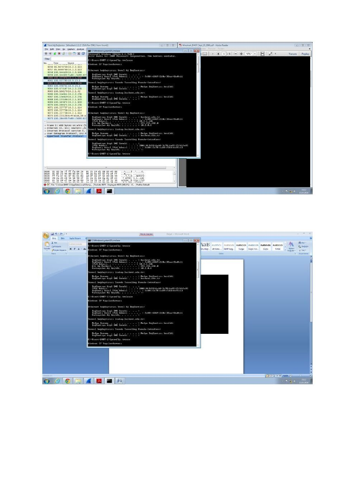

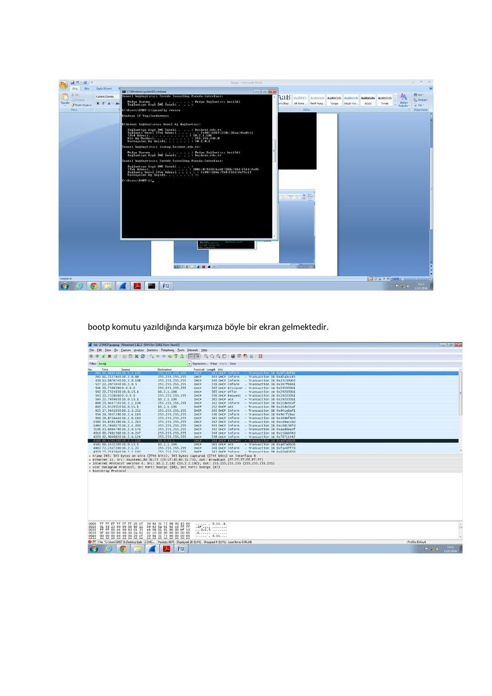

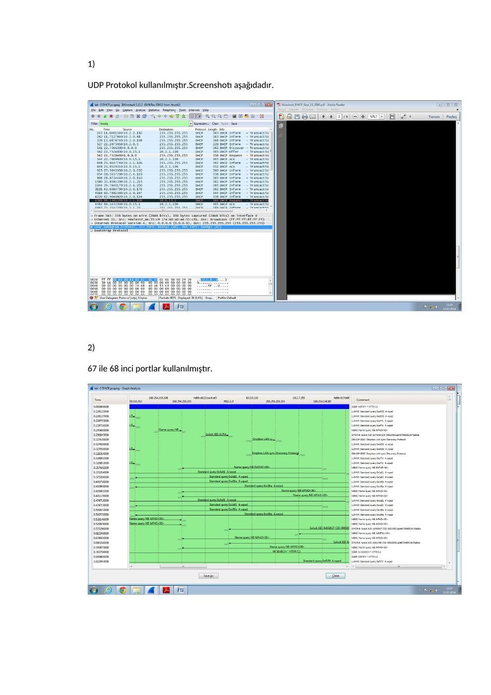

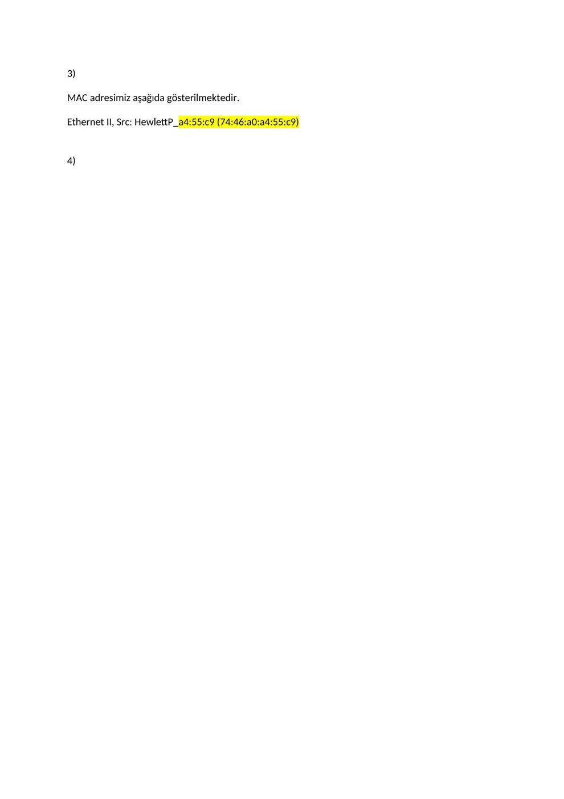

## DHCP Report A

Başkent University, Department of Electrical and Electronics Engineering

EEM 438

Bootp:

1- Since "User Datagram Protocol" is seen, the messages are carried over "UDP".

2- Port numbers 67 and 68 were used. Everyone sees the same port numbers.

3- My MAC address:

Ethernet II, Src: HewlettP_9e:76:4c (74:46:a0:9e:76:4c), Dst: Broadcast (ff:ff:ff:ff:ff:ff)

Figure-a

Figure-b

4- These are messages broadcast to the network; the only difference is the message types. Figure-a)

DHCP: Release

Figure-b) DHCP: Request

5- To prevent requests from getting mixed up, each request is given a code. In this way the request is understood by the server and does not get mixed up.

My Transaction ID, which is the same across all four messages: 0x2f972289

6- For DHCP Discover and Request, the destination address is 255.255.255.255 and the source address is 0.0.0.0.

For Offer and ACK, the real IP addresses are used.

7- My source address in the offer: 10.0.15.1

8- The IP address given to me is as follows. Your (client) IP address: 10.2.1.98 (10.2.1.98)

9- Relay agent IP address: 10.2.0.1 (10.2.0.1)

Since the server had no suitable IP address available in its own subnet, it means it assigned an IP address from the subnet of another server.

10- Option: (1) Subnet Mask: Tells which subnet mask is to be used.

Option: (3) Router: Tells what the default gateway should be.

11- In the experiment performed, the server shows that it accepted the IP address it offered.

12- The lease time is the period of time for which the server reserves the IP for me. The duration given to me:

IP Address Lease Time: (864000s) 10 days

13- We indicate that we are giving up the IP address that was assigned. The server does not respond to the release message. When the time expires, it is reset automatically and the assigned IP address changes.

14- When the filters are removed, the ARP messages that were sent become visible. The purpose of the ARP messages is to make sure that the assigned IP address is not being used by another computer.

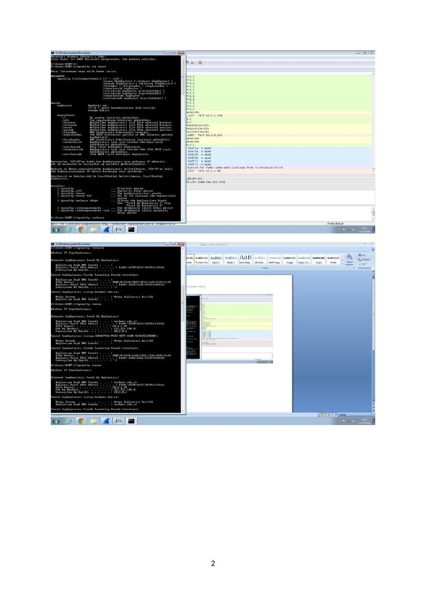

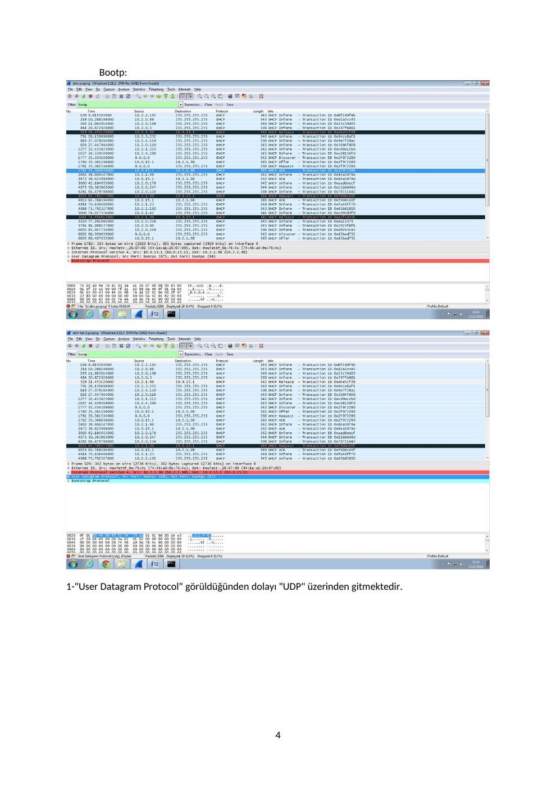

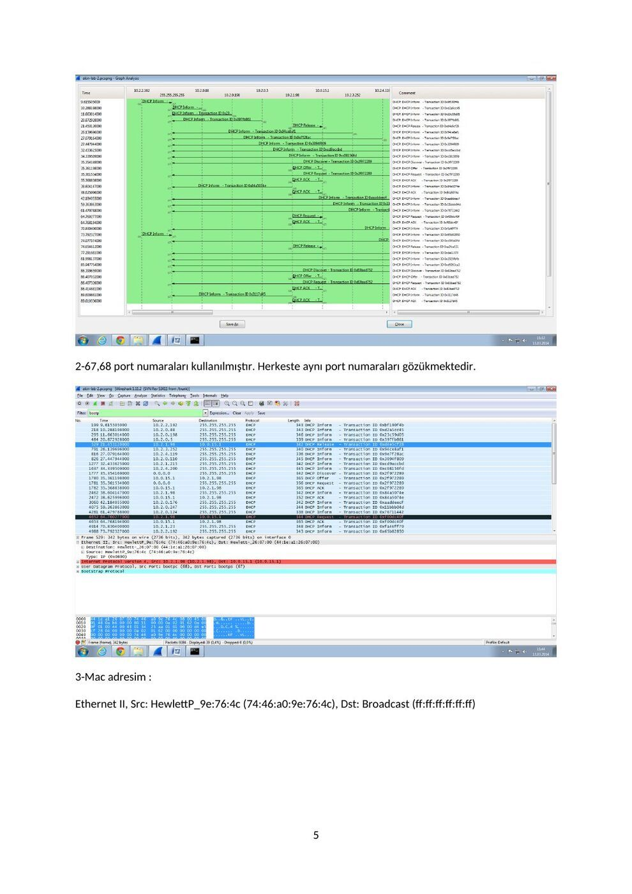

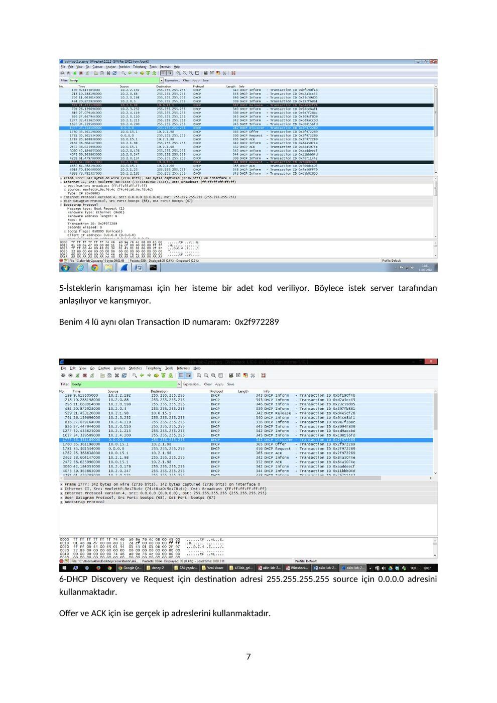

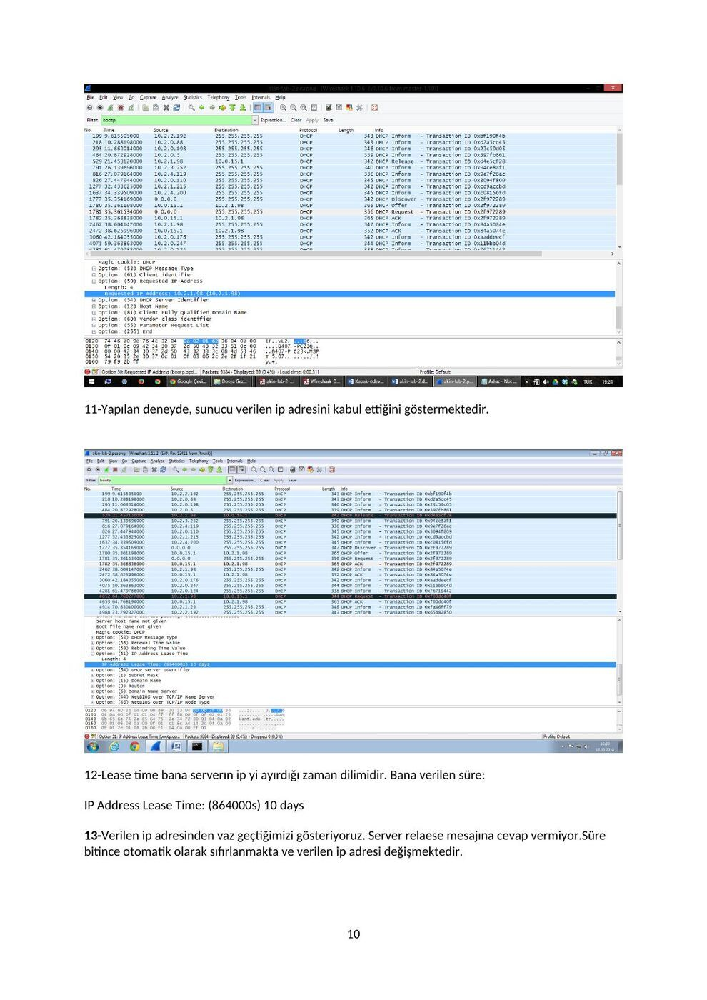

## DHCP Report B

Başkent University, Department of Electrical and Electronics Engineering

EEM 438

Experiment No: 2

Note: We carried out the operations requested at the beginning.

"bootp" was typed into the search field.

**1.** Are DHCP messages sent over UDP or TCP?

Since "User Datagram Protocol" is seen, the messages are carried over "UDP".

**2.** Draw a timing datagram illustrating the sequence of the first four-packet Discover/Offer/Request/ACK DHCP exchange between the client and server. For each packet, indicated the source and destination port numbers. Are the port numbers the same as in the example given in this lab assignment?

Port numbers 67 and 68 were used. Everyone sees the same port numbers.

**3.** What is the link-layer (e.g., Ethernet) address of your host?

My MAC address:

Ethernet II, Src: HewlettP_9e:76:4c (74:46:a0:9e:76:4c), Dst: Broadcast (ff:ff:ff:ff:ff:ff)

**4.** What values in the DHCP discover message differentiate this message from the DHCP request message?

Figure-a

Figure-b

These are messages broadcast to the network; the only difference is the message types.

Figure-a) DHCP: Release

Figure-b) DHCP: Request

**5.** What is the value of the Transaction-ID in each of the first four (Discover/Offer/Request/ACK) DHCP messages? What are the values of the Transaction-ID in the second set (Request/ACK) set of DHCP messages? What is the purpose of the Transaction-ID field?

To prevent requests from getting mixed up, each request is given a code. In this way the request is understood by the server and does not get mixed up.

My Transaction ID, which is the same across all four messages: 0x2f972289

**6.** A host uses DHCP to obtain an IP address, among other things. But a host’s IP address is not confirmed until the end of the four-message exchange! If the IP address is not set until the end of the four-message exchange, then what values are used in the IP datagrams in the four-message exchange? For each of the four DHCP messages (Discover/Offer/Request/ACK DHCP), indicate the source and destination IP addresses that are carried in the encapsulating IP datagram.

For DHCP Discover and Request, the destination address is 255.255.255.255 and the source address is 0.0.0.0.

For Offer and ACK, the real IP addresses are used.

**7.** What is the IP address of your DHCP server?

My source address in the offer: 10.0.15.1

**8.** What IP address is the DHCP server offering to your host in the DHCP Offer message? Indicate which DHCP message contains the offered DHCP address.

The IP address given to me is as follows.

Your (client) IP address: 10.2.1.98 (10.2.1.98)

**9.** In the example screenshot in this assignment, there is no relay agent between the host and the DHCP server. What values in the trace indicate the absence of a relay agent? Is there a relay agent in your experiment? If so what is the IP address of the agent?

Relay agent IP address: 10.2.0.1 (10.2.0.1)

Since the server had no suitable IP address available in its own subnet, it means it assigned an IP address from the subnet of another server.

**10.** Explain the purpose of the router and subnet mask lines in the DHCP offer message.

Option: (1) Subnet Mask: Tells which subnet mask is to be used.

Option: (3) Router: Tells what the default gateway should be.

**11.** In the example screenshots in this assignment, the host requests the offered IP address in the DHCP Request message. What happens in your own experiment?

In the experiment performed, the server shows that it accepted the IP address it offered.

**12.** Explain the purpose of the lease time. How long is the lease time in your experiment?

The lease time is the period of time for which the server reserves the IP for me. The duration given to me:

IP Address Lease Time: (864000s) 10 days

**13.** What is the purpose of the DHCP release message? Does the DHCP server issue an acknowledgment of receipt of the client’s DHCP request? What would happen if the client’s DHCP release message is lost? 14. Clear the bootp filter from your Wireshark window. Were any ARP packets sent or received during the DHCP packet-exchange period? If so, explain the purpose of those ARP packets.

We indicate that we are giving up the IP address that was assigned. The server does not respond to the release message.

When the time expires, it is reset automatically and the assigned IP address changes.

**14.** Clear the bootp filter from your Wireshark window. Were any ARP packets sent or received during the DHCP packet-exchange period? If so, explain the purpose of those ARP packets.

When the filters are removed, the ARP messages that were sent become visible. The purpose of the ARP messages is to make sure that the assigned IP address is not being used by another computer.

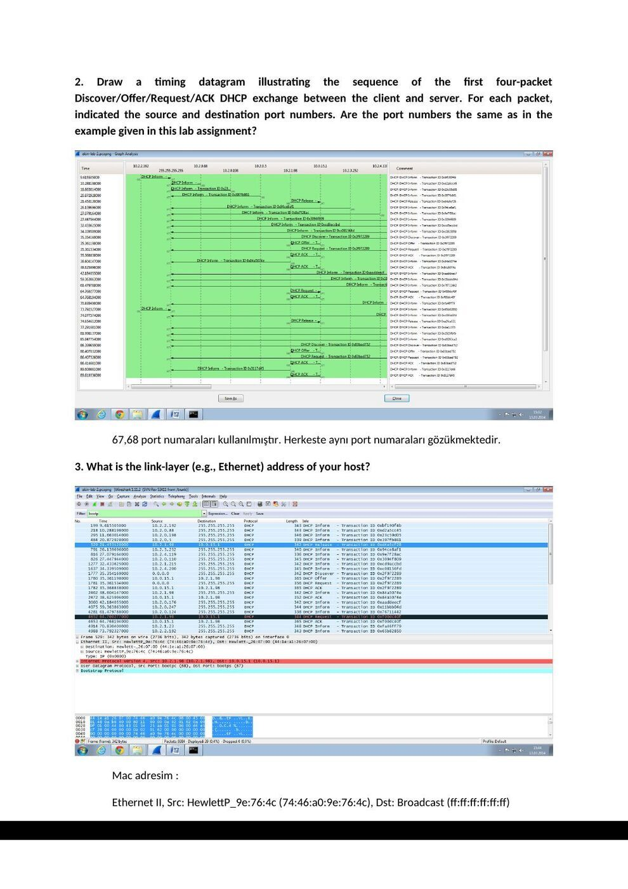

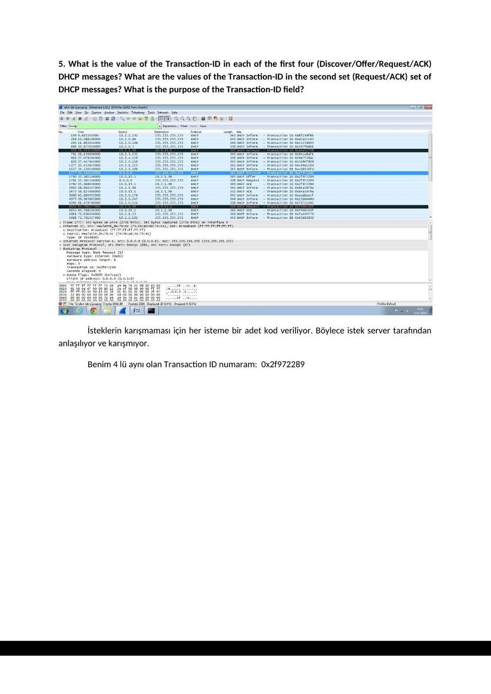

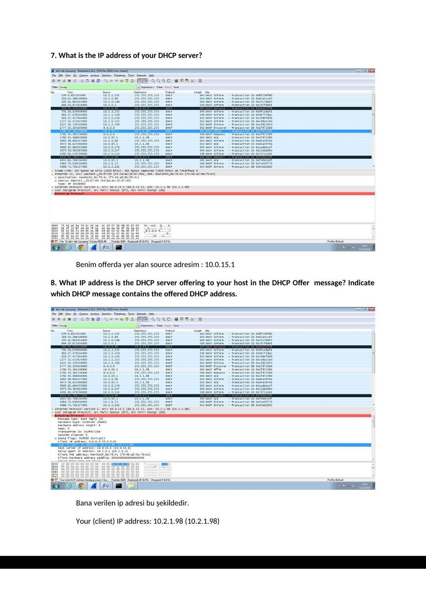

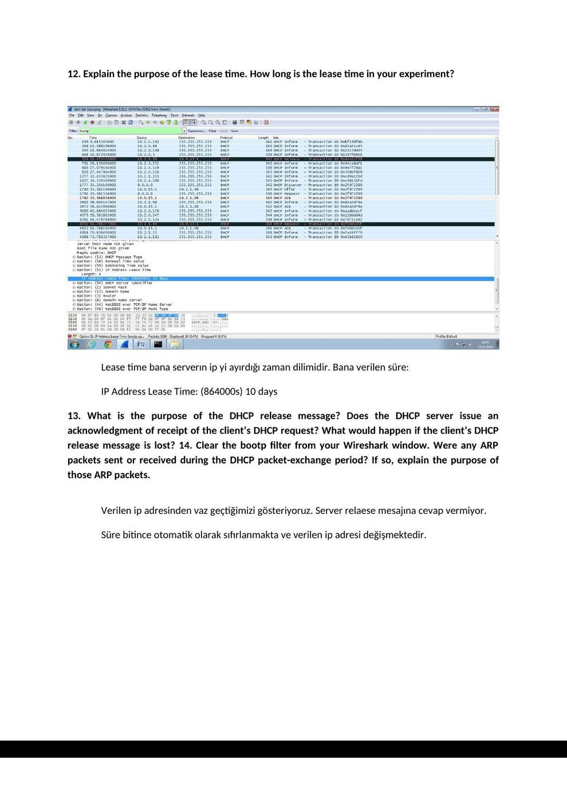

*Note: In some screenshots, the Release and Request labels were given in response to the Discover question. These are not the same message type. Missing/incorrect answers in the source have been preserved; 67 is the server and 68 is the client UDP port.*

*Note: Sections of a commercial book's lab handout that were open in the background of the screenshots have been covered in the archive copy; the student's experiment outputs have been preserved.*
