Ders arşivindeki öğrenci laboratuvar raporlarıdır; öğrenci adları, numaraları ve kimlik bilgileri çıkarılmıştır. Belge üzerindeki tarih bulunmadığında kaynak dosyanın oluşturulma ya da son değiştirilme tarihi kullanılmıştır. Belgelerin arşiv için hazırlanmış PDF kopyaları yazının sonunda indirilebilir.

## DHCP ekran görüntülü rapor

 bootp komutu yazıldığında karşımıza böyle bir ekran gelmektedir.

**1.** 

UDP Protokol kullanılmıştır.Screenshotı aşağıdadır.

**2.** 

67 ile 68 inci portlar kullanılmıştır.

**3.** 

MAC adresimiz aşağıda gösterilmektedir.

Ethernet II, Src: HewlettP_a4:55:c9 (74:46:a0:a4:55:c9)

**4.** 

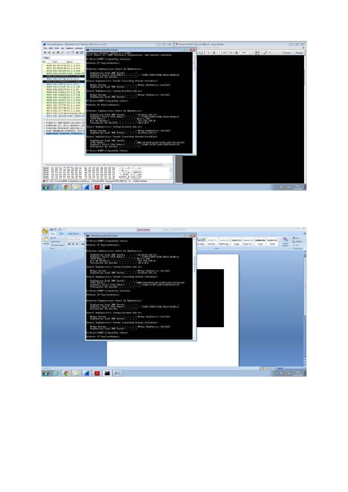

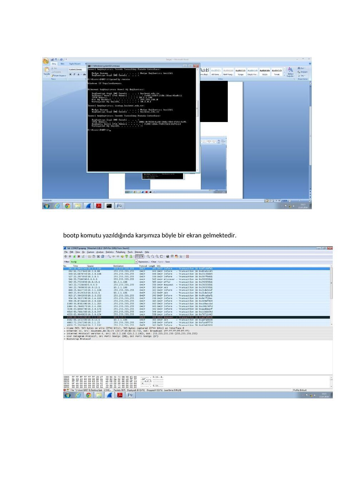

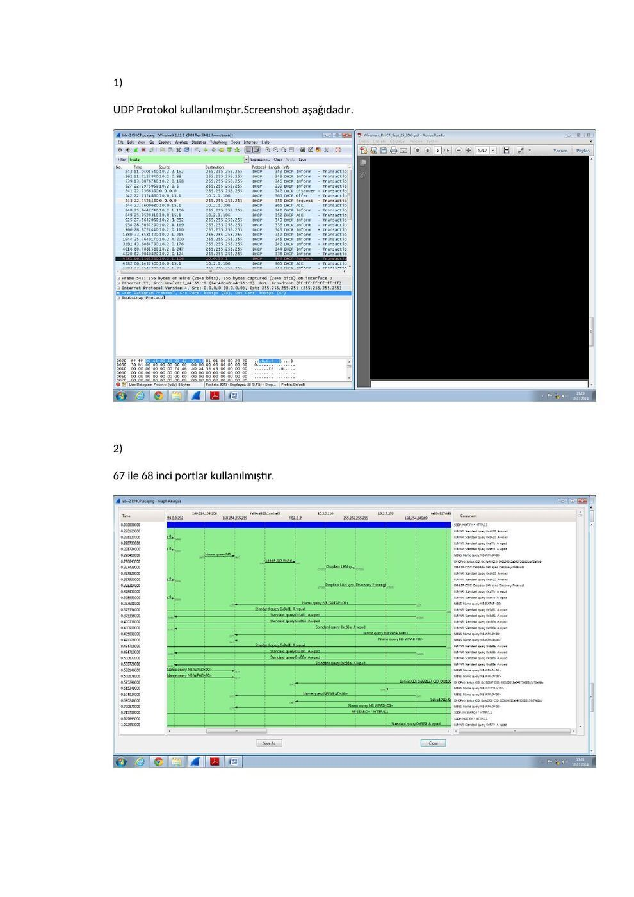

## DHCP raporu A

Başkent Üniversitesi Elektrik - Elektronik Mühendisliği Bölümü

EEM 438

Bootp:

1-"User Datagram Protocol" görüldüğünden dolayı "UDP" üzerinden gitmektedir.

2-67,68 port numaraları kullanılmıştır. Herkeste aynı port numaraları gözükmektedir.

3-Mac adresim :

Ethernet II, Src: HewlettP_9e:76:4c (74:46:a0:9e:76:4c), Dst: Broadcast (ff:ff:ff:ff:ff:ff)

Şekil-a

Şekil-b

4-Bunlar broadcast olarak yayınlanan mesajlardır farklı olarak tek fark mesaj tipleridir. Şekil-a)

DHCP:Relese

Şekil-b) DHCP: Request

5-İsteklerin karışmaması için her isteme bir adet kod veriliyor. Böylece istek server tarafından anlaşılıyor ve karışmıyor.

Benim 4 lü aynı olan Transaction ID numaram: 0x2f972289

6-DHCP Discovery ve Request için destination adresi 255.255.255.255 source için 0.0.0.0 adresini kullanmaktadır.

Offer ve ACK için ise gerçek ip adreslerini kullanmaktadır.

7-Benim offerda yer alan source adresim : 10.0.15.1

8-Bana verilen ip adresi bu şekildedir. Your (client) IP address: 10.2.1.98 (10.2.1.98)

9-Relay agent IP address: 10.2.0.1 (10.2.0.1)

Serverın içinde subnet' te uygun ip bulunmadığından başka bir sunucunun subnetinden ip adresi vermiş demektir.

10-Option: (1) Subnet Mask : Hangi “subnet mask”ın kullanılacağını söyler.

Option: (3) Router: Varsayılan ağ geçidinin ne olması gerektiğini söyler.

11-Yapılan deneyde, sunucu verilen ip adresini kabul ettiğini göstermektedir.

12-Lease time bana serverın ip yi ayırdığı zaman dilimidir. Bana verilen süre:

IP Address Lease Time: (864000s) 10 days

13-Verilen ip adresinden vaz geçtiğimizi gösteriyoruz. Server relaese mesajına cevap vermiyor.Süre bitince otomatik olarak sıfırlanmakta ve verilen ip adresi değişmektedir.

14-Filtreleri kaldırınca verilen arp mesajları gözüküyor. ARP mesajlarının amacı verilen ip adresinin başka bilgisayar tarafından kullanılmadığına emin olmaktır.

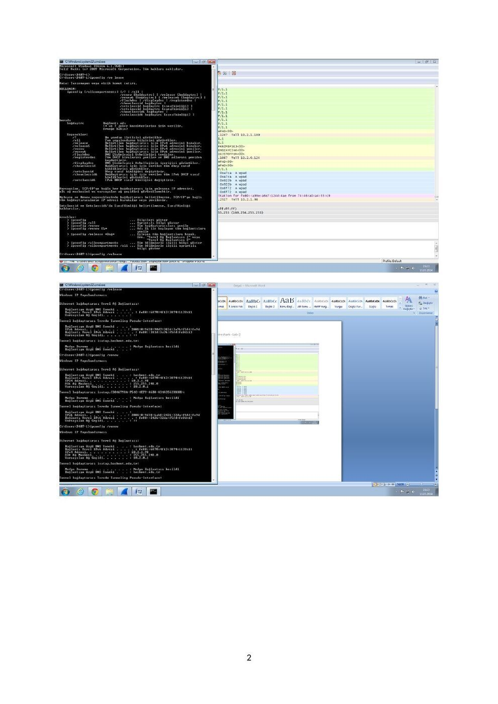

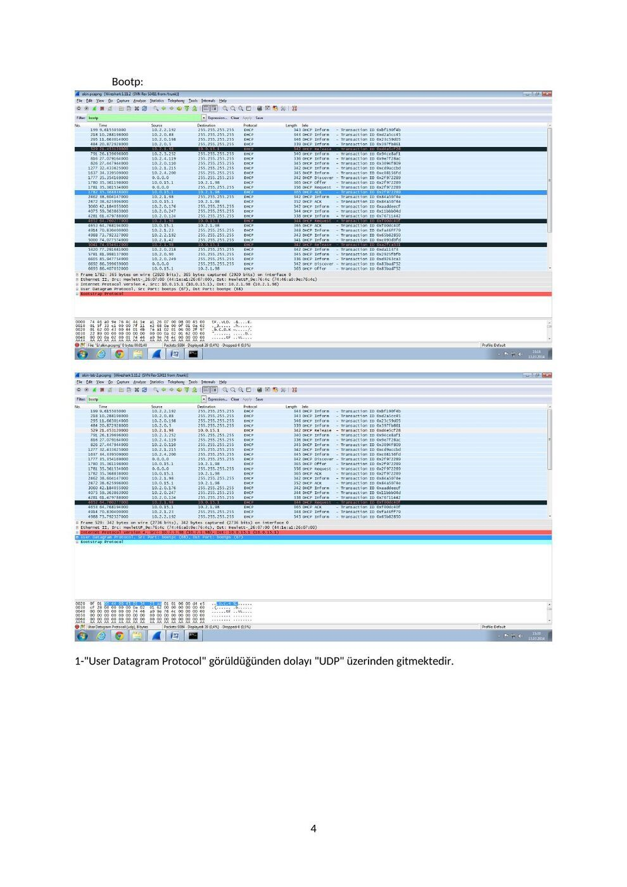

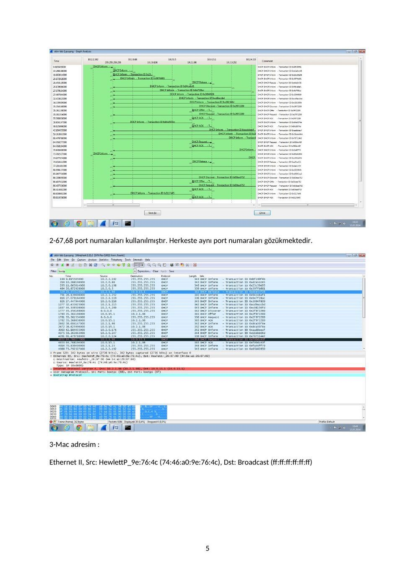

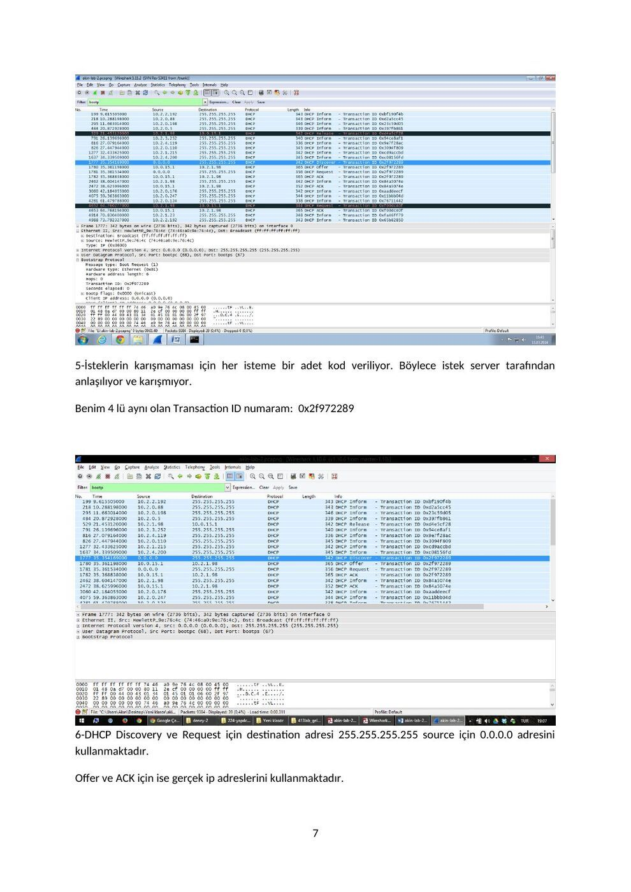

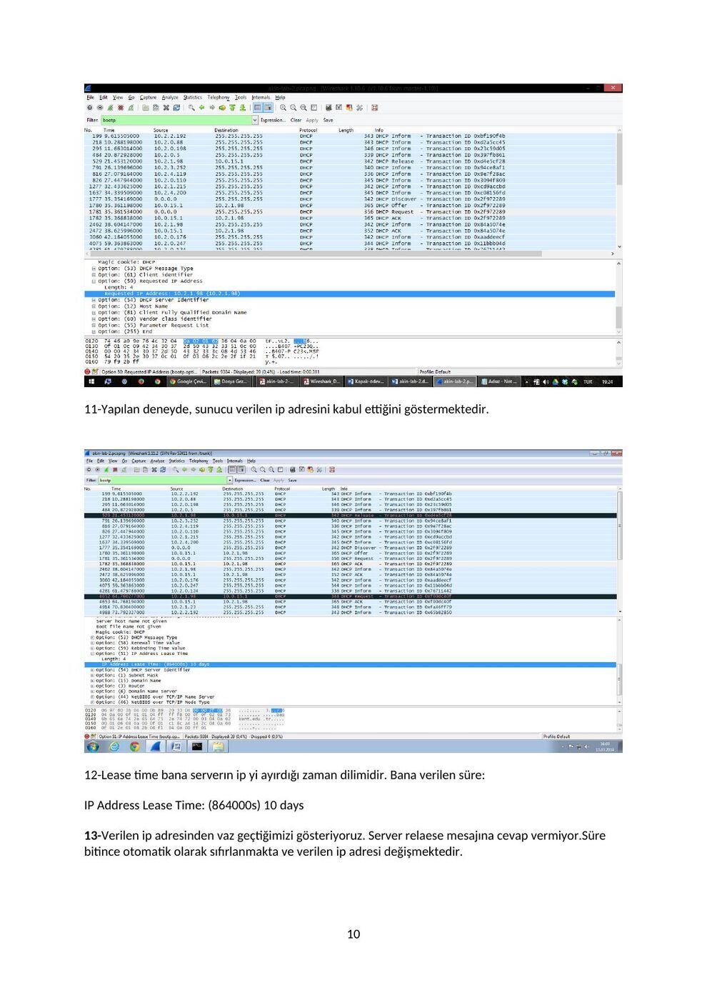

## DHCP raporu B

Başkent Üniversitesi Elektrik - Elektronik Mühendisliği Bölümü

EEM 438

Deney No: 2

NOt: Başlangıçta yapmamız istenen işlemleri gerçekleştirdik.

Arama kısmına "bootp" yazıldı.

**1.** Are DHCP messages sent over UDP or TCP?

"User Datagram Protocol" görüldüğünden dolayı "UDP" üzerinden gitmektedir.

**2.** Draw a timing datagram illustrating the sequence of the first four-packet Discover/Offer/Request/ACK DHCP exchange between the client and server. For each packet, indicated the source and destination port numbers. Are the port numbers the same as in the example given in this lab assignment?

67,68 port numaraları kullanılmıştır. Herkeste aynı port numaraları gözükmektedir.

**3.** What is the link-layer (e.g., Ethernet) address of your host?

Mac adresim :

Ethernet II, Src: HewlettP_9e:76:4c (74:46:a0:9e:76:4c), Dst: Broadcast (ff:ff:ff:ff:ff:ff)

**4.** What values in the DHCP discover message differentiate this message from the DHCP request message?

Şekil-a

Şekil-b

Bunlar broadcast olarak yayınlanan mesajlardır farklı olarak tek fark mesaj tipleridir.

Şekil-a) DHCP:Relese

Şekil-b) DHCP: Request

**5.** What is the value of the Transaction-ID in each of the first four (Discover/Offer/Request/ACK) DHCP messages? What are the values of the Transaction-ID in the second set (Request/ACK) set of DHCP messages? What is the purpose of the Transaction-ID field?

İsteklerin karışmaması için her isteme bir adet kod veriliyor. Böylece istek server tarafından anlaşılıyor ve karışmıyor.

Benim 4 lü aynı olan Transaction ID numaram: 0x2f972289

**6.** A host uses DHCP to obtain an IP address, among other things. But a host’s IP address is not confirmed until the end of the four-message exchange! If the IP address is not set until the end of the four-message exchange, then what values are used in the IP datagrams in the four-message exchange? For each of the four DHCP messages (Discover/Offer/Request/ACK DHCP), indicate the source and destination IP addresses that are carried in the encapsulating IP datagram.

DHCP Discovery ve Request için destination adresi 255.255.255.255 source için 0.0.0.0 adresini kullanmaktadır.

Offer ve ACK için ise gerçek ip adreslerini kullanmaktadır.

**7.** What is the IP address of your DHCP server?

Benim offerda yer alan source adresim : 10.0.15.1

**8.** What IP address is the DHCP server offering to your host in the DHCP Offer message? Indicate which DHCP message contains the offered DHCP address.

Bana verilen ip adresi bu şekildedir.

Your (client) IP address: 10.2.1.98 (10.2.1.98)

**9.** In the example screenshot in this assignment, there is no relay agent between the host and the DHCP server. What values in the trace indicate the absence of a relay agent? Is there a relay agent in your experiment? If so what is the IP address of the agent?

Relay agent IP address: 10.2.0.1 (10.2.0.1)

Serverın içinde subnet' te uygun ip bulunmadığından başka bir sunucunun subnetinden ip adresi vermiş demektir.

**10.** Explain the purpose of the router and subnet mask lines in the DHCP offer message.

Option: (1) Subnet Mask : Hangi “subnet mask”ın kullanılacağını söyler.

Option: (3) Router: Varsayılan ağ geçidinin ne olması gerektiğini söyler.

**11.** In the example screenshots in this assignment, the host requests the offered IP address in the DHCP Request message. What happens in your own experiment?

Yapılan deneyde, sunucu verilen ip adresini kabul ettiğini göstermektedir.

**12.** Explain the purpose of the lease time. How long is the lease time in your experiment?

Lease time bana serverın ip yi ayırdığı zaman dilimidir. Bana verilen süre:

IP Address Lease Time: (864000s) 10 days

**13.** What is the purpose of the DHCP release message? Does the DHCP server issue an acknowledgment of receipt of the client’s DHCP request? What would happen if the client’s DHCP release message is lost? 14. Clear the bootp filter from your Wireshark window. Were any ARP packets sent or received during the DHCP packet-exchange period? If so, explain the purpose of those ARP packets.

Verilen ip adresinden vaz geçtiğimizi gösteriyoruz. Server relaese mesajına cevap vermiyor.

Süre bitince otomatik olarak sıfırlanmakta ve verilen ip adresi değişmektedir.

**14.** Clear the bootp filter from your Wireshark window. Were any ARP packets sent or received during the DHCP packet-exchange period? If so, explain the purpose of those ARP packets.

Filtreleri kaldırınca verilen arp mesajları gözüküyor. ARP mesajlarının amacı verilen ip adresinin başka bilgisayar tarafından kullanılmadığına emin olmaktır.

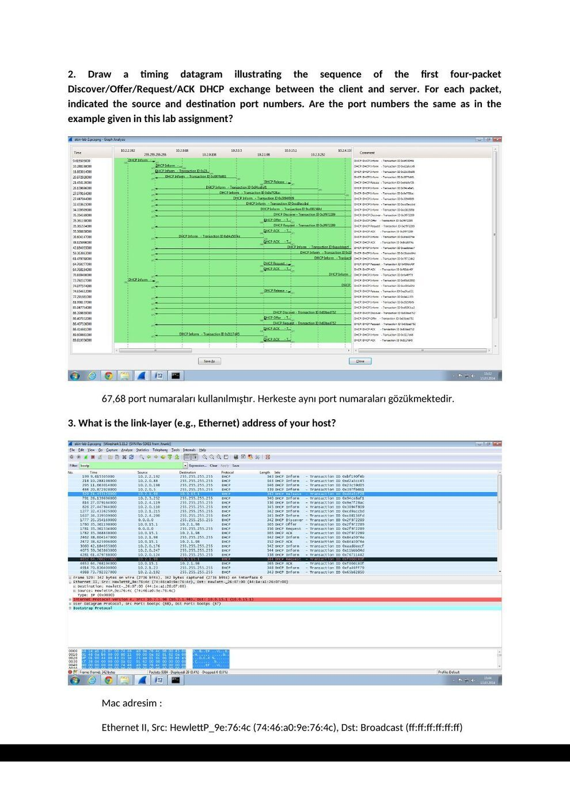

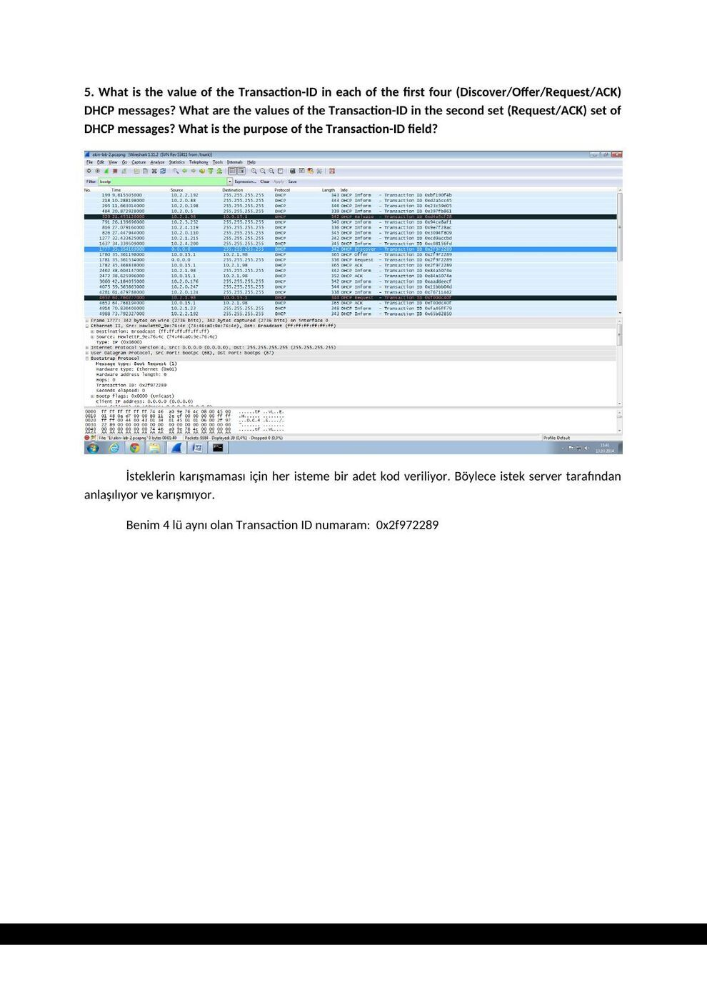

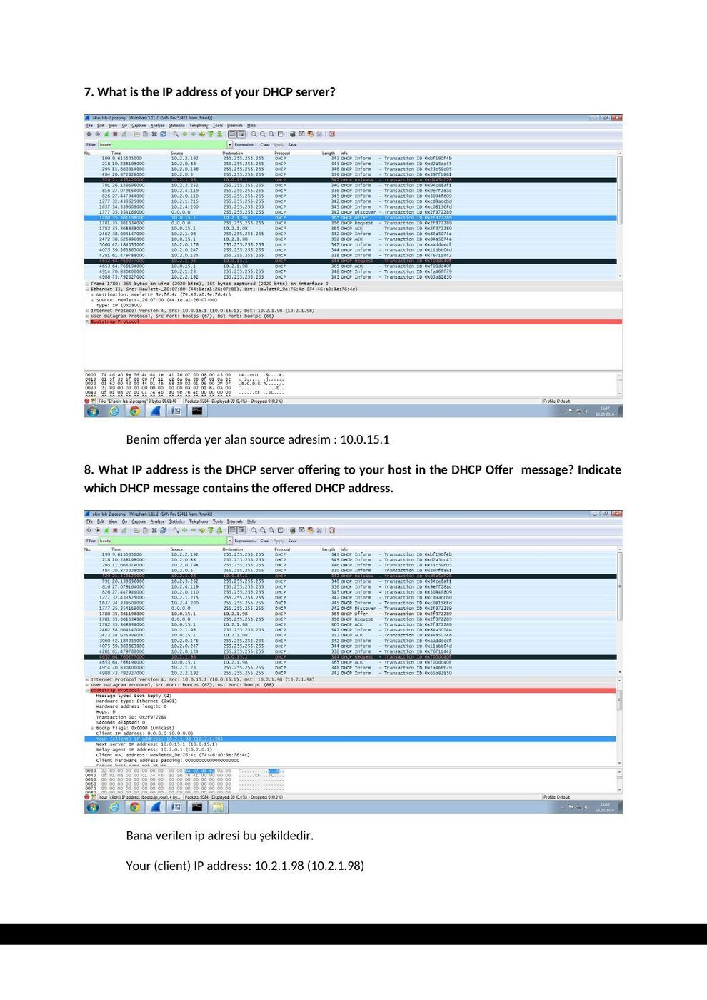

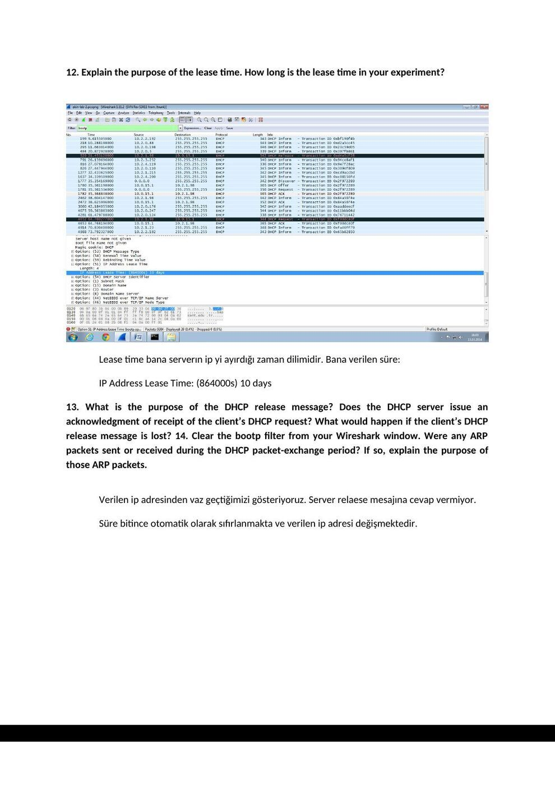

*Not: Bazı ekran görüntülerindeki Release ve Request etiketleri, Discover sorusuna karşılık verilmiştir. Bunlar aynı mesaj türü değildir. Kaynaktaki eksik/yanlış cevaplar korunmuştur; 67 sunucu, 68 istemci UDP portudur.*

*Not: Ekran görüntülerinin arka planında açık duran ticari kitap laboratuvar föyü bölümleri arşiv kopyasında kapatıldı; öğrencinin deney çıktıları korundu.*
