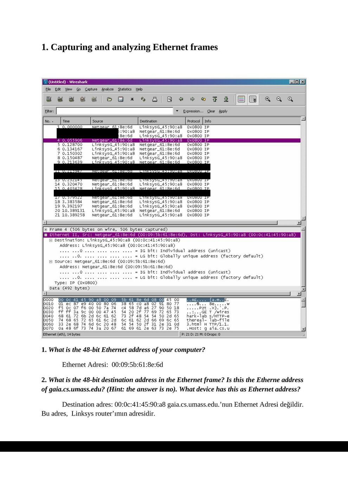
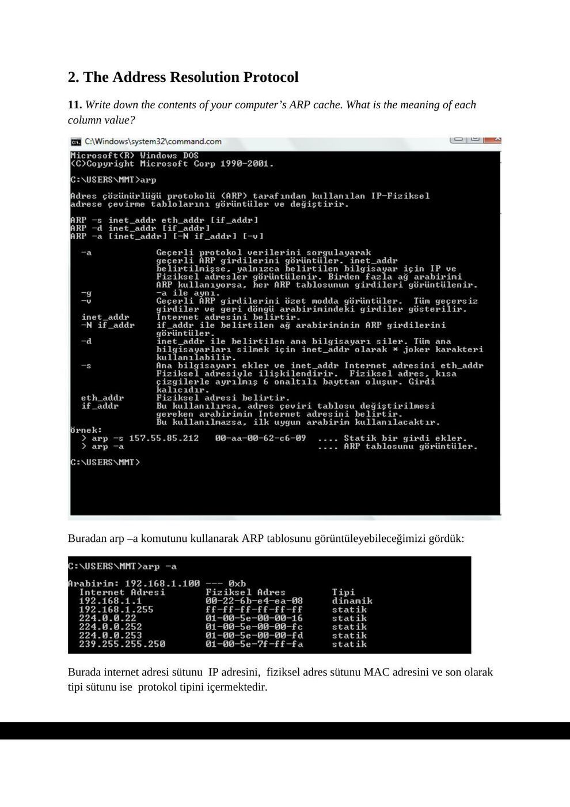
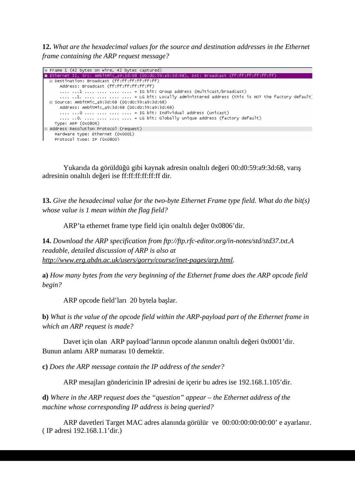
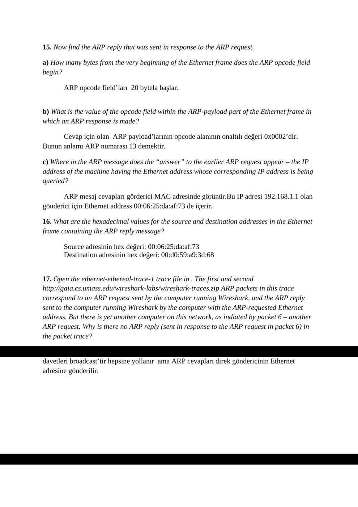

These are student laboratory reports from the course archive; student names, numbers and identity information have been removed. When a document carries no date, the creation or last-modified date of the source file has been used. PDF copies of the documents prepared for the archive can be downloaded at the end of the post.

## Ethernet and ARP report

Başkent University, Department of Electrical and Electronics Engineering

EEM 438

Experiment No: 5

**1.** Capturing and analyzing Ethernet frames

**1.** What is the 48-bit Ethernet address of your computer?

Ethernet Address: 00:09:5b:61:8e:6d

**2.** What is the 48-bit destination address in the Ethernet frame? Is this the Etherne address of gaia.cs.umass.edu? (Hint: the answer is no). What device has this as Ethernet address?

Destination address: 00:0c:41:45:90:a8. It is not the Ethernet address of gaia.cs.umass.edu. This address belongs to my Linksys router.

**3.** Give the hexadecimal value for the two-byte Frame type field. What do the bit(s) whose value is 1 mean within the flag field?

The hexadecimal value of the two-byte Frame type field is 0x0800.

**4.** How many bytes from the very start of the Ethernet frame does the ASCII “G” in “GET” appear in the Ethernet frame?

The ASCII “G” appears 52 bytes from the start of the Ethernet frame. This consists of the 14-byte Ethernet frame header, the 20-byte IP header, and the 20-byte TCP header.

**5.** What is the hexadecimal value of the CRC field in this Ethernet frame?

The hexadecimal value of the CRC field in the Ethernet frame is 0x0d0a0d0a.

**6.** What is the value of the Ethernet source address? Is this the address of your computer, or of gaia.cs.umass.edu (Hint: the answer is no). What device has this as its Ethernet address?

Destination address: 00:0c:41:45:90:a8. It is not the Ethernet address of gaia.cs.umass.edu. This address belongs to my Linksys router.

**7.** What is the destination address in the Ethernet frame? Is this the Ethernet address of your computer?

The destination address of the Ethernet frame is 00:09:5b:61:8e:6d. This is also the address of my computer.

**8.** Give the hexadecimal value for the two-byte Frame type field. What do the bit(s) whose value is 1 mean within the flag field?

The hexadecimal value of the Frame type field is 0x0800.

**9.** How many bytes from the very start of the Ethernet frame does the ASCII “O” in “OK” (i.e., the HTTP response code) appear in the Ethernet frame?

The ASCII “O” is at the same position as the ASCII “G”. That is, it appears 52 bytes from the start of the Ethernet frame. This consists of the 14-byte Ethernet frame header, the 20-byte IP header, and the 20-byte TCP header.

**10.** What is the hexadecimal value of the CRC field in this Ethernet frame?

The hexadecimal value of the CRC field in the Ethernet frame is 0x0d0a0d0a.

**2.** The Address Resolution Protocol

**11.** Write down the contents of your computer’s ARP cache. What is the meaning of each column value?

Here we saw that the ARP table can be displayed using the arp –a command:

Here, the Internet Address column contains the IP address, the Physical Address column contains the MAC address, and finally the Type column contains the protocol type.

**12.** What are the hexadecimal values for the source and destination addresses in the Ethernet frame containing the ARP request message?

As seen above, the hexadecimal value of the source address is 00:d0:59:a9:3d:68, and the hexadecimal value of the destination address is ff:ff:ff:ff:ff:ff.

**13.** Give the hexadecimal value for the two-byte Ethernet Frame type field. What do the bit(s) whose value is 1 mean within the flag field?

For ARP, the hexadecimal value of the Ethernet frame type field is 0x0806.

**14.** Download the ARP specification from ftp://ftp.rfc-editor.org/in-notes/std/std37.txt.A readable, detailed discussion of ARP is also at http://www.erg.abdn.ac.uk/users/gorry/course/inet-pages/arp.html.

a) How many bytes from the very beginning of the Ethernet frame does the ARP opcode field begin?

The ARP opcode field begins at byte 20.

b) What is the value of the opcode field within the ARP-payload part of the Ethernet frame in which an ARP request is made?

The hexadecimal value of the opcode field of the ARP payload for a request is 0x0001. This means ARP number 10.

c) Does the ARP message contain the IP address of the sender?

ARP messages also contain the sender's IP address, which is 192.168.1.105.

d) Where in the ARP request does the “question” appear – the Ethernet address of the machine whose corresponding IP address is being queried?

ARP requests appear in the Target MAC address field, which is set to 00:00:00:00:00:00. (The IP address is 192.168.1.1.)

**15.** Now find the ARP reply that was sent in response to the ARP request.

a) How many bytes from the very beginning of the Ethernet frame does the ARP opcode field begin?

The ARP opcode field begins at byte 20.

b) What is the value of the opcode field within the ARP-payload part of the Ethernet frame in which an ARP response is made?

The hexadecimal value of the opcode field of the ARP payload for a reply is 0x0002. This means ARP number 13.

c) Where in the ARP message does the “answer” to the earlier ARP request appear – the IP address of the machine having the Ethernet address whose corresponding IP address is being queried?

The answer in an ARP reply message appears in the sender MAC address field. It contains the Ethernet address 00:06:25:da:af:73 of the sender whose IP address is 192.168.1.1.

**16.** What are the hexadecimal values for the source and destination addresses in the Ethernet frame containing the ARP reply message?

Hex value of the source address: 00:06:25:da:af:73. Hex value of the destination address: 00:d0:59:a9:3d:68.

**17.** Open the ethernet-ethereal-trace-1 trace file in . The first and second http://gaia.cs.umass.edu/wireshark-labs/wireshark-traces.zip ARP packets in this trace correspond to an ARP request sent by the computer running Wireshark, and the ARP reply sent to the computer running Wireshark by the computer with the ARP-requested Ethernet address. But there is yet another computer on this network, as indiated by packet 6 – another ARP request. Why is there no ARP reply (sent in response to the ARP request in packet 6) in the packet trace?

There is no reply at all in this trace, because we are not on the machine that sent the request. ARP requests are broadcast and are sent to everyone, but ARP replies are sent directly to the Ethernet address of the sender.

*Note: A 14-byte Ethernet header + 20-byte IPv4 header + 20-byte TCP header comes to 54 bytes; the 52-byte total in the report is inconsistent with these values. The final bytes seen in the capture are not evidence that they are the FCS/CRC; the network card may not pass the FCS to the capture.*
