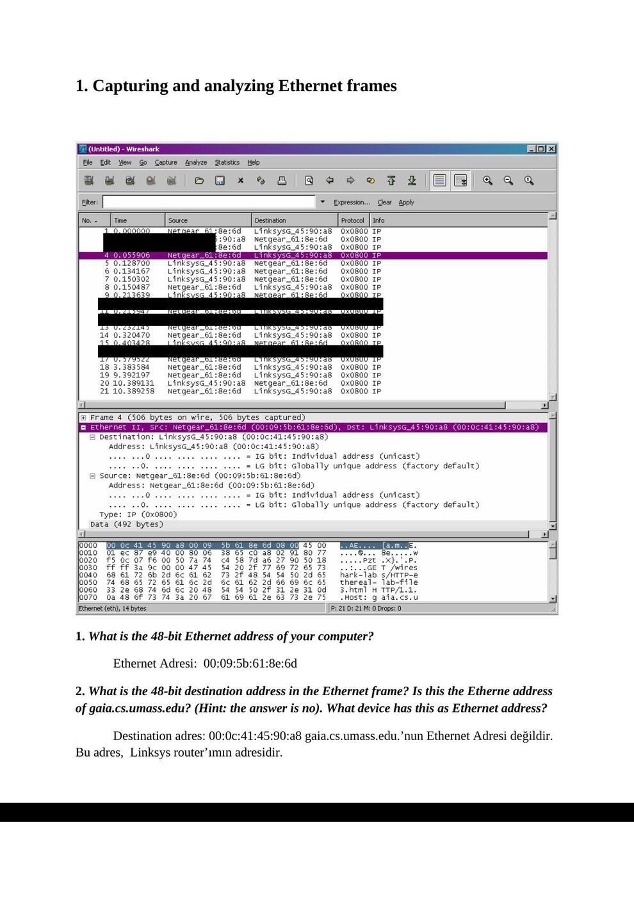
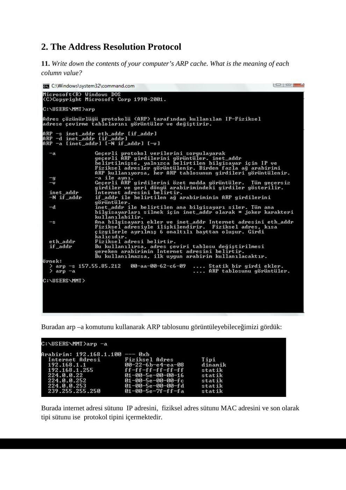
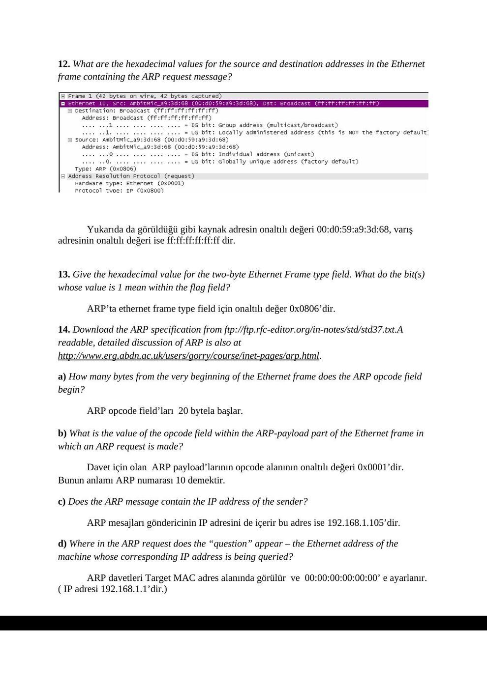
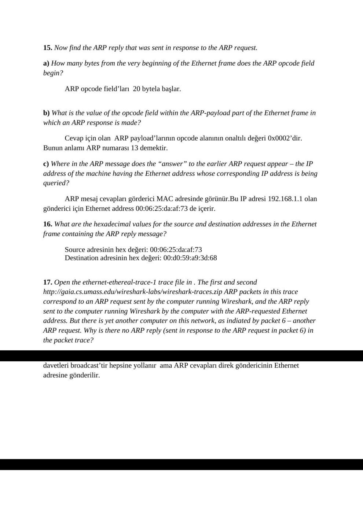

Ders arşivindeki öğrenci laboratuvar raporlarıdır; öğrenci adları, numaraları ve kimlik bilgileri çıkarılmıştır. Belge üzerindeki tarih bulunmadığında kaynak dosyanın oluşturulma ya da son değiştirilme tarihi kullanılmıştır. Belgelerin arşiv için hazırlanmış PDF kopyaları yazının sonunda indirilebilir.

## Ethernet ve ARP raporu

Başkent Üniversitesi Elektrik - Elektronik Mühendisliği Bölümü

EEM 438

Deney No: 5

**1.** Capturing and analyzing Ethernet frames

**1.** What is the 48-bit Ethernet address of your computer?

Ethernet Adresi: 00:09:5b:61:8e:6d

**2.** What is the 48-bit destination address in the Ethernet frame? Is this the Etherne address of gaia.cs.umass.edu? (Hint: the answer is no). What device has this as Ethernet address?

Destination adres: 00:0c:41:45:90:a8 gaia.cs.umass.edu.’nun Ethernet Adresi değildir. Bu adres, Linksys router’ımın adresidir.

**3.** Give the hexadecimal value for the two-byte Frame type field. What do the bit(s) whose value is 1 mean within the flag field?

Two – byte Frame type field’in hexadecimal değeri 0x0800’ dir.

**4.** How many bytes from the very start of the Ethernet frame does the ASCII “G” in “GET” appear in the Ethernet frame?

ASCII “G”, ethernet frame’in başından itibaren 52 byte olarak görülmektedir. 14byte Ethernet frame, 20 byte IP header, 20 byte TCP header’dır.

**5.** What is the hexadecimal value of the CRC field in this Ethernet frame?

Ethernet frame’indeki CRC field’in hexadecimal karşılığı 0x0d0a0d0a.

**6.** What is the value of the Ethernet source address? Is this the address of your computer, or of gaia.cs.umass.edu (Hint: the answer is no). What device has this as its Ethernet address?

Destination adres: 00:0c:41:45:90:a8 gaia.cs.umass.edu.’nun Ethernet Adresi değildir. Bu adres, Linksys router’ımın adresidir.

**7.** What is the destination address in the Ethernet frame? Is this the Ethernet address of your computer?

Ethernet frame’in destination adresi 00:09:5b:61:8e:6d. Bu adres aynı zamanda benim bilgisayarımın adresi.

**8.** Give the hexadecimal value for the two-byte Frame type field. What do the bit(s) whose value is 1 mean within the flag field?

Frame type field’ın hexadecimal değeri 0x0800’dir.

**9.** How many bytes from the very start of the Ethernet frame does the ASCII “O” in “OK” (i.e., the HTTP response code) appear in the Ethernet frame?

ASCII “O” da ASCII “G” ile aynıdır. Yani; ethernet frame’in başından itibaren 52 byte olarak görülmektedir. 14byte Ethernet frame, 20 byte IP header, 20 byte TCP header’dır.

**10.** What is the hexadecimal value of the CRC field in this Ethernet frame?

Ethernet frame’indeki CRC field’in hexadecimal karşılığı 0x0d0a0d0a.

**2.** The Address Resolution Protocol

**11.** Write down the contents of your computer’s ARP cache. What is the meaning of each column value?

Buradan arp –a komutunu kullanarak ARP tablosunu görüntüleyebileceğimizi gördük:

Burada internet adresi sütunu IP adresini, fiziksel adres sütunu MAC adresini ve son olarak tipi sütunu ise protokol tipini içermektedir.

**12.** What are the hexadecimal values for the source and destination addresses in the Ethernet frame containing the ARP request message?

Yukarıda da görüldüğü gibi kaynak adresin onaltılı değeri 00:d0:59:a9:3d:68, varış adresinin onaltılı değeri ise ff:ff:ff:ff:ff:ff dir.

**13.** Give the hexadecimal value for the two-byte Ethernet Frame type field. What do the bit(s) whose value is 1 mean within the flag field?

ARP’ta ethernet frame type field için onaltılı değer 0x0806’dir.

**14.** Download the ARP specification from ftp://ftp.rfc-editor.org/in-notes/std/std37.txt.A readable, detailed discussion of ARP is also at http://www.erg.abdn.ac.uk/users/gorry/course/inet-pages/arp.html.

a) How many bytes from the very beginning of the Ethernet frame does the ARP opcode field begin?

ARP opcode field’ları 20 bytela başlar.

b) What is the value of the opcode field within the ARP-payload part of the Ethernet frame in which an ARP request is made?

Davet için olan ARP payload’larının opcode alanının onaltılı değeri 0x0001’dir. Bunun anlamı ARP numarası 10 demektir.

c) Does the ARP message contain the IP address of the sender?

ARP mesajları göndericinin IP adresini de içerir bu adres ise 192.168.1.105’dir.

d) Where in the ARP request does the “question” appear – the Ethernet address of the machine whose corresponding IP address is being queried?

ARP davetleri Target MAC adres alanında görülür ve 00:00:00:00:00:00’ e ayarlanır. ( IP adresi 192.168.1.1’dir.)

**15.** Now find the ARP reply that was sent in response to the ARP request.

a) How many bytes from the very beginning of the Ethernet frame does the ARP opcode field begin?

ARP opcode field’ları 20 bytela başlar.

b) What is the value of the opcode field within the ARP-payload part of the Ethernet frame in which an ARP response is made?

Cevap için olan ARP payload’larının opcode alanının onaltılı değeri 0x0002’dir. Bunun anlamı ARP numarası 13 demektir.

c) Where in the ARP message does the “answer” to the earlier ARP request appear – the IP address of the machine having the Ethernet address whose corresponding IP address is being queried?

ARP mesaj cevapları görderici MAC adresinde görünür.Bu IP adresi 192.168.1.1 olan gönderici için Ethernet address 00:06:25:da:af:73 de içerir.

**16.** What are the hexadecimal values for the source and destination addresses in the Ethernet frame containing the ARP reply message?

Source adresinin hex değeri: 00:06:25:da:af:73 Destination adresinin hex değeri: 00:d0:59:a9:3d:68

**17.** Open the ethernet-ethereal-trace-1 trace file in . The first and second http://gaia.cs.umass.edu/wireshark-labs/wireshark-traces.zip ARP packets in this trace correspond to an ARP request sent by the computer running Wireshark, and the ARP reply sent to the computer running Wireshark by the computer with the ARP-requested Ethernet address. But there is yet another computer on this network, as indiated by packet 6 – another ARP request. Why is there no ARP reply (sent in response to the ARP request in packet 6) in the packet trace?

Bu trace için hiç cevap yoktur. Çünkü davet gönderen makinede değiliz. ARP davetleri broadcast’tir hepsine yollanır ama ARP cevapları direk göndericinin Ethernet adresine gönderilir.

*Not: 14 bayt Ethernet + 20 bayt IPv4 + 20 bayt TCP başlığı 54 bayttır; rapordaki 52 bayt toplamı bu değerlerle tutarsızdır. Yakalamada görülen son baytlar FCS/CRC olduğunun kanıtı değildir; ağ kartı FCS’yi yakalamaya vermeyebilir.*

