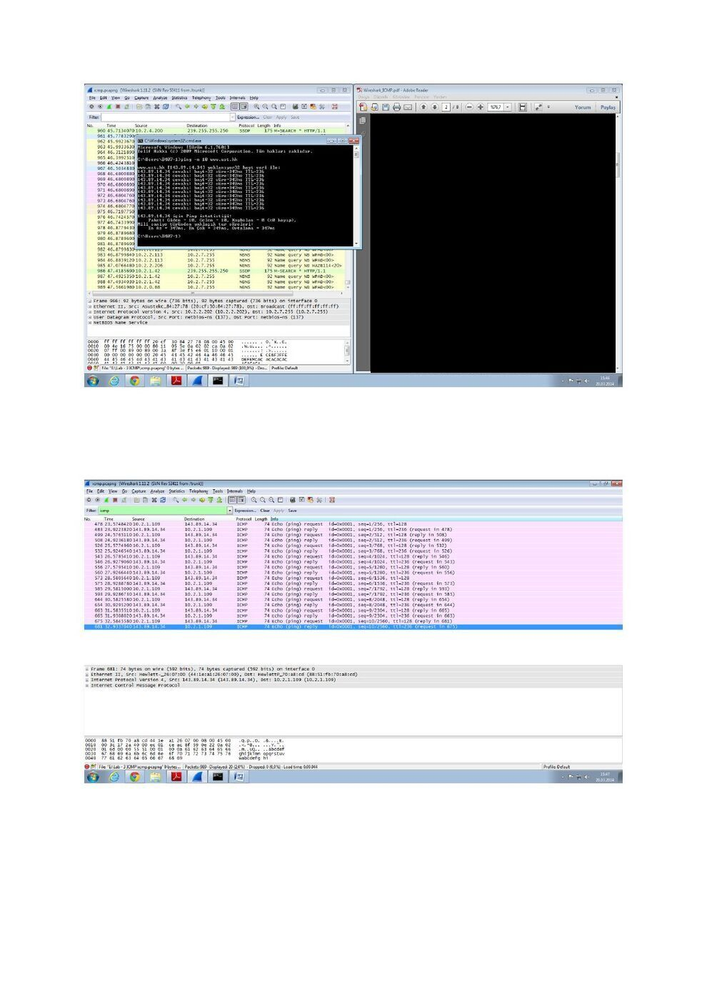
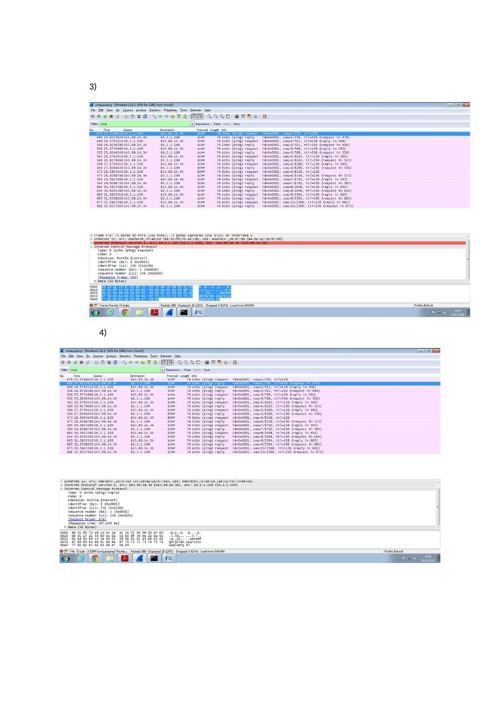
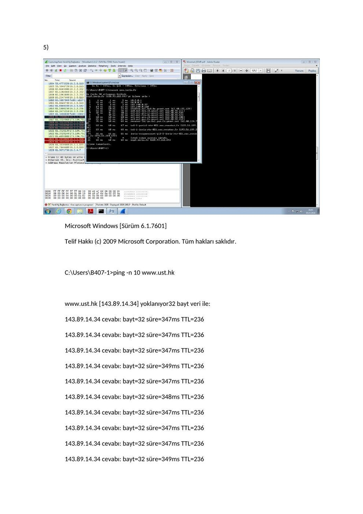
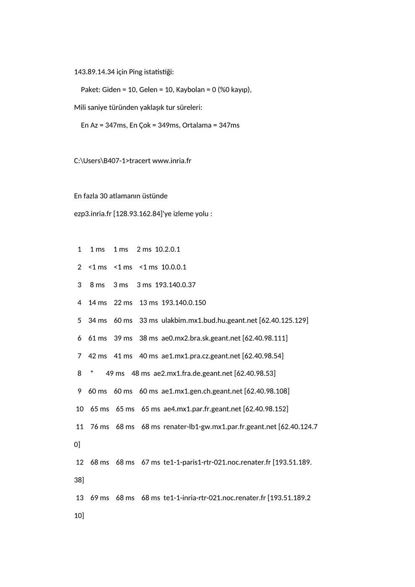
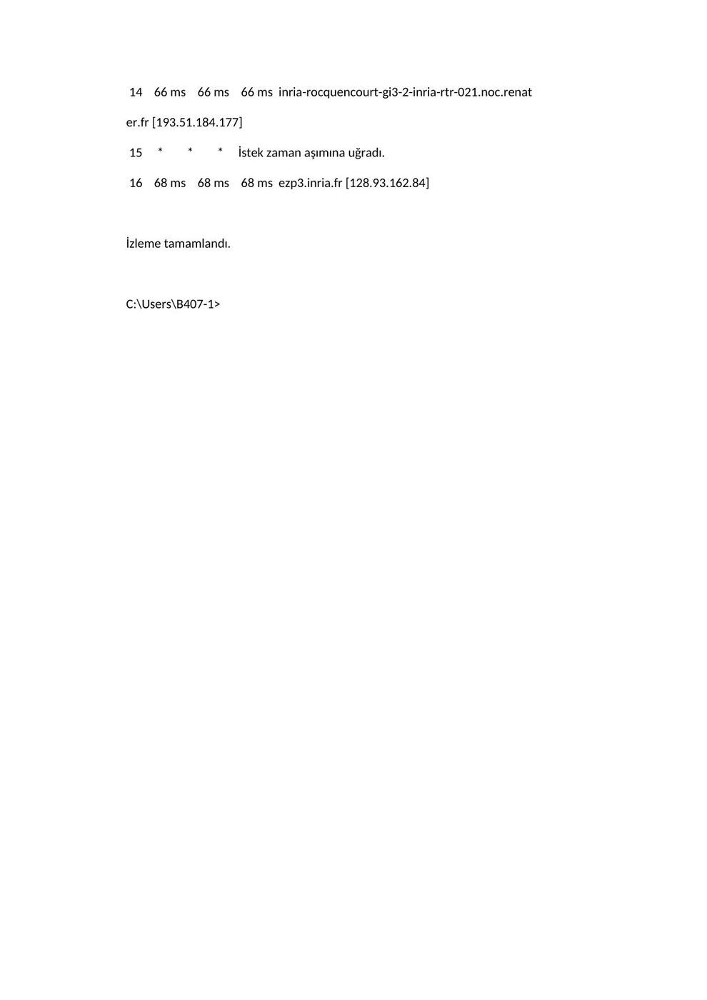
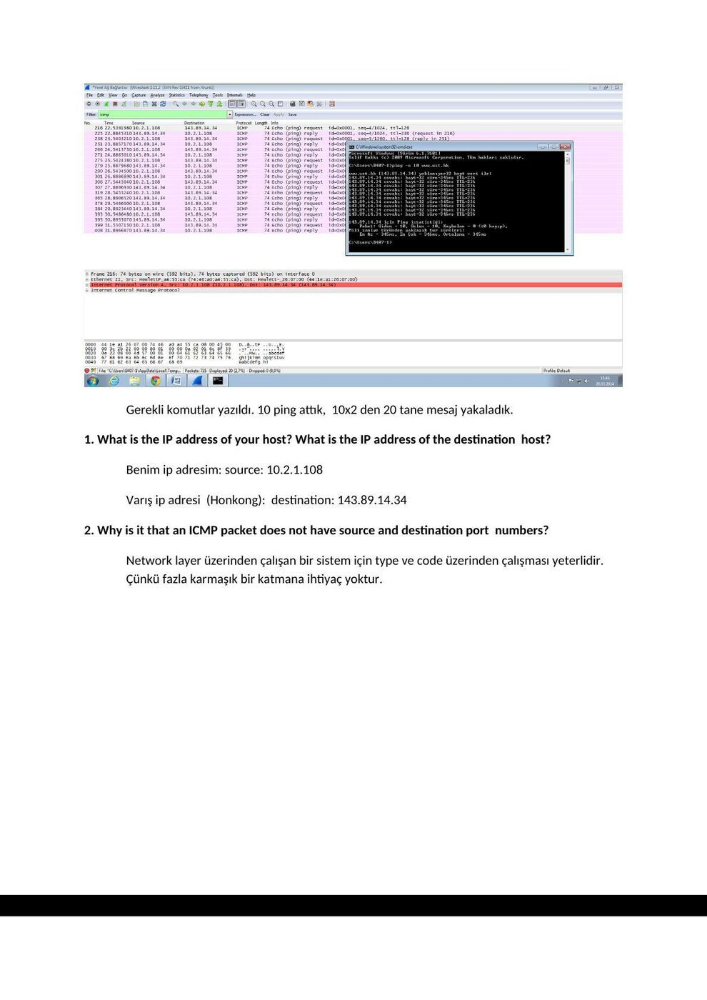
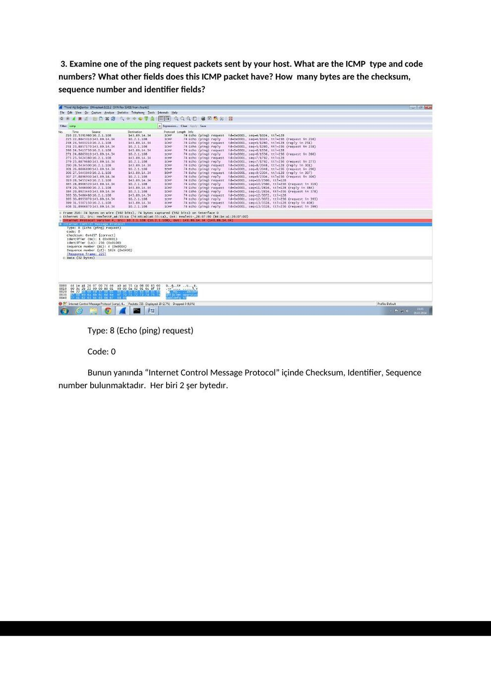
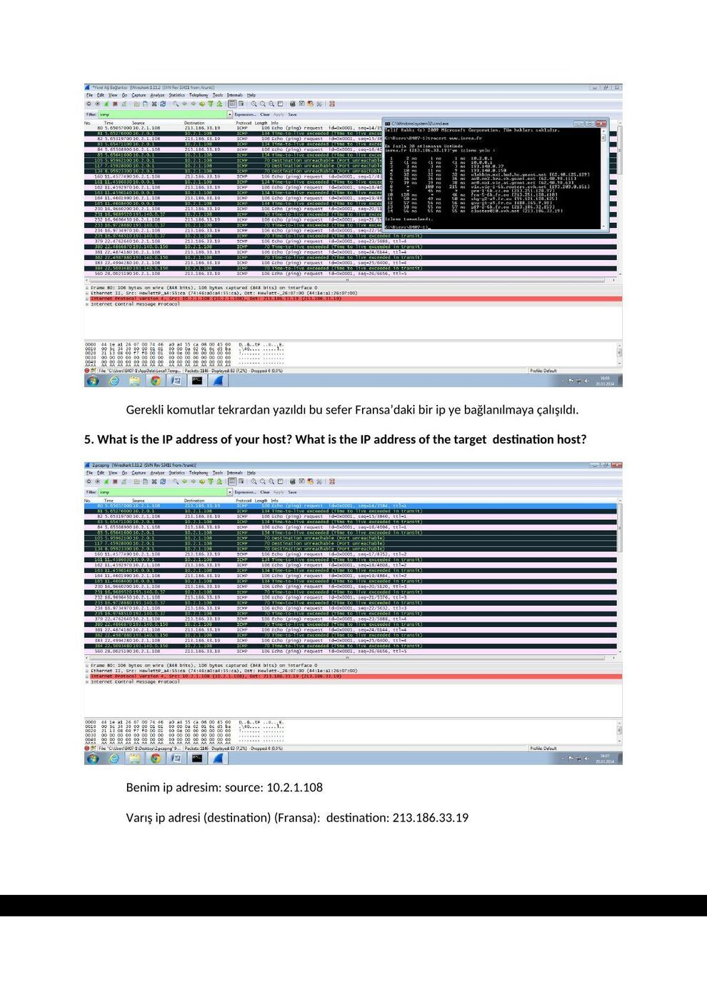
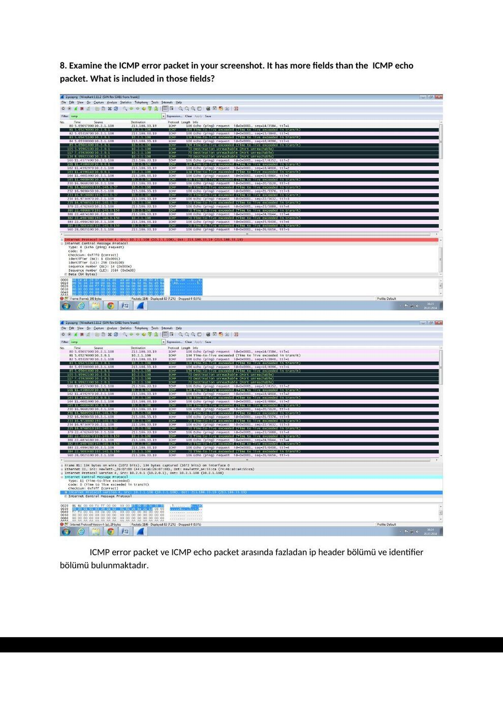
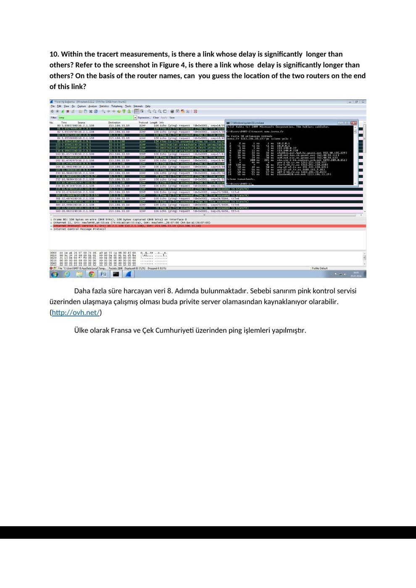

These are student laboratory reports from the course archive; student names, numbers and identity information have been removed. When a date is not present on the document, the creation or last-modified date of the source file has been used. PDF copies of the documents prepared for the archive can be downloaded at the end of the post.

## ICMP Application Outputs

**3.** 

**4.** 

**5.** 

Microsoft Windows [Version 6.1.7601]

Copyright (c) 2009 Microsoft Corporation. All rights reserved.

C:\Users\B407-1>ping -n 10 www.ust.hk

Pinging www.ust.hk [143.89.14.34] with 32 bytes of data:

**143.** 89.14.34 reply: bytes=32 time=347ms TTL=236

**143.** 89.14.34 reply: bytes=32 time=347ms TTL=236

**143.** 89.14.34 reply: bytes=32 time=347ms TTL=236

**143.** 89.14.34 reply: bytes=32 time=349ms TTL=236

**143.** 89.14.34 reply: bytes=32 time=347ms TTL=236

**143.** 89.14.34 reply: bytes=32 time=348ms TTL=236

**143.** 89.14.34 reply: bytes=32 time=347ms TTL=236

**143.** 89.14.34 reply: bytes=32 time=347ms TTL=236

**143.** 89.14.34 reply: bytes=32 time=347ms TTL=236

**143.** 89.14.34 reply: bytes=32 time=349ms TTL=236

**143.** 89.14.34 ping statistics:

Packets: Sent = 10, Received = 10, Lost = 0 (0% loss),

Approximate round trip times in milliseconds:

Minimum = 347ms, Maximum = 349ms, Average = 347ms

C:\Users\B407-1>tracert www.inria.fr

Over a maximum of 30 hops

Tracing route to ezp3.inria.fr [128.93.162.84]:

1 1 ms 1 ms 2 ms 10.2.0.1

2 <1 ms <1 ms <1 ms 10.0.0.1

3 8 ms 3 ms 3 ms 193.140.0.37

4 14 ms 22 ms 13 ms 193.140.0.150

5 34 ms 60 ms 33 ms ulakbim.mx1.bud.hu.geant.net [62.40.125.129]

6 61 ms 39 ms 38 ms ae0.mx2.bra.sk.geant.net [62.40.98.111]

7 42 ms 41 ms 40 ms ae1.mx1.pra.cz.geant.net [62.40.98.54]

8 * 49 ms 48 ms ae2.mx1.fra.de.geant.net [62.40.98.53]

9 60 ms 60 ms 60 ms ae1.mx1.gen.ch.geant.net [62.40.98.108]

10 65 ms 65 ms 65 ms ae4.mx1.par.fr.geant.net [62.40.98.152]

11 76 ms 68 ms 68 ms renater-lb1-gw.mx1.par.fr.geant.net [62.40.124.7

0]

12 68 ms 68 ms 67 ms te1-1-paris1-rtr-021.noc.renater.fr [193.51.189.

38]

13 69 ms 68 ms 68 ms te1-1-inria-rtr-021.noc.renater.fr [193.51.189.2

10]

14 66 ms 66 ms 66 ms inria-rocquencourt-gi3-2-inria-rtr-021.noc.renat

er.fr [193.51.184.177]

15 * * * Request timed out.

16 68 ms 68 ms 68 ms ezp3.inria.fr [128.93.162.84]

Trace complete.

C:\Users\B407-1>

## ICMP Report

Başkent University, Department of Electrical and Electronics Engineering

EEM 438

Experiment No: 3

The required commands were entered. We sent 10 pings and captured 20 messages (10 × 2).

**1.** What is the IP address of your host? What is the IP address of the destination host?

My IP address: source: 10.2.1.108

Destination IP address (Hong Kong): destination: 143.89.14.34

**2.** Why is it that an ICMP packet does not have source and destination port numbers?

For a system operating at the network layer, working with the type and code fields is sufficient, because there is no need for an overly complex layer.

**3.** Examine one of the ping request packets sent by your host. What are the ICMP type and code numbers? What other fields does this ICMP packet have? How many bytes are the checksum, sequence number and identifier fields?

Type: 8 (Echo (ping) request)

Code: 0

In addition, the "Internet Control Message Protocol" section contains Checksum, Identifier and Sequence number fields. Each is 2 bytes.

**4.** Examine the corresponding ping reply packet. What are the ICMP type and code numbers? What other fields does this ICMP packet have? How many bytes are the checksum, sequence number and identifier fields?

Type: 0 (Echo (ping) request)

Code: 0

In addition, the "Internet Control Message Protocol" section contains Checksum, Identifier and Sequence number fields. Each is 2 bytes.

The required commands were entered again; this time a connection to an IP address in France was attempted.

**5.** What is the IP address of your host? What is the IP address of the target destination host?

My IP address: source: 10.2.1.108

Destination IP address (France): destination: 213.186.33.19

**6.** If ICMP sent UDP packets instead (as in Unix/Linux), would the IP protocol number still be 01 for the probe packets? If not, what would it be?

No. If UDP packets were being sent, the IP protocol number would be 0x11.

**7.** Examine the ICMP echo packet in your screenshot. Is this different from the ICMP ping query packets in the first half of this lab? If yes, how so?

All the information in the ping request message and the ICMP echo packet is the same. In terms of content, they contain Type, Code, Checksum, Identifier and Sequence number.

**8.** Examine the ICMP error packet in your screenshot. It has more fields than the ICMP echo packet. What is included in those fields?

Compared with the ICMP echo packet, the ICMP error packet has an additional IP header section and an identifier section.

**9.** Examine the last three ICMP packets received by the source host. How are these packets different from the ICMP error packets? Why are they different?

Among the last three packets, the only small difference appears to be the change in the time-to-live value from 11 to 0.

**10.** Within the tracert measurements, is there a link whose delay is significantly longer than others? Refer to the screenshot in Figure 4, is there a link whose delay is significantly longer than others? On the basis of the router names, can you guess the location of the two routers on the end of this link?

The data that took the longest time is at the 8th hop. I think the reason is that it tried to reach the destination through a ping control service, which may be because it is a private server. (http://ovh.net/)

Pings were performed to destinations in France and the Czech Republic.

*Note: ICMP has no TCP/UDP ports; it has type and code fields. The addresses, times and hop counts in the screen outputs apply only to the measurement of the relevant experiment.*

*Note: The commercial textbook lab-manual sections that were open in the background of the screenshots have been blanked out in the archive copy; the student's experiment outputs have been preserved.*
