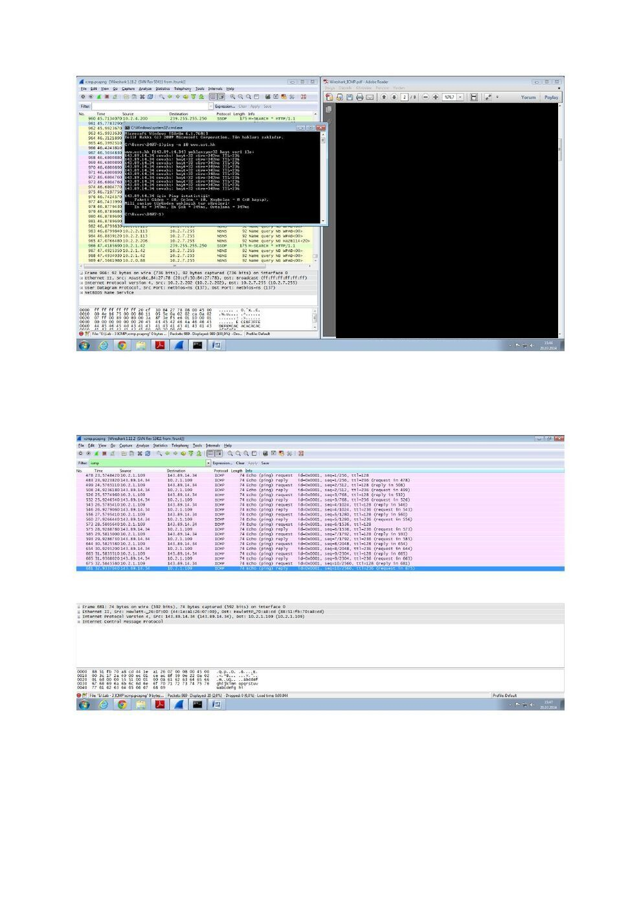
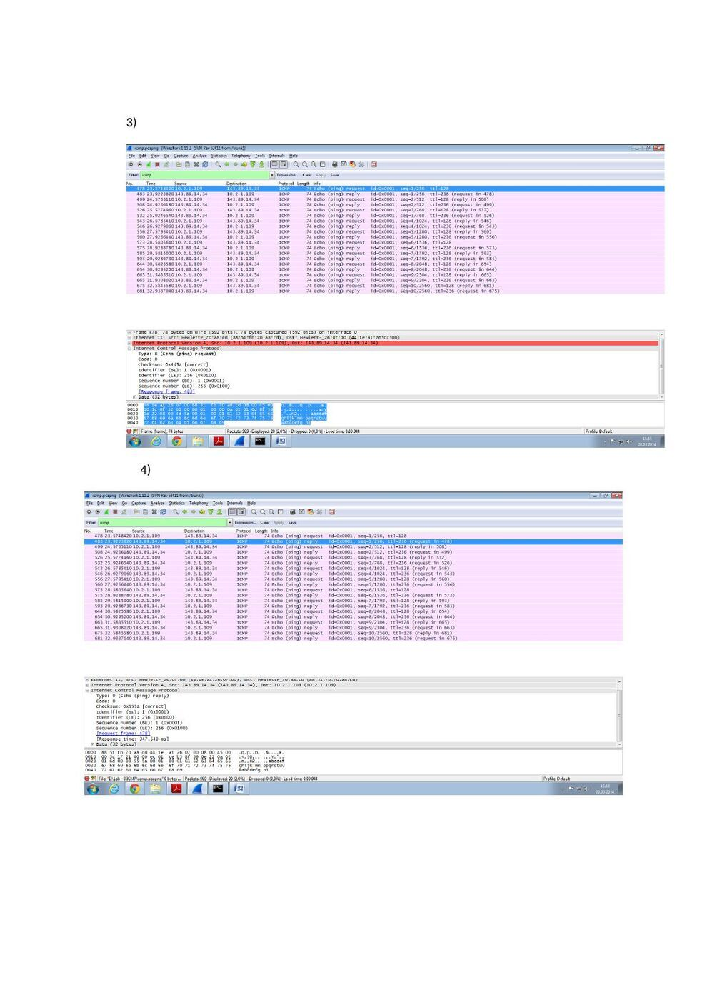
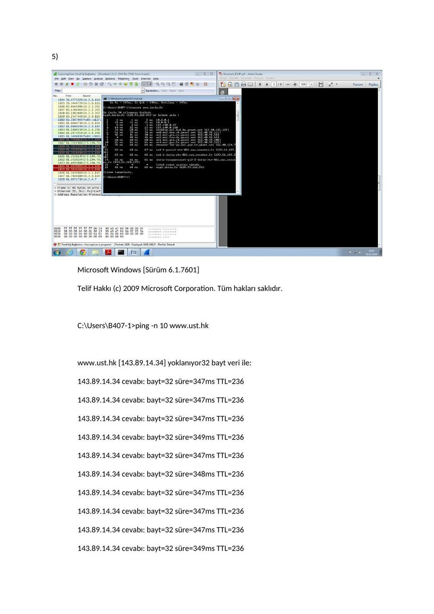
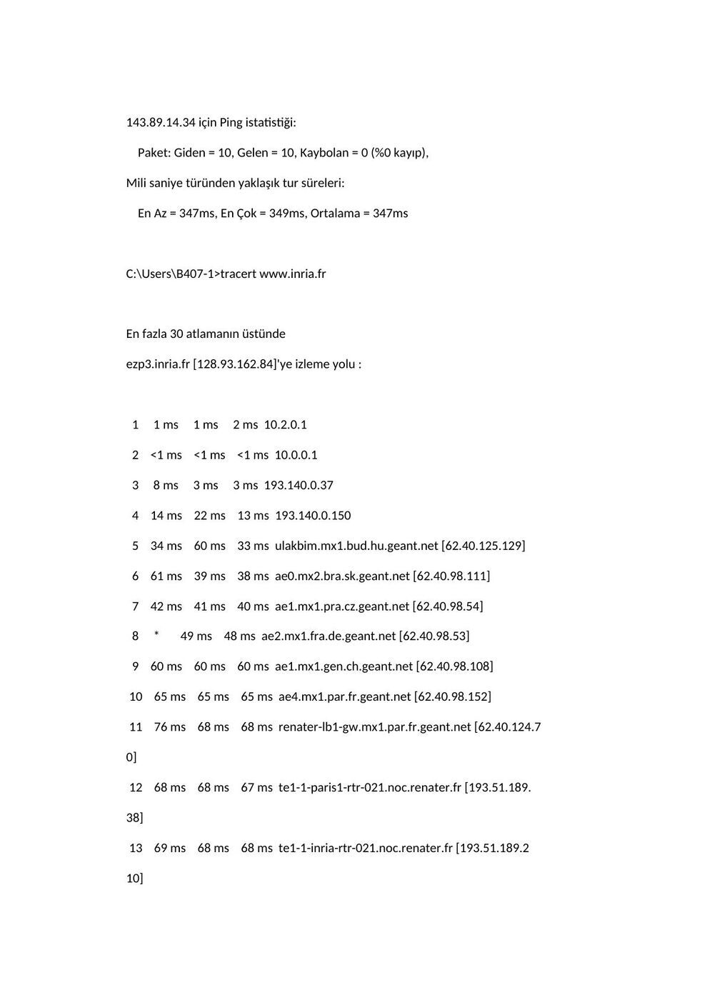
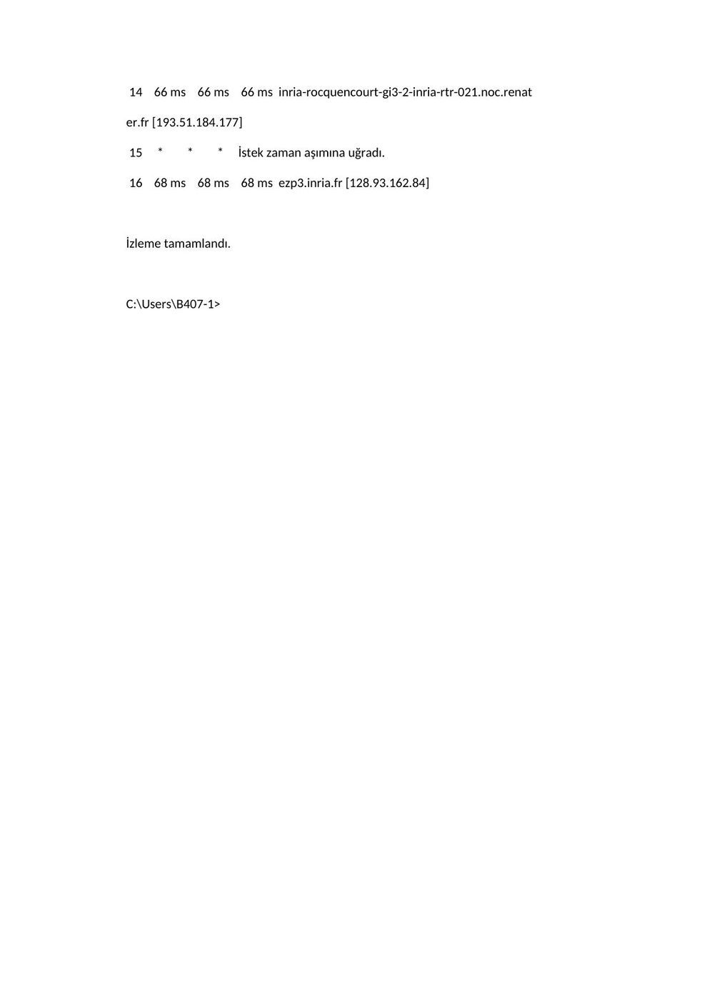
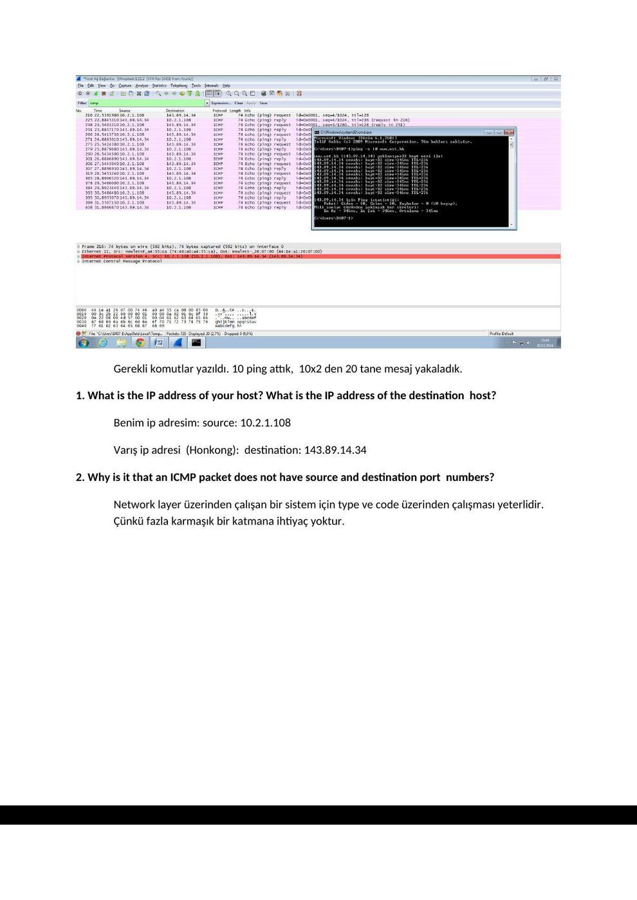
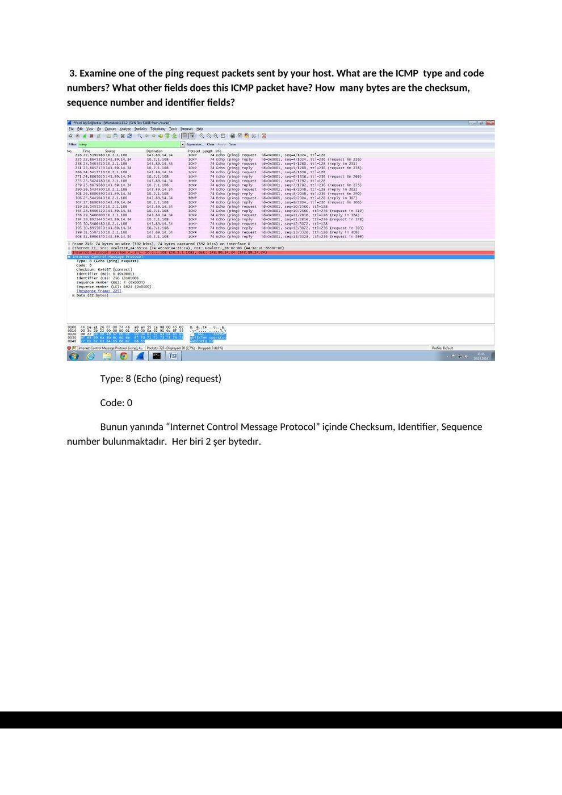
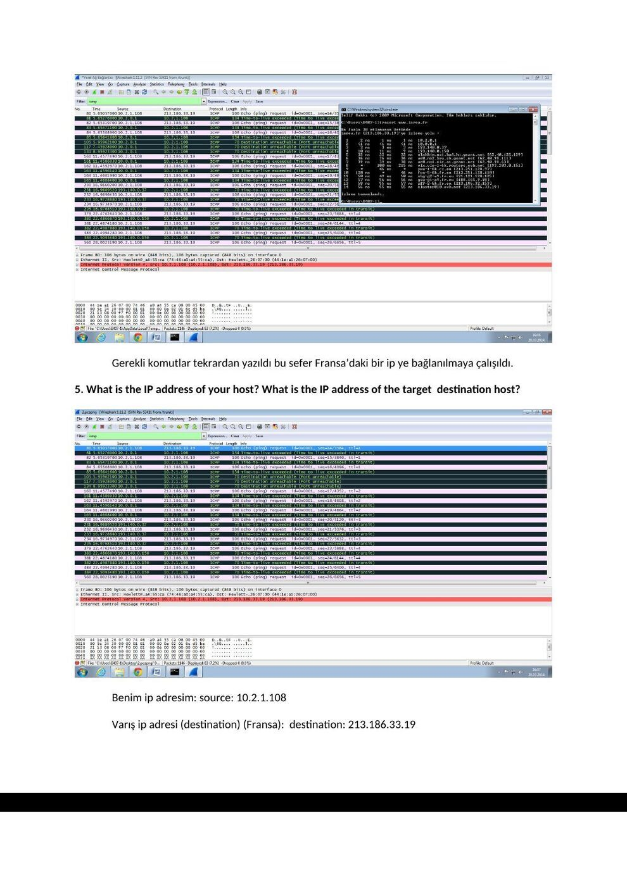
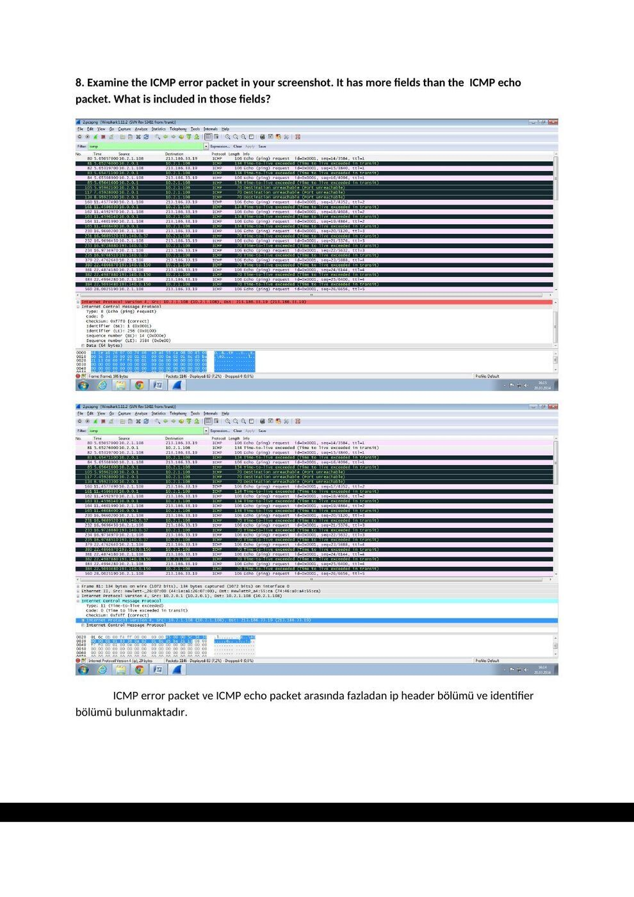
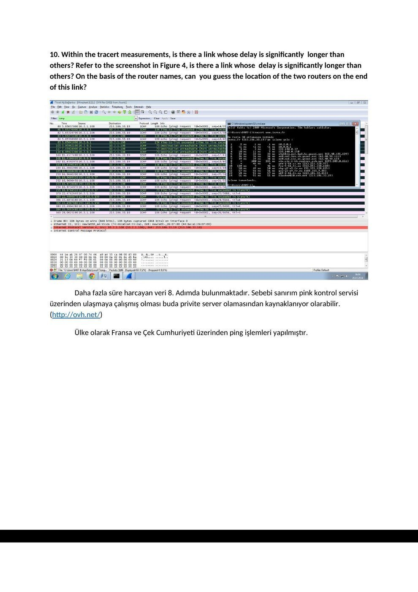

Ders arşivindeki öğrenci laboratuvar raporlarıdır; öğrenci adları, numaraları ve kimlik bilgileri çıkarılmıştır. Belge üzerindeki tarih bulunmadığında kaynak dosyanın oluşturulma ya da son değiştirilme tarihi kullanılmıştır. Belgelerin arşiv için hazırlanmış PDF kopyaları yazının sonunda indirilebilir.

## ICMP uygulama çıktıları

**3.** 

**4.** 

**5.** 

Microsoft Windows [Sürüm 6.1.7601]

Telif Hakkı (c) 2009 Microsoft Corporation. Tüm hakları saklıdır.

C:\Users\B407-1>ping -n 10 www.ust.hk

www.ust.hk [143.89.14.34] yoklanıyor32 bayt veri ile:

**143.** 89.14.34 cevabı: bayt=32 süre=347ms TTL=236

**143.** 89.14.34 cevabı: bayt=32 süre=347ms TTL=236

**143.** 89.14.34 cevabı: bayt=32 süre=347ms TTL=236

**143.** 89.14.34 cevabı: bayt=32 süre=349ms TTL=236

**143.** 89.14.34 cevabı: bayt=32 süre=347ms TTL=236

**143.** 89.14.34 cevabı: bayt=32 süre=348ms TTL=236

**143.** 89.14.34 cevabı: bayt=32 süre=347ms TTL=236

**143.** 89.14.34 cevabı: bayt=32 süre=347ms TTL=236

**143.** 89.14.34 cevabı: bayt=32 süre=347ms TTL=236

**143.** 89.14.34 cevabı: bayt=32 süre=349ms TTL=236

**143.** 89.14.34 için Ping istatistiği:

Paket: Giden = 10, Gelen = 10, Kaybolan = 0 (%0 kayıp),

Mili saniye türünden yaklaşık tur süreleri:

En Az = 347ms, En Çok = 349ms, Ortalama = 347ms

C:\Users\B407-1>tracert www.inria.fr

En fazla 30 atlamanın üstünde

ezp3.inria.fr [128.93.162.84]'ye izleme yolu :

1 1 ms 1 ms 2 ms 10.2.0.1

2 <1 ms <1 ms <1 ms 10.0.0.1

3 8 ms 3 ms 3 ms 193.140.0.37

4 14 ms 22 ms 13 ms 193.140.0.150

5 34 ms 60 ms 33 ms ulakbim.mx1.bud.hu.geant.net [62.40.125.129]

6 61 ms 39 ms 38 ms ae0.mx2.bra.sk.geant.net [62.40.98.111]

7 42 ms 41 ms 40 ms ae1.mx1.pra.cz.geant.net [62.40.98.54]

8 * 49 ms 48 ms ae2.mx1.fra.de.geant.net [62.40.98.53]

9 60 ms 60 ms 60 ms ae1.mx1.gen.ch.geant.net [62.40.98.108]

10 65 ms 65 ms 65 ms ae4.mx1.par.fr.geant.net [62.40.98.152]

11 76 ms 68 ms 68 ms renater-lb1-gw.mx1.par.fr.geant.net [62.40.124.7

0]

12 68 ms 68 ms 67 ms te1-1-paris1-rtr-021.noc.renater.fr [193.51.189.

38]

13 69 ms 68 ms 68 ms te1-1-inria-rtr-021.noc.renater.fr [193.51.189.2

10]

14 66 ms 66 ms 66 ms inria-rocquencourt-gi3-2-inria-rtr-021.noc.renat

er.fr [193.51.184.177]

15 * * * İstek zaman aşımına uğradı.

16 68 ms 68 ms 68 ms ezp3.inria.fr [128.93.162.84]

İzleme tamamlandı.

C:\Users\B407-1>

## ICMP raporu

Başkent Üniversitesi Elektrik - Elektronik Mühendisliği Bölümü

EEM 438

Deney No: 3

Gerekli komutlar yazıldı. 10 ping attık, 10x2 den 20 tane mesaj yakaladık.

**1.** What is the IP address of your host? What is the IP address of the destination host?

Benim ip adresim: source: 10.2.1.108

Varış ip adresi (Honkong): destination: 143.89.14.34

**2.** Why is it that an ICMP packet does not have source and destination port numbers?

Network layer üzerinden çalışan bir sistem için type ve code üzerinden çalışması yeterlidir. Çünkü fazla karmaşık bir katmana ihtiyaç yoktur.

**3.** Examine one of the ping request packets sent by your host. What are the ICMP type and code numbers? What other fields does this ICMP packet have? How many bytes are the checksum, sequence number and identifier fields?

Type: 8 (Echo (ping) request)

Code: 0

Bunun yanında “Internet Control Message Protocol” içinde Checksum, Identifier, Sequence number bulunmaktadır. Her biri 2 şer bytedır.

**4.** Examine the corresponding ping reply packet. What are the ICMP type and code numbers? What other fields does this ICMP packet have? How many bytes are the checksum, sequence number and identifier fields?

Type: 0 (Echo (ping) request)

Code: 0

Bunun yanında “Internet Control Message Protocol” içinde Checksum, Identifier, Sequence number bulunmaktadır. Her biri 2 şer byte dır.

Gerekli komutlar tekrardan yazıldı bu sefer Fransa’daki bir ip ye bağlanılmaya çalışıldı.

**5.** What is the IP address of your host? What is the IP address of the target destination host?

Benim ip adresim: source: 10.2.1.108

Varış ip adresi (destination) (Fransa): destination: 213.186.33.19

**6.** If ICMP sent UDP packets instead (as in Unix/Linux), would the IP protocol number still be 01 for the probe packets? If not, what would it be?

Hayır eğer UDP paketleri yollanıyor olsaydı IP protokol numarası 0x11 olurdu.

**7.** Examine the ICMP echo packet in your screenshot. Is this different from the ICMP ping query packets in the first half of this lab? If yes, how so?

Ping request mesajı ile ICMP echo packet arasındaki tüm bilgiler aynıdır. İçerik olarak Type, Code, Checksum, Identifier, Sequence number bulunmaktadır.

**8.** Examine the ICMP error packet in your screenshot. It has more fields than the ICMP echo packet. What is included in those fields?

ICMP error packet ve ICMP echo packet arasında fazladan ip header bölümü ve identifier bölümü bulunmaktadır.

**9.** Examine the last three ICMP packets received by the source host. How are these packets different from the ICMP error packets? Why are they different?

Son 3 paket arasındaki time to live değerlerinde küçük fark 11 den 0 a değişmesi olarak gözükmektedir.

**10.** Within the tracert measurements, is there a link whose delay is significantly longer than others? Refer to the screenshot in Figure 4, is there a link whose delay is significantly longer than others? On the basis of the router names, can you guess the location of the two routers on the end of this link?

Daha fazla süre harcayan veri 8. Adımda bulunmaktadır. Sebebi sanırım pink kontrol servisi üzerinden ulaşmaya çalışmış olması buda privite server olamasından kaynaklanıyor olarabilir. (http://ovh.net/)

Ülke olarak Fransa ve Çek Cumhuriyeti üzerinden ping işlemleri yapılmıştır.

*Not: ICMP’nin TCP/UDP portları yoktur; type ve code alanları vardır. Ekran çıktılarındaki adresler, süreler ve atlama sayıları yalnız ilgili deney ölçümüdür.*

*Not: Ekran görüntülerinin arka planında açık duran ticari kitap laboratuvar föyü bölümleri arşiv kopyasında kapatıldı; öğrencinin deney çıktıları korundu.*
