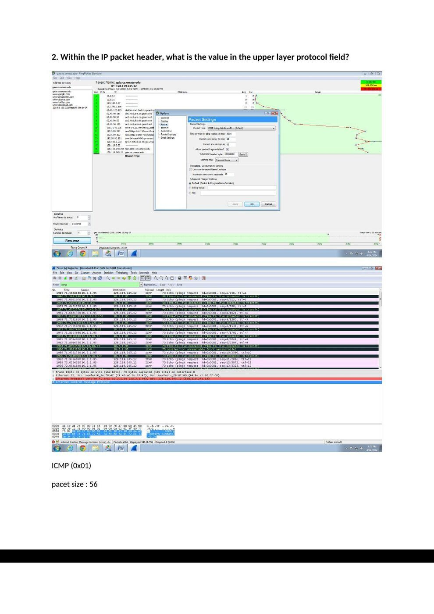
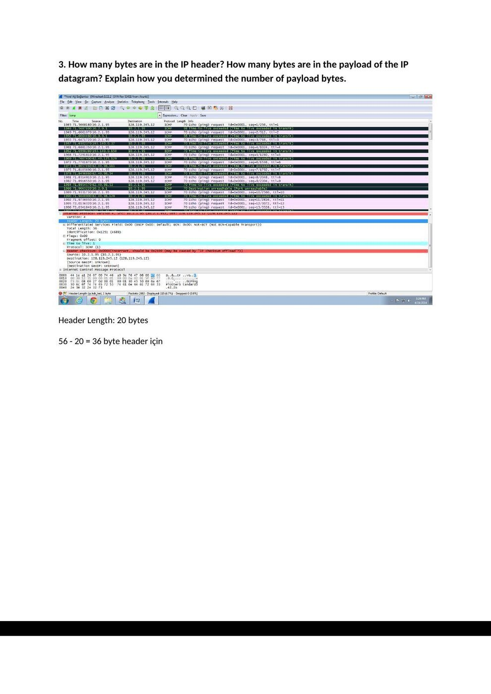
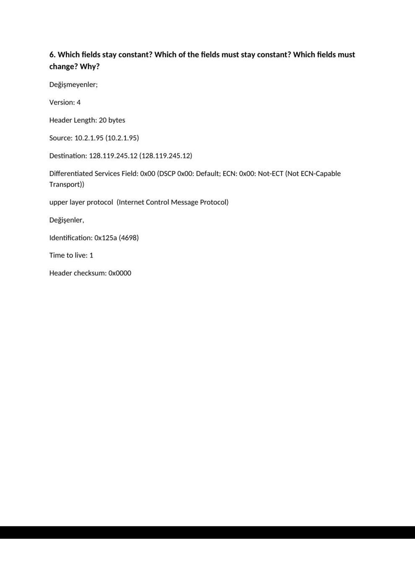
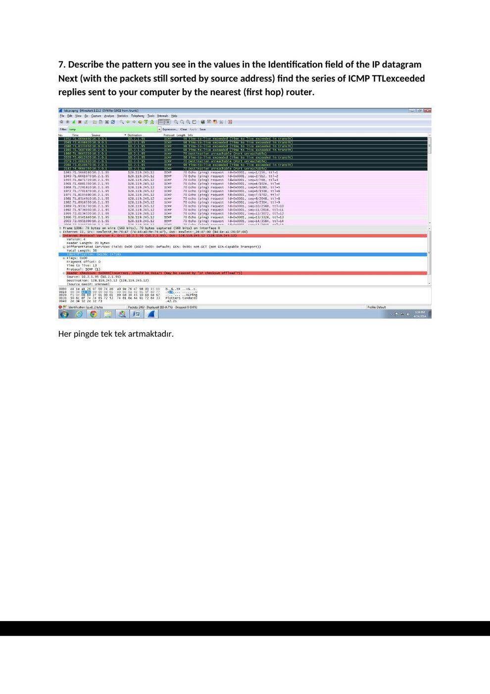
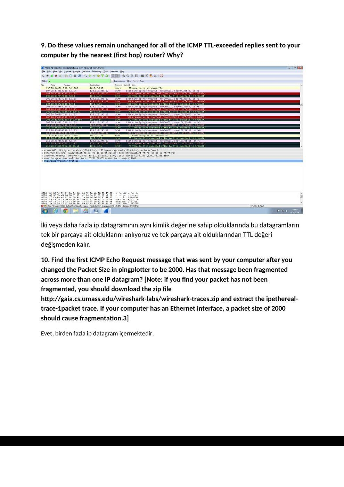
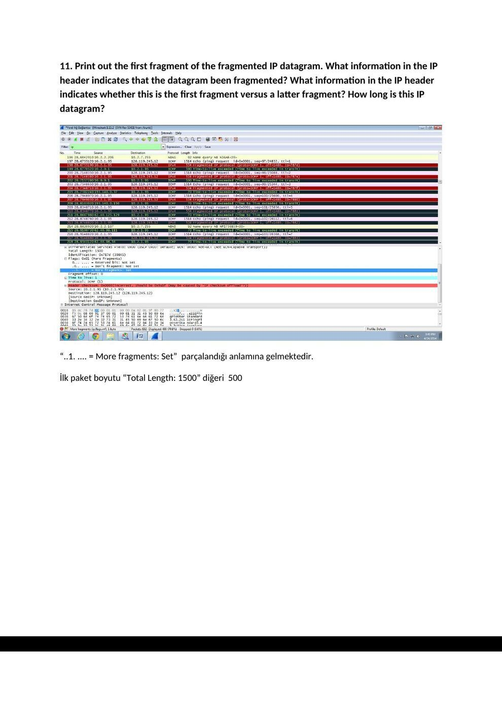
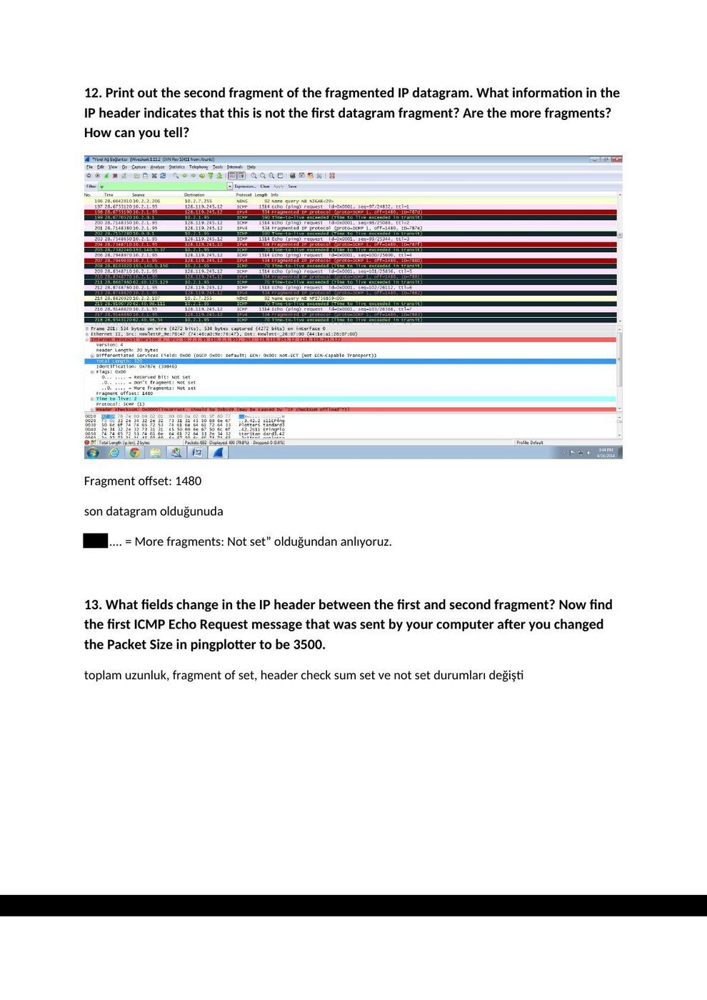
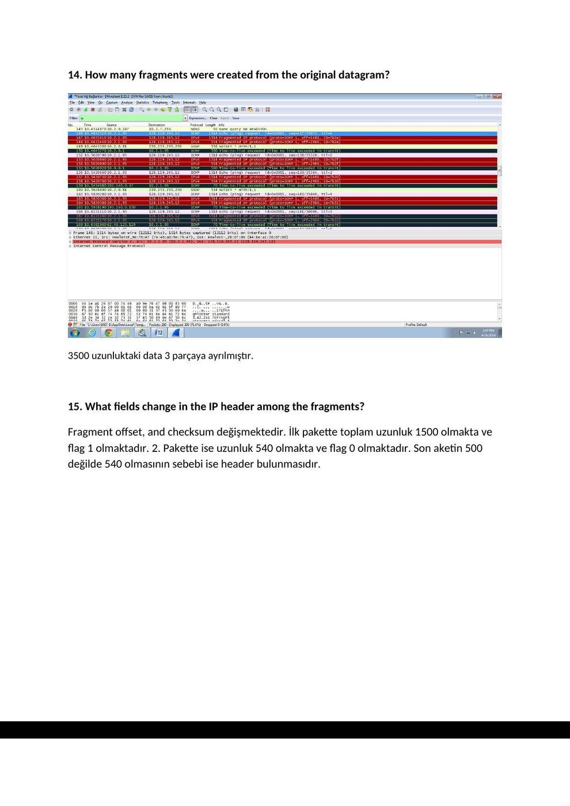

These are student laboratory reports from the course archive; student names, numbers and identity details have been removed. Where a document carried no date, the creation or last-modified date of the source file was used. Archive PDF copies of the documents can be downloaded at the end of the post.

## IP Report A

Başkent University, Department of Electrical and Electronics Engineering

EEM 438

Experiment No: 4

We installed our program to send files of a given size.

**1.** Select the first ICMP Echo Request message sent by your computer, and expand the Internet Protocol part of the packet in the packet details window. What is the IP address of your computer?

The source IP, i.e. my computer's IP address: 10.2.1.95

**2.** Within the IP packet header, what is the value in the upper layer protocol field?

ICMP (0x01)

packet size: 56

**3.** How many bytes are in the IP header? How many bytes are in the payload of the IP datagram? Explain how you determined the number of payload bytes.

Header Length: 20 bytes

56 - 20 = 36 bytes (for the header)

**4.** Has this IP datagram been fragmented? Explain how you determined whether or not the datagram has been fragmented. Next, sort the traced packets according to IP source address by clicking on the Source column header; a small downward pointing arrow should appear next to the word Source. If the arrow points up, click on the Source column header again. Select the first ICMP Echo Request message sent by your computer, and expand the Internet Protocol portion in the “details of selected packet header” window. In the “listing of captured packets” window, you should see all of the subsequent ICMP messages (perhaps with additional interspersed packets sent my other protocols running on your computer) below this first ICMP. Use the down arrow to move through the ICMP messages sent by your computer.

“More fragments: Not set”, i.e. it is not fragmented.

**5.** Which fields in the IP datagram always change from one datagram to the next within this series of ICMP messages sent by your computer?

The fields that change:

Identification: 0x125a (4698)

Time to live: 1

Header checksum: 0x0000

**6.** Which fields stay constant? Which of the fields must stay constant? Which fields must change? Why?

The fields that stay constant:

Version: 4

Header Length: 20 bytes

Source: 10.2.1.95 (10.2.1.95)

Destination: 128.119.245.12 (128.119.245.12)

Differentiated Services Field: 0x00 (DSCP 0x00: Default; ECN: 0x00: Not-ECT (Not ECN-Capable Transport))

upper layer protocol (Internet Control Message Protocol)

The fields that change:

Identification: 0x125a (4698)

Time to live: 1

Header checksum: 0x0000

**7.** Describe the pattern you see in the values in the Identification field of the IP datagram Next (with the packets still sorted by source address) find the series of ICMP TTLexceeded replies sent to your computer by the nearest (first hop) router.

It increases by one with each ping.

**8.** What is the value in the Identification field and the TTL field?

Time to live: 64

Identification: 0xe408 (58376)

**9.** Do these values remain unchanged for all of the ICMP TTL-exceeded replies sent to your computer by the nearest (first hop) router? Why?

When two or more IP datagrams have the same identification value, we understand that these datagrams belong to a single original datagram, and since they belong to the same one, the TTL value remains unchanged.

**10.** Find the first ICMP Echo Request message that was sent by your computer after you changed the Packet Size in pingplotter to be 2000. Has that message been fragmented across more than one IP datagram? [Note: if you find your packet has not been fragmented, you should download the zip file http://gaia.cs.umass.edu/wireshark-labs/wireshark-traces.zip and extract the ipethereal- trace-1packet trace. If your computer has an Ethernet interface, a packet size of 2000 should cause fragmentation.3]

Yes, it spans more than one IP datagram.

**11.** Print out the first fragment of the fragmented IP datagram. What information in the IP header indicates that the datagram been fragmented? What information in the IP header indicates whether this is the first fragment versus a latter fragment? How long is this IP datagram?

“..1. .... = More fragments: Set” means that it has been fragmented.

The size of the first packet is “Total Length: 1500”, and the other is 500.

**12.** Print out the second fragment of the fragmented IP datagram. What information in the IP header indicates that this is not the first datagram fragment? Are the more fragments? How can you tell?

Fragment offset: 1480

We also see that it is the last datagram, because

“..0. .... = More fragments: Not set”.

**13.** What fields change in the IP header between the first and second fragment? Now find the first ICMP Echo Request message that was sent by your computer after you changed the Packet Size in pingplotter to be 3500.

The total length, the fragment offset, the header checksum, and the Set / Not set states changed.

**14.** How many fragments were created from the original datagram?

The 3500-byte data was split into 3 fragments.

**15.** What fields change in the IP header among the fragments?

The fragment offset and the checksum change. In the first packet the total length is 1500 and the flag is 1. In the second packet the length is 540 and the flag is 0. The reason the last packet is 540 rather than 500 is that it includes a header.

*Note: The PDF copy of the same report carries the same content apart from personal cover-page and footer changes; it was not added again. 56−20=36 bytes is the IP payload; the phrase "for the header" in the source is incorrect. The on-the-wire unit of the Fragment Offset field is 8 bytes; the Wireshark display may have been converted to a byte offset.*
