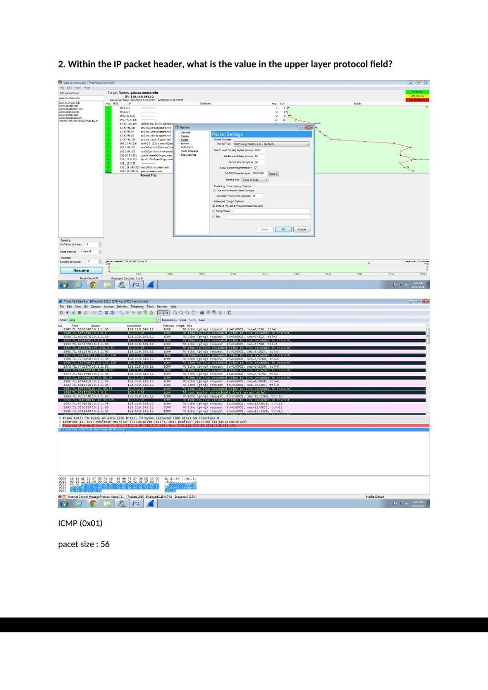
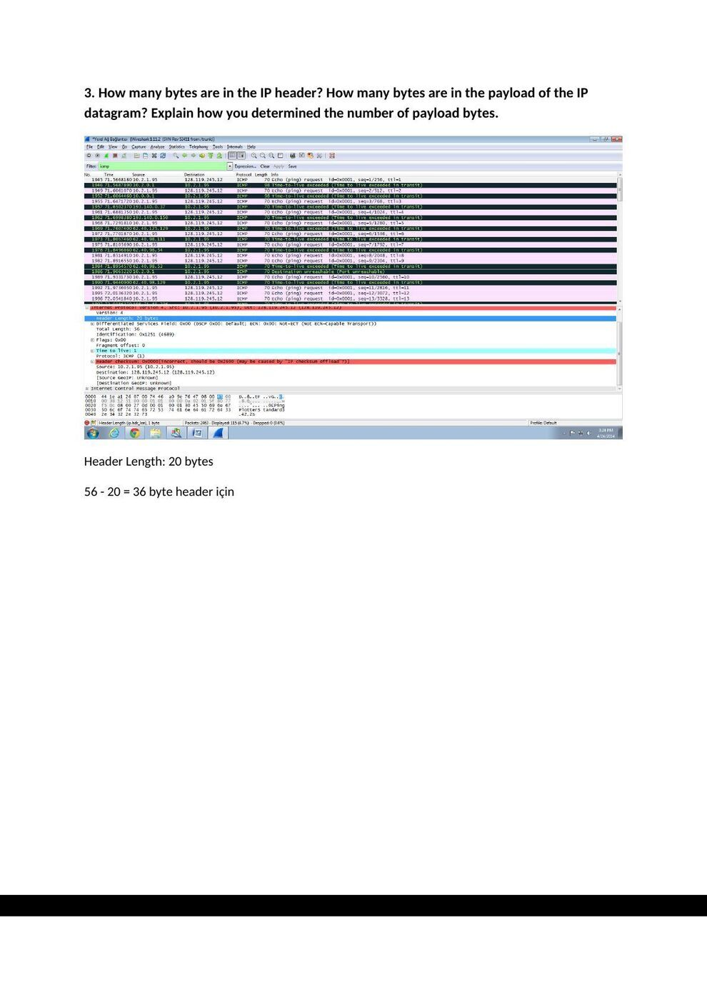
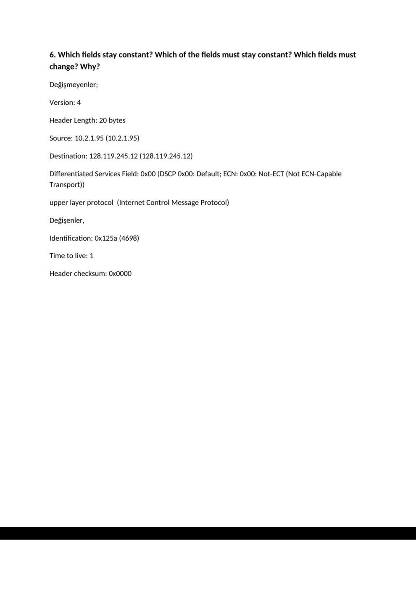
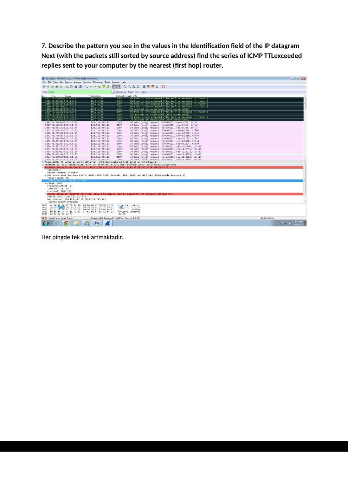
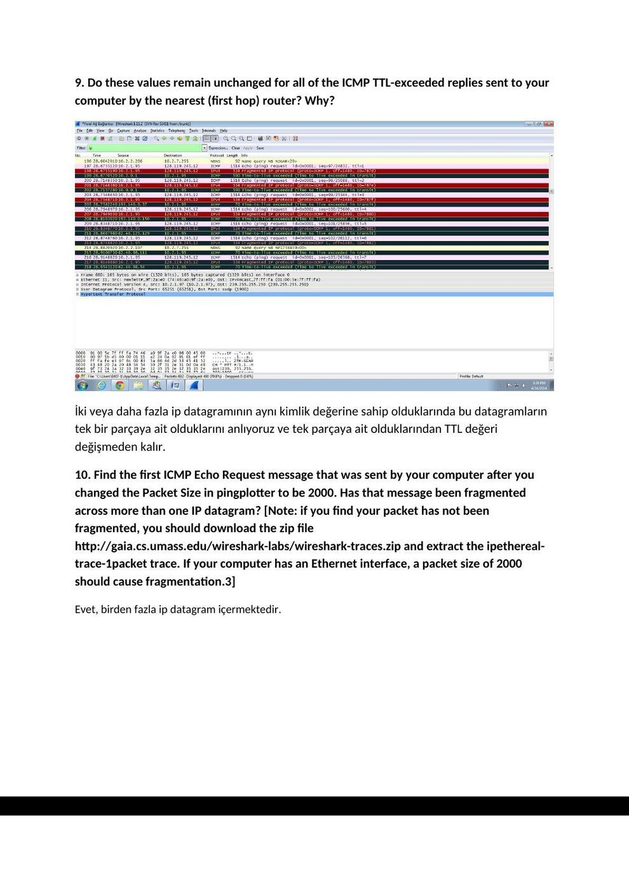
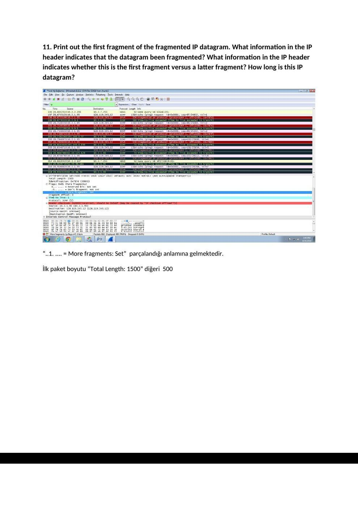
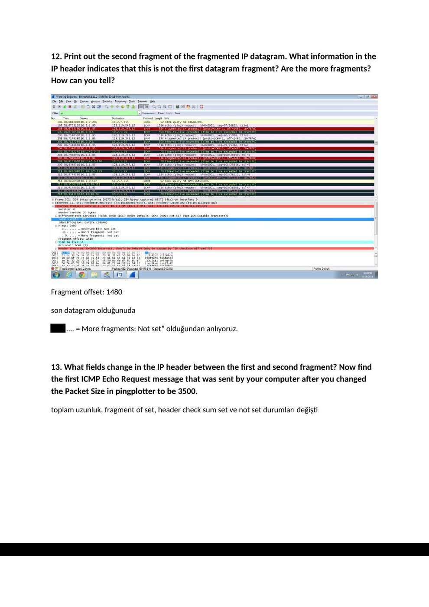
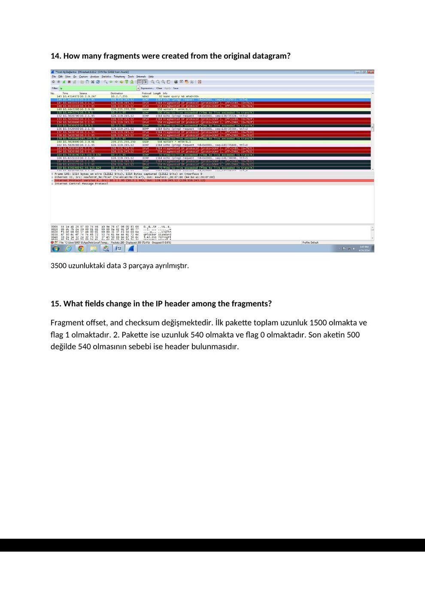

Ders arşivindeki öğrenci laboratuvar raporlarıdır; öğrenci adları, numaraları ve kimlik bilgileri çıkarılmıştır. Belge üzerindeki tarih bulunmadığında kaynak dosyanın oluşturulma ya da son değiştirilme tarihi kullanılmıştır. Belgelerin arşiv için hazırlanmış PDF kopyaları yazının sonunda indirilebilir.

## IP raporu A

Başkent Üniversitesi Elektrik - Elektronik Mühendisliği Bölümü

EEM 438

Deney No: 4

Belirli büyüklükte dosya göndermek için programımızı yükledik.

**1.** Select the first ICMP Echo Request message sent by your computer, and expand the Internet Protocol part of the packet in the packet details window. What is the IP address of your computer?

Source ip yani benim bilgisayarımın ip adresi: 10.2.1.95

**2.** Within the IP packet header, what is the value in the upper layer protocol field?

ICMP (0x01)

pacet size : 56

**3.** How many bytes are in the IP header? How many bytes are in the payload of the IP datagram? Explain how you determined the number of payload bytes.

Header Length: 20 bytes

56 - 20 = 36 byte header için

**4.** Has this IP datagram been fragmented? Explain how you determined whether or not the datagram has been fragmented. Next, sort the traced packets according to IP source address by clicking on the Source column header; a small downward pointing arrow should appear next to the word Source. If the arrow points up, click on the Source column header again. Select the first ICMP Echo Request message sent by your computer, and expand the Internet Protocol portion in the “details of selected packet header” window. In the “listing of captured packets” window, you should see all of the subsequent ICMP messages (perhaps with additional interspersed packets sent my other protocols running on your computer) below this first ICMP. Use the down arrow to move through the ICMP messages sent by your computer.

“More fragments :Not set” yani parçalanmamış durumdadır.

**5.** Which fields in the IP datagram always change from one datagram to the next within this series of ICMP messages sent by your computer?

Değişenler,

Identification: 0x125a (4698)

Time to live: 1

Header checksum: 0x0000

**6.** Which fields stay constant? Which of the fields must stay constant? Which fields must change? Why?

Değişmeyenler;

Version: 4

Header Length: 20 bytes

Source: 10.2.1.95 (10.2.1.95)

Destination: 128.119.245.12 (128.119.245.12)

Differentiated Services Field: 0x00 (DSCP 0x00: Default; ECN: 0x00: Not-ECT (Not ECN-Capable Transport))

upper layer protocol (Internet Control Message Protocol)

Değişenler,

Identification: 0x125a (4698)

Time to live: 1

Header checksum: 0x0000

**7.** Describe the pattern you see in the values in the Identification field of the IP datagram Next (with the packets still sorted by source address) find the series of ICMP TTLexceeded replies sent to your computer by the nearest (first hop) router.

Her pingde tek tek artmaktadır.

**8.** What is the value in the Identification field and the TTL field?

Time to live: 64

Identification: 0xe408 (58376)

**9.** Do these values remain unchanged for all of the ICMP TTL-exceeded replies sent to your computer by the nearest (first hop) router? Why?

İki veya daha fazla ip datagramının aynı kimlik değerine sahip olduklarında bu datagramların tek bir parçaya ait olduklarını anlıyoruz ve tek parçaya ait olduklarından TTL değeri değişmeden kalır.

**10.** Find the first ICMP Echo Request message that was sent by your computer after you changed the Packet Size in pingplotter to be 2000. Has that message been fragmented across more than one IP datagram? [Note: if you find your packet has not been fragmented, you should download the zip file http://gaia.cs.umass.edu/wireshark-labs/wireshark-traces.zip and extract the ipethereal- trace-1packet trace. If your computer has an Ethernet interface, a packet size of 2000 should cause fragmentation.3]

Evet, birden fazla ip datagram içermektedir.

**11.** Print out the first fragment of the fragmented IP datagram. What information in the IP header indicates that the datagram been fragmented? What information in the IP header indicates whether this is the first fragment versus a latter fragment? How long is this IP datagram?

“..1. .... = More fragments: Set” parçalandığı anlamına gelmektedir.

İlk paket boyutu “Total Length: 1500” diğeri 500

**12.** Print out the second fragment of the fragmented IP datagram. What information in the IP header indicates that this is not the first datagram fragment? Are the more fragments? How can you tell?

Fragment offset: 1480

son datagram olduğunuda

“..0. .... = More fragments: Not set” olduğundan anlıyoruz.

**13.** What fields change in the IP header between the first and second fragment? Now find the first ICMP Echo Request message that was sent by your computer after you changed the Packet Size in pingplotter to be 3500.

toplam uzunluk, fragment of set, header check sum set ve not set durumları değişti

**14.** How many fragments were created from the original datagram?

3500 uzunluktaki data 3 parçaya ayrılmıştır.

**15.** What fields change in the IP header among the fragments?

Fragment offset, and checksum değişmektedir. İlk pakette toplam uzunluk 1500 olmakta ve flag 1 olmaktadır. 2. Pakette ise uzunluk 540 olmakta ve flag 0 olmaktadır. Son aketin 500 değilde 540 olmasının sebebi ise header bulunmasıdır.

*Not: Aynı raporun PDF kopyası kişisel kapak ve alt bilgi değişiklikleri dışında aynı içeriği taşır; tekrar eklenmedi. 56−20=36 bayt IP yüküdür; kaynakta “header için” denmesi hatalıdır. Fragment Offset alanının tel üzerindeki birimi 8 bayttır; Wireshark gösterimi bayt ofsetine çevrilmiş olabilir.*

