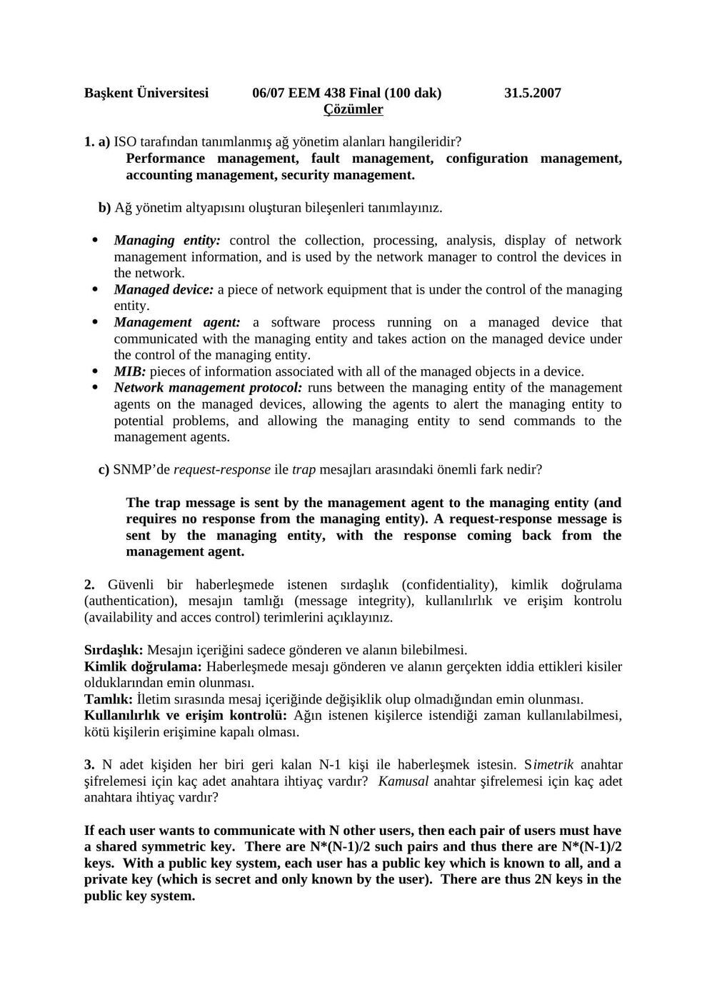
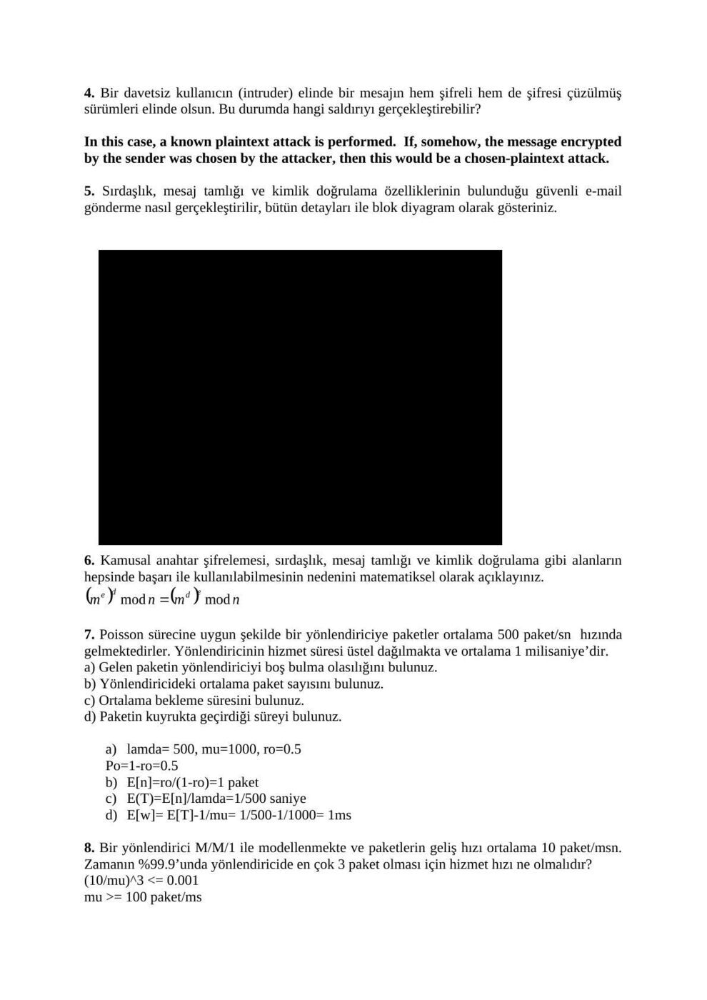
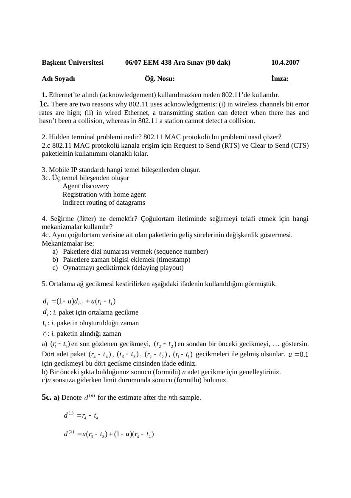
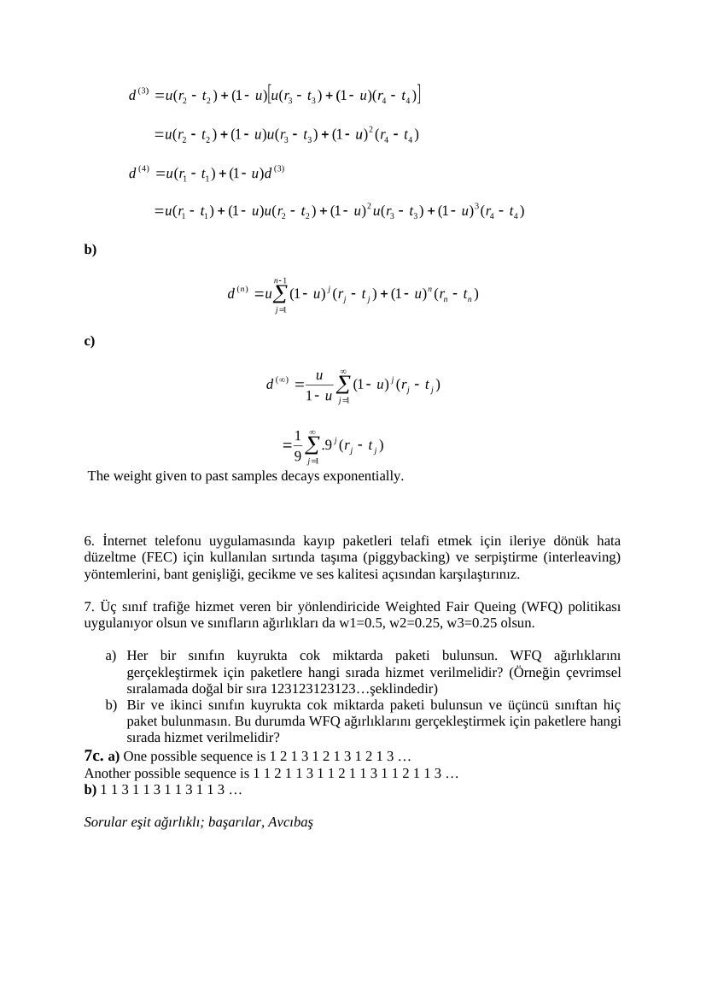

The 2007 midterm and final exam questions for the Başkent University course EEM438 are presented here together with their answer keys. Commercial textbook slides that had been pasted into the answer documents have been removed from the published copies. Archive PDF copies of the documents are available for download at the end of the post.

## EEM438 Final 2007

Başkent University 06/07 EEM 438 Final (100 Minutes) 31.5.2007

**1.** (15p) a) What are the network management domains defined by ISO? b) Define the components that make up the network management infrastructure. c) What is the difference between request-response and trap messages in SNMP?

**2.** (10p) Explain the terms confidentiality, authentication, message integrity, and availability and access control, which are desired in secure communication.

**3.** (10p) Suppose each of N people wants to communicate with the remaining N-1 people. How many keys are needed for symmetric key encryption? How many keys are needed for public key encryption?

**4.** (5p) Suppose an intruder has both the encrypted and the decrypted versions of a message. Which attack can the intruder carry out in this case?

**5.** (20p) How is secure e-mail sending, with confidentiality, message integrity, and authentication properties, achieved? Show all the details on a block diagram.

**6.** (10p) Explain mathematically why public key encryption can be used successfully in all of the areas such as confidentiality, message integrity, and authentication.

**7.** (15p) Packets arrive at a router at an average rate of 500 packets/s, following a Poisson process. The router's service time is exponentially distributed with a mean of 1 millisecond. a) Find the probability that an arriving packet finds the router idle. b) Find the average number of packets in the router. c) Find the average waiting time. d) Find the time the packet spends in the queue.

**8.** (15p) A router is modeled as M/M/1, and the average packet arrival rate is 10 packets/ms. What should the service rate be so that there are at most 3 packets in the router 99.9% of the time?

The questions carry equal weight. Calculators will not be used. Good luck… Avcıbaş

## EEM438 Final 2007 Solution

Başkent University 06/07 EEM 438 Final (100 min) 31.5.2007 Solutions

**1.** a) What are the network management domains defined by ISO? Performance management, fault management, configuration management, accounting management, security management.

b) Define the components that make up the network management infrastructure.

- Managing entity: control the collection, processing, analysis, display of network management information, and is used by the network manager to control the devices in the network.

- Managed device: a piece of network equipment that is under the control of the managing entity.

- Management agent: a software process running on a managed device that communicated with the managing entity and takes action on the managed device under the control of the managing entity.

- MIB: pieces of information associated with all of the managed objects in a device.

- Network management protocol: runs between the managing entity of the management agents on the managed devices, allowing the agents to alert the managing entity to potential problems, and allowing the managing entity to send commands to the management agents.

c) What is the important difference between request-response and trap messages in SNMP?

The trap message is sent by the management agent to the managing entity (and requires no response from the managing entity). A request-response message is sent by the managing entity, with the response coming back from the management agent.

**2.** Explain the terms confidentiality, authentication, message integrity, and availability and access control, which are desired in secure communication.

Confidentiality: Only the sender and the receiver can know the content of the message. Authentication: Making sure that the sender and the receiver of the message in the communication are really who they claim to be. Integrity: Making sure whether the message content has been altered during transmission. Availability and access control: The network being usable by the intended people whenever they want, and being closed to access by malicious people.

**3.** Suppose each of N people wants to communicate with the remaining N-1 people. How many keys are needed for symmetric key encryption? How many keys are needed for public key encryption?

If each user wants to communicate with N other users, then each pair of users must have a shared symmetric key. There are N*(N-1)/2 such pairs and thus there are N*(N-1)/2 keys. With a public key system, each user has a public key which is known to all, and a private key (which is secret and only known by the user). There are thus 2N keys in the public key system.

**4.** Suppose an intruder has both the encrypted and the decrypted versions of a message. Which attack can the intruder carry out in this case?

In this case, a known plaintext attack is performed. If, somehow, the message encrypted by the sender was chosen by the attacker, then this would be a chosen-plaintext attack.

**5.** How is secure e-mail sending, with confidentiality, message integrity, and authentication properties, achieved? Show all the details as a block diagram.

[Textbook slide removed from the archive copy.]

**6.** Explain mathematically why public key encryption can be used successfully in all of the areas such as confidentiality, message integrity, and authentication.

**7.** Packets arrive at a router at an average rate of 500 packets/s, following a Poisson process. The router's service time is exponentially distributed with a mean of 1 millisecond. a) Find the probability that an arriving packet finds the router idle. b) Find the average number of packets in the router. c) Find the average waiting time. d) Find the time the packet spends in the queue.

a) lambda = 500, mu = 1000, rho = 0.5, P0 = 1 - rho = 0.5 b) E[n] = rho/(1-rho) = 1 packet c) E(T) = E[n]/lambda = 1/500 second d) E[w] = E[T] - 1/mu = 1/500 - 1/1000 = 1 ms

**8.** A router is modeled as M/M/1, and the average packet arrival rate is 10 packets/ms. What should the service rate be so that there are at most 3 packets in the router 99.9% of the time? (10/mu)^3 <= 0.001, mu >= 100 packets/ms

## EEM438 Midterm 2007

Başkent University 06/07 EEM 438 Midterm (100 min) 10.4.2007

**1.** Why are acknowledgements used in 802.11 while they are not used in Ethernet?

**2.** What is the hidden terminal problem? How does the 802.11 MAC protocol solve this problem?

**3.** What are the basic components of the Mobile IP standard?

**4.** What is jitter? What mechanisms are used to compensate for jitter in multimedia transmission?

**5.** We saw that the following expression is used when estimating the average network delay:

: average delay for the i-th packet, : the time the i-th packet was generated, : the time the i-th packet was received.

Let denote the latest delay, the delay before the latest, … Suppose four packets have arrived with delays , , , . a) Express the delay for in terms of these four delays.

b) Generalize the result (formula) you found in the previous part to n delays.

c) Find the result (formula) in the limit as n goes to infinity.

**6.** To compensate for lost packets in an Internet telephony application, compare the piggybacking and interleaving methods used in forward error correction (FEC) in terms of bandwidth, delay, and voice quality.

**7.** Suppose a Weighted Fair Queueing (WFQ) policy is applied in a router serving three classes of traffic, with class weights w1=0.5, w2=0.25, w3=0.25.

a) Suppose each class has a large number of packets in its queue. In what order should packets be served to realize the WFQ weights? (For example, a natural order in round-robin scheduling is 1 2 3 1 2 3 1 2 3 1 2 3….)

b) Suppose the first and second classes have a large number of packets in their queues and the third class has no packets at all. In this case, in what order should packets be served to realize the WFQ weights?

The questions carry equal weight. Calculators will not be used. Good luck… Avcıbaş

## EEM438 Midterm 2007 Answer Key

Başkent University 06/07 EEM 438 Midterm (90 min) 10.4.2007

**1.** Why are acknowledgements used in 802.11 while they are not used in Ethernet? 1c. There are two reasons why 802.11 uses acknowledgments: (i) in wireless channels bit error rates are high; (ii) in wired Ethernet, a transmitting station can detect when there has and hasn’t been a collision, whereas in 802.11 a station cannot detect a collision.

**2.** What is the hidden terminal problem? How does the 802.11 MAC protocol solve this problem?

**2.** c The 802.11 MAC protocol makes it possible to use Request to Send (RTS) and Clear to Send (CTS) packets for channel access.

**3.** What are the basic components of the Mobile IP standard? 3c. It consists of three basic components: Agent discovery, Registration with home agent, Indirect routing of datagrams

**4.** What is jitter? What mechanisms are used to compensate for jitter in multimedia transmission? 4c. The variability in the arrival times of packets belonging to the same multimedia data. The mechanisms are: a) Assigning sequence numbers to packets b) Adding timestamps to packets c) Delaying playout

**5.** We saw that the following expression is used when estimating the average network delay.

: average delay for the i-th packet : the time the i-th packet was generated : the time the i-th packet was received a) Let denote the latest observed delay, the delay before the latest, … Suppose four packets have arrived with delays , , , . Express the delay for in terms of these four delays. b) Generalize the result (formula) you found in the previous part to n delays. c) Find the result (formula) in the limit as n goes to infinity.

5c. a) Denote for the estimate after the nth sample.

b)

c)

The weight given to past samples decays exponentially.

**6.** To compensate for lost packets in an Internet telephony application, compare the piggybacking and interleaving methods used for forward error correction (FEC) in terms of bandwidth, delay, and voice quality.

**7.** Suppose a Weighted Fair Queueing (WFQ) policy is applied in a router serving three classes of traffic, with class weights w1=0.5, w2=0.25, w3=0.25.

a) Suppose each class has a large number of packets in its queue. In what order should packets be served to realize the WFQ weights? (For example, a natural order in round-robin scheduling is 1 2 3 1 2 3 1 2 3 1 2 3…) b) Suppose the first and second classes have a large number of packets in their queues and the third class has no packets at all. In this case, in what order should packets be served to realize the WFQ weights? 7c. a) One possible sequence is 1 2 1 3 1 2 1 3 1 2 1 3 … Another possible sequence is 1 1 2 1 1 3 1 1 2 1 1 3 1 1 2 1 1 3 … b) 1 1 3 1 1 3 1 1 3 1 1 3 …

The questions carry equal weight; good luck, Avcıbaş

*Note: Delay estimate: dᵢ=(1−u)dᵢ₋₁+u(rᵢ−tᵢ). Including the initial d₀, the expansion is dₙ=(1−u)ⁿd₀+uΣₖ₌₀ⁿ⁻¹(1−u)ᵏxₙ₋ₖ; for 0<u<1 the weights of old samples decay exponentially. In the WFQ question, the key's sequence 1 1 3 for the case where the third class is empty is incorrect; repeating 1 1 2 for the first and second classes gives the required 2:1 weighting. When all three classes are backlogged, 1 2 1 3 is appropriate; the other example in the key, 1 1 2 1 1 3, does not satisfy the 0.5/0.25/0.25 ratio. In the M/M/1 example, ρ=0.5, P₀=0.5, E[N]=1, the time in the system is 2 ms and the queueing wait is 1 ms. For the condition "at most 3 packets," P(N≥4)=ρ⁴≤0.001 should be used; this gives μ≥10/(0.001)^(1/4)≈56.23 packets/ms. The key used ρ³ and gave 100 packets/ms.*

## Photographed review questions

The nine-item review sheet in the course folder was transcribed to text from a photographed page; the photograph is kept in the private archive. The questions combine exam topics from different years.

1. Why is ACK used in 802.11 but not in Ethernet? The note gives the wireless error rate and the sender's inability to detect collisions as justification.
2. For the hidden terminal problem, it is written that 802.11 MAC allows the use of RTS/CTS.
3. Mobile IP: agent discovery, registration with home agent, indirect routing of datagrams.
4. Jitter is the variation in packet arrival times. Sequence numbers, timestamps, and delaying playout methods are listed.
5. The difficulty of collision detection in wireless: the sender's own signal, hidden terminals, and signal attenuation.
6. CSMA/CA: DIFS for an idle channel, backoff for a busy channel, and SIFS for the ACK are recalled. It is written that the backoff interval grows as collisions increase.
7. The collision detection question is repeated in the heading, and below it two methods used at the application layer for multimedia communication are asked; there is no answer.
8. The need for a MAC address in addition to IP is explained by the switch forwarding frames without performing network-layer processing.
9. The RTS/CTS answer is a repeat of the second question.

*Note: The MAC explanation in the photograph is in the context of a basic layer-2 switch. RTS/CTS reduces the hidden terminal problem; it does not definitively eliminate every kind of collision. The CSMA/CA summary should not be taken as a full state machine.*
