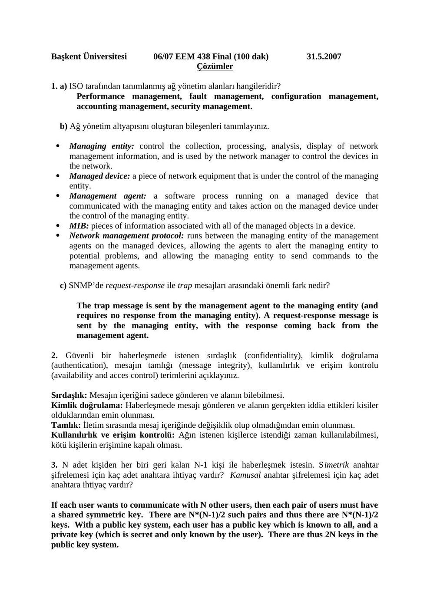
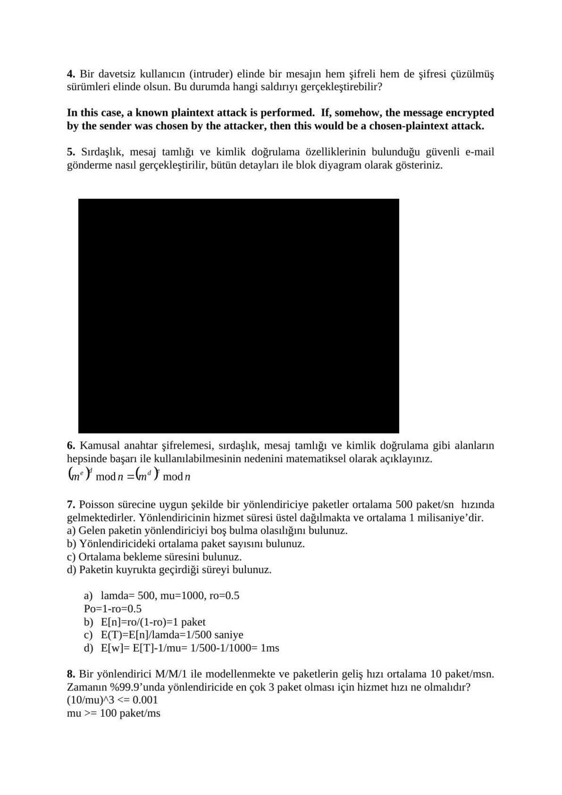
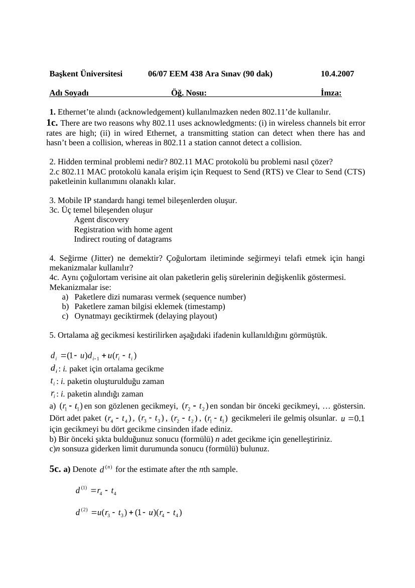
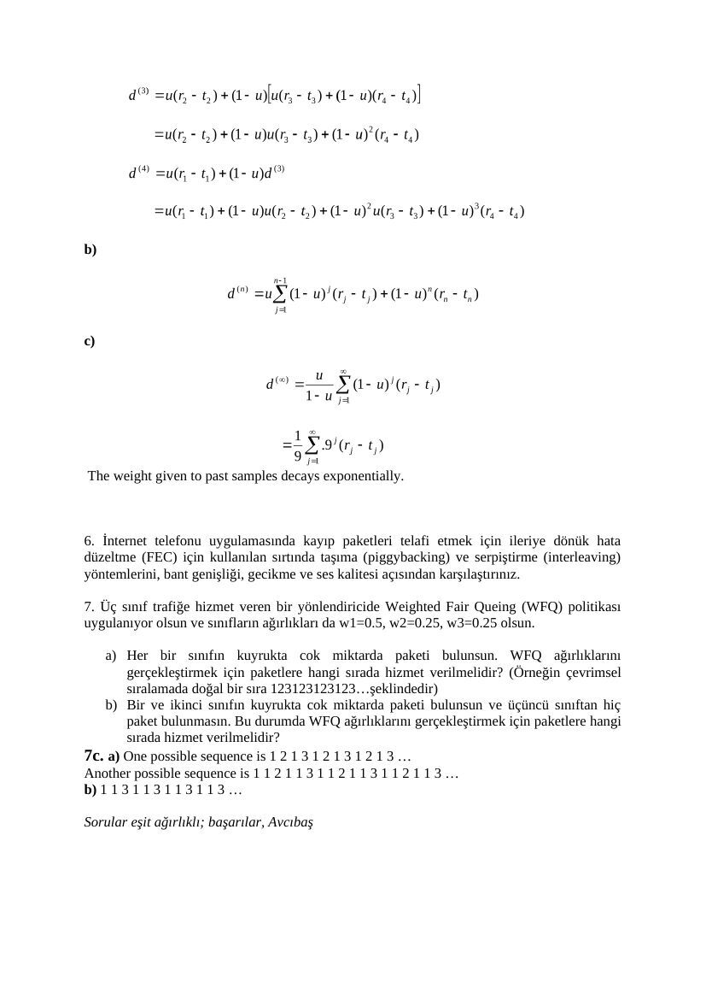

Başkent Üniversitesi EEM438 dersinin 2007 yılı ara sınav ve final soruları, ilgili cevap anahtarlarıyla birlikte aktarılmıştır. Cevap belgelerine yapıştırılmış ticari kitap slaytları yayın kopyalarından çıkarılmıştır. Belgelerin arşiv için hazırlanmış PDF kopyaları yazının sonunda indirilebilir.

## EEM438 Final 2007

Başkent Üniversitesi 06/07 EEM 438 Final (100 Dakika) 31.5.2007

**1.** (15p) a) ISO tarafından tanımlanmış ağ yönetim alanları hangileridir? b)Ağ yönetim altyapısını oluşturan bileşenleri tanımlayınız. c) SNMP’de request-response ile trap mesajları arasındaki fark nedir?

**2.** (10p)Güvenli bir haberleşmede istenen sırdaşlık (confidentiality), kimlik doğrulama (authentication), mesajın tamlığı (message integrity), kullanılırlık ve erişim kontrolü (availability and acces control) terimlerini açıklayınız.

**3.** (10p) N adet kişiden her biri geri kalan N-1 kişi ile haberleşmek istesin. Simetrik anahtar şifrelemesi için kaç adet anahtara ihtiyaç vardır? Kamusal anahtar şifrelemesi için kaç adet anahtara ihtiyaç vardır?

**4.** (5p) Bir davetsiz kullanıcın (intruder) elinde bir mesajın hem şifreli hem de şifresi çözülmüş sürümleri olsun. Bu durumda hangi saldırıyı gerçekleştirebilir?

**5.** (20p) Sırdaşlık, mesaj tamlığı ve kimlik doğrulama özelliklerinin bulunduğu güvenli e-mail gönderme nasıl gerçekleştirilir? Bütün detayları blok diyagram üzerinde gösteriniz.

**6.** (10p) Kamusal anahtar şifrelemesi, sırdaşlık, mesaj tamlığı ve kimlik doğrulama gibi alanların hepsinde başarı ile kullanılabilmesinin nedenini matematiksel olarak açıklayınız.

**7.** (15p) Poisson sürecine uygun şekilde bir yönlendiriciye paketler ortalama 500 paket/sn hızında gelmektedirler. Yönlendiricinin hizmet süresi üstel dağılmakta ve ortalama 1 milisaniye’dir. a) Gelen paketin yönlendiriciyi boş bulma olasılığını bulunuz. b) Yönlendiricideki ortalama paket sayısını bulunuz. c) Ortalama bekleme süresini bulunuz. d) Paketin kuyrukta geçirdiği süreyi bulunuz.

**8.** (15p) Bir yönlendirici M/M/1 ile modellenmekte ve paketlerin geliş hızı ortalama 10 paket/msn. Zamanın %99.9’unda yönlendiricide en çok 3 paket olması için hizmet hızı ne olmalıdır?

Sorular eşit ağırlıklı. Hesap makinesi kullanılmayacaktır. Başarılar… Avcıbaş

## EEM438 Final 2007 Cozum

Başkent Üniversitesi 06/07 EEM 438 Final (100 dak) 31.5.2007 Çözümler

**1.** a) ISO tarafından tanımlanmış ağ yönetim alanları hangileridir? Performance management, fault management, configuration management, accounting management, security management.

b) Ağ yönetim altyapısını oluşturan bileşenleri tanımlayınız.

- Managing entity: control the collection, processing, analysis, display of network management information, and is used by the network manager to control the devices in the network.

- Managed device: a piece of network equipment that is under the control of the managing entity.

- Management agent: a software process running on a managed device that communicated with the managing entity and takes action on the managed device under the control of the managing entity.

- MIB: pieces of information associated with all of the managed objects in a device.

- Network management protocol: runs between the managing entity of the management agents on the managed devices, allowing the agents to alert the managing entity to potential problems, and allowing the managing entity to send commands to the management agents.

c) SNMP’de request-response ile trap mesajları arasındaki önemli fark nedir?

The trap message is sent by the management agent to the managing entity (and requires no response from the managing entity). A request-response message is sent by the managing entity, with the response coming back from the management agent.

**2.** Güvenli bir haberleşmede istenen sırdaşlık (confidentiality), kimlik doğrulama (authentication), mesajın tamlığı (message integrity), kullanılırlık ve erişim kontrolu (availability and acces control) terimlerini açıklayınız.

Sırdaşlık: Mesajın içeriğini sadece gönderen ve alanın bilebilmesi. Kimlik doğrulama: Haberleşmede mesajı gönderen ve alanın gerçekten iddia ettikleri kisiler olduklarından emin olunması. Tamlık: İletim sırasında mesaj içeriğinde değişiklik olup olmadığından emin olunması. Kullanılırlık ve erişim kontrolü: Ağın istenen kişilerce istendiği zaman kullanılabilmesi, kötü kişilerin erişimine kapalı olması.

**3.** N adet kişiden her biri geri kalan N-1 kişi ile haberleşmek istesin. Simetrik anahtar şifrelemesi için kaç adet anahtara ihtiyaç vardır? Kamusal anahtar şifrelemesi için kaç adet anahtara ihtiyaç vardır?

If each user wants to communicate with N other users, then each pair of users must have a shared symmetric key. There are N*(N-1)/2 such pairs and thus there are N*(N-1)/2 keys. With a public key system, each user has a public key which is known to all, and a private key (which is secret and only known by the user). There are thus 2N keys in the public key system.

**4.** Bir davetsiz kullanıcın (intruder) elinde bir mesajın hem şifreli hem de şifresi çüzülmüş sürümleri elinde olsun. Bu durumda hangi saldırıyı gerçekleştirebilir?

In this case, a known plaintext attack is performed. If, somehow, the message encrypted by the sender was chosen by the attacker, then this would be a chosen-plaintext attack.

**5.** Sırdaşlık, mesaj tamlığı ve kimlik doğrulama özelliklerinin bulunduğu güvenli e-mail gönderme nasıl gerçekleştirilir, bütün detayları ile blok diyagram olarak gösteriniz.

[Kitap slaydı arşiv kopyasından çıkarıldı.]

**6.** Kamusal anahtar şifrelemesi, sırdaşlık, mesaj tamlığı ve kimlik doğrulama gibi alanların hepsinde başarı ile kullanılabilmesinin nedenini matematiksel olarak açıklayınız.

**7.** Poisson sürecine uygun şekilde bir yönlendiriciye paketler ortalama 500 paket/sn hızında gelmektedirler. Yönlendiricinin hizmet süresi üstel dağılmakta ve ortalama 1 milisaniye’dir. a) Gelen paketin yönlendiriciyi boş bulma olasılığını bulunuz. b) Yönlendiricideki ortalama paket sayısını bulunuz. c) Ortalama bekleme süresini bulunuz. d) Paketin kuyrukta geçirdiği süreyi bulunuz.

a) lamda= 500, mu=1000, ro=0.5 Po=1-ro=0.5 b) E[n]=ro/(1-ro)=1 paket c) E(T)=E[n]/lamda=1/500 saniye d) E[w]= E[T]-1/mu= 1/500-1/1000= 1ms

**8.** Bir yönlendirici M/M/1 ile modellenmekte ve paketlerin geliş hızı ortalama 10 paket/msn. Zamanın %99.9’unda yönlendiricide en çok 3 paket olması için hizmet hızı ne olmalıdır? (10/mu)^3 <= 0.001 mu >= 100 paket/ms

## EEM438 Midterm 2007

Başkent Üniversitesi 06/07 EEM 438 Ara Sınav (100 dak) 10.4.2007

**1.** Ethernet’te alındı (acknowledgement) kullanılmazken neden 802.11’de kullanılır?

**2.** Hidden terminal problemi nedir? 802.11 MAC protokolü bu problemi nasıl çözer?

**3.** Mobile IP standardı hangi temel bileşenlerden oluşur?

**4.** Seğirme (Jitter) ne demektir? Çoğulortam iletiminde seğirmeyi telafi etmek için hangi mekanizmalar kullanılır?

**5.** Ortalama ağ gecikmesi kestirilirken aşağıdaki ifadenin kullanıldığını görmüştük:

: i. paket için ortalama gecikme, : i. paketin oluşturulduğu zaman, : i. paketin alındığı zaman.

en son gecikmeyi, en sondan bir önceki gecikmeyi, … göstersin. Dört adet paket , , , gecikmeleri ile gelmiş olsunlar. a) için gecikmeyi bu dört gecikme cinsinden ifade ediniz.

b) Bir önceki şıkta bulduğunuz sonucu (formülü) n adet gecikme için genelleştiriniz.

c) n sonsuza giderken limit durumunda sonucu (formülü) bulunuz.

**6.** İnternet telefonu uygulamasında kayıp paketleri telafi etmek için, ileriye dönük hata düzeltmede (FEC) kullanılan sırtında taşıma (piggybacking) ve serpiştirme (interleaving) yöntemlerini, bant genişliği, gecikme ve ses kalitesi açısından karşılaştırınız.

**7.** Üç sınıf trafiğe hizmet veren bir yönlendiricide Weighted Fair Queing (WFQ) politikası uygulanıyor olsun ve sınıfların ağırlıkları da w1=0.5, w2=0.25, w3=0.25 olsun.

a) Her bir sınıfın kuyrukta cok miktarda paketi bulunsun. WFQ ağırlıklarını gerçekleştirmek için paketlere hangi sırada hizmet verilmelidir? (Örneğin çevrimsel sıralamada doğal bir sıra 1 2 3 1 2 3 1 2 3 1 2 3…şeklindedir.)

b) Bir ve ikinci sınıfın kuyrukta cok miktarda paketi bulunsun ve üçüncü sınıftan hiç paket bulunmasın. Bu durumda WFQ ağırlıklarını gerçekleştirmek için paketlere hangi sırada hizmet verilmelidir?

Sorular eşit ağırlıklı. Hesap makinesi kullanılmayacaktır. Başarılar… Avcıbaş

## EEM438 Midterm 2007 Cevap Anahtar

Başkent Üniversitesi 06/07 EEM 438 Ara Sınav (90 dak) 10.4.2007

**1.** Ethernet’te alındı (acknowledgement) kullanılmazken neden 802.11’de kullanılır. 1c. There are two reasons why 802.11 uses acknowledgments: (i) in wireless channels bit error rates are high; (ii) in wired Ethernet, a transmitting station can detect when there has and hasn’t been a collision, whereas in 802.11 a station cannot detect a collision.

**2.** Hidden terminal problemi nedir? 802.11 MAC protokolü bu problemi nasıl çözer?

**2.** c 802.11 MAC protokolü kanala erişim için Request to Send (RTS) ve Clear to Send (CTS) paketleinin kullanımını olanaklı kılar.

**3.** Mobile IP standardı hangi temel bileşenlerden oluşur. 3c. Üç temel bileşenden oluşur Agent discovery Registration with home agent Indirect routing of datagrams

**4.** Seğirme (Jitter) ne demektir? Çoğulortam iletiminde seğirmeyi telafi etmek için hangi mekanizmalar kullanılır? 4c. Aynı çoğulortam verisine ait olan paketlerin geliş sürelerinin değişkenlik göstermesi. Mekanizmalar ise: a) Paketlere dizi numarası vermek (sequence number) b) Paketlere zaman bilgisi eklemek (timestamp) c) Oynatmayı geciktirmek (delaying playout)

**5.** Ortalama ağ gecikmesi kestirilirken aşağıdaki ifadenin kullanıldığını görmüştük.

: i. paket için ortalama gecikme : i. paketin oluşturulduğu zaman : i. paketin alındığı zaman a) en son gözlenen gecikmeyi, en sondan bir önceki gecikmeyi, … göstersin. Dört adet paket , , , gecikmeleri ile gelmiş olsunlar. için gecikmeyi bu dört gecikme cinsinden ifade ediniz. b) Bir önceki şıkta bulduğunuz sonucu (formülü) n adet gecikme için genelleştiriniz. c)n sonsuza giderken limit durumunda sonucu (formülü) bulunuz.

5c. a) Denote for the estimate after the nth sample.

b)

c)

The weight given to past samples decays exponentially.

**6.** İnternet telefonu uygulamasında kayıp paketleri telafi etmek için ileriye dönük hata düzeltme (FEC) için kullanılan sırtında taşıma (piggybacking) ve serpiştirme (interleaving) yöntemlerini, bant genişliği, gecikme ve ses kalitesi açısından karşılaştırınız.

**7.** Üç sınıf trafiğe hizmet veren bir yönlendiricide Weighted Fair Queing (WFQ) politikası uygulanıyor olsun ve sınıfların ağırlıkları da w1=0.5, w2=0.25, w3=0.25 olsun.

a) Her bir sınıfın kuyrukta cok miktarda paketi bulunsun. WFQ ağırlıklarını gerçekleştirmek için paketlere hangi sırada hizmet verilmelidir? (Örneğin çevrimsel sıralamada doğal bir sıra 1 2 3 1 2 3 1 2 3 1 2 3…şeklindedir) b) Bir ve ikinci sınıfın kuyrukta cok miktarda paketi bulunsun ve üçüncü sınıftan hiç paket bulunmasın. Bu durumda WFQ ağırlıklarını gerçekleştirmek için paketlere hangi sırada hizmet verilmelidir? 7c. a) One possible sequence is 1 2 1 3 1 2 1 3 1 2 1 3 … Another possible sequence is 1 1 2 1 1 3 1 1 2 1 1 3 1 1 2 1 1 3 … b) 1 1 3 1 1 3 1 1 3 1 1 3 …

Sorular eşit ağırlıklı; başarılar, Avcıbaş

*Not:  Gecikme kestirimi: dᵢ=(1−u)dᵢ₋₁+u(rᵢ−tᵢ). Başlangıç d₀ dahil açılım dₙ=(1−u)ⁿd₀+uΣₖ₌₀ⁿ⁻¹(1−u)ᵏxₙ₋ₖ şeklindedir; 0<u<1 için eski örnek ağırlıkları üstel azalır. WFQ sorusunda üçüncü sınıf boşken anahtarın 1 1 3 sırası hatalıdır; birinci ve ikinci sınıf için 1 1 2 tekrarı istenen 2:1 ağırlığı sağlar. Her üç sınıf doluyken 1 2 1 3 uygundur; anahtardaki diğer örnek 1 1 2 1 1 3, 0,5/0,25/0,25 oranını sağlamaz. M/M/1 örneğinde ρ=0,5, P₀=0,5, E[N]=1, sistemde kalış 2 ms ve kuyruk beklemesi 1 ms’dir. “En çok 3 paket” koşulu için P(N≥4)=ρ⁴≤0,001 kullanılmalıdır; μ≥10/(0,001)^(1/4)≈56,23 paket/ms bulunur. Anahtar ρ³ kullanarak 100 paket/ms vermiştir.*

## Fotoğraflanmış tekrar soruları

Ders klasöründeki dokuz maddelik tekrar sayfası fotoğraflanmış sayfadan metne aktarıldı; fotoğraf özel arşivde tutulur. Sorular farklı yılların sınav konularını birleştirir.

1. Ethernet’te ACK kullanılmazken 802.11’de neden kullanılır? Notta kablosuz hata oranı ve göndericinin çarpışmayı algılayamaması gerekçe gösterilir.
2. Hidden terminal problemi için 802.11 MAC’in RTS/CTS kullanımına izin verdiği yazılmıştır.
3. Mobile IP: agent discovery, registration with home agent, indirect routing of datagrams.
4. Jitter paketlerin geliş sürelerinin değişmesidir. Sıra numarası, timestamp ve oynatmayı geciktirme yöntemleri sıralanır.
5. Kablosuz çarpışma seziminin güçlüğü: göndericinin kendi sinyali, gizli terminaller ve sinyal zayıflaması.
6. CSMA/CA: boş kanal için DIFS, meşgul kanal için backoff, ACK için SIFS hatırlatılır. Çarpışmalar arttıkça backoff aralığının uzadığı yazılmıştır.
7. Başlıkta çarpışma sezimi sorusu yinelenmiş, altında çoklu ortam iletişimi için uygulama katmanında kullanılan iki yöntem sorulmuştur; cevap yoktur.
8. IP’ye ek MAC adresi gereksinimi, switch’in ağ katmanı işlemi yapmadan çerçeve iletmesiyle açıklanmıştır.
9. RTS/CTS cevabı ikinci sorunun tekrarıdır.

*Not: Fotoğraftaki MAC açıklaması temel katman-2 switch bağlamındadır. RTS/CTS gizli terminal sorununu azaltır; her tür çarpışmayı kesin biçimde ortadan kaldırmaz. CSMA/CA özeti, tam durum makinesi olarak değerlendirilmemelidir.*
