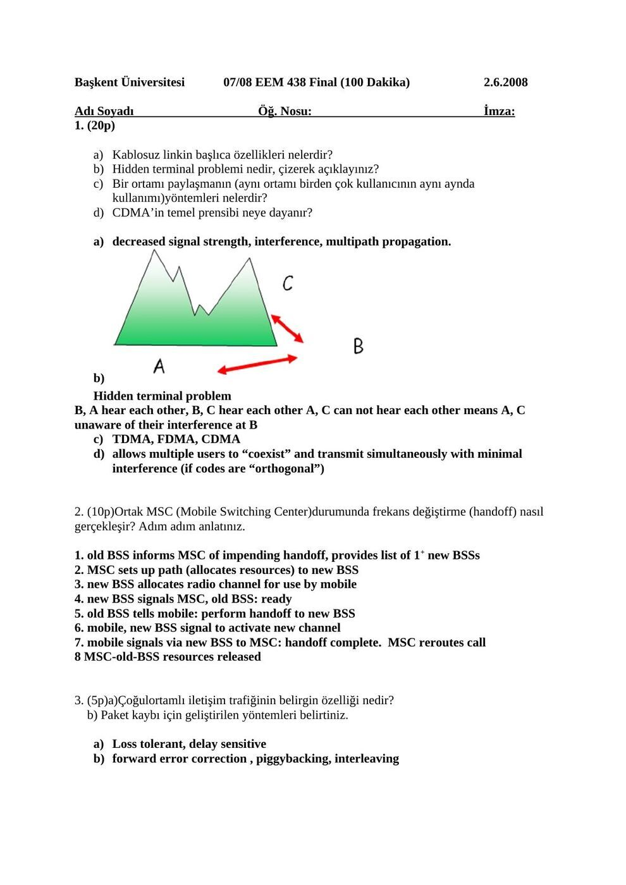
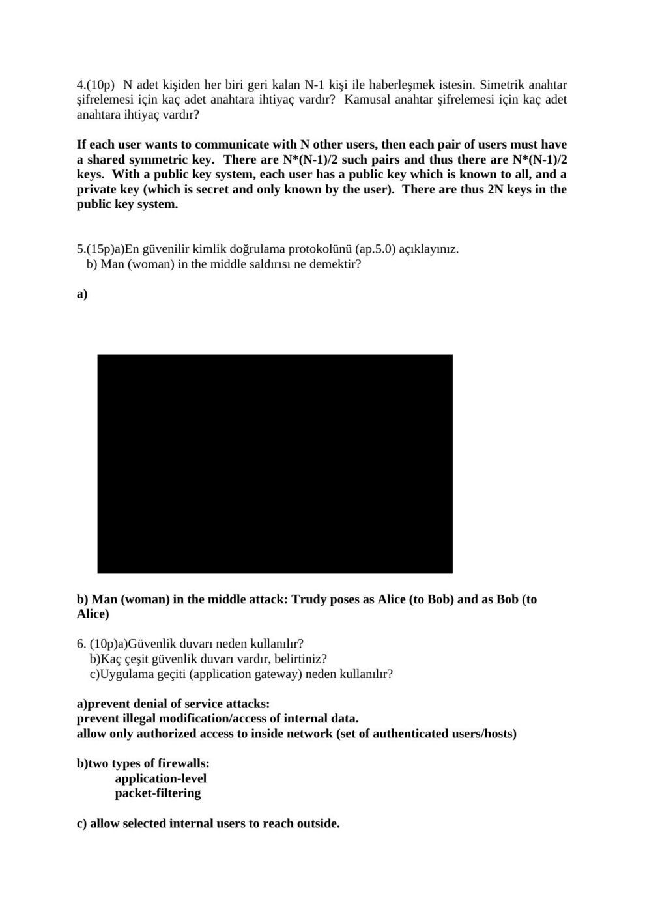
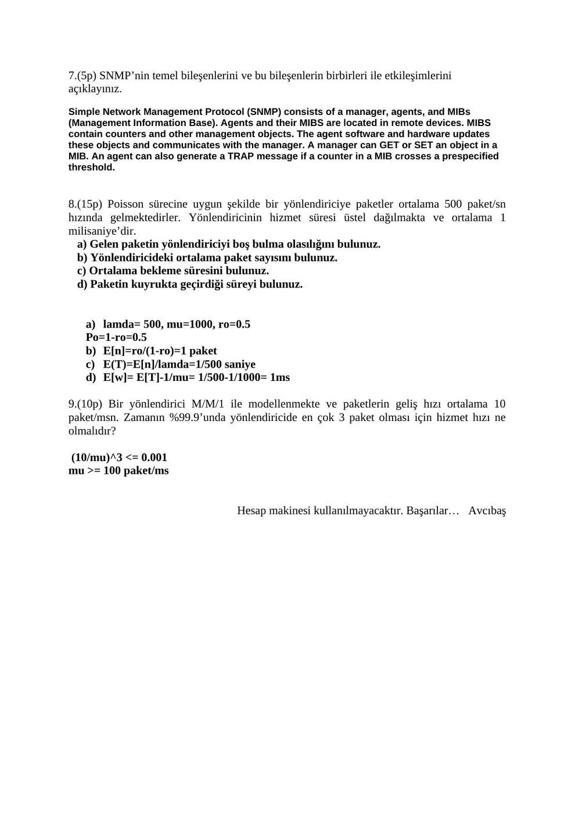
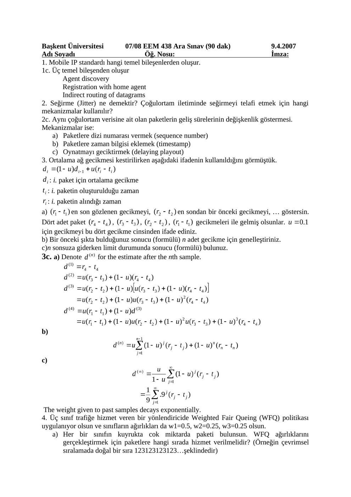
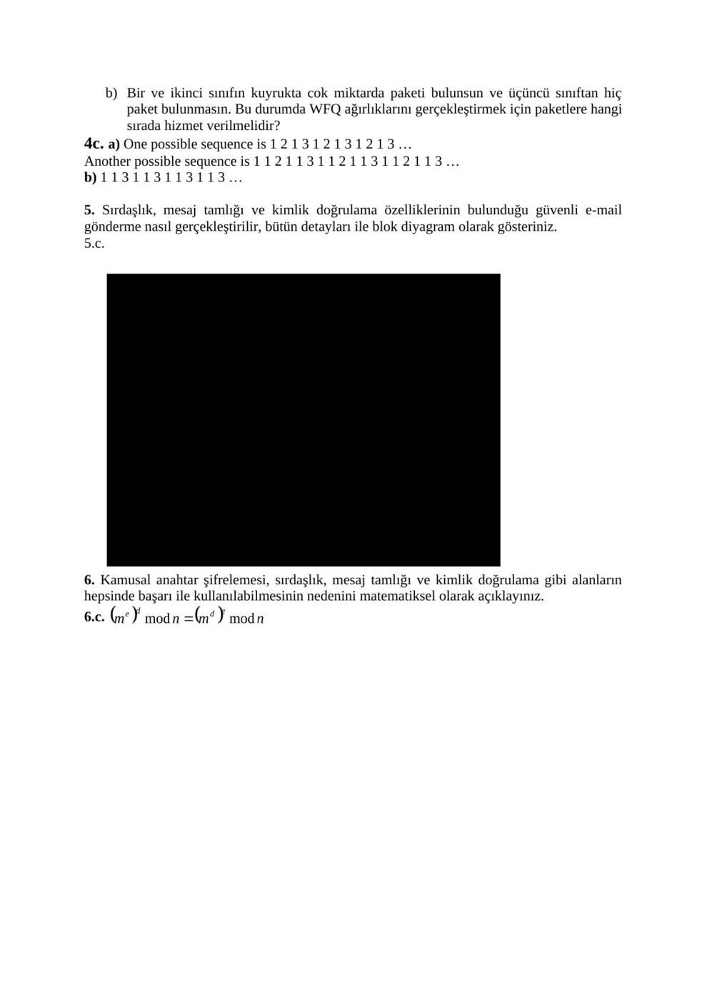

The 2008 midterm and final exam questions of the Başkent University EEM438 course are presented here together with their answer keys. Commercial textbook slides that had been pasted into the answer documents have been removed from the published copies. PDF copies of the documents prepared for the archive can be downloaded at the end of the post.

## EEM438 Final 2008

Başkent University 07/08 EEM 438 Final (100 Minutes) 02/06/2008

**1.** (20p) a) What are the main characteristics of a wireless link? b) What is the hidden terminal problem? Explain with a drawing. c) What are the methods of sharing a medium (multiple users using the same medium at the same time)? d) What is the basic principle of CDMA?

**2.** (10p) How does frequency change (handoff) take place in the case of a common MSC (Mobile Switching Center)? Explain step by step.

**3.** (5p) a) What is the characteristic feature of multimedia communication traffic? b) State the methods developed for packet loss.

**4.** (10p) Suppose each of N people wants to communicate with the remaining N-1 people. How many keys are needed for symmetric key encryption? How many keys are needed for public key encryption?

**5.** (15p) a) Explain the most reliable authentication protocol (ap5.0). b) What is a man (woman) in the middle attack?

**6.** (10p) a) Why is a firewall used? b) State how many types of firewalls there are. c) Why is an application gateway used?

**7.** (5p) Explain the basic components of SNMP and how these components interact with each other.

**8.** (15p) Packets arrive at a router according to a Poisson process at an average rate of 500 packets/s. The router's service time is exponentially distributed with a mean of 1 millisecond. a) Find the probability that an arriving packet finds the router empty. b) Find the average number of packets in the router. c) Find the average waiting time. d) Find the time the packet spends in the queue.

**9.** (10p) A router is modeled as M/M/1 and the average packet arrival rate is 10 packets/ms. What should the service rate be so that there are at most 3 packets in the router 99.9% of the time?

Calculators are not allowed. Good luck… Avcıbaş

## EEM438 Final 2008 Answer Key

Başkent University 07/08 EEM 438 Final (100 Minutes) 2.6.2008

**1.** (20p)

a) What are the main characteristics of a wireless link? b) What is the hidden terminal problem? Explain with a drawing. c) What are the methods of sharing a medium (multiple users using the same medium at the same time)? d) What is the basic principle of CDMA?

a) decreased signal strength, interference, multipath propagation.

b) Hidden terminal problem B, A hear each other, B, C hear each other A, C can not hear each other means A, C unaware of their interference at B c) TDMA, FDMA, CDMA d) allows multiple users to “coexist” and transmit simultaneously with minimal interference (if codes are “orthogonal”)

**2.** (10p) How does frequency change (handoff) take place in the case of a common MSC (Mobile Switching Center)? Explain step by step.

**1.** old BSS informs MSC of impending handoff, provides list of 1+ new BSSs

**2.** MSC sets up path (allocates resources) to new BSS

**3.** new BSS allocates radio channel for use by mobile

**4.** new BSS signals MSC, old BSS: ready

**5.** old BSS tells mobile: perform handoff to new BSS

**6.** mobile, new BSS signal to activate new channel

**7.** mobile signals via new BSS to MSC: handoff complete. MSC reroutes call 8 MSC-old-BSS resources released

**3.** (5p) a) What is the distinguishing feature of multimedia communication traffic? b) State the methods developed for packet loss.

a) Loss tolerant, delay sensitive b) forward error correction , piggybacking, interleaving

**4.** (10p) Suppose each of N people wants to communicate with the remaining N-1 people. How many keys are needed for symmetric key encryption? How many keys are needed for public key encryption?

If each user wants to communicate with N other users, then each pair of users must have a shared symmetric key. There are N*(N-1)/2 such pairs and thus there are N*(N-1)/2 keys. With a public key system, each user has a public key which is known to all, and a private key (which is secret and only known by the user). There are thus 2N keys in the public key system.

**5.** (15p) a) Explain the most reliable authentication protocol (ap5.0). b) What is a man (woman) in the middle attack?

a)

b) Man (woman) in the middle attack: Trudy poses as Alice (to Bob) and as Bob (to Alice)

**6.** (10p) a) Why is a firewall used? b) State how many types of firewalls there are. c) Why is an application gateway used?

a)prevent denial of service attacks: prevent illegal modification/access of internal data. allow only authorized access to inside network (set of authenticated users/hosts)

b)two types of firewalls: application-level packet-filtering

c) allow selected internal users to reach outside.

**7.** (5p) Explain the basic components of SNMP and how these components interact with each other. Simple Network Management Protocol (SNMP) consists of a manager, agents, and MIBs (Management Information Base). Agents and their MIBS are located in remote devices. MIBS contain counters and other management objects. The agent software and hardware updates these objects and communicates with the manager. A manager can GET or SET an object in a MIB. An agent can also generate a TRAP message if a counter in a MIB crosses a prespecified threshold.

**8.** (15p) Packets arrive at a router according to a Poisson process at an average rate of 500 packets/s. The router's service time is exponentially distributed with a mean of 1 millisecond. a) Find the probability that an arriving packet finds the router empty. b) Find the average number of packets in the router. c) Find the average waiting time. d) Find the time the packet spends in the queue.

a) lamda= 500, mu=1000, ro=0.5 Po=1-ro=0.5 b) E[n]=ro/(1-ro)=1 paket c) E(T)=E[n]/lamda=1/500 saniye d) E[w]= E[T]-1/mu= 1/500-1/1000= 1ms

**9.** (10p) A router is modeled as M/M/1 and the average packet arrival rate is 10 packets/ms. What should the service rate be so that there are at most 3 packets in the router 99.9% of the time?

(10/mu)^3 <= 0.001 mu >= 100 paket/ms

Calculators are not allowed. Good luck… Avcıbaş

## EEM438 Midterm 2008

Başkent University 07/08 EEM 438 Midterm (90 min) 9.4.2008

**1.** (10p) What basic components does the Mobile IP standard consist of?

**2.** (10p) What is jitter? What mechanisms are used to compensate for jitter in multimedia transmission?

**3.** (30p) We saw that the following expression is used when estimating the average network delay:

: average delay for the i-th packet, : time at which the i-th packet was generated, : time at which the i-th packet was received, the most recent delay, the delay before the most recent one, … .

Suppose four packets arrive with delays , , , .

a) Express the delay for in terms of these four delays.

b) Generalize the result (formula) you found in the previous part to n delays.

c) Find the result (formula) in the limit as n goes to infinity.

**4.** (20p) Suppose the Weighted Fair Queueing (WFQ) policy is applied at a router serving three classes of traffic, and the class weights are w1=0.5, w2=0.25, w3=0.25.

a) Suppose each class has a large number of packets in its queue. In what order should packets be served to realize the WFQ weights? (For example, a natural order in round-robin scheduling is 1 2 3 1 2 3 1 2 3 1 2 3….)

b) Suppose the first and second classes have a large number of packets in the queue and there are no packets from the third class. In this case, in what order should packets be served to realize the WFQ weights?

**5.** (20p) How is secure e-mail sending, with confidentiality, message integrity and authentication, carried out? Show all the details on a block diagram.

**6.** (10p) Explain mathematically why public key cryptography can be used successfully in all of the applications such as confidentiality, message integrity and authentication.

Calculators are not allowed. Good luck… Avcıbaş

## EEM438 Midterm 2008 Answer Key

Başkent University 07/08 EEM 438 Midterm (90 min) 9.4.2007

**1.** What basic components does the Mobile IP standard consist of. 1c. Üç temel bileşenden oluşur Agent discovery Registration with home agent Indirect routing of datagrams

**2.** What is jitter? What mechanisms are used to compensate for jitter in multimedia transmission? 2c. Aynı çoğulortam verisine ait olan paketlerin geliş sürelerinin değişkenlik göstermesi. Mekanizmalar ise: a) Paketlere dizi numarası vermek (sequence number) b) Paketlere zaman bilgisi eklemek (timestamp) c) Oynatmayı geciktirmek (delaying playout)

**3.** We saw that the following expression is used when estimating the average network delay.

: average delay for the i-th packet : time at which the i-th packet was generated : time at which the i-th packet was received a) Let denote the most recently observed delay, the delay before the most recent one, … . Suppose four packets arrive with delays , , , . Express the delay for in terms of these four delays. b) Generalize the result (formula) you found in the previous part to n delays. c) Find the result (formula) in the limit as n goes to infinity. 3c. a) Denote for the estimate after the nth sample.

b)

c)

The weight given to past samples decays exponentially.

**4.** Suppose the Weighted Fair Queueing (WFQ) policy is applied at a router serving three classes of traffic, and the class weights are w1=0.5, w2=0.25, w3=0.25. a) Suppose each class has a large number of packets in its queue. In what order should packets be served to realize the WFQ weights? (For example, a natural order in round-robin scheduling is 1 2 3 1 2 3 1 2 3 1 2 3…)

b) Suppose the first and second classes have a large number of packets in the queue and there are no packets from the third class. In this case, in what order should packets be served to realize the WFQ weights? 4c. a) One possible sequence is 1 2 1 3 1 2 1 3 1 2 1 3 … Another possible sequence is 1 1 2 1 1 3 1 1 2 1 1 3 1 1 2 1 1 3 … b) 1 1 3 1 1 3 1 1 3 1 1 3 …

**5.** How is secure e-mail sending, with confidentiality, message integrity and authentication, carried out? Show all the details as a block diagram.

**5.** c.

[Textbook slide removed from the archive copy.]

**6.** Explain mathematically why public key cryptography can be used successfully in all of the areas such as confidentiality, message integrity and authentication.

**6.** c.

*Note: The 2008 midterm answer key is dated 9.4.2007, whereas the question document says 9.4.2008. The date discrepancy in the source has been preserved. Delay estimation: dᵢ=(1−u)dᵢ₋₁+u(rᵢ−tᵢ). Including the initial d₀, the expansion is dₙ=(1−u)ⁿd₀+uΣₖ₌₀ⁿ⁻¹(1−u)ᵏxₙ₋ₖ; for 0<u<1 the weights of old samples decay exponentially. In the WFQ question, the key's sequence 1 1 3 is incorrect when the third class is empty; repeating 1 1 2 for the first and second classes gives the required 2:1 weighting. With all three classes backlogged, 1 2 1 3 is appropriate; the other example in the key, 1 1 2 1 1 3, does not satisfy the 0.5/0.25/0.25 ratio.*

*Note: For the "at most 3 packets" condition, P(N≥4)=ρ⁴≤0.001 is used; μ≥10/(0.001)^(1/4)≈56.23 packets/ms. The 100 packets/ms that the key obtains with ρ³ corresponds to a stronger, different condition.*
