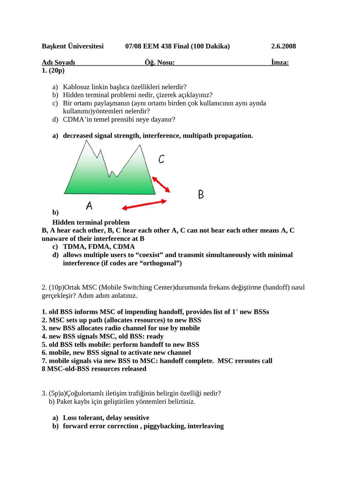
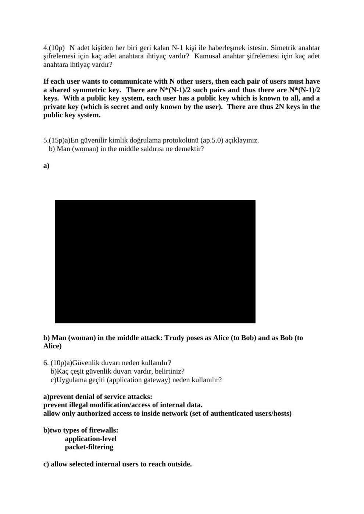
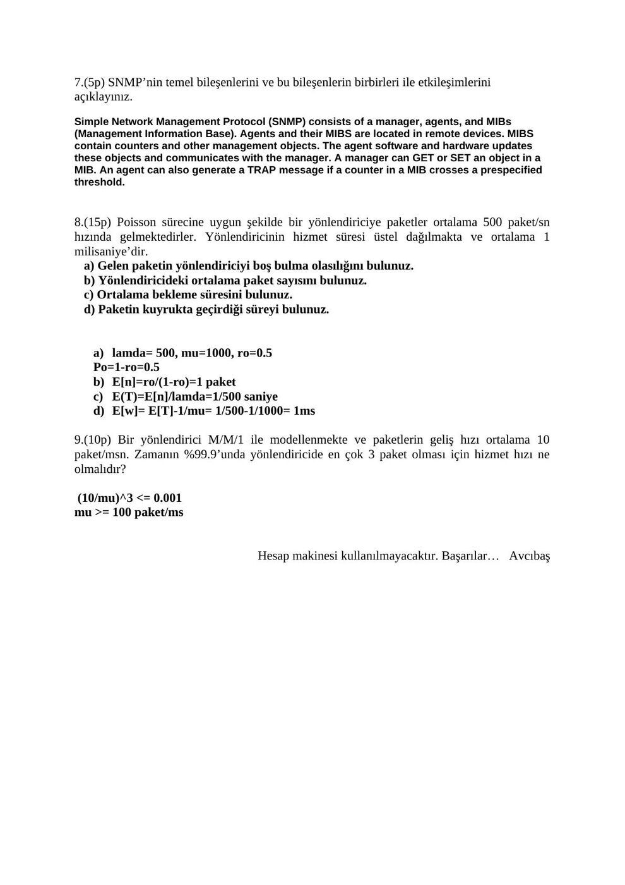
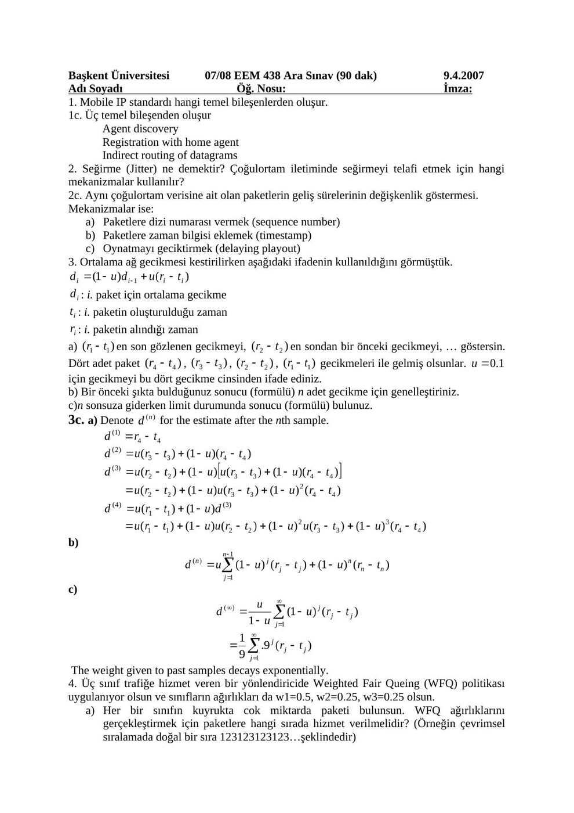
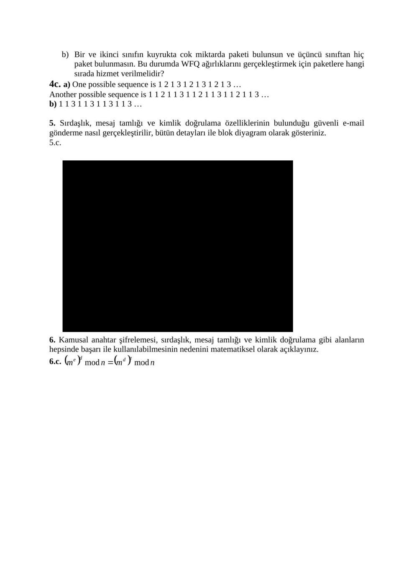

Başkent Üniversitesi EEM438 dersinin 2008 yılı ara sınav ve final soruları, ilgili cevap anahtarlarıyla birlikte aktarılmıştır. Cevap belgelerine yapıştırılmış ticari kitap slaytları yayın kopyalarından çıkarılmıştır. Belgelerin arşiv için hazırlanmış PDF kopyaları yazının sonunda indirilebilir.

## EEM438 Final 2008

Başkent Üniversitesi 07/08 EEM 438 Final (100 Dakika) 02/06/2008

**1.** (20p) a) Kablosuz linkin başlıca özellikleri nelerdir? b) Hidden terminal problemi nedir, çizerek açıklayınız? c) Bir ortamı paylaşmanın (aynı ortamı birden çok kullanıcının aynı anda kullanımı) yöntemleri nelerdir? d) CDMA’in temel prensibi neye dayanır?

**2.** (10p) Ortak MSC (Mobile Switching Center)durumunda frekans değiştirme (handoff) nasıl gerçekleşir? Adım adım anlatınız.

**3.** (5p) a) Çoğulortamlı iletişim trafiğinin karakteristik özelliği nedir? b) Paket kaybı için geliştirilen yöntemleri belirtiniz.

**4.** (10p) N adet kişiden her biri geri kalan N-1 kişi ile haberleşmek istesin. Simetrik anahtar şifrelemesi için kaç adet anahtara ihtiyaç vardır? Kamusal anahtar şifrelemesi için kaç adet anahtara ihtiyaç vardır?

**5.** (15p) a) En güvenilir kimlik doğrulama protokolünü (ap.5.0) açıklayınız. b) Man (woman) in the middle saldırısı ne demektir?

**6.** (10p) a) Güvenlik duvarı neden kullanılır? b) Kaç çeşit güvenlik duvarı vardır, belirtiniz? c) Uygulama geçiti (application gateway) neden kullanılır?

**7.** (5p) SNMP’nin temel bileşenlerini ve bu bileşenlerin birbirleri ile etkileşimlerini açıklayınız.

**8.** (15p) Poisson sürecine uygun şekilde bir yönlendiriciye paketler ortalama 500 paket/sn hızında gelmektedirler. Yönlendiricinin hizmet süresi üstel dağılmakta ve ortalama 1 milisaniye’dir. a) Gelen paketin yönlendiriciyi boş bulma olasılığını bulunuz. b) Yönlendiricideki ortalama paket sayısını bulunuz. c) Ortalama bekleme süresini bulunuz. d) Paketin kuyrukta geçirdiği süreyi bulunuz.

**9.** (10p) Bir yönlendirici M/M/1 ile modellenmekte ve paketlerin geliş hızı ortalama 10 paket/msn. Zamanın %99.9’unda yönlendiricide en çok 3 paket olması için hizmet hızı ne olmalıdır?

Hesap makinesi kullanılmayacaktır. Başarılar… Avcıbaş

## EEM438 Final 2008 Cevap Anahtari

Başkent Üniversitesi 07/08 EEM 438 Final (100 Dakika) 2.6.2008

**1.** (20p)

a) Kablosuz linkin başlıca özellikleri nelerdir? b) Hidden terminal problemi nedir, çizerek açıklayınız? c) Bir ortamı paylaşmanın (aynı ortamı birden çok kullanıcının aynı aynda kullanımı)yöntemleri nelerdir? d) CDMA’in temel prensibi neye dayanır?

a) decreased signal strength, interference, multipath propagation.

b) Hidden terminal problem B, A hear each other, B, C hear each other A, C can not hear each other means A, C unaware of their interference at B c) TDMA, FDMA, CDMA d) allows multiple users to “coexist” and transmit simultaneously with minimal interference (if codes are “orthogonal”)

**2.** (10p)Ortak MSC (Mobile Switching Center)durumunda frekans değiştirme (handoff) nasıl gerçekleşir? Adım adım anlatınız.

**1.** old BSS informs MSC of impending handoff, provides list of 1+ new BSSs

**2.** MSC sets up path (allocates resources) to new BSS

**3.** new BSS allocates radio channel for use by mobile

**4.** new BSS signals MSC, old BSS: ready

**5.** old BSS tells mobile: perform handoff to new BSS

**6.** mobile, new BSS signal to activate new channel

**7.** mobile signals via new BSS to MSC: handoff complete. MSC reroutes call 8 MSC-old-BSS resources released

**3.** (5p)a)Çoğulortamlı iletişim trafiğinin belirgin özelliği nedir? b) Paket kaybı için geliştirilen yöntemleri belirtiniz.

a) Loss tolerant, delay sensitive b) forward error correction , piggybacking, interleaving

**4.** (10p) N adet kişiden her biri geri kalan N-1 kişi ile haberleşmek istesin. Simetrik anahtar şifrelemesi için kaç adet anahtara ihtiyaç vardır? Kamusal anahtar şifrelemesi için kaç adet anahtara ihtiyaç vardır?

If each user wants to communicate with N other users, then each pair of users must have a shared symmetric key. There are N*(N-1)/2 such pairs and thus there are N*(N-1)/2 keys. With a public key system, each user has a public key which is known to all, and a private key (which is secret and only known by the user). There are thus 2N keys in the public key system.

**5.** (15p)a)En güvenilir kimlik doğrulama protokolünü (ap.5.0) açıklayınız. b) Man (woman) in the middle saldırısı ne demektir?

a)

b) Man (woman) in the middle attack: Trudy poses as Alice (to Bob) and as Bob (to Alice)

**6.** (10p)a)Güvenlik duvarı neden kullanılır? b)Kaç çeşit güvenlik duvarı vardır, belirtiniz? c)Uygulama geçiti (application gateway) neden kullanılır?

a)prevent denial of service attacks: prevent illegal modification/access of internal data. allow only authorized access to inside network (set of authenticated users/hosts)

b)two types of firewalls: application-level packet-filtering

c) allow selected internal users to reach outside.

**7.** (5p) SNMP’nin temel bileşenlerini ve bu bileşenlerin birbirleri ile etkileşimlerini açıklayınız. Simple Network Management Protocol (SNMP) consists of a manager, agents, and MIBs (Management Information Base). Agents and their MIBS are located in remote devices. MIBS contain counters and other management objects. The agent software and hardware updates these objects and communicates with the manager. A manager can GET or SET an object in a MIB. An agent can also generate a TRAP message if a counter in a MIB crosses a prespecified threshold.

**8.** (15p) Poisson sürecine uygun şekilde bir yönlendiriciye paketler ortalama 500 paket/sn hızında gelmektedirler. Yönlendiricinin hizmet süresi üstel dağılmakta ve ortalama 1 milisaniye’dir. a) Gelen paketin yönlendiriciyi boş bulma olasılığını bulunuz. b) Yönlendiricideki ortalama paket sayısını bulunuz. c) Ortalama bekleme süresini bulunuz. d) Paketin kuyrukta geçirdiği süreyi bulunuz.

a) lamda= 500, mu=1000, ro=0.5 Po=1-ro=0.5 b) E[n]=ro/(1-ro)=1 paket c) E(T)=E[n]/lamda=1/500 saniye d) E[w]= E[T]-1/mu= 1/500-1/1000= 1ms

**9.** (10p) Bir yönlendirici M/M/1 ile modellenmekte ve paketlerin geliş hızı ortalama 10 paket/msn. Zamanın %99.9’unda yönlendiricide en çok 3 paket olması için hizmet hızı ne olmalıdır?

(10/mu)^3 <= 0.001 mu >= 100 paket/ms

Hesap makinesi kullanılmayacaktır. Başarılar… Avcıbaş

## EEM438 Midterm 2008

Başkent Üniversitesi 07/08 EEM 438 Ara Sınav (90 dak) 9.4.2008

**1.** (10p) Mobile IP standardı hangi temel bileşenlerden oluşur?

**2.** (10p) Seğirme (Jitter) ne demektir? Çoğulortam iletiminde seğirmeyi telafi etmek için hangi mekanizmalar kullanılır?

**3.** (30p)Ortalama ağ gecikmesi kestirilirken aşağıdaki ifadenin kullanıldığını görmüştük:

: i. paket için ortalama gecikmeyi, : i. paketin oluşturulduğu zamanı, : i. paketin alındığı zamanı, en son gecikmeyi, en sondan bir önceki gecikmeyi, … göstermektedir.

Dört adet paket , , , gecikmeleri ile gelmiş olsunlar.

a) için gecikmeyi bu dört gecikme cinsinden ifade ediniz.

b) Bir önceki şıkta bulduğunuz sonucu (formülü) n adet gecikme için genelleştiriniz.

c) n sonsuza giderken limit durumunda sonucu (formülü) bulunuz.

**4.** (20p) Üç sınıf trafiğe hizmet veren bir yönlendiricide Weighted Fair Queing (WFQ) politikası uygulanıyor olsun ve sınıfların ağırlıkları da w1=0.5, w2=0.25, w3=0.25 olsun.

a) Her bir sınıfın kuyrukta cok miktarda paketi bulunsun. WFQ ağırlıklarını gerçekleştirmek için paketlere hangi sırada hizmet verilmelidir? (Örneğin çevrimsel sıralamada doğal bir sıra 1 2 3 1 2 3 1 2 3 1 2 3…şeklindedir.)

b) Bir ve ikinci sınıfın kuyrukta cok miktarda paketi bulunsun ve üçüncü sınıftan hiç paket bulunmasın. Bu durumda WFQ ağırlıklarını gerçekleştirmek için paketlere hangi sırada hizmet verilmelidir?

**5.** (20p) Sırdaşlık, mesaj tamlığı ve kimlik doğrulama özelliklerinin bulunduğu güvenli e-mail gönderme nasıl gerçekleştirilir? Bütün detayları blok diyagram üzerinde gösteriniz.

**6.** (10p) Kamusal şifrelemenin (public key cryptography), sırdaşlık, mesaj tamlığı ve kimlik doğrulama gibi uygulamaların hepsinde başarı ile kullanılabilmesinin nedenini matematiksel olarak açıklayınız.

Hesap makinesi kullanılmayacaktır. Başarılar… Avcıbaş

## EEM438 Midterm 2008 Cevap Anahtar

Başkent Üniversitesi 07/08 EEM 438 Ara Sınav (90 dak) 9.4.2007

**1.** Mobile IP standardı hangi temel bileşenlerden oluşur. 1c. Üç temel bileşenden oluşur Agent discovery Registration with home agent Indirect routing of datagrams

**2.** Seğirme (Jitter) ne demektir? Çoğulortam iletiminde seğirmeyi telafi etmek için hangi mekanizmalar kullanılır? 2c. Aynı çoğulortam verisine ait olan paketlerin geliş sürelerinin değişkenlik göstermesi. Mekanizmalar ise: a) Paketlere dizi numarası vermek (sequence number) b) Paketlere zaman bilgisi eklemek (timestamp) c) Oynatmayı geciktirmek (delaying playout)

**3.** Ortalama ağ gecikmesi kestirilirken aşağıdaki ifadenin kullanıldığını görmüştük.

: i. paket için ortalama gecikme : i. paketin oluşturulduğu zaman : i. paketin alındığı zaman a) en son gözlenen gecikmeyi, en sondan bir önceki gecikmeyi, … göstersin. Dört adet paket , , , gecikmeleri ile gelmiş olsunlar. için gecikmeyi bu dört gecikme cinsinden ifade ediniz. b) Bir önceki şıkta bulduğunuz sonucu (formülü) n adet gecikme için genelleştiriniz. c)n sonsuza giderken limit durumunda sonucu (formülü) bulunuz. 3c. a) Denote for the estimate after the nth sample.

b)

c)

The weight given to past samples decays exponentially.

**4.** Üç sınıf trafiğe hizmet veren bir yönlendiricide Weighted Fair Queing (WFQ) politikası uygulanıyor olsun ve sınıfların ağırlıkları da w1=0.5, w2=0.25, w3=0.25 olsun. a) Her bir sınıfın kuyrukta cok miktarda paketi bulunsun. WFQ ağırlıklarını gerçekleştirmek için paketlere hangi sırada hizmet verilmelidir? (Örneğin çevrimsel sıralamada doğal bir sıra 1 2 3 1 2 3 1 2 3 1 2 3…şeklindedir)

b) Bir ve ikinci sınıfın kuyrukta cok miktarda paketi bulunsun ve üçüncü sınıftan hiç paket bulunmasın. Bu durumda WFQ ağırlıklarını gerçekleştirmek için paketlere hangi sırada hizmet verilmelidir? 4c. a) One possible sequence is 1 2 1 3 1 2 1 3 1 2 1 3 … Another possible sequence is 1 1 2 1 1 3 1 1 2 1 1 3 1 1 2 1 1 3 … b) 1 1 3 1 1 3 1 1 3 1 1 3 …

**5.** Sırdaşlık, mesaj tamlığı ve kimlik doğrulama özelliklerinin bulunduğu güvenli e-mail gönderme nasıl gerçekleştirilir, bütün detayları ile blok diyagram olarak gösteriniz.

**5.** c.

[Kitap slaydı arşiv kopyasından çıkarıldı.]

**6.** Kamusal anahtar şifrelemesi, sırdaşlık, mesaj tamlığı ve kimlik doğrulama gibi alanların hepsinde başarı ile kullanılabilmesinin nedenini matematiksel olarak açıklayınız.

**6.** c.

*Not: 2008 ara sınav cevap anahtarında 9.4.2007 tarihi yazılıdır; soru belgesinde 9.4.2008 yazmaktadır. Kaynaktaki tarih farkı korunmuştur. Gecikme kestirimi: dᵢ=(1−u)dᵢ₋₁+u(rᵢ−tᵢ). Başlangıç d₀ dahil açılım dₙ=(1−u)ⁿd₀+uΣₖ₌₀ⁿ⁻¹(1−u)ᵏxₙ₋ₖ şeklindedir; 0<u<1 için eski örnek ağırlıkları üstel azalır. WFQ sorusunda üçüncü sınıf boşken anahtarın 1 1 3 sırası hatalıdır; birinci ve ikinci sınıf için 1 1 2 tekrarı istenen 2:1 ağırlığı sağlar. Her üç sınıf doluyken 1 2 1 3 uygundur; anahtardaki diğer örnek 1 1 2 1 1 3, 0,5/0,25/0,25 oranını sağlamaz.*

*Not: “En çok 3 paket” koşulunda P(N≥4)=ρ⁴≤0,001 kullanılır; μ≥10/(0,001)^(1/4)≈56,23 paket/ms. Anahtarın ρ³ ile bulduğu 100 paket/ms daha güçlü, farklı bir koşula karşılık gelir.*
