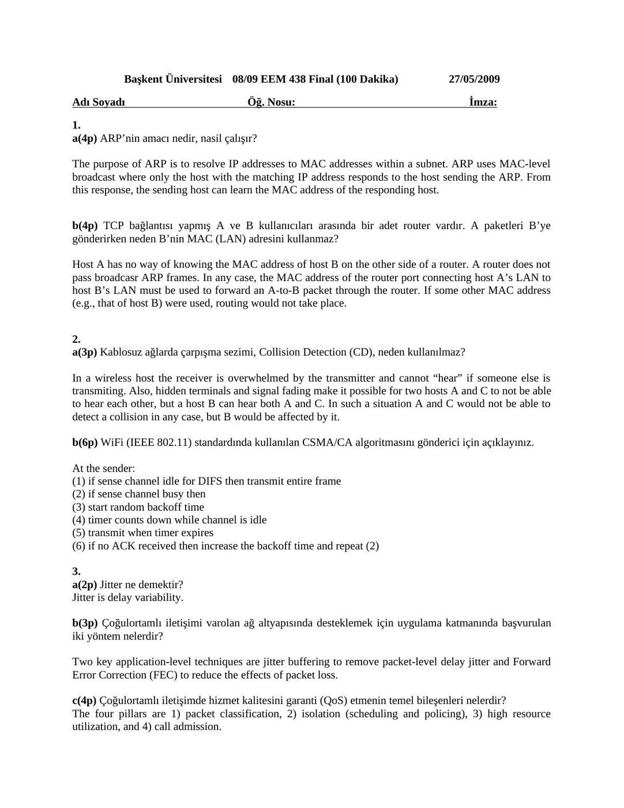
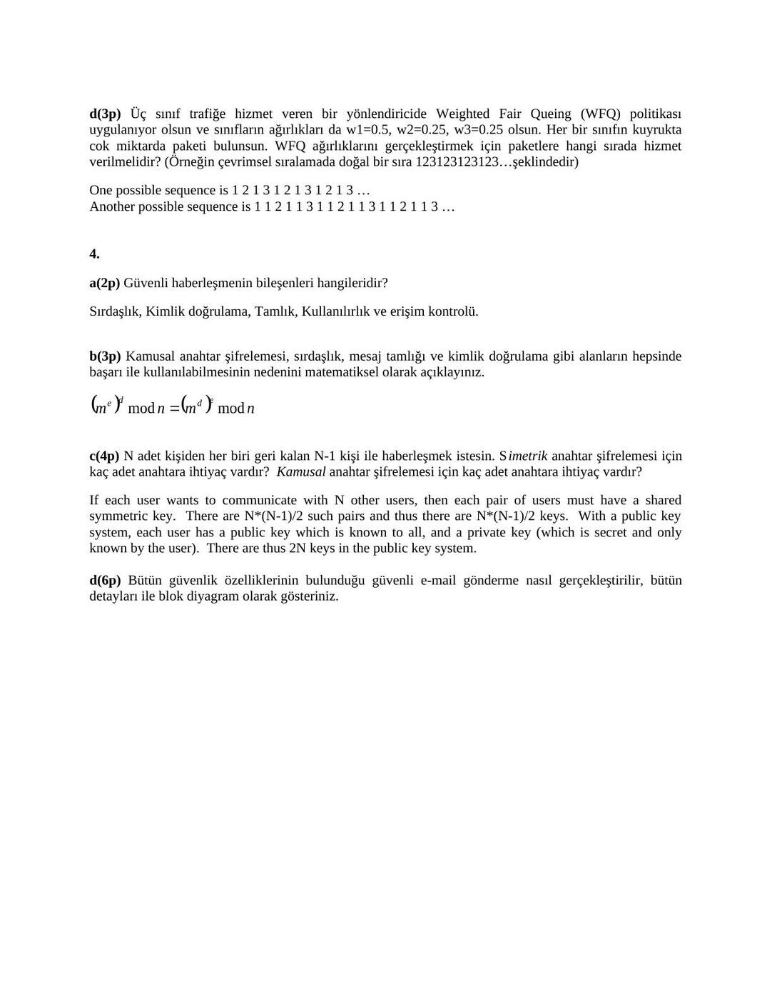
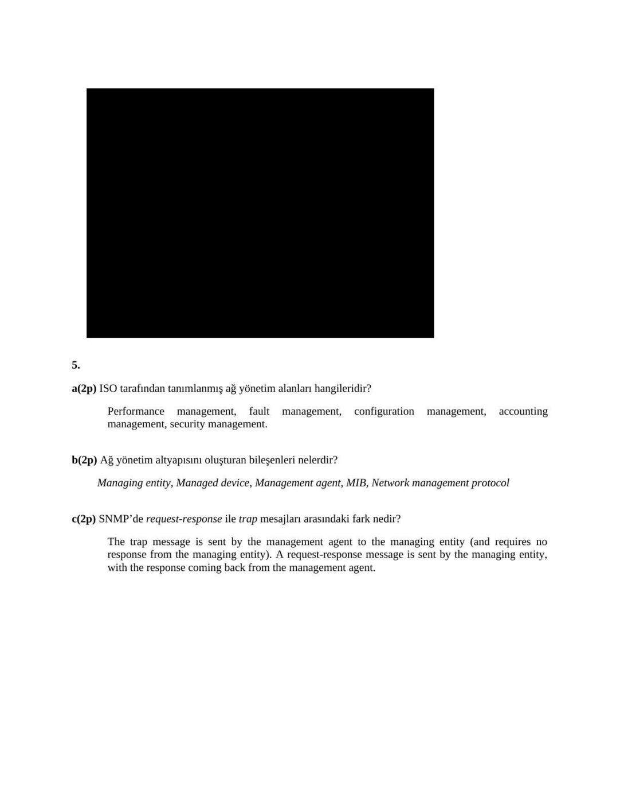
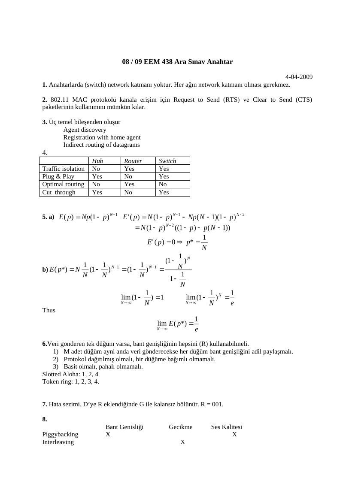

The 2009 midterm and final exam questions of the Başkent University EEM438 course are presented here together with their answer keys. Commercial textbook slides that had been pasted into the answer documents have been removed from the published copies. Archive PDF copies of the documents prepared for this purpose can be downloaded at the end of the post.

## EEM438 Final 2009

Başkent University 08/09 EEM 438 Final (100 Minutes) 27/05/2009

**1.**  a(4p) What is the purpose of ARP and how does it work? b(4p) There is one router between users A and B, who have established a TCP connection. Why does A not use B's MAC (LAN) address when sending packets to B?

**2.**  a(3p) Why is collision detection (CD) not used in wireless networks? b(6p) Explain the CSMA/CA algorithm used in the WiFi (IEEE 802.11) standard from the sender's perspective.

**3.**  a(1p) What is jitter? b(3p) What methods are used at the application layer to support multimedia communication over the existing network infrastructure? c(4p) What are the basic components of guaranteeing quality of service (QoS) in multimedia communication? d(3p) Suppose a router serving three traffic classes applies the Weighted Fair Queueing (WFQ) policy, and the class weights are given as w1=0.5, w2=0.25, w3=0.25. Let each class have a large number of packets in its queue. In what order should packets be served according to these weights under WFQ? (For example, a natural order in round-robin scheduling is 1 2 3 1 2 3 1 2 3 1 2 3…)

**4.**  a(2p) What are the components of secure communication? b(3p) Explain mathematically why public-key cryptography can be used successfully in all of these areas: confidentiality, message integrity, and authentication. c(5p) Suppose each of N people wants to communicate with the remaining N-1 people. How many keys are needed for symmetric-key cryptography? How many keys are needed for public-key cryptography? d(6p) How is secure e-mail with all security properties implemented? Show it as a block diagram with all details.

**5.**  a(2p) What are the network management areas defined by ISO? b(2p) What are the components that make up the network management infrastructure? c(2p) What is the difference between request-response messages and trap messages in SNMP?

Calculators are not allowed. Good luck… Avcıbaş

## EEM438 Final 2009 Answer Key

Başkent University 08/09 EEM 438 Final (100 Minutes) 27/05/2009

**1.**  a(4p) What is the purpose of ARP and how does it work?

The purpose of ARP is to resolve IP addresses to MAC addresses within a subnet. ARP uses MAC-level broadcast where only the host with the matching IP address responds to the host sending the ARP. From this response, the sending host can learn the MAC address of the responding host.

b(4p) There is one router between users A and B, who have established a TCP connection. Why does A not use B's MAC (LAN) address when sending packets to B?

Host A has no way of knowing the MAC address of host B on the other side of a router. A router does not pass broadcasr ARP frames. In any case, the MAC address of the router port connecting host A’s LAN to host B’s LAN must be used to forward an A-to-B packet through the router. If some other MAC address (e.g., that of host B) were used, routing would not take place.

**2.**  a(3p) Why is collision detection (CD) not used in wireless networks?

In a wireless host the receiver is overwhelmed by the transmitter and cannot “hear” if someone else is transmiting. Also, hidden terminals and signal fading make it possible for two hosts A and C to not be able to hear each other, but a host B can hear both A and C. In such a situation A and C would not be able to detect a collision in any case, but B would be affected by it.

b(6p) Explain the CSMA/CA algorithm used in the WiFi (IEEE 802.11) standard from the sender's perspective.

At the sender: (1) if sense channel idle for DIFS then transmit entire frame (2) if sense channel busy then (3) start random backoff time (4) timer counts down while channel is idle (5) transmit when timer expires (6) if no ACK received then increase the backoff time and repeat (2)

**3.**  a(2p) What is jitter? Jitter is delay variability.

b(3p) What are the two methods used at the application layer to support multimedia communication over the existing network infrastructure?

Two key application-level techniques are jitter buffering to remove packet-level delay jitter and Forward Error Correction (FEC) to reduce the effects of packet loss.

c(4p) What are the basic components of guaranteeing quality of service (QoS) in multimedia communication? The four pillars are 1) packet classification, 2) isolation (scheduling and policing), 3) high resource utilization, and 4) call admission.

d(3p) Suppose a router serving three traffic classes applies the Weighted Fair Queueing (WFQ) policy, and the class weights are w1=0.5, w2=0.25, w3=0.25. Let each class have a large number of packets in its queue. In what order should packets be served to realize the WFQ weights? (For example, a natural order in round-robin scheduling is 1 2 3 1 2 3 1 2 3 1 2 3…)

One possible sequence is 1 2 1 3 1 2 1 3 1 2 1 3 … Another possible sequence is 1 1 2 1 1 3 1 1 2 1 1 3 1 1 2 1 1 3 …

**4.** 

a(2p) What are the components of secure communication?

Confidentiality, authentication, integrity, availability, and access control.

b(3p) Explain mathematically why public-key cryptography can be used successfully in all of these areas: confidentiality, message integrity, and authentication.

c(4p) Suppose each of N people wants to communicate with the remaining N-1 people. How many keys are needed for symmetric-key cryptography? How many keys are needed for public-key cryptography?

If each user wants to communicate with N other users, then each pair of users must have a shared symmetric key. There are N*(N-1)/2 such pairs and thus there are N*(N-1)/2 keys. With a public key system, each user has a public key which is known to all, and a private key (which is secret and only known by the user). There are thus 2N keys in the public key system.

d(6p) How is secure e-mail with all security properties implemented? Show it as a block diagram with all details.

[Textbook slide removed from the archive copy.]

**5.** 

a(2p) What are the network management areas defined by ISO?

Performance management, fault management, configuration management, accounting management, security management.

b(2p) What are the components that make up the network management infrastructure?

Managing entity, Managed device, Management agent, MIB, Network management protocol

c(2p) What is the difference between request-response messages and trap messages in SNMP?

The trap message is sent by the management agent to the managing entity (and requires no response from the managing entity). A request-response message is sent by the managing entity, with the response coming back from the management agent.

## EEM438 Midterm 2009

08 / 09 EEM 438 Midterm Exam ( 90 min. )

4-04-2009

**1.** Why is a MAC address needed in addition to an IP address?

**2.** What is the hidden terminal problem? How does the 802.11 MAC protocol solve this problem?

**3.** State the basic components of the Mobile IP standard.

**4.** Compare the hub, switch, and router devices with the help of a table in terms of traffic isolation, plug and play, optimal routing, and cut-through forwarding.

**5.** With N active nodes, the probability that any given node succeeds in slotted ALOHA is given by E(p)=Np(1-p)N-1.

a. Find the value of p that maximizes this expression.

b. Substitute the value of p found in part a into the expression and find the efficiency of slotted ALOHA as N goes to infinity. Hint: The expression ( 1-1/N) N approaches 1/e as N goes to infinity.

**6.** What are the four desired properties of a broadcast channel? Which of these properties does slotted ALOHA have? Which of these properties does token passing have?

**7.** What is the function of cyclic redundancy coding (CRC), and what is its working principle based on? Let the generator be G = 1001 and the data bit sequence be D = 1010 1010. R = ?

**8.** Compare the piggybacking and interleaving methods used in forward error correction (FEC) to compensate for lost packets in terms of bandwidth, delay, and audio quality.

The questions are equally weighted. Good luck… Avcıbaş

## EEM438 Midterm 2009 Answer Key

08 / 09 EEM 438 Midterm Exam Answer Key

4-04-2009

**1.** Switches have no network layer. Not every network needs to have a network layer.

**2.** The 802.11 MAC protocol makes it possible to use Request to Send (RTS) and Clear to Send (CTS) packets for channel access.

**3.** It consists of three basic components: Agent discovery, Registration with home agent, Indirect routing of datagrams.

**4.**  Hub Router Switch Traffic isolation No Yes Yes Plug & Play Yes No Yes Optimal routing No Yes No Cut_through Yes No Yes

**5.** a)

b)

Thus

**6.** If only one node is sending data, it must be able to use all of the bandwidth (R).

**1.** If M nodes send data at the same time, each node must share the bandwidth fairly.

**2.** The protocol must be distributed and must not depend on a single node.

**3.** It must be simple and not expensive. Slotted Aloha: 1, 2, 4 Token ring: 1, 2, 3, 4.

**7.** Error detection. When R is appended to D, the result is divisible by G with no remainder. R = 001.

**8.**  Bandwidth Delay Audio Quality Piggybacking X X Interleaving X

*Note:  Delay estimation: dᵢ=(1−u)dᵢ₋₁+u(rᵢ−tᵢ). Including the initial d₀, the expansion is dₙ=(1−u)ⁿd₀+uΣₖ₌₀ⁿ⁻¹(1−u)ᵏxₙ₋ₖ; for 0<u<1 the weights of older samples decay exponentially.*

*Note: For WFQ, 1 2 1 3 gives the correct 0.5/0.25/0.25 ratio; the 1 1 2 1 1 3 in the key does not give the same ratio.*
