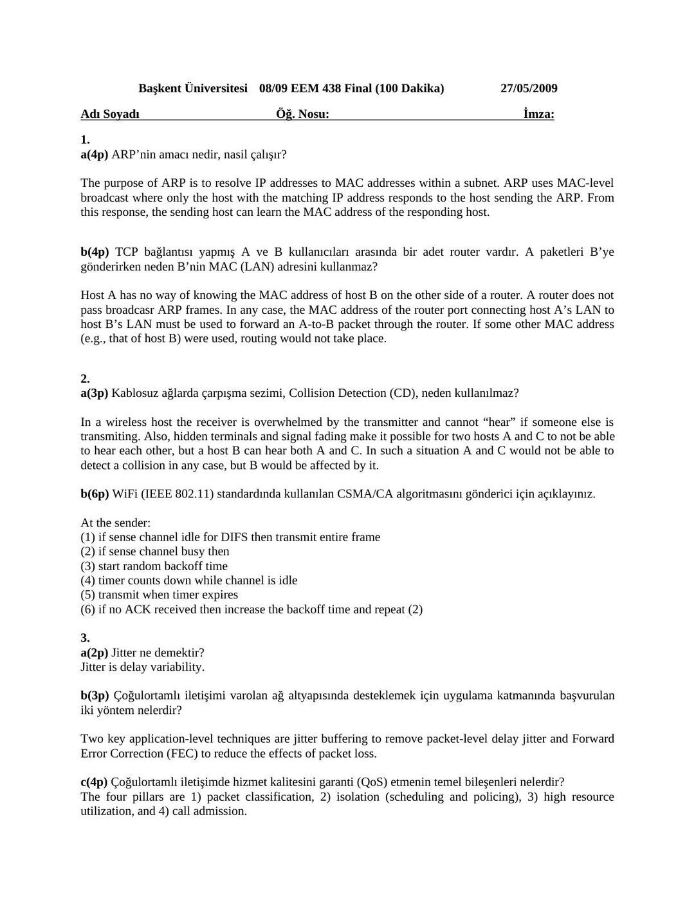
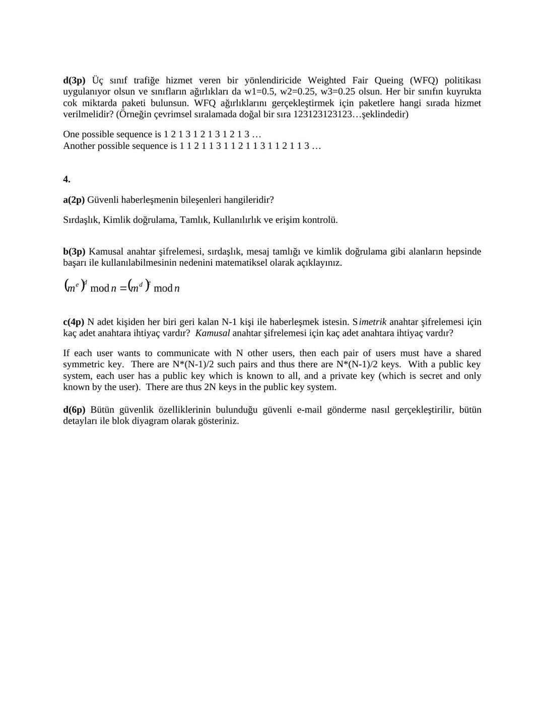
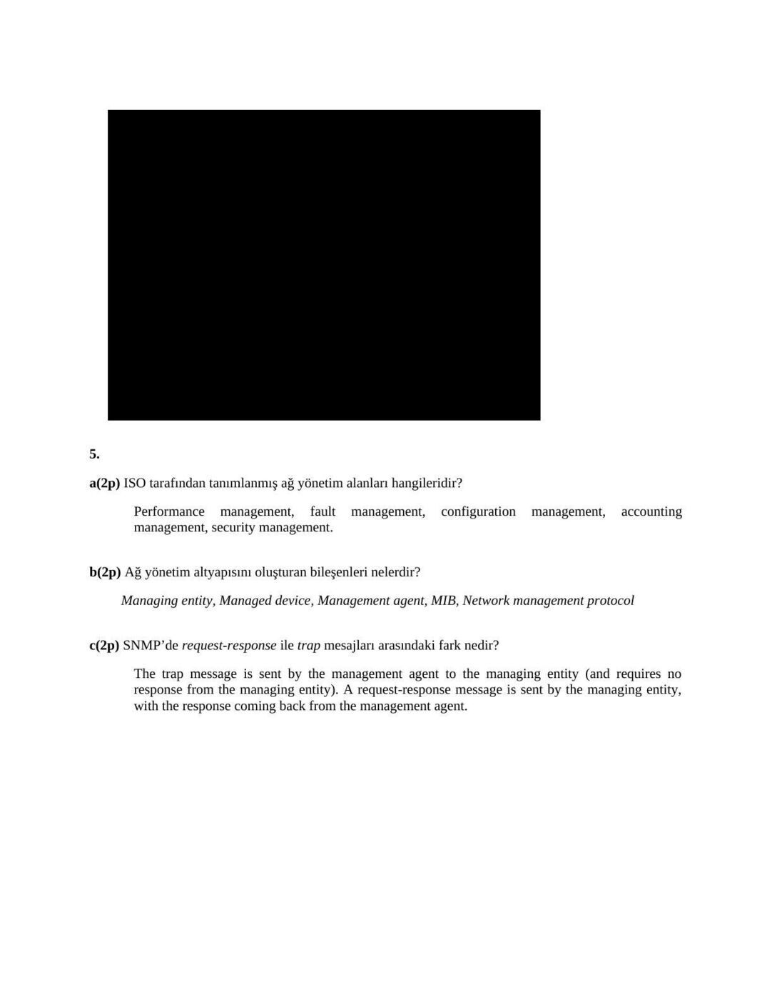
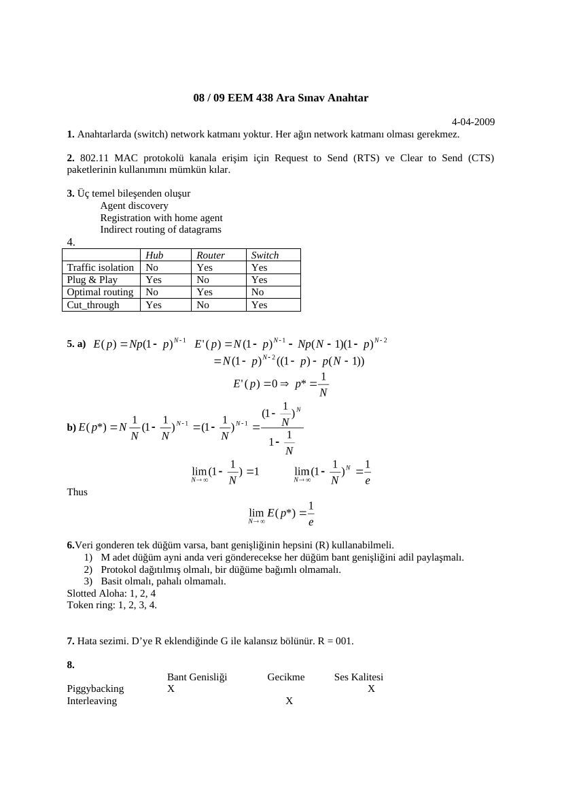

Başkent Üniversitesi EEM438 dersinin 2009 yılı ara sınav ve final soruları, ilgili cevap anahtarlarıyla birlikte aktarılmıştır. Cevap belgelerine yapıştırılmış ticari kitap slaytları yayın kopyalarından çıkarılmıştır. Belgelerin arşiv için hazırlanmış PDF kopyaları yazının sonunda indirilebilir.

## EEM438 Final 2009

Başkent Üniversitesi 08/09 EEM 438 Final (100 Dakika) 27/05/2009

**1.**  a(4p) ARP’nin amacı nedir, nasıl çalışır? b(4p) TCP bağlantısı yapmış A ve B kullanıcıları arasında bir adet router vardır. A paketleri B’ye gönderirken neden B’nin MAC (LAN) adresini kullanmaz?

**2.**  a(3p) Kablosuz ağlarda çarpışma sezimi, Collision Detection (CD), neden kullanılmaz? b(6p) WiFi (IEEE 802.11) standardında kullanılan CSMA/CA algoritmasını gönderici için açıklayınız.

**3.**  a(1p) Jitter ne demektir? b(3p) Çoğulortamlı iletişimi varolan ağ altyapısında desteklemek için uygulama katmanında başvurulan yöntemler nelerdir? c(4p) Çoğulortamlı iletişimde hizmet kalitesini (QoS) garanti etmenin temel bileşenleri nelerdir? d(3p) Üç sınıf trafiğe hizmet veren bir yönlendiricide Weighted Fair Queing (WFQ) politikası uygulanıyor olsun ve sınıfların ağırlıkları w1=0.5, w2=0.25, w3=0.25 olarak verilsin. Her bir sınıfın kuyrukta cok miktarda paketi bulunsun. WFQ bu ağırlıklara göre paketlere hangi sırada hizmet verilmelidir? (Örneğin çevrimsel sıralamada doğal bir sıra 1 2 3 1 2 3 1 2 3 1 2 3…şeklindedir)

**4.**  a(2p) Güvenli iletişimin bileşenleri hangileridir? b(3p) Kamusal anahtar şifrelemesi, sırdaşlık, mesaj tamlığı ve kimlik doğrulama gibi alanların hepsinde başarı ile kullanılabilmesinin nedenini matematiksel olarak açıklayınız. c(5p) N adet kişiden her biri geri kalan N-1 kişi ile haberleşmek istesin. Simetrik anahtar şifrelemesi için kaç adet anahtara ihtiyaç vardır? Kamusal anahtar şifrelemesi için kaç adet anahtara ihtiyaç vardır? d(6p) Bütün güvenlik özelliklerinin bulunduğu güvenli e-mail gönderme nasıl gerçekleştirilir, bütün detayları ile blok diyagram olarak gösteriniz.

**5.**  a(2p) ISO tarafından tanımlanmış ağ yönetim alanları hangileridir? b(2p) Ağ yönetim altyapısını oluşturan bileşenler nelerdir? c(2p) SNMP’de request-response ile trap mesajları arasındaki fark nedir?

Hesap makinesi kullanılmayacaktır. Başarılar… Avcıbaş

## EEM438 Final 2009 Cevap Anahtar

Başkent Üniversitesi 08/09 EEM 438 Final (100 Dakika) 27/05/2009

**1.**  a(4p) ARP’nin amacı nedir, nasil çalışır?

The purpose of ARP is to resolve IP addresses to MAC addresses within a subnet. ARP uses MAC-level broadcast where only the host with the matching IP address responds to the host sending the ARP. From this response, the sending host can learn the MAC address of the responding host.

b(4p) TCP bağlantısı yapmış A ve B kullanıcıları arasında bir adet router vardır. A paketleri B’ye gönderirken neden B’nin MAC (LAN) adresini kullanmaz?

Host A has no way of knowing the MAC address of host B on the other side of a router. A router does not pass broadcasr ARP frames. In any case, the MAC address of the router port connecting host A’s LAN to host B’s LAN must be used to forward an A-to-B packet through the router. If some other MAC address (e.g., that of host B) were used, routing would not take place.

**2.**  a(3p) Kablosuz ağlarda çarpışma sezimi, Collision Detection (CD), neden kullanılmaz?

In a wireless host the receiver is overwhelmed by the transmitter and cannot “hear” if someone else is transmiting. Also, hidden terminals and signal fading make it possible for two hosts A and C to not be able to hear each other, but a host B can hear both A and C. In such a situation A and C would not be able to detect a collision in any case, but B would be affected by it.

b(6p) WiFi (IEEE 802.11) standardında kullanılan CSMA/CA algoritmasını gönderici için açıklayınız.

At the sender: (1) if sense channel idle for DIFS then transmit entire frame (2) if sense channel busy then (3) start random backoff time (4) timer counts down while channel is idle (5) transmit when timer expires (6) if no ACK received then increase the backoff time and repeat (2)

**3.**  a(2p) Jitter ne demektir? Jitter is delay variability.

b(3p) Çoğulortamlı iletişimi varolan ağ altyapısında desteklemek için uygulama katmanında başvurulan iki yöntem nelerdir?

Two key application-level techniques are jitter buffering to remove packet-level delay jitter and Forward Error Correction (FEC) to reduce the effects of packet loss.

c(4p) Çoğulortamlı iletişimde hizmet kalitesini garanti (QoS) etmenin temel bileşenleri nelerdir? The four pillars are 1) packet classification, 2) isolation (scheduling and policing), 3) high resource utilization, and 4) call admission.

d(3p) Üç sınıf trafiğe hizmet veren bir yönlendiricide Weighted Fair Queing (WFQ) politikası uygulanıyor olsun ve sınıfların ağırlıkları da w1=0.5, w2=0.25, w3=0.25 olsun. Her bir sınıfın kuyrukta cok miktarda paketi bulunsun. WFQ ağırlıklarını gerçekleştirmek için paketlere hangi sırada hizmet verilmelidir? (Örneğin çevrimsel sıralamada doğal bir sıra 1 2 3 1 2 3 1 2 3 1 2 3…şeklindedir)

One possible sequence is 1 2 1 3 1 2 1 3 1 2 1 3 … Another possible sequence is 1 1 2 1 1 3 1 1 2 1 1 3 1 1 2 1 1 3 …

**4.** 

a(2p) Güvenli haberleşmenin bileşenleri hangileridir?

Sırdaşlık, Kimlik doğrulama, Tamlık, Kullanılırlık ve erişim kontrolü.

b(3p) Kamusal anahtar şifrelemesi, sırdaşlık, mesaj tamlığı ve kimlik doğrulama gibi alanların hepsinde başarı ile kullanılabilmesinin nedenini matematiksel olarak açıklayınız.

c(4p) N adet kişiden her biri geri kalan N-1 kişi ile haberleşmek istesin. Simetrik anahtar şifrelemesi için kaç adet anahtara ihtiyaç vardır? Kamusal anahtar şifrelemesi için kaç adet anahtara ihtiyaç vardır?

If each user wants to communicate with N other users, then each pair of users must have a shared symmetric key. There are N*(N-1)/2 such pairs and thus there are N*(N-1)/2 keys. With a public key system, each user has a public key which is known to all, and a private key (which is secret and only known by the user). There are thus 2N keys in the public key system.

d(6p) Bütün güvenlik özelliklerinin bulunduğu güvenli e-mail gönderme nasıl gerçekleştirilir, bütün detayları ile blok diyagram olarak gösteriniz.

[Kitap slaydı arşiv kopyasından çıkarıldı.]

**5.** 

a(2p) ISO tarafından tanımlanmış ağ yönetim alanları hangileridir?

Performance management, fault management, configuration management, accounting management, security management.

b(2p) Ağ yönetim altyapısını oluşturan bileşenleri nelerdir?

Managing entity, Managed device, Management agent, MIB, Network management protocol

c(2p) SNMP’de request-response ile trap mesajları arasındaki fark nedir?

The trap message is sent by the management agent to the managing entity (and requires no response from the managing entity). A request-response message is sent by the managing entity, with the response coming back from the management agent.

## EEM438 Midterm 2009

08 / 09 EEM 438 Ara Sınav ( 90 dak. )

4-04-2009

**1.** IP adresine ek olarak neden MAC adresine gereksinim duyulur?

**2.** Hidden terminal problemi nedir? 802.11 MAC protokolü bu problemi nasıl çözer?

**3.** Mobile IP standardı hangi temel bileşenlerden oluşur, belirtiniz?

**4.** Hub, Switch ve Router aygıtlarını tarafik izolasyonu, tak ve oyna, optimal yönlendirme, kestirmeden gönderme özellikleri açısından bir tablo yardımı ile karşılaştırınız.

**5.** N adet aktif düğüm (node) varken slotted ALOHA’da her hangi bir düğümün başarılı olması E(p)=Np(1-p)N-1 ifadesi ile bulunur.

a. Bu ifadeyi en büyük yapan p değerini bulunuz.

b. a şıkkında bulduğunuz p değerini ifadede yerine koyup, N sonsuza giderken slotted ALOHA’nın verimliliğini bulunuz. İpucu: ( 1-1/N) N ifadesi N sonsuza giderken 1/e değerini alır.

**6.** Yayın (broadcast) kanalının istenen dört özelliği nelerdir? Slotted ALOHA bu özelliklerden hangilerine sahiptir? Jeton geçirme (token-passing) bu özelliklerden hangilerine sahiptir?

**7.** Çevrimsel artıklık kodlamasının (CRC) işlevi nedir, çalışma esası neye dayanır? Üreteç G = 1001, veri bit dizisi D = 1010 1010 olsun. R = ?

**8.** Kayıp paketleri telafi etmek için, ileriye dönük hata düzeltmede (FEC) kullanılan sırtında taşıma (piggybacking) ve serpiştirme (interleaving) yöntemlerini, bant genişliği, gecikme ve ses kalitesi açısından karşılaştırınız.

Sorular eşit ağırlıklı. Başarılar… Avcıbaş

## EEM438 Midterm 2009 Cevap Anahtar

08 / 09 EEM 438 Ara Sınav Anahtar

4-04-2009

**1.** Anahtarlarda (switch) network katmanı yoktur. Her ağın network katmanı olması gerekmez.

**2.** 802.11 MAC protokolü kanala erişim için Request to Send (RTS) ve Clear to Send (CTS) paketlerinin kullanımını mümkün kılar.

**3.** Üç temel bileşenden oluşur Agent discovery Registration with home agent Indirect routing of datagrams

**4.**  Hub Router Switch Traffic isolation No Yes Yes Plug & Play Yes No Yes Optimal routing No Yes No Cut_through Yes No Yes

**5.** a)

b)

Thus

**6.** Veri gonderen tek düğüm varsa, bant genişliğinin hepsini (R) kullanabilmeli.

**1.** M adet düğüm ayni anda veri gönderecekse her düğüm bant genişliğini adil paylaşmalı.

**2.** Protokol dağıtılmış olmalı, bir düğüme bağımlı olmamalı.

**3.** Basit olmalı, pahalı olmamalı. Slotted Aloha: 1, 2, 4 Token ring: 1, 2, 3, 4.

**7.** Hata sezimi. D’ye R eklendiğinde G ile kalansız bölünür. R = 001.

**8.**  Bant Genisliği Gecikme Ses Kalitesi Piggybacking X X Interleaving X

*Not:  Gecikme kestirimi: dᵢ=(1−u)dᵢ₋₁+u(rᵢ−tᵢ). Başlangıç d₀ dahil açılım dₙ=(1−u)ⁿd₀+uΣₖ₌₀ⁿ⁻¹(1−u)ᵏxₙ₋ₖ şeklindedir; 0<u<1 için eski örnek ağırlıkları üstel azalır.*

*Not: WFQ için 1 2 1 3 doğru 0,5/0,25/0,25 oranını verir; anahtardaki 1 1 2 1 1 3 aynı oranı vermez.*
