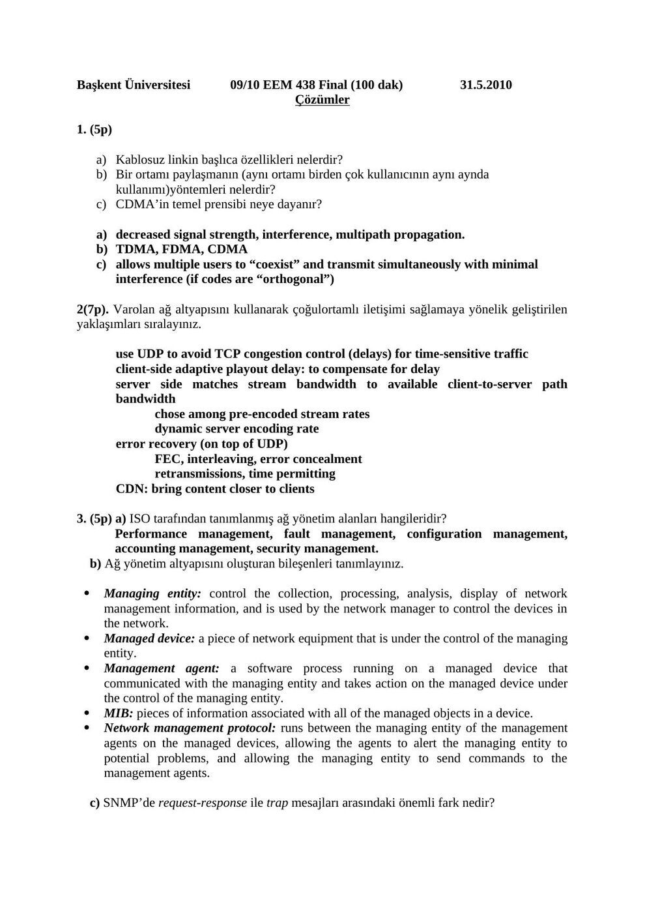
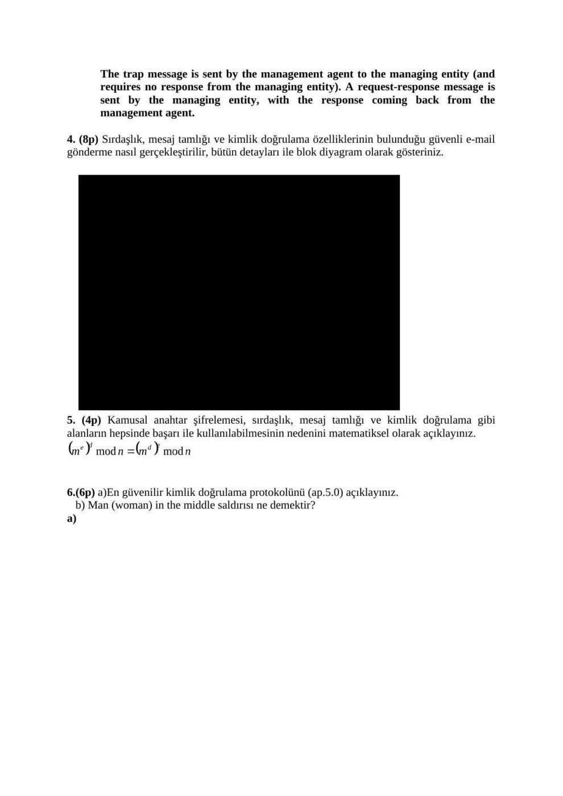
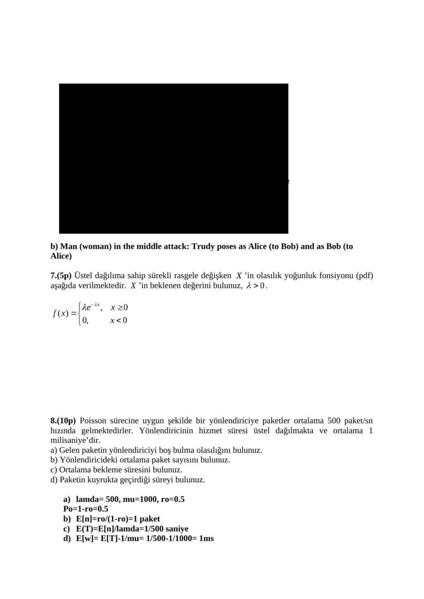
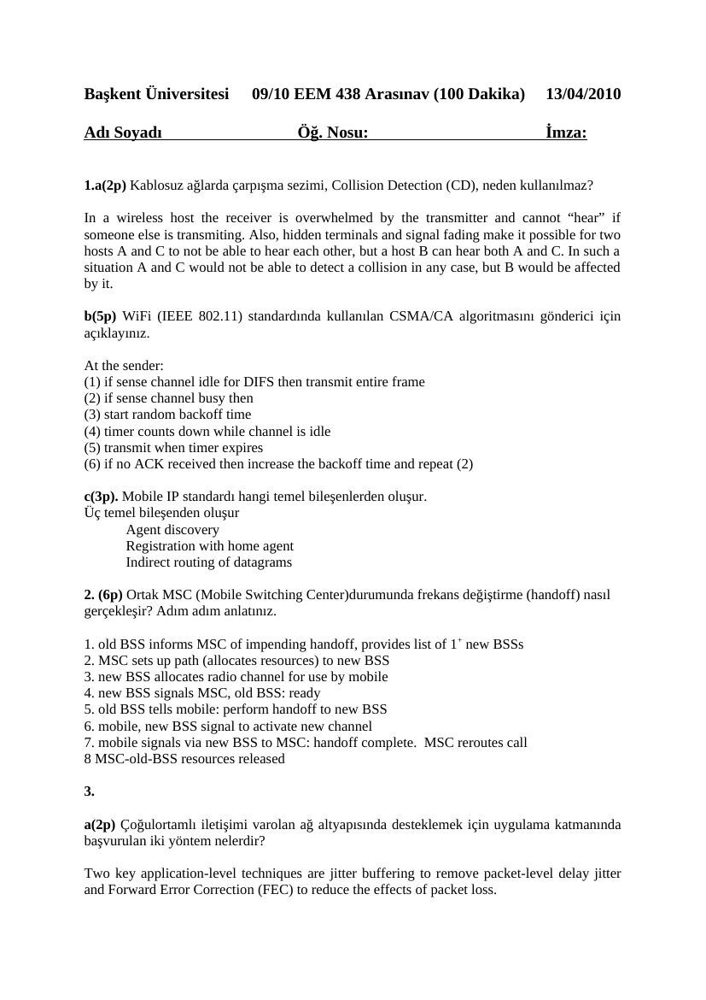
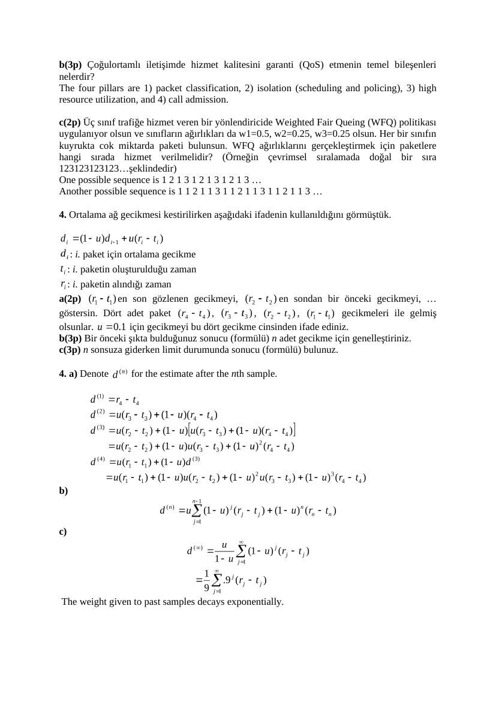

The 2010 midterm and final exam questions of the Başkent University EEM438 course are presented here together with the corresponding answer keys. Commercial textbook slides pasted into the answer documents have been removed from the published copies. Archive PDF copies of the documents prepared for the archive can be downloaded at the end of the post.

## EEM438 Final 2010

Başkent University 09/10 EEM 438 Final (100 Minutes) 31.5.2010

**1.** (5p) a) What are the main characteristics of a wireless link? b) What are the methods of sharing a medium (multiple users using the same medium at the same time)? c) What is the basic principle of CDMA?

**2.** (7p) State the approaches developed for providing multimedia communication using the existing network infrastructure.

**3.** (5p) a) What are the network management areas defined by ISO? b) Define the components that make up the network management infrastructure. c) What is the difference between request-response and trap messages in SNMP?

**4.** (8p) How is secure e-mail sending, which provides confidentiality, message integrity, and authentication, carried out? Show all the details on a block diagram.

**5.** (4p) Explain mathematically why public key cryptography can be used successfully in all of the areas such as confidentiality, message integrity, and authentication.

**6.** (6p) a) Explain the most reliable authentication protocol (ap5.0). b) What does a man (woman) in the middle attack mean?

**7.** (5p) The probability density function (pdf) of a continuous random variable  with an exponential distribution is given below. Find the expected value of , .

**8.** (10p) Packets arrive at a router at an average rate of 500 packets/s according to a Poisson process. The router's service time is exponentially distributed with a mean of 1 millisecond. a) Find the probability that an arriving packet finds the router idle. b) Find the average number of packets in the router. c) Find the average waiting time. d) Find the time the packet spends in the queue.

Calculators are not allowed. Good luck… Avcıbaş

## EEM438 Final 2010 Solution

Başkent University 09/10 EEM 438 Final (100 min) 31.5.2010 Solutions

**1.** (5p)

a) What are the main characteristics of a wireless link? b) What are the methods of sharing a medium (multiple users using the same medium at the same time)? c) What is the basic principle of CDMA?

a) decreased signal strength, interference, multipath propagation. b) TDMA, FDMA, CDMA c) allows multiple users to “coexist” and transmit simultaneously with minimal interference (if codes are “orthogonal”)

2(7p). List the approaches developed for providing multimedia communication using the existing network infrastructure.

use UDP to avoid TCP congestion control (delays) for time-sensitive traffic client-side adaptive playout delay: to compensate for delay server side matches stream bandwidth to available client-to-server path bandwidth chose among pre-encoded stream rates dynamic server encoding rate error recovery (on top of UDP) FEC, interleaving, error concealment retransmissions, time permitting CDN: bring content closer to clients

**3.** (5p) a) What are the network management areas defined by ISO? Performance management, fault management, configuration management, accounting management, security management. b) Define the components that make up the network management infrastructure.

- Managing entity: control the collection, processing, analysis, display of network management information, and is used by the network manager to control the devices in the network.

- Managed device: a piece of network equipment that is under the control of the managing entity.

- Management agent: a software process running on a managed device that communicated with the managing entity and takes action on the managed device under the control of the managing entity.

- MIB: pieces of information associated with all of the managed objects in a device.

- Network management protocol: runs between the managing entity of the management agents on the managed devices, allowing the agents to alert the managing entity to potential problems, and allowing the managing entity to send commands to the management agents.

c) What is the important difference between request-response and trap messages in SNMP?

The trap message is sent by the management agent to the managing entity (and requires no response from the managing entity). A request-response message is sent by the managing entity, with the response coming back from the management agent.

**4.** (8p) How is secure e-mail sending, which provides confidentiality, message integrity, and authentication, carried out? Show all the details as a block diagram.

[Textbook slide removed from the archive copy.]

**5.** (4p) Explain mathematically why public key cryptography can be used successfully in all of the areas such as confidentiality, message integrity, and authentication.

**6.** (6p) a) Explain the most reliable authentication protocol (ap5.0). b) What does a man (woman) in the middle attack mean? a)

b) Man (woman) in the middle attack: Trudy poses as Alice (to Bob) and as Bob (to Alice)

**7.** (5p) The probability density function (pdf) of a continuous random variable  with an exponential distribution is given below. Find the expected value of , .

**8.** (10p) Packets arrive at a router at an average rate of 500 packets/s according to a Poisson process. The router's service time is exponentially distributed with a mean of 1 millisecond. a) Find the probability that an arriving packet finds the router idle. b) Find the average number of packets in the router. c) Find the average waiting time. d) Find the time the packet spends in the queue.

a) lamda= 500, mu=1000, ro=0.5 Po=1-ro=0.5 b) E[n]=ro/(1-ro)=1 packet c) E(T)=E[n]/lamda=1/500 seconds d) E[w]= E[T]-1/mu= 1/500-1/1000= 1ms

## EEM438 Midterm 2010

Başkent University 09/10 EEM 438 Midterm (100 Minutes) 13/04/2010

**1.**  a(2p) Why is collision detection (CD) not used in wireless networks?

b(5p) Explain the CSMA/CA algorithm used in the WiFi (IEEE 802.11) standard for the sender.

c(3p) What are the basic components of the Mobile IP standard?

**2.**  (6p) How does frequency change (handoff) take place in the case of a common MSC (Mobile Switching Center)? Explain step by step.

**3.**  a(2p) What are the two techniques used at the application layer to support multimedia communication over the existing network infrastructure?

b(3p) What are the basic components of guaranteeing quality of service (QoS) in multimedia communication?

c(2p) Suppose the Weighted Fair Queueing (WFQ) policy is applied in a router serving three classes of traffic, and the class weights are w1=0.5, w2=0.25, w3=0.25. Suppose each class has a large number of packets in the queue. In what order should packets be served to realize the WFQ weights? (For example, a natural order in round-robin is 1 2 3 1 2 3 1 2 3 1 2 3…)

**4.**  We saw that the following expression is used when estimating the average network delay.

: average delay for the i-th packet : time the i-th packet was created : time the i-th packet was received

a(2p) Let  denote the most recently observed delay,  the second most recent delay, … Suppose four packets have arrived with delays , , , . Express the delay for  in terms of these four delays.

b(3p) Generalize the result (formula) you found in the previous part to n delays.

c(3p) Find the result (formula) in the limit as n goes to infinity.

**5.**  (4p) What are the basic components of network security? Explain.

Calculators are not allowed. Good luck… Avcıbaş

## EEM438 Midterm 2010 Answer Key

Başkent University 09/10 EEM 438 Midterm (100 Minutes) 13/04/2010

**1.** a(2p) Why is collision detection (CD) not used in wireless networks?

In a wireless host the receiver is overwhelmed by the transmitter and cannot “hear” if someone else is transmiting. Also, hidden terminals and signal fading make it possible for two hosts A and C to not be able to hear each other, but a host B can hear both A and C. In such a situation A and C would not be able to detect a collision in any case, but B would be affected by it.

b(5p) Explain the CSMA/CA algorithm used in the WiFi (IEEE 802.11) standard for the sender.

At the sender: (1) if sense channel idle for DIFS then transmit entire frame (2) if sense channel busy then (3) start random backoff time (4) timer counts down while channel is idle (5) transmit when timer expires (6) if no ACK received then increase the backoff time and repeat (2)

c(3p). What are the basic components of the Mobile IP standard? It consists of three basic components: Agent discovery Registration with home agent Indirect routing of datagrams

**2.** (6p) How does frequency change (handoff) take place in the case of a common MSC (Mobile Switching Center)? Explain step by step.

**1.** old BSS informs MSC of impending handoff, provides list of 1+ new BSSs

**2.** MSC sets up path (allocates resources) to new BSS

**3.** new BSS allocates radio channel for use by mobile

**4.** new BSS signals MSC, old BSS: ready

**5.** old BSS tells mobile: perform handoff to new BSS

**6.** mobile, new BSS signal to activate new channel

**7.** mobile signals via new BSS to MSC: handoff complete. MSC reroutes call 8 MSC-old-BSS resources released

**3.** 

a(2p) What are the two techniques used at the application layer to support multimedia communication over the existing network infrastructure?

Two key application-level techniques are jitter buffering to remove packet-level delay jitter and Forward Error Correction (FEC) to reduce the effects of packet loss.

b(3p) What are the basic components of guaranteeing quality of service (QoS) in multimedia communication? The four pillars are 1) packet classification, 2) isolation (scheduling and policing), 3) high resource utilization, and 4) call admission.

c(2p) Suppose the Weighted Fair Queueing (WFQ) policy is applied in a router serving three classes of traffic, and the class weights are w1=0.5, w2=0.25, w3=0.25. Suppose each class has a large number of packets in the queue. In what order should packets be served to realize the WFQ weights? (For example, a natural order in round-robin is 1 2 3 1 2 3 1 2 3 1 2 3…) One possible sequence is 1 2 1 3 1 2 1 3 1 2 1 3 … Another possible sequence is 1 1 2 1 1 3 1 1 2 1 1 3 1 1 2 1 1 3 …

**4.** We saw that the following expression is used when estimating the average network delay.

: average delay for the i-th packet : time the i-th packet was created : time the i-th packet was received a(2p) Let  denote the most recently observed delay,  the second most recent delay, … Suppose four packets have arrived with delays , , , . Express the delay for  in terms of these four delays. b(3p) Generalize the result (formula) you found in the previous part to n delays. c(3p) Find the result (formula) in the limit as n goes to infinity.

**4.** a) Denote for the estimate after the nth sample.

b)

c)

The weight given to past samples decays exponentially.

**5.** (4p) What are the basic components of network security? Explain.

Confidentiality: Only the sender and the receiver can know the content of the message. Authentication: Making sure that the sender and the receiver in the communication are really who they claim to be. Integrity: Making sure whether the message content has been altered during transmission. Availability and access control: The network being usable by the intended people when desired, and closed to access by malicious people.

Calculators are not allowed. Good luck… Avcıbaş

*Note:  Delay estimation: dᵢ=(1−u)dᵢ₋₁+u(rᵢ−tᵢ). The expansion including the initial d₀ is dₙ=(1−u)ⁿd₀+uΣₖ₌₀ⁿ⁻¹(1−u)ᵏxₙ₋ₖ; for 0<u<1 the weights of older samples decay exponentially. For WFQ, 1 2 1 3 satisfies the 0.5/0.25/0.25 ratio; the second sequence in the key, 1 1 2 1 1 3, does not satisfy this ratio.*
