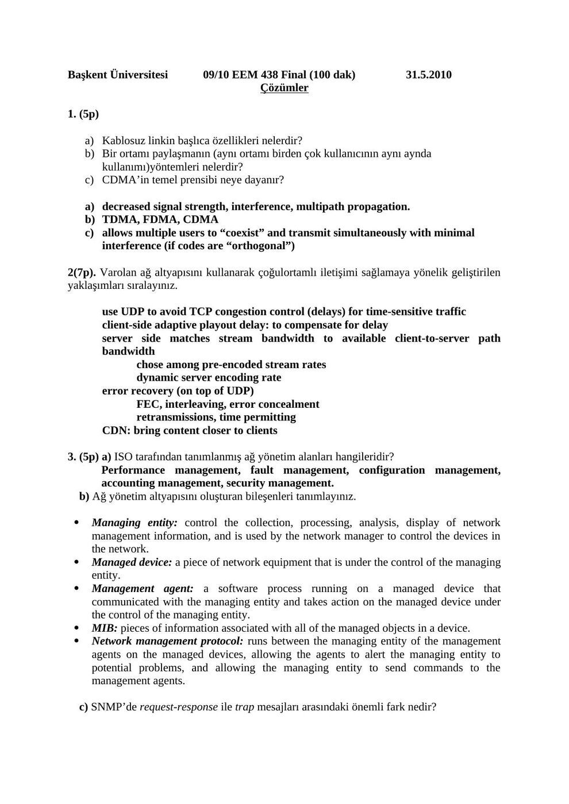
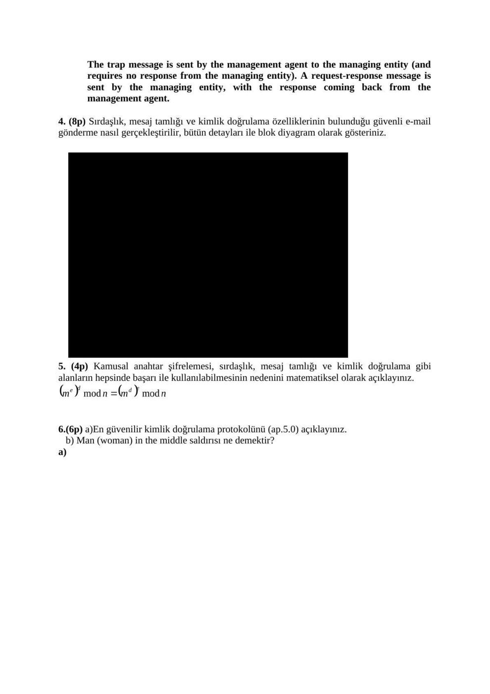
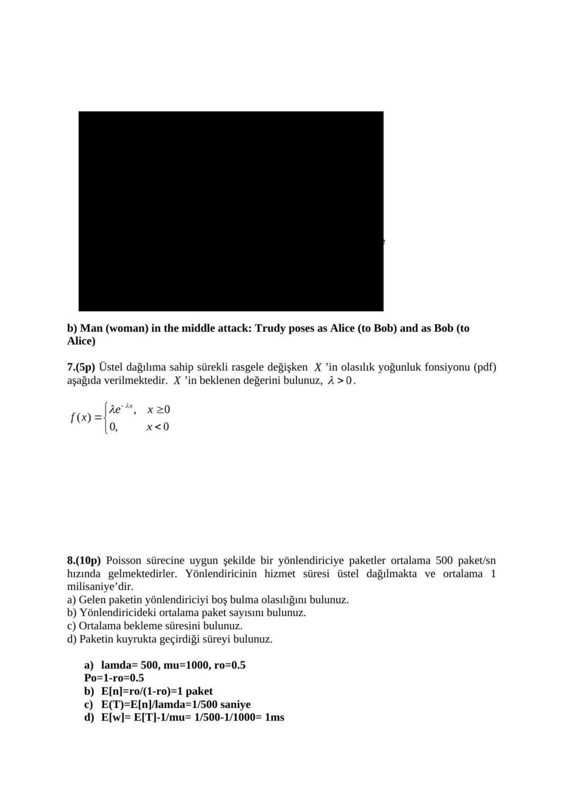
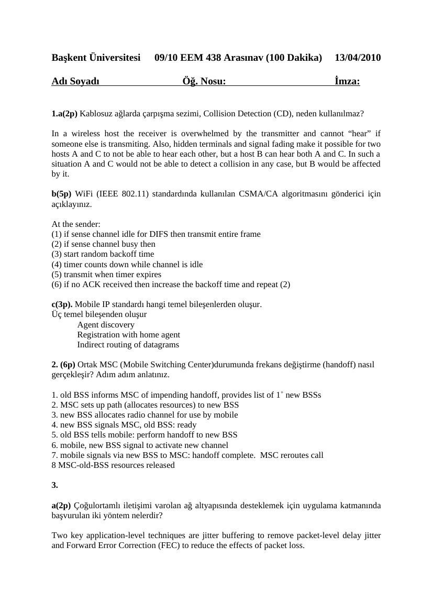
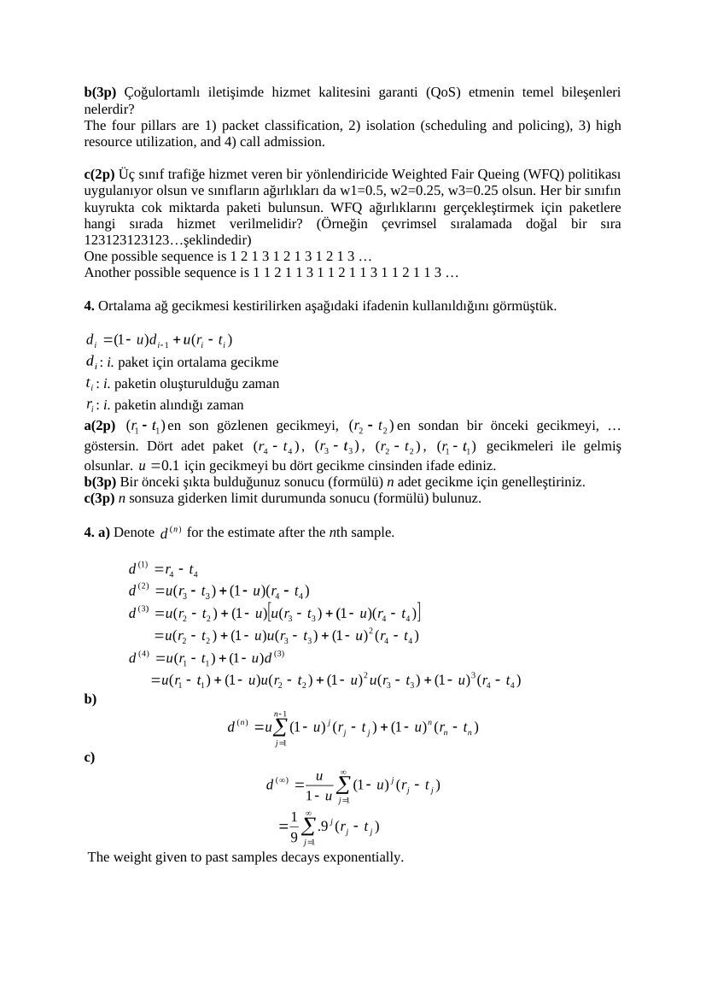

Başkent Üniversitesi EEM438 dersinin 2010 yılı ara sınav ve final soruları, ilgili cevap anahtarlarıyla birlikte aktarılmıştır. Cevap belgelerine yapıştırılmış ticari kitap slaytları yayın kopyalarından çıkarılmıştır. Belgelerin arşiv için hazırlanmış PDF kopyaları yazının sonunda indirilebilir.

## EEM438 Final 2010

Başkent Üniversitesi 09/10 EEM 438 Final (100 Dakika) 31.5.2010

**1.** (5p) a) Kablosuz linkin başlıca özellikleri nelerdir? b) Bir ortamı paylaşmanın (aynı ortamı birden çok kullanıcının aynı anda kullanımı) yöntemleri nelerdir? c) CDMA’in temel prensibi neye dayanır?

**2.** (7p)Varolan ağ altyapısını kullanarak çoğulortamlı iletişimi sağlamaya yönelik geliştirilen yaklaşımlar nelerdir, belirtiniz?

**3.** (5p) a) ISO tarafından tanımlanmış ağ yönetim alanları hangileridir? b)Ağ yönetim altyapısını oluşturan bileşenleri tanımlayınız. c) SNMP’de request-response ile trap mesajları arasındaki fark nedir?

**4.** (8p) Sırdaşlık, mesaj tamlığı ve kimlik doğrulama özelliklerinin bulunduğu güvenli e-mail gönderme nasıl gerçekleştirilir? Bütün detayları blok diyagram üzerinde gösteriniz.

**5.** (4p) Kamusal anahtar şifrelemesi, sırdaşlık, mesaj tamlığı ve kimlik doğrulama gibi alanların hepsinde başarı ile kullanılabilmesinin nedenini matematiksel olarak açıklayınız.

**6.** (6p) a) En güvenilir kimlik doğrulama protokolünü (ap.5.0) açıklayınız. b) Man (woman) in the middle saldırısı ne demektir?

**7.** (5p) Üstel dağılıma sahip sürekli rasgele değişken ’in olasılık yoğunluk fonsiyonu (pdf) aşağıda verilmektedir. ’in beklenen değerini bulunuz, .

**8.** (10p) Poisson sürecine uygun şekilde bir yönlendiriciye paketler ortalama 500 paket/sn hızında gelmektedirler. Yönlendiricinin hizmet süresi üstel dağılmakta ve ortalama 1 milisaniye’dir. a) Gelen paketin yönlendiriciyi boş bulma olasılığını bulunuz. b) Yönlendiricideki ortalama paket sayısını bulunuz. c) Ortalama bekleme süresini bulunuz. d) Paketin kuyrukta geçirdiği süreyi bulunuz.

Hesap makinesi kullanılmayacaktır. Başarılar… Avcıbaş

## EEM438 Final 2010 Cozum

Başkent Üniversitesi 09/10 EEM 438 Final (100 dak) 31.5.2010 Çözümler

**1.** (5p)

a) Kablosuz linkin başlıca özellikleri nelerdir? b) Bir ortamı paylaşmanın (aynı ortamı birden çok kullanıcının aynı aynda kullanımı)yöntemleri nelerdir? c) CDMA’in temel prensibi neye dayanır?

a) decreased signal strength, interference, multipath propagation. b) TDMA, FDMA, CDMA c) allows multiple users to “coexist” and transmit simultaneously with minimal interference (if codes are “orthogonal”)

2(7p). Varolan ağ altyapısını kullanarak çoğulortamlı iletişimi sağlamaya yönelik geliştirilen yaklaşımları sıralayınız.

use UDP to avoid TCP congestion control (delays) for time-sensitive traffic client-side adaptive playout delay: to compensate for delay server side matches stream bandwidth to available client-to-server path bandwidth chose among pre-encoded stream rates dynamic server encoding rate error recovery (on top of UDP) FEC, interleaving, error concealment retransmissions, time permitting CDN: bring content closer to clients

**3.** (5p) a) ISO tarafından tanımlanmış ağ yönetim alanları hangileridir? Performance management, fault management, configuration management, accounting management, security management. b) Ağ yönetim altyapısını oluşturan bileşenleri tanımlayınız.

- Managing entity: control the collection, processing, analysis, display of network management information, and is used by the network manager to control the devices in the network.

- Managed device: a piece of network equipment that is under the control of the managing entity.

- Management agent: a software process running on a managed device that communicated with the managing entity and takes action on the managed device under the control of the managing entity.

- MIB: pieces of information associated with all of the managed objects in a device.

- Network management protocol: runs between the managing entity of the management agents on the managed devices, allowing the agents to alert the managing entity to potential problems, and allowing the managing entity to send commands to the management agents.

c) SNMP’de request-response ile trap mesajları arasındaki önemli fark nedir?

The trap message is sent by the management agent to the managing entity (and requires no response from the managing entity). A request-response message is sent by the managing entity, with the response coming back from the management agent.

**4.** (8p) Sırdaşlık, mesaj tamlığı ve kimlik doğrulama özelliklerinin bulunduğu güvenli e-mail gönderme nasıl gerçekleştirilir, bütün detayları ile blok diyagram olarak gösteriniz.

[Kitap slaydı arşiv kopyasından çıkarıldı.]

**5.** (4p) Kamusal anahtar şifrelemesi, sırdaşlık, mesaj tamlığı ve kimlik doğrulama gibi alanların hepsinde başarı ile kullanılabilmesinin nedenini matematiksel olarak açıklayınız.

**6.** (6p) a)En güvenilir kimlik doğrulama protokolünü (ap.5.0) açıklayınız. b) Man (woman) in the middle saldırısı ne demektir? a)

b) Man (woman) in the middle attack: Trudy poses as Alice (to Bob) and as Bob (to Alice)

**7.** (5p) Üstel dağılıma sahip sürekli rasgele değişken ’in olasılık yoğunluk fonsiyonu (pdf) aşağıda verilmektedir. ’in beklenen değerini bulunuz, .

**8.** (10p) Poisson sürecine uygun şekilde bir yönlendiriciye paketler ortalama 500 paket/sn hızında gelmektedirler. Yönlendiricinin hizmet süresi üstel dağılmakta ve ortalama 1 milisaniye’dir. a) Gelen paketin yönlendiriciyi boş bulma olasılığını bulunuz. b) Yönlendiricideki ortalama paket sayısını bulunuz. c) Ortalama bekleme süresini bulunuz. d) Paketin kuyrukta geçirdiği süreyi bulunuz.

a) lamda= 500, mu=1000, ro=0.5 Po=1-ro=0.5 b) E[n]=ro/(1-ro)=1 paket c) E(T)=E[n]/lamda=1/500 saniye d) E[w]= E[T]-1/mu= 1/500-1/1000= 1ms

## EEM438 Midterm 2010

Başkent Üniversitesi 09/10 EEM 438 Arasınav (100 Dakika) 13/04/2010

**1.**  a(2p) Kablosuz ağlarda çarpışma sezimi, Collision Detection (CD), neden kullanılmaz?

b(5p) WiFi (IEEE 802.11) standardında kullanılan CSMA/CA algoritmasını gönderici için açıklayınız.

c(3p) Mobile IP standardı hangi temel bileşenlerden oluşur.

**2.**  (6p) Ortak MSC (Mobile Switching Center) durumunda frekans değiştirme (handoff) nasıl gerçekleşir? Adım adım anlatınız.

**3.**  a(2p) Çoğulortamlı iletişimi varolan ağ altyapısında desteklemek için uygulama katmanında başvurulan iki yöntem nelerdir?

b(3p) Çoğulortamlı iletişimde hizmet kalitesini (QoS) garanti etmenin temel bileşenleri nelerdir?

c(2p) Üç sınıf trafiğe hizmet veren bir yönlendiricide Weighted Fair Queing (WFQ) politikası uygulanıyor olsun ve sınıfların ağırlıkları da w1=0.5, w2=0.25, w3=0.25 olsun. Her bir sınıfın kuyrukta cok miktarda paketi bulunsun. WFQ ağırlıklarını gerçekleştirmek için paketlere hangi sırada hizmet verilmelidir? (Örneğin çevrimsel sıralamada doğal bir sıra 1 2 3 1 2 3 1 2 3 1 2 3…şeklindedir)

**4.**  Ortalama ağ gecikmesi kestirilirken aşağıdaki ifadenin kullanıldığını görmüştük.

: i. paket için ortalama gecikme : i. paketin oluşturulduğu zaman : i. paketin alındığı zaman

a(2p) en son gözlenen gecikmeyi, en sondan bir önceki gecikmeyi, … göstersin. Dört adet paket , , , gecikmeleri ile gelmiş olsunlar. için gecikmeyi bu dört gecikme cinsinden ifade ediniz.

b(3p) Bir önceki şıkta bulduğunuz sonucu (formülü) n adet gecikme için genelleştiriniz.

c(3p) n sonsuza giderken limit durumunda sonucu (formülü) bulunuz.

**5.**  (4p) Ağ güvenliğinin temel bileşenleri hangileridir, açıklayınız?

Hesap makinesi kullanılmayacaktır. Başarılar… Avcıbaş

## EEM438 Midterm 2010 Cevap Anahtari

Başkent Üniversitesi 09/10 EEM 438 Arasınav (100 Dakika) 13/04/2010

**1.** a(2p) Kablosuz ağlarda çarpışma sezimi, Collision Detection (CD), neden kullanılmaz?

In a wireless host the receiver is overwhelmed by the transmitter and cannot “hear” if someone else is transmiting. Also, hidden terminals and signal fading make it possible for two hosts A and C to not be able to hear each other, but a host B can hear both A and C. In such a situation A and C would not be able to detect a collision in any case, but B would be affected by it.

b(5p) WiFi (IEEE 802.11) standardında kullanılan CSMA/CA algoritmasını gönderici için açıklayınız.

At the sender: (1) if sense channel idle for DIFS then transmit entire frame (2) if sense channel busy then (3) start random backoff time (4) timer counts down while channel is idle (5) transmit when timer expires (6) if no ACK received then increase the backoff time and repeat (2)

c(3p). Mobile IP standardı hangi temel bileşenlerden oluşur. Üç temel bileşenden oluşur Agent discovery Registration with home agent Indirect routing of datagrams

**2.** (6p) Ortak MSC (Mobile Switching Center)durumunda frekans değiştirme (handoff) nasıl gerçekleşir? Adım adım anlatınız.

**1.** old BSS informs MSC of impending handoff, provides list of 1+ new BSSs

**2.** MSC sets up path (allocates resources) to new BSS

**3.** new BSS allocates radio channel for use by mobile

**4.** new BSS signals MSC, old BSS: ready

**5.** old BSS tells mobile: perform handoff to new BSS

**6.** mobile, new BSS signal to activate new channel

**7.** mobile signals via new BSS to MSC: handoff complete. MSC reroutes call 8 MSC-old-BSS resources released

**3.** 

a(2p) Çoğulortamlı iletişimi varolan ağ altyapısında desteklemek için uygulama katmanında başvurulan iki yöntem nelerdir?

Two key application-level techniques are jitter buffering to remove packet-level delay jitter and Forward Error Correction (FEC) to reduce the effects of packet loss.

b(3p) Çoğulortamlı iletişimde hizmet kalitesini garanti (QoS) etmenin temel bileşenleri nelerdir? The four pillars are 1) packet classification, 2) isolation (scheduling and policing), 3) high resource utilization, and 4) call admission.

c(2p) Üç sınıf trafiğe hizmet veren bir yönlendiricide Weighted Fair Queing (WFQ) politikası uygulanıyor olsun ve sınıfların ağırlıkları da w1=0.5, w2=0.25, w3=0.25 olsun. Her bir sınıfın kuyrukta cok miktarda paketi bulunsun. WFQ ağırlıklarını gerçekleştirmek için paketlere hangi sırada hizmet verilmelidir? (Örneğin çevrimsel sıralamada doğal bir sıra 1 2 3 1 2 3 1 2 3 1 2 3…şeklindedir) One possible sequence is 1 2 1 3 1 2 1 3 1 2 1 3 … Another possible sequence is 1 1 2 1 1 3 1 1 2 1 1 3 1 1 2 1 1 3 …

**4.** Ortalama ağ gecikmesi kestirilirken aşağıdaki ifadenin kullanıldığını görmüştük.

: i. paket için ortalama gecikme : i. paketin oluşturulduğu zaman : i. paketin alındığı zaman a(2p) en son gözlenen gecikmeyi, en sondan bir önceki gecikmeyi, … göstersin. Dört adet paket , , , gecikmeleri ile gelmiş olsunlar. için gecikmeyi bu dört gecikme cinsinden ifade ediniz. b(3p) Bir önceki şıkta bulduğunuz sonucu (formülü) n adet gecikme için genelleştiriniz. c(3p) n sonsuza giderken limit durumunda sonucu (formülü) bulunuz.

**4.** a) Denote for the estimate after the nth sample.

b)

c)

The weight given to past samples decays exponentially.

**5.** (4p) Ağ güvenliğinin temel bileşenleri hangileridir, açıklayınız?

Sırdaşlık: Mesajın içeriğini sadece gönderen ve alanın bilebilmesi. Kimlik doğrulama: Haberleşmede mesajı gönderen ve alanın gerçekten iddia ettikleri kisiler olduklarından emin olunması. Tamlık: İletim sırasında mesaj içeriğinde değişiklik olup olmadığından emin olunması. Kullanılırlık ve erişim kontrolü: Ağın istenen kişilerce istendiği zaman kullanılabilmesi, kötü kişilerin erişimine kapalı olması.

Hesap makinesi kullanılmayacaktır. Başarılar… Avcıbaş

*Not:  Gecikme kestirimi: dᵢ=(1−u)dᵢ₋₁+u(rᵢ−tᵢ). Başlangıç d₀ dahil açılım dₙ=(1−u)ⁿd₀+uΣₖ₌₀ⁿ⁻¹(1−u)ᵏxₙ₋ₖ şeklindedir; 0<u<1 için eski örnek ağırlıkları üstel azalır. WFQ için 1 2 1 3, 0,5/0,25/0,25 oranını sağlar; anahtardaki ikinci dizi 1 1 2 1 1 3 bu oranı sağlamaz.*

