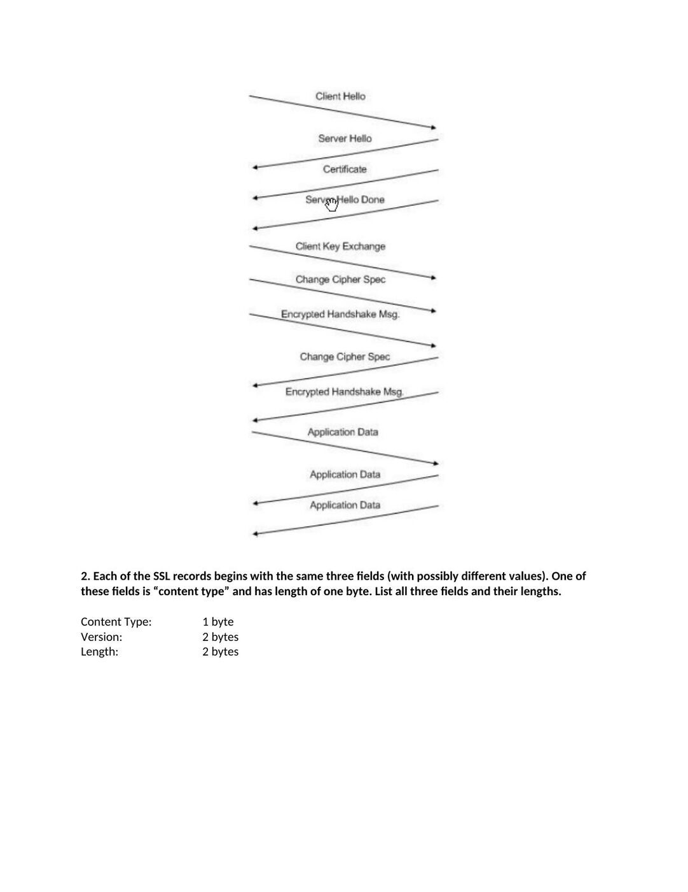
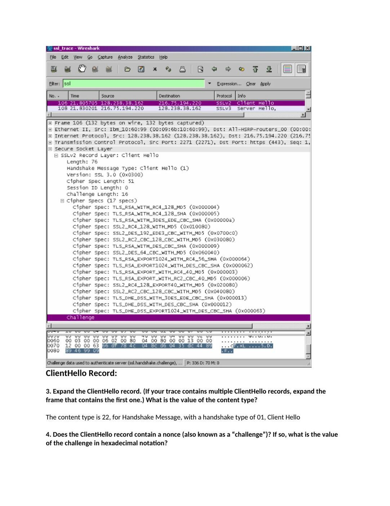
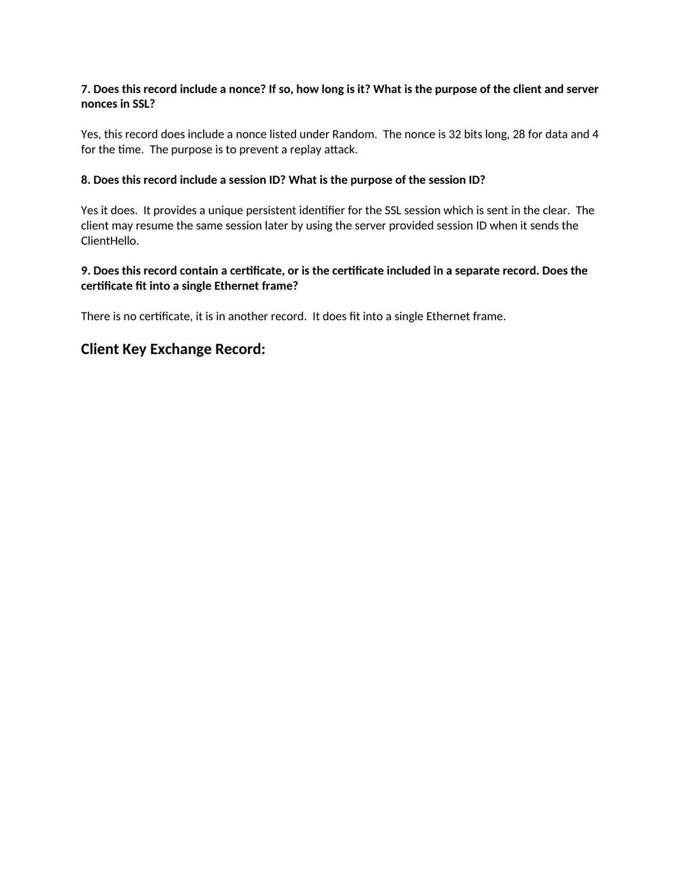

CSC337 Networking 2 dersinin 2012 bahar döneminden İngilizce bir öğrenci raporudur; kurum adı belgede belirtilmemiştir. EEM438 klasöründe saklanan bu üçüncü taraf belgeden öğrenci adı çıkarılmıştır. Belgelerin arşiv için hazırlanmış PDF kopyaları yazının sonunda indirilebilir.

*Bu içerik üçüncü taraf bir kaynağa aittir; arşiv ve nostalji amacıyla kaynak belirtilerek paylaşılmıştır. Hak sahibinin talebi hâlinde kaldırılır.*

## SSL raporu, 2012 baharı

CSC 337 Networking 2 Spring 2012

Wireshark Lab 1: SSL

*Note – I am using the captured trace from the authors website

**1.** For each of the first 8 Ethernet frames, specify the source of the frame (client or server), determine the number of SSL records that are included in the frame, and list the SSL record types that are included in the frame. Draw a timing diagram between client and server, with one arrow for each SSL record.

Frame Source SSL Count SSL Type 106 Client 1 Client Hello 108 Server 1 Server Hello Certificate 111 Server 2 Server Hello Done Client Key Exchange Change Cipher Spec 112 Client 3 Encrypted Handshake Message Change Cipher Spec 113 Server 2 Encrypted Handshake Message 114 Client 1 Application Data 122 Server 1 Application Data 127 Server 1 Application Data

**2.** Each of the SSL records begins with the same three fields (with possibly different values). One of these fields is “content type” and has length of one byte. List all three fields and their lengths.

Content Type: 1 byte Version: 2 bytes Length: 2 bytes

ClientHello Record:

**3.** Expand the ClientHello record. (If your trace contains multiple ClientHello records, expand the frame that contains the first one.) What is the value of the content type?

The content type is 22, for Handshake Message, with a handshake type of 01, Client Hello

**4.** Does the ClientHello record contain a nonce (also known as a “challenge”)? If so, what is the value of the challenge in hexadecimal notation?

The client hello challenge is 66df 784c 048c d604 35dc 4489 8946 9909

**5.** Does the ClientHello record advertise the cyber suites it supports? If so, in the first listed suite, what are the public-key algorithm, the symmetric-key algorithm, and the hash algorithm?

The first suite uses RSA for public key crypto, RC4 for the symmetric-key cipher and uses the MD5 hash algorithm.

ServerHello Record:

**6.** Locate the ServerHello SSL record. Does this record specify a chosen cipher suite? What are the algorithms in the chosen cipher suite?

The cipher suite uses RSA for public key crypto, RC4 for the symmetric-key cipher and uses the MD5 hash algorithm.

**7.** Does this record include a nonce? If so, how long is it? What is the purpose of the client and server nonces in SSL?

Yes, this record does include a nonce listed under Random. The nonce is 32 bits long, 28 for data and 4 for the time. The purpose is to prevent a replay attack.

**8.** Does this record include a session ID? What is the purpose of the session ID?

Yes it does. It provides a unique persistent identifier for the SSL session which is sent in the clear. The client may resume the same session later by using the server provided session ID when it sends the ClientHello.

**9.** Does this record contain a certificate, or is the certificate included in a separate record. Does the certificate fit into a single Ethernet frame?

There is no certificate, it is in another record. It does fit into a single Ethernet frame.

Client Key Exchange Record:

**10.** Locate the client key exchange record. Does this record contain a pre-master secret? What is this secret used for? Is the secret encrypted? If so, how? How long is the encrypted secret?

Yes, it does contain a premaster secret. It is used by both the server and client to make a master secret, which is used to generate session keys for MAC and encryption. The secret gets encrypted using the server’s public key, which the client extracted from the certificate sent by the server. The secret is 128 bytes long.

Change Cipher Spec Record (sent by client) and Encrypted Handshake Record:

**11.** What is the purpose of the Change Cipher Spec record? How many bytes is the record in your trace?

The purpose of the Change Cipher Spec record is to indicate that the contents of the following SSL records sent by the client (data, not header) will be encrypted. This record is 6 bytes long: 5 for the header and 1 for the message segment.

**12.** In the encrypted handshake record, what is being encrypted? How?

In the encrypted handshake record, a MAC of the concatenation of all the previous handshake messages sent from this client is generated and sent to the server.

**13.** Does the server also send a change cipher record and an encrypted handshake record to the client? How are those records different from those sent by the client?

Yes the server will also send a Change Cipher Spec record and encrypted handshake to the client. The server’s encrypted handshake record is different from that sent by the client because it contains the concatenation of all the handshake messages sent from the server rather than from the client. Otherwise the records would end up being the same.

Application Data:

**14.** How is the application data being encrypted? Do the records containing application data include a MAC? Does Wireshark distinguish between the encrypted application data and the MAC?

Application data is encrypted using symmetric key encryption algorithm chosen in the handshake phase (RC4) using the keys generated using the pre-master key and nonces from both client and server. The client encryption key is used to encrypt the data being sent from client to server and the server encryption key is used to encrypt the data being sent from the server to the client.

**15.** Comment on and explain anything else that you found interesting in the trace.

The version of SSL used changes from SSLv2 in the initial ClientHello message to SSLv3 in all following message exchanges.

Also, during resumes the handshake process is slightly different from the initial one. The client does not need another cert so the server never sends it. It just has to send a new nonce followed by Change Cipher Spec and Encrypted Handshake records from the server to client. After a response from the client then application data can be sent.

