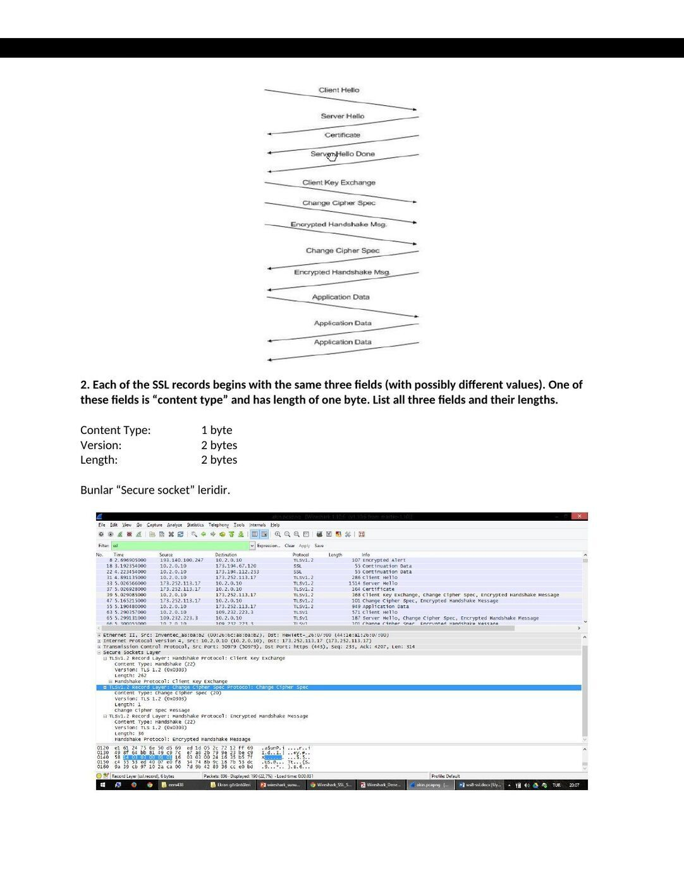
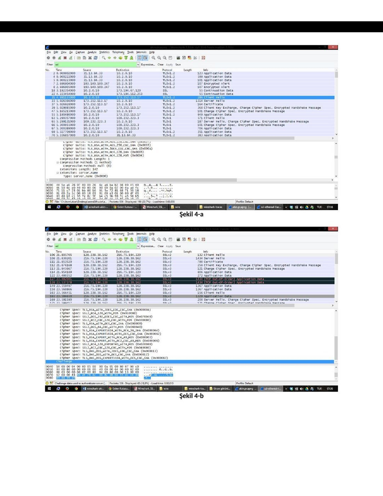
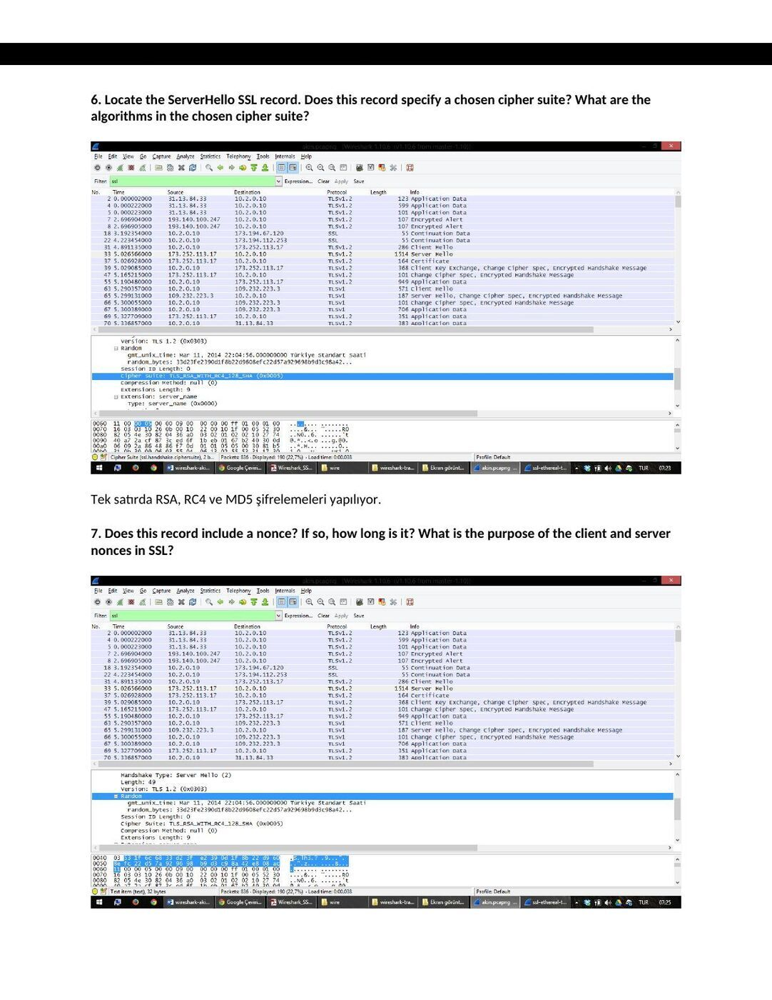
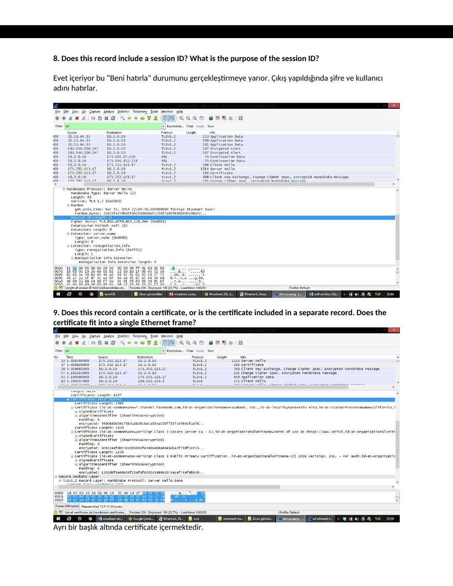

These are student laboratory reports from the course archive; student names, numbers, and identity details have been removed. Where the document carries no date, the creation or last-modified date of the source file has been used. Archive-ready PDF copies of the documents can be downloaded at the end of the post.

## SSL report, 6 March 2014

NOTE: For the experiment, a membership was created at http://www.clubboon.com, and the session was logged in and then logged out.

**1.** For each of the first 8 Ethernet frames, specify the source of the frame (client or server), determine the number of SSL records that are included in the frame, and list the SSL record types that are included in the frame. Draw a timing diagram between client and server, with one arrow for each SSL record.

Frame Source SSL Count SSL Type 31 Client 1 Client Hello 33 Server 1 Server Hello Certificate 37 Server 2 Server Hello Done Client Key Exchange Change Cipher Spec 39 Client 3 Encrypted Handshake Message Change Cipher Spec 47 Server 2 Encrypted Handshake Message 55 Client 1 Application Data 67 Server 1 Application Data 69 Server 1 Application Data

**2.** Each of the SSL records begins with the same three fields (with possibly different values). One of these fields is “content type” and has length of one byte. List all three fields and their lengths.

Content Type: 1 byte Version: 2 bytes Length: 2 bytes

These are the "Secure Sockets" records.

**3.** Expand the ClientHello record. (If your trace contains multiple ClientHello records, expand the frame that contains the first one.) What is the value of the content type?

Handshake messages are displayed as shown on the screen.

**4.** Does the ClientHello record contain a nonce (also known as a “challenge”)? If so, what is the value of the challenge in hexadecimal notation?

The challenge, which should appear at the end, guarantees freshness. However, it does not appear in the outputs I obtained (Figure 4-a). For this reason, I have included the image that should be there (Figure 4-b) from the example trace provided.

Figure 4-a

Figure 4-b

**5.** Does the ClientHello record advertise the cyber suites it supports? If so, in the first listed suite, what are the public-key algorithm, the symmetric-key algorithm, and the hash algorithm?

RSA, RC4, and MD5 encryption methods are used. RSA = public-key encryption, RC4 = symmetric-key encryption, MD5 = hash algorithm.

**6.** Locate the ServerHello SSL record. Does this record specify a chosen cipher suite? What are the algorithms in the chosen cipher suite?

RSA, RC4, and MD5 encryption are performed in a single line.

**7.** Does this record include a nonce? If so, how long is it? What is the purpose of the client and server nonces in SSL?

Yes, it contains two lines within the Random field. Their values in bytes are given below.

- > 1st line: 4 bytes (Figure 7-a)

- > 2nd line: 28 bytes (Figure 7-b)

Figure 7-a

Figure 7-b

**8.** Does this record include a session ID? What is the purpose of the session ID?

Yes, it does. It serves to implement the "Remember me" feature. When the user logs out, it remembers the password and username.

**9.** Does this record contain a certificate, or is the certificate included in a separate record. Does the certificate fit into a single Ethernet frame?

It contains the certificate under a separate heading.

**10.** Locate the client key exchange record. Does this record contain a pre-master secret? What is this secret used for? Is the secret encrypted? If so, how? How long is the encrypted secret?

Yes, it contains a pre-master secret. It is used for encrypting the MAC addresses. It is 256 bytes long.

**11.** What is the purpose of the Change Cipher Spec record? How many bytes is the record in your trace?

Sequential packets are all sent together with the MAC ID, and the next ID is included, so that no loss occurs. The packet that follows carries 6 bytes in its cipher field. (6 bytes = 1 byte message + 5 bytes header)

**12.** In the encrypted handshake record, what is being encrypted? How?

Encrypted Handshake Message -> it sends the preceding handshake messages after encrypting them; the purpose of this is assurance.

**13.** Does the server also send a change cipher record and an encrypted handshake record to the client? How are those records different from those sent by the client?

One Change Cipher Spec record is sent by the client and one by the server, each with a single MAC; the encrypted handshake record is sent encrypted according to all the MAC addresses.

**14.** How is the application data being encrypted? Do the records containing application data include a MAC? Does Wireshark distinguish between the encrypted application data and the MAC?

The application data starts out being encrypted with RC4; then the pre-master key is used and finally the challenge is applied, so that encryption takes place between both the server and the user.

**15.** Comment on and explain anything else that you found interesting in the trace.

For data transmission, TLSv1.2 is used for SSL message exchange; some ClientHello messages use TLSv1, while others use TLSv1.2.

*Note: Compared with the similar report in the EEM413 folder, the page layout and course title differ; this document is the EEM438 experiment 1 copy.*
