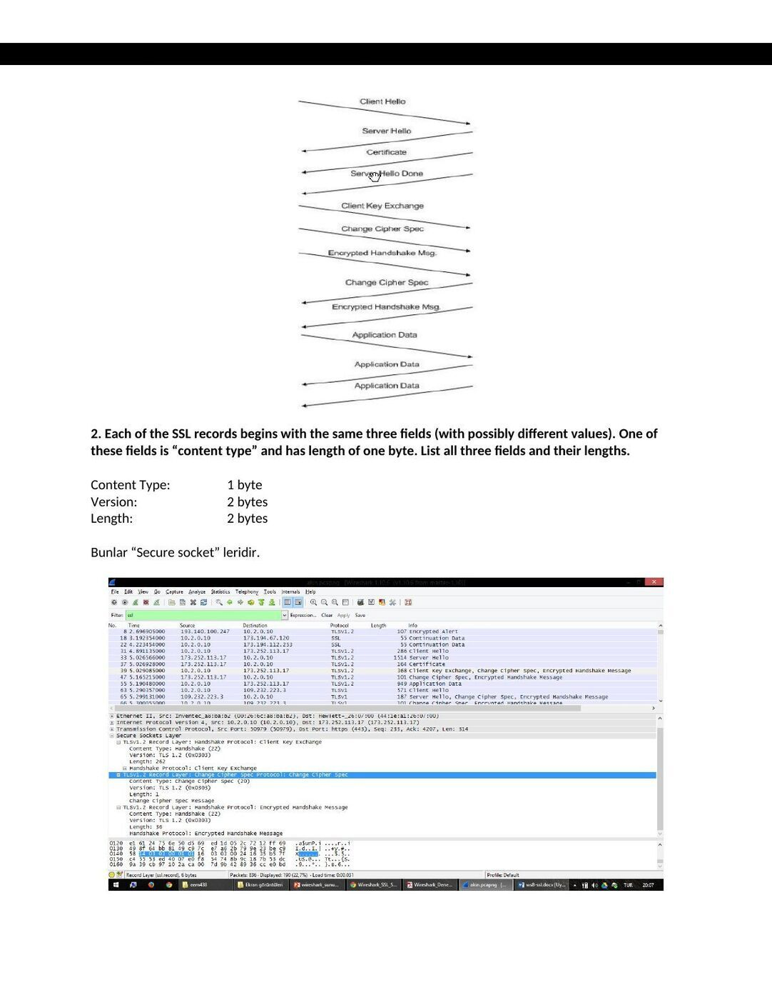
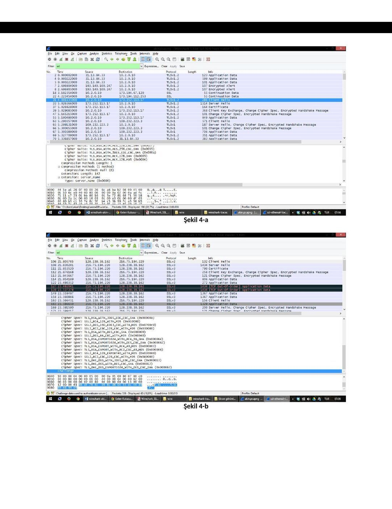
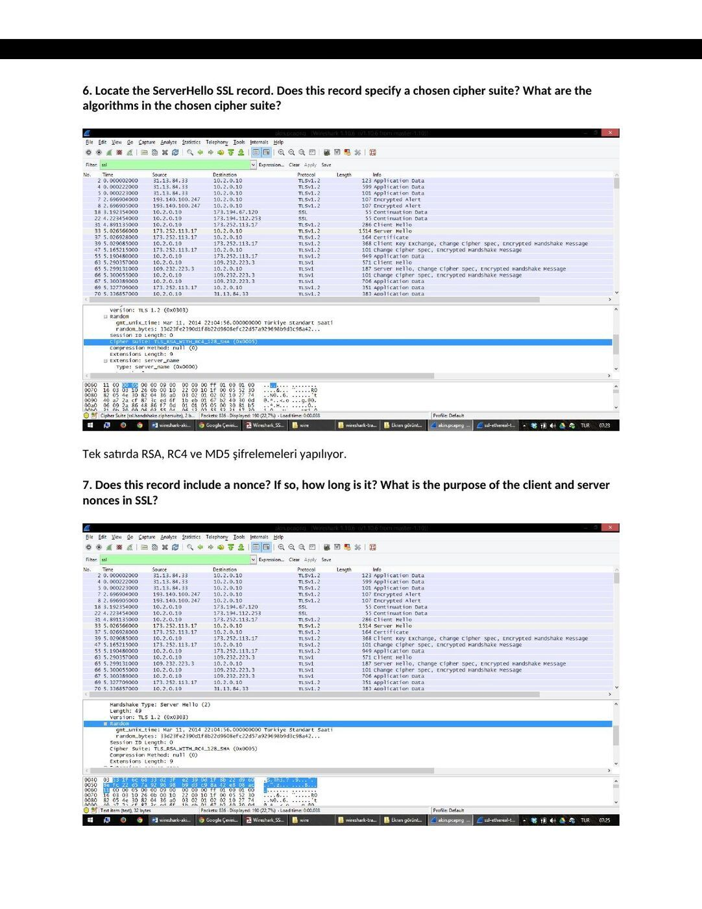
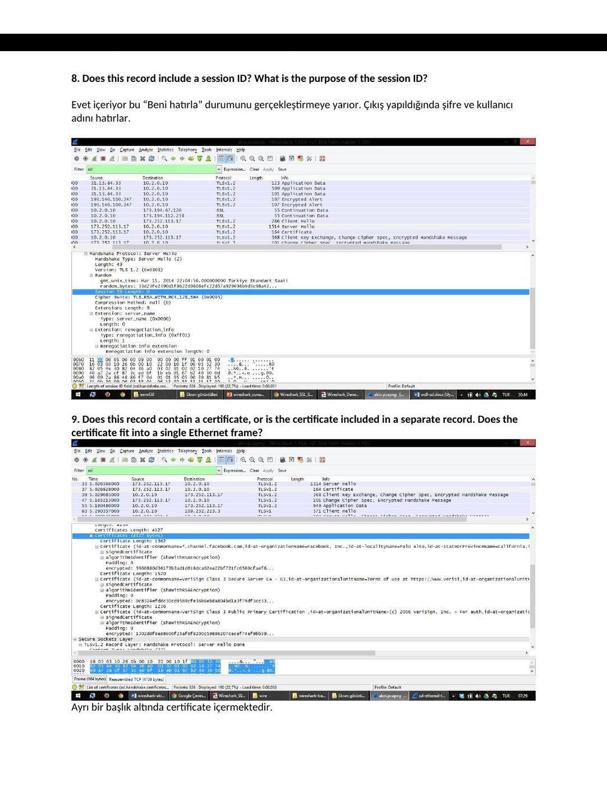

Ders arşivindeki öğrenci laboratuvar raporlarıdır; öğrenci adları, numaraları ve kimlik bilgileri çıkarılmıştır. Belge üzerindeki tarih bulunmadığında kaynak dosyanın oluşturulma ya da son değiştirilme tarihi kullanılmıştır. Belgelerin arşiv için hazırlanmış PDF kopyaları yazının sonunda indirilebilir.

## SSL raporu, 6 Mart 2014

NOT: Uygulama için http://www.clubboon.com adresinden üyelik alınmış giriş yaplmış ve çıkış yapılmıştır.

**1.** For each of the first 8 Ethernet frames, specify the source of the frame (client or server), determine the number of SSL records that are included in the frame, and list the SSL record types that are included in the frame. Draw a timing diagram between client and server, with one arrow for each SSL record.

Frame Source SSL Count SSL Type 31 Client 1 Client Hello 33 Server 1 Server Hello Certificate 37 Server 2 Server Hello Done Client Key Exchange Change Cipher Spec 39 Client 3 Encrypted Handshake Message Change Cipher Spec 47 Server 2 Encrypted Handshake Message 55 Client 1 Application Data 67 Server 1 Application Data 69 Server 1 Application Data

**2.** Each of the SSL records begins with the same three fields (with possibly different values). One of these fields is “content type” and has length of one byte. List all three fields and their lengths.

Content Type: 1 byte Version: 2 bytes Length: 2 bytes

Bunlar “Secure socket” leridir.

**3.** Expand the ClientHello record. (If your trace contains multiple ClientHello records, expand the frame that contains the first one.) What is the value of the content type?

Handshake mesajları ekranda gözüktüğü üzere gösterilmektedir.

**4.** Does the ClientHello record contain a nonce (also known as a “challenge”)? If so, what is the value of the challenge in hexadecimal notation?

Sonda yer alması gereken challenge, güncelliği garanti etmektedir. Fakat aldığım çıktılarda (şekil 4-a) yer almamaktadır. Bu yüzden olması gereken resmi (şekil 4-b) verilen örnek trace üzerinden koymuş bulunmaktayım.

Şekil 4-a

Şekil 4-b

**5.** Does the ClientHello record advertise the cyber suites it supports? If so, in the first listed suite, what are the public-key algorithm, the symmetric-key algorithm, and the hash algorithm?

RSA, RC4, MD5 şifreleme metodları kullanılmış. RSA = açık anahtarlama şifrelemesi, RC4 = simetrik anahtar şifreleme, MD5 = karma algoritma.

**6.** Locate the ServerHello SSL record. Does this record specify a chosen cipher suite? What are the algorithms in the chosen cipher suite?

Tek satırda RSA, RC4 ve MD5 şifrelemeleri yapılıyor.

**7.** Does this record include a nonce? If so, how long is it? What is the purpose of the client and server nonces in SSL?

Evet bu random içindeki iki satır yer almaktadır. Aşağıda byte cinsinden değerleri verilmiştir.

- > 1. Satır 4 byte (şekil 7-a)

- > 2. Satır 28 byte (şekil 7-b)

Şekil 7-a

Şekil 7-b

**8.** Does this record include a session ID? What is the purpose of the session ID?

Evet içeriyor bu “Beni hatırla” durumunu gerçekleştirmeye yarıor. Çıkış yapıldığında şifre ve kullanıcı adını hatırlar.

**9.** Does this record contain a certificate, or is the certificate included in a separate record. Does the certificate fit into a single Ethernet frame?

Ayrı bir başlık altında certificate içermektedir.

**10.** Locate the client key exchange record. Does this record contain a pre-master secret? What is this secret used for? Is the secret encrypted? If so, how? How long is the encrypted secret?

Evet, premaster secret içermektedir. Bu mac adreslerini şifreleme için kullanılmaktadır. 256 byte uzunluğundadır.

**11.** What is the purpose of the Change Cipher Spec record? How many bytes is the record in your trace?

Sıralı gelen paket mac id ile hep birlikte gönderiyor bir sonraki id de yer alıyor böylece kayıp olmuyor. Sonra gelen paket şifresinde 6 byte yer alıyor. (6 byte = 1 byte mesaj 5 byte header)

**12.** In the encrypted handshake record, what is being encrypted? How?

Encrypted Handshake Message -> kendinden önceki hadshake mesajlarını şifreleyerek gönderiyor, bunun amacı garantilemedir.

**13.** Does the server also send a change cipher record and an encrypted handshake record to the client? How are those records different from those sent by the client?

Biri client biri server tarafından Change Cipher Spec record tek mac, encrypted handshake record bütün mac adreslerine göre şifreleyerek gönderiyor.

**14.** How is the application data being encrypted? Do the records containing application data include a MAC? Does Wireshark distinguish between the encrypted application data and the MAC?

Application data RC4 şifrelemesi kullanılarak başlanmış sonrasında pre-master key ve en sonunda ise challence işlemi yapılarak şifreleme hem server hemde kullanıcı arasında gerçekleşmiştir.

**15.** Comment on and explain anything else that you found interesting in the trace.

Data gönderiminde SSL mesaj alışverişi için TLSv1.2 kullanmaktadır ve bağzı ClientHello mesajında TLSv1 kullanırken bazılarında TLSv1.2 kullanılmıştır.

*Not: EEM413 klasöründeki benzer rapora göre sayfa düzeni ve ders başlığı farklıdır; bu belge EEM438 deney 1 kopyasıdır.*

