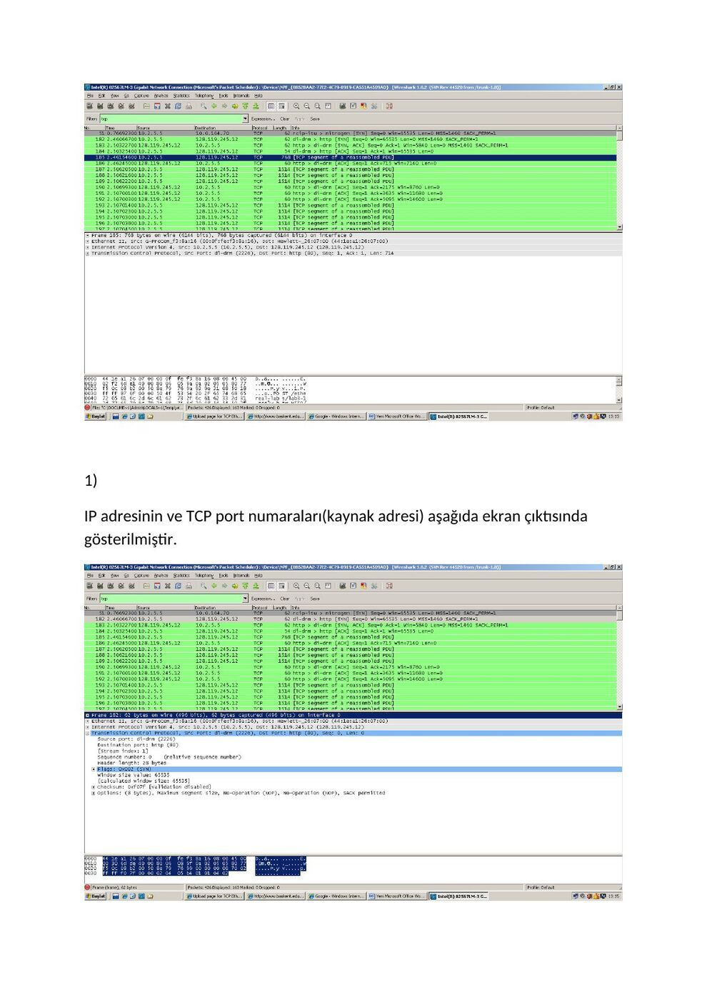
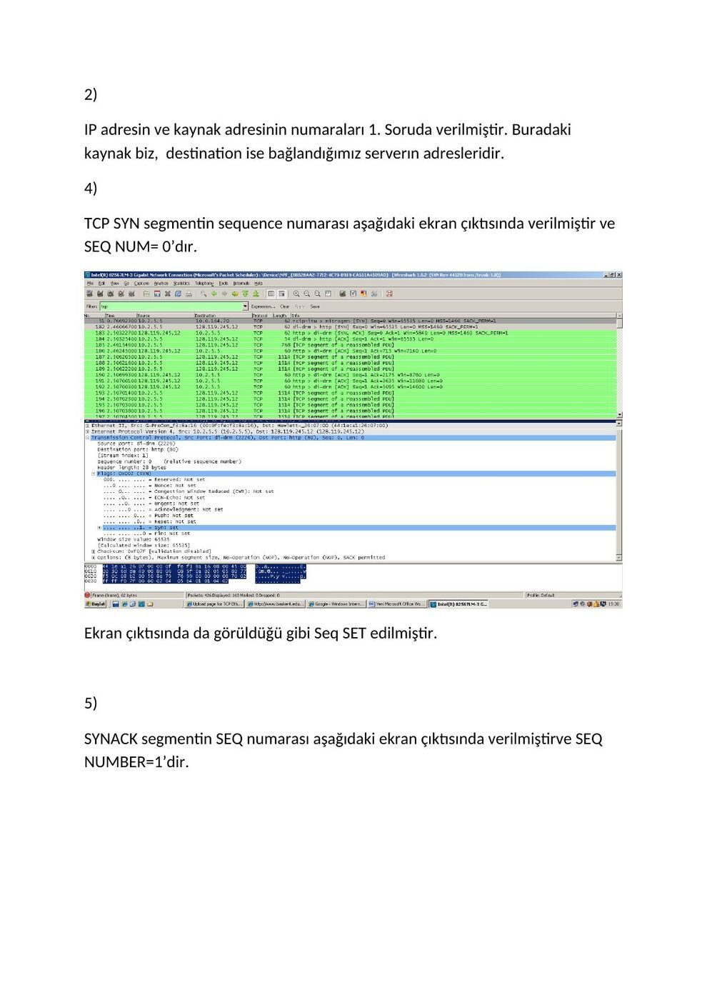
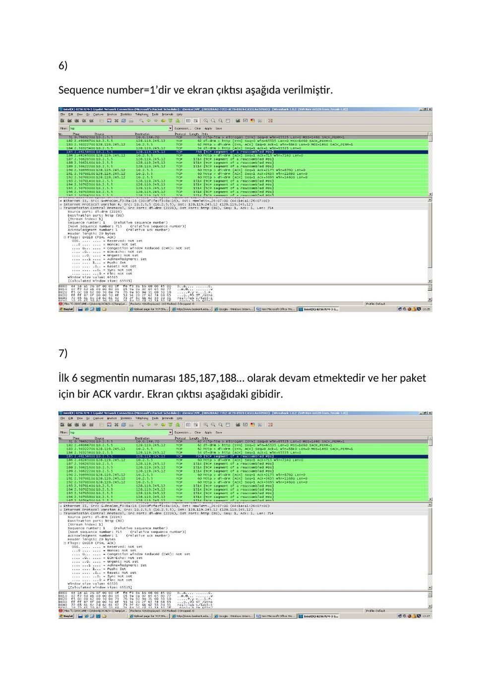
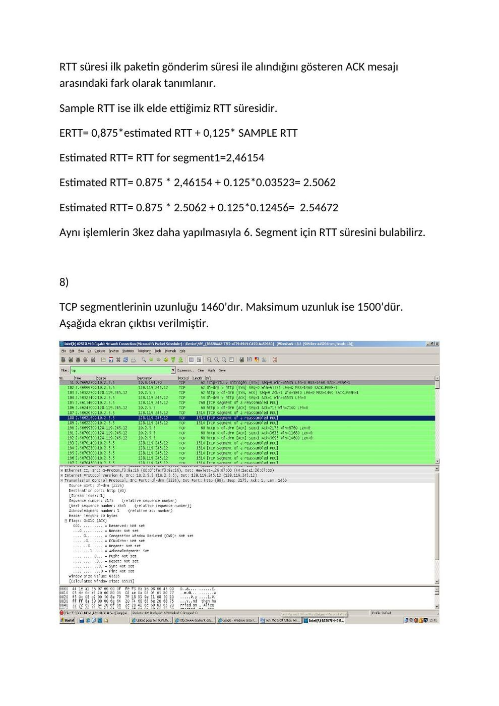
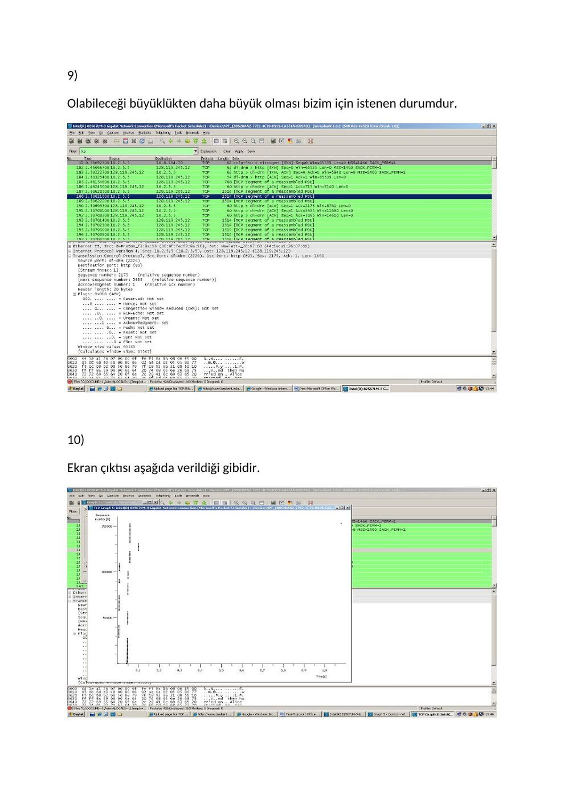
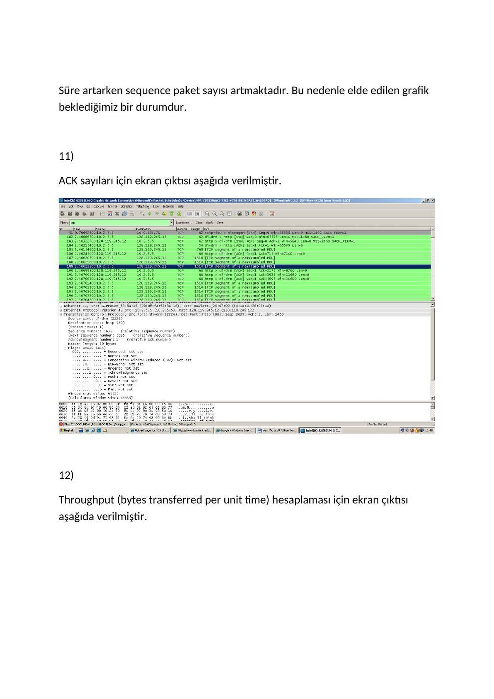
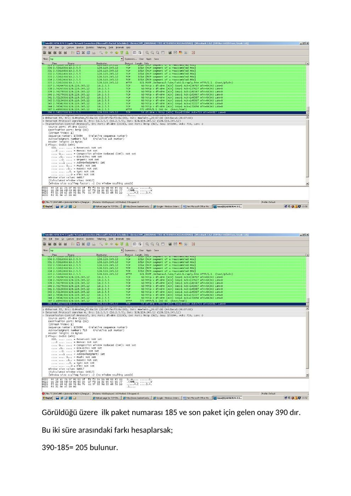

These are student laboratory reports from the course archive; student names, numbers and identity details have been removed. Where the document carries no date, the creation or last-modified date of the source file has been used. PDF copies of the documents prepared for the archive can be downloaded at the end of the post.

## TCP supplementary report

In this laboratory exercise, the TCP protocol was examined. After entering the requested web address, packet capture was stopped once the 'congratulations!' message appeared. Screenshots of these steps are given below.

**1.** 

**1.** 

The IP address and the TCP port numbers (source address) are shown in the screenshot below.

**2.** 

The numbers of the IP address and the source address are given in Question 1. Here the source is us, and the destination is the address of the server we connect to.

**4.** 

The sequence number of the TCP SYN segment is given in the screenshot below, and SEQ NUM = 0.

As can be seen in the screenshot, the Seq flag is SET.

**5.** 

The SEQ number of the SYNACK segment is given in the screenshot below, and SEQ NUMBER = 1.

After at most two sequence messages, an ACK or NAK message arrives.

**6.** 

The sequence number is 1, and the screenshot is given below.

**7.** 

The numbers of the first 6 segments continue as 185, 187, 188… and there is an ACK for each packet. The screenshot is as follows.

The RTT is defined as the difference between the time the first packet was sent and the time the ACK message indicating its receipt arrived.

The Sample RTT is the first RTT value we obtain.

ERTT = 0.875 * estimated RTT + 0.125 * SAMPLE RTT

Estimated RTT = RTT for segment 1 = 2.46154

Estimated RTT = 0.875 * 2.46154 + 0.125 * 0.03523 = 2.5062

Estimated RTT = 0.875 * 2.5062 + 0.125 * 0.12456 = 2.54672

By repeating the same operations 3 more times, we can find the RTT for the 6th segment.

**8.** 

The length of the TCP segments is 1460. The maximum length is 1500. The screenshot is given below.

**9.** 

It is the desired situation for us that it is larger than it could possibly be.

**10.** 

The screenshot is as given below.

As time increases, the number of sequence packets increases. Therefore, the graph obtained is what we expect.

**11.** 

The screenshot for the ACK numbers is given below.

**12.** 

The screenshot for the throughput (bytes transferred per unit time) calculation is given below.

As can be seen, the first packet number is 185 and the acknowledgment for the last packet is 390.

If we calculate the difference between these two values:

390 - 185 = 205 is found.

*Note: In the source, the calculation 0.875×2.46154 + 0.125×0.03523 is written as 2.5062; the arithmetic result is 2.15825125. The packet-number difference 390−185=205 is not a time difference and does not by itself give throughput. To obtain throughput, the number of bytes transferred must be divided by the elapsed time.*
