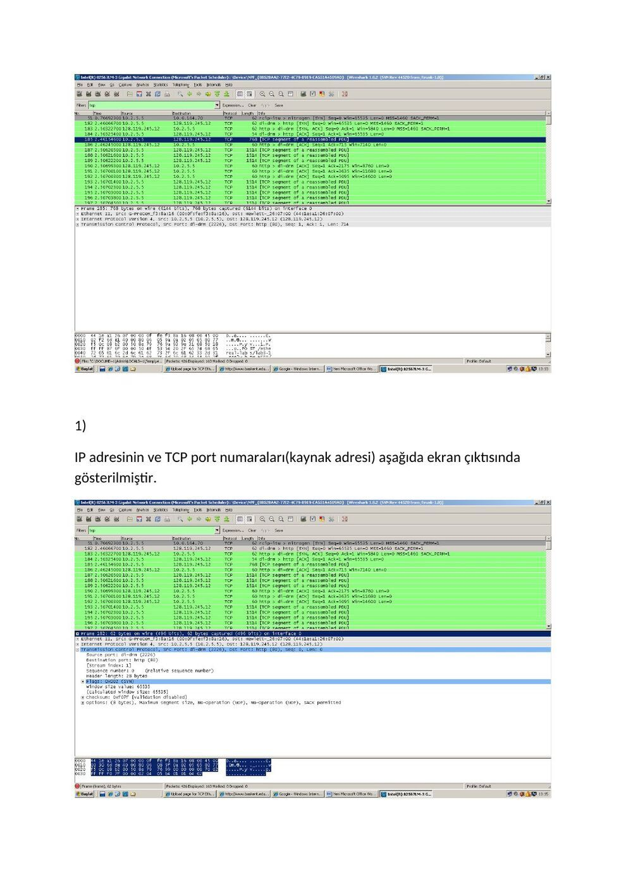
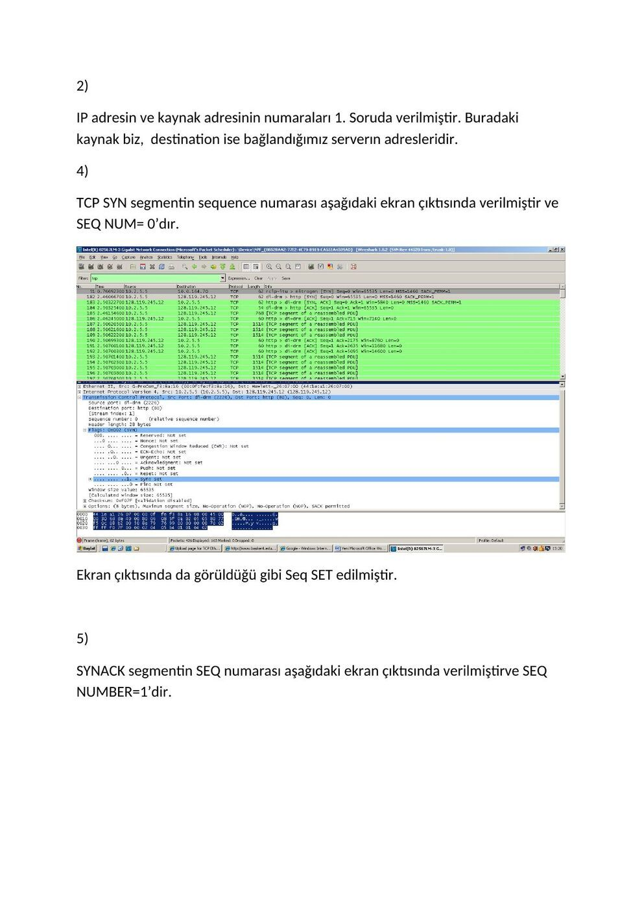
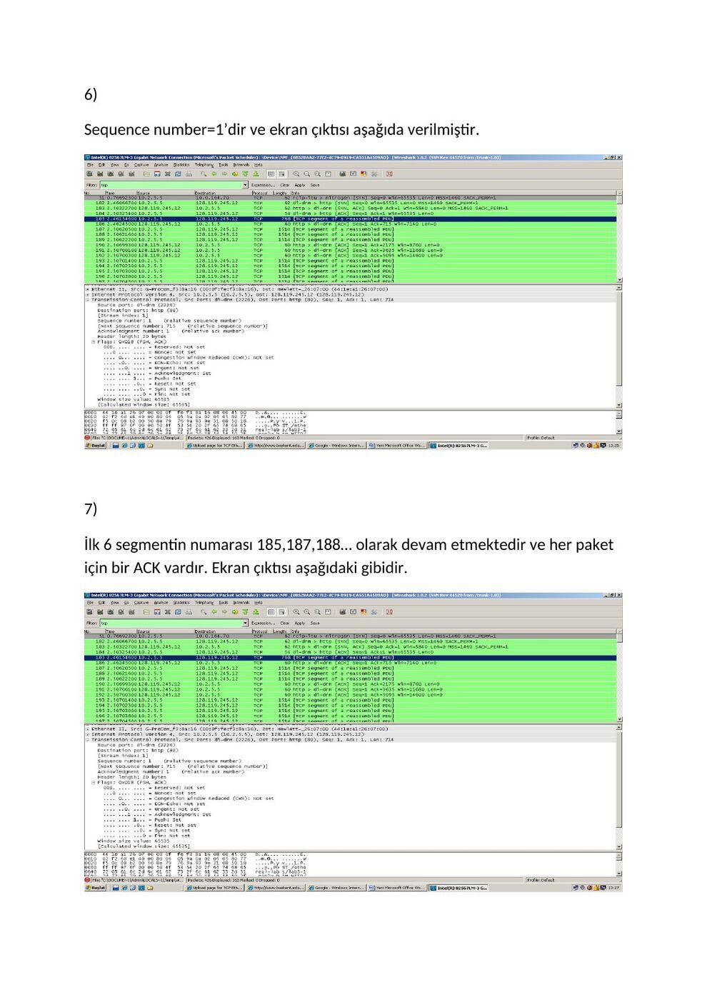
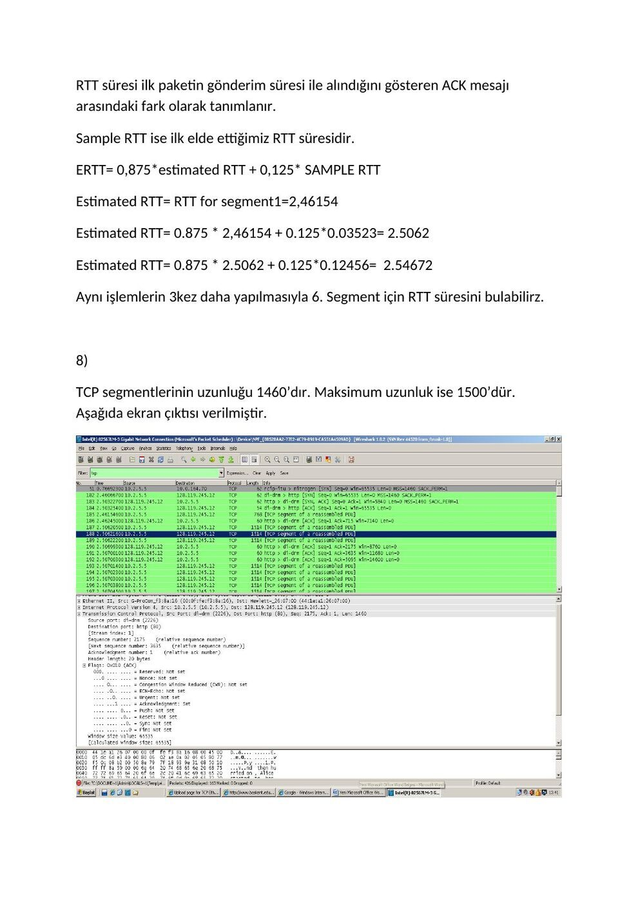
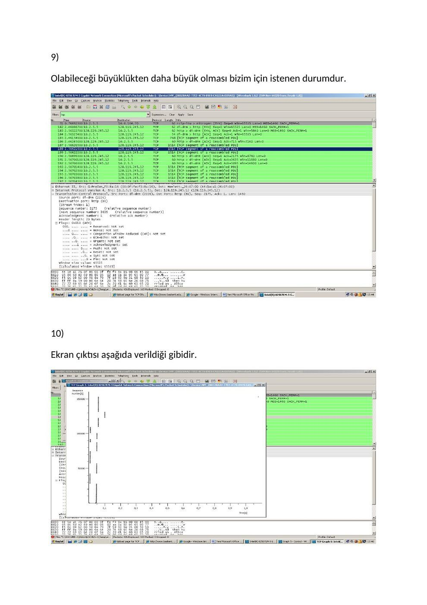
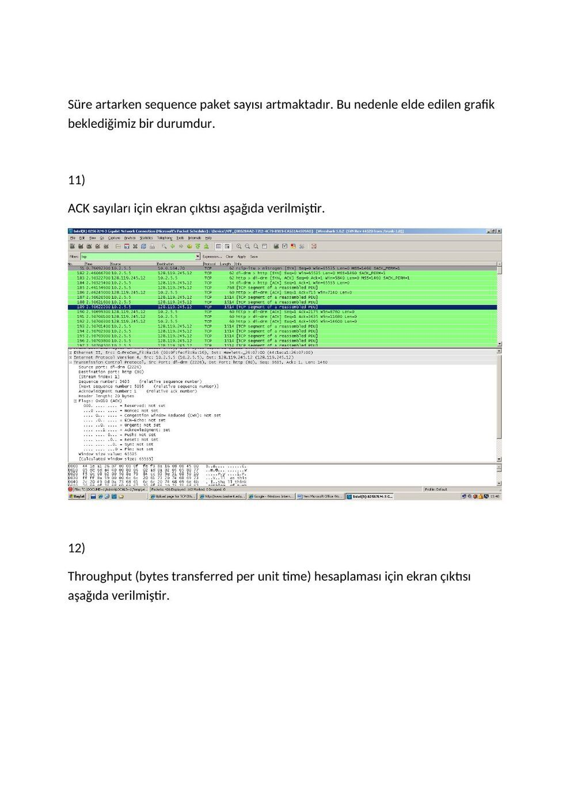
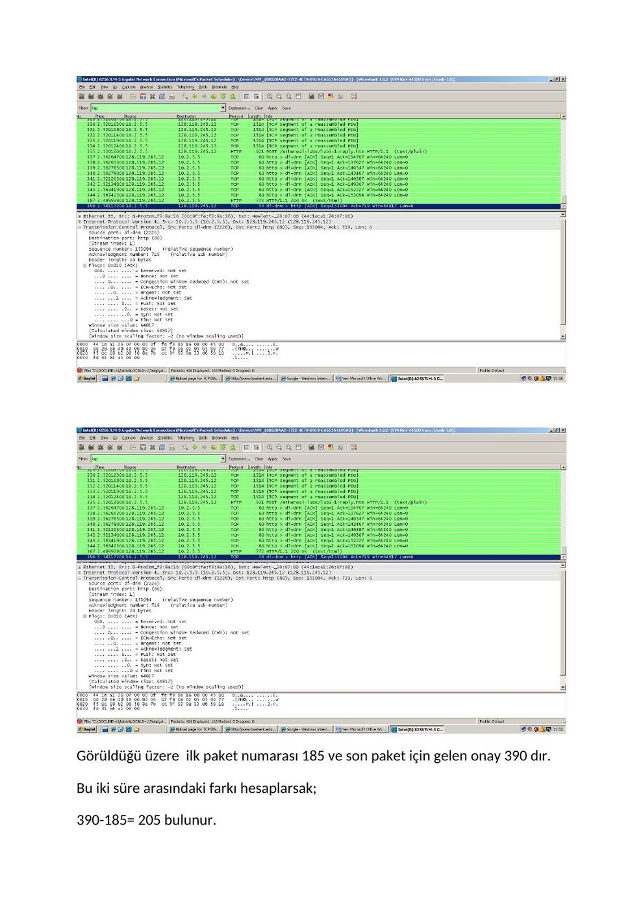

Ders arşivindeki öğrenci laboratuvar raporlarıdır; öğrenci adları, numaraları ve kimlik bilgileri çıkarılmıştır. Belge üzerindeki tarih bulunmadığında kaynak dosyanın oluşturulma ya da son değiştirilme tarihi kullanılmıştır. Belgelerin arşiv için hazırlanmış PDF kopyaları yazının sonunda indirilebilir.

## TCP ek raporu

Bu laboratuar uygulamasında TCP protokolü incelenmiştir. İstenilen web adresine girdikten sonra ‘congratulations!’ mesajı çıktıktan sonra paket yakalama durdurulmuştur. Bu işlemlerin ekran çıktıları aşağıda verilmiştir.

**1.** 

**1.** 

IP adresinin ve TCP port numaraları(kaynak adresi) aşağıda ekran çıktısında gösterilmiştir.

**2.** 

IP adresin ve kaynak adresinin numaraları 1. Soruda verilmiştir. Buradaki kaynak biz, destination ise bağlandığımız serverın adresleridir.

**4.** 

TCP SYN segmentin sequence numarası aşağıdaki ekran çıktısında verilmiştir ve SEQ NUM= 0’dır.

Ekran çıktısında da görüldüğü gibi Seq SET edilmiştir.

**5.** 

SYNACK segmentin SEQ numarası aşağıdaki ekran çıktısında verilmiştirve SEQ NUMBER=1’dir.

Maksimum iki sequence mesajından sonra ACK mesajı yada NAC mesajı gelir.

**6.** 

Sequence number=1’dir ve ekran çıktısı aşağıda verilmiştir.

**7.** 

İlk 6 segmentin numarası 185,187,188… olarak devam etmektedir ve her paket için bir ACK vardır. Ekran çıktısı aşağıdaki gibidir.

RTT süresi ilk paketin gönderim süresi ile alındığını gösteren ACK mesajı arasındaki fark olarak tanımlanır.

Sample RTT ise ilk elde ettiğimiz RTT süresidir.

ERTT= 0,875*estimated RTT + 0,125* SAMPLE RTT

Estimated RTT= RTT for segment1=2,46154

Estimated RTT= 0.875 * 2,46154 + 0.125*0.03523= 2.5062

Estimated RTT= 0.875 * 2.5062 + 0.125*0.12456= 2.54672

Aynı işlemlerin 3kez daha yapılmasıyla 6. Segment için RTT süresini bulabilirz.

**8.** 

TCP segmentlerinin uzunluğu 1460’dır. Maksimum uzunluk ise 1500’dür. Aşağıda ekran çıktısı verilmiştir.

**9.** 

Olabileceği büyüklükten daha büyük olması bizim için istenen durumdur.

**10.** 

Ekran çıktısı aşağıda verildiği gibidir.

Süre artarken sequence paket sayısı artmaktadır. Bu nedenle elde edilen grafik beklediğimiz bir durumdur.

**11.** 

ACK sayıları için ekran çıktısı aşağıda verilmiştir.

**12.** 

Throughput (bytes transferred per unit time) hesaplaması için ekran çıktısı aşağıda verilmiştir.

Görüldüğü üzere ilk paket numarası 185 ve son paket için gelen onay 390 dır.

Bu iki süre arasındaki farkı hesaplarsak;

390-185= 205 bulunur.

*Not: Kaynakta 0,875×2,46154 + 0,125×0,03523 işlemi 2,5062 yazılmıştır; aritmetik sonuç 2,15825125’tir. Paket numaralarının 390−185=205 farkı zaman farkı değildir ve tek başına throughput vermez. Throughput için aktarılan baytın geçen süreye bölünmesi gerekir.*

