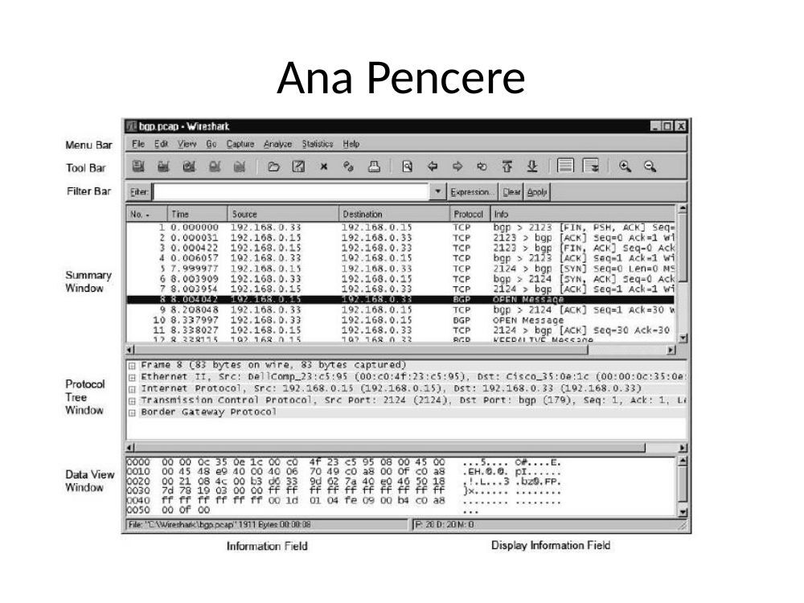
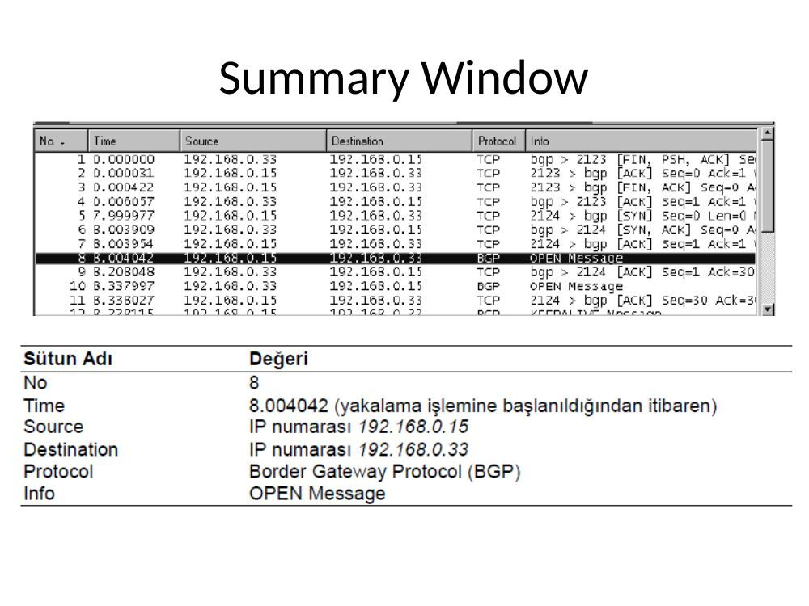
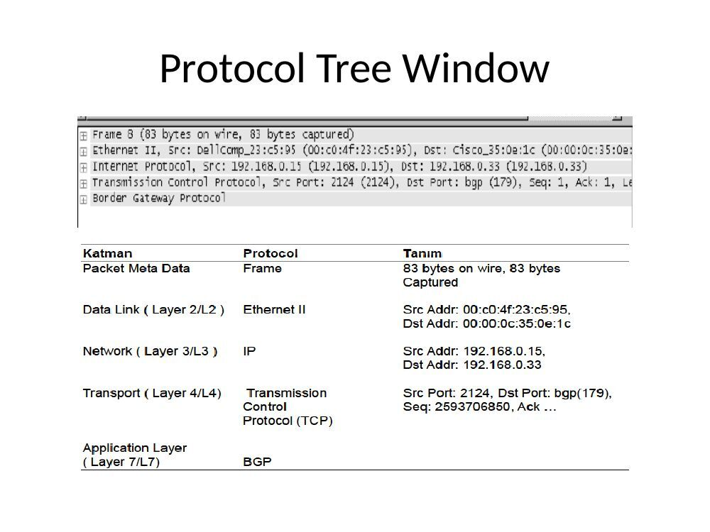
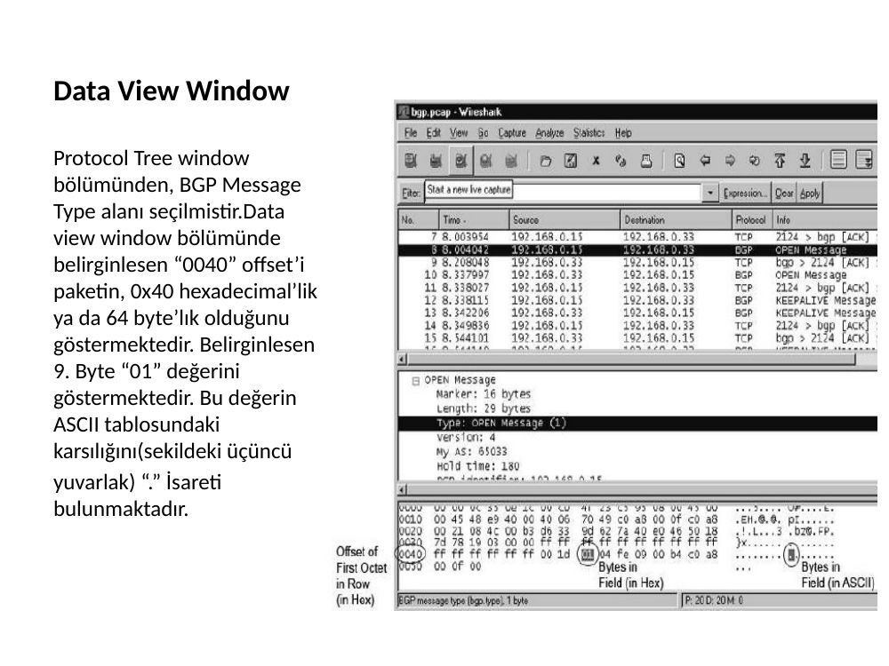
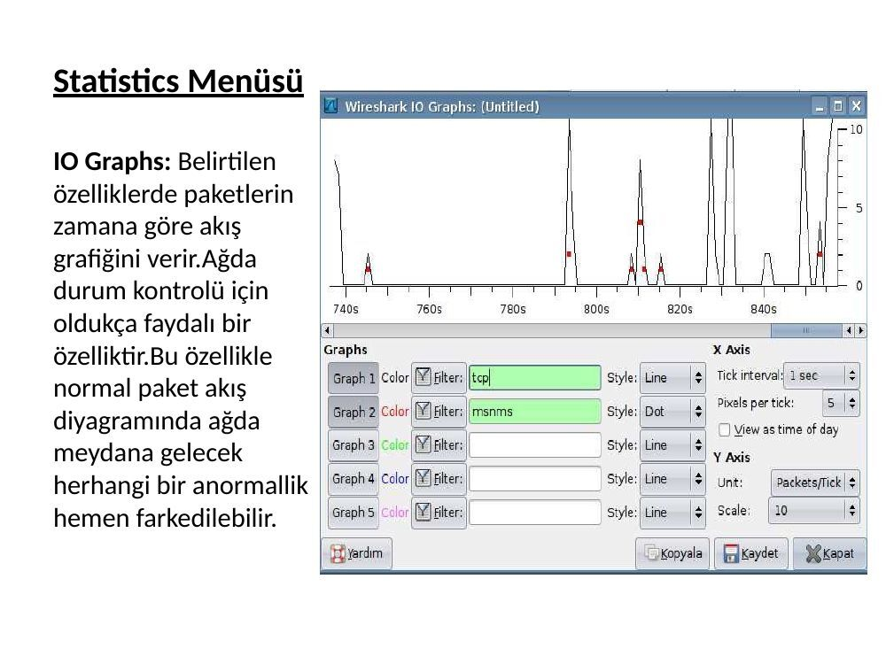
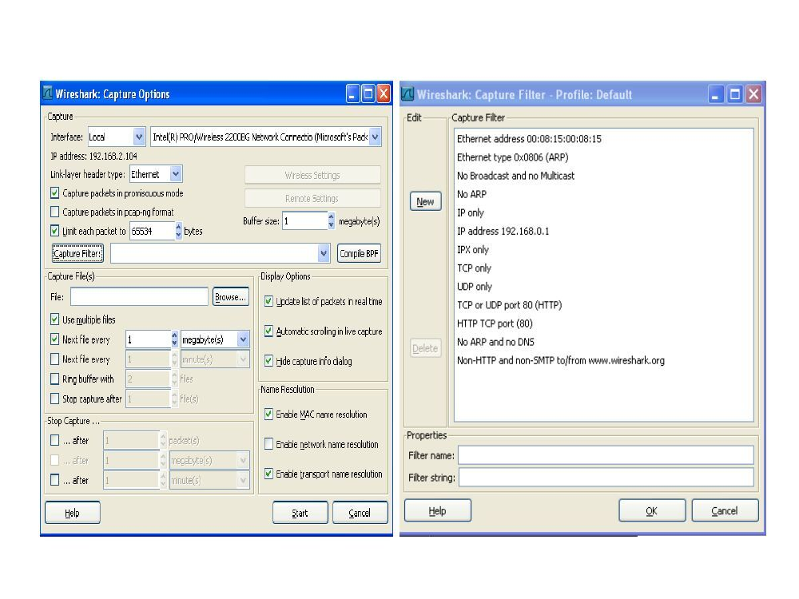

This is the Wireshark lecture presentation prepared by Research Assistant Dilara Değerliyurt. The document carries no date; the archive date is taken from the creation record of the source file. PDF copies of the documents, prepared for the archive, can be downloaded at the end of the post.

## Research Assistant (slide 1)

Research Assistant Dilara DEĞERLİYURT

## WIRESHARK (slide 2)

WIRESHARK

- It allows capturing packets that reach the computer and viewing the contents of those packets.

- It is a program that can analyze all TCP/IP messages on any network card connected to the computer.

- The files required for installation can be obtained from http://www.wireshark.org.

## WIRESHARK FEATURES (slide 3)

WIRESHARK FEATURES

- It is available for Unix and Windows operating systems.

- It captures packets from the local network interface and displays them in detail together with protocol information.

- It has the ability to save captured packets.

- It searches and filters packets according to various criteria.

- It colors and categorizes sent and received packets based on filtering.

- It presents various statistics to the user according to the configured settings.

- It analyzes more than 750 protocols.

## Areas of use; (slide 4)

Areas of use;

- It is used to convert the binary data in packets into a readable format.

- It is used to troubleshoot network problems.

- It is used to analyze network performance.

- It is used to detect network intruders.

- It is used to analyze the operations performed by applications.

- It is used to find faults in the network card.

## Main Window (slide 5)

Main Window

## Main Window Components (slide 6)

Main Window Components Window Component Description

- Menu Bar: A classic application containing the graphical interface for the menu items.

- Tool Bar: Contains shortcuts to Wireshark's frequently used functions. It can be customized by the user.

- Filter Bar: Allows the captured packets to be displayed separated as desired.

- Summary Window: Presents a one-line summary for each of the captured packets.

- Protocol Tree Window: Presents the detailed information of the packet selected in the Summary Window, organized in a way users can understand.

- Data View Window: Presents the detailed information of the packet selected in the Summary Window, without any rearrangement.

- Display Information Field: Shows the packet numbers, kept up to date.

## Summary Window (slide 7)

Summary Window

## Summary Window (slide 8)

Summary Window

## Protocol Tree Window (slide 9)

Protocol Tree Window

- Let us visualize the packet as a top-level tree of all protocols. A tree node is created for each protocol. Thanks to these tree nodes, the protocol field can be described in more detail. If a tree node has a subtree, it can be expanded to show more detailed information or collapsed to show only summary information.

## Protocol Tree Window (slide 10)

Protocol Tree Window

## Protocol Tree Window (slide 11)

Protocol Tree Window

## Data View Window (slide 12)

Data View Window

The BGP Message Type field has been selected in the Protocol Tree Window. The offset "0040" highlighted in the Data View Window indicates that the packet is 0x40 hexadecimal, or 64 bytes. The highlighted

**9.** byte shows the value "01". The ASCII table equivalent of this value (the third circle in the figure) is the "." character.

## Display Information Field (slide 13)

Display Information Field

## File Menu (slide 14)

File Menu

## File Menu (slide 15)

File Menu

Menu Option Description

Open: Allows us to open a saved Wireshark file. Open Recent: Lists the Wireshark files most recently worked on and helps us open them. Merge: Displays two separate files as if they were a single file. Close: Closes the files we have captured. Save: Save. Save As: Allows us to save changes made to a saved file independently in another location. File Set: A submenu for organizing the information in the file. Export: Allows us to export another file. Print: Prints to the printer. Quit: Exits the Wireshark application.

## Edit Menu (slide 16)

Edit Menu

## Edit Menu (slide 17)

Edit Menu

Menu Option Description

Find Packet: Searches by the filter used, a hex value, or a string and lists the packets it finds. Find Next: Finds the packet following the packet that matches the search. Find Previous: Finds the packet preceding the packet that matches the search. Mark Packet: Marks the packet selected in the Summary Window. Find Next Mark: Finds the next marked packet among the marked packets. Find Previous Mark: Finds the previous marked packet among the marked packets. Set Time Reference: Takes the selected packet as the time reference, and subsequent packets take their time values relative to it. Preferences: Changes user-defined settings.

## View Menu (slide 18)

View Menu

## Go Menu (slide 19)

Go Menu

## Capture Menu (slide 20)

Capture Menu

## Capture Menu (slide 21)

Capture Menu Menu Option Description

Interfaces: The place in the program where we start the packet capture process. Options: Opens the packet settings menu. Start: Starts the packet capture process. Stop: Stops the packet capture process. Restart: Resumes a stopped packet capture process. Capture Filters: Sets the capture filter.

## Analyze Menu (slide 22)

Analyze Menu

## Analyze Menu (slide 23)

Analyze Menu Menu Option Description

Display Filter: Sorts the captured packets according to the specified expressions. Decode As: Decodes packets according to specific protocols. User Specified Decodes: Displays the conversions defined by the user. Follow TCP Stream: Shows all TCP segments of the TCP connection related to the selected packet in a separate window. Expert Info: A log of the events that occur during communication. It classifies captured packets by the criteria errors, notes, warnings, and chats.

## Statistics Menu (slide 24)

Statistics Menu

## Statistics Menu (slide 25)

Statistics Menu

Summary: Contains data about the open capture file, including file format, packet count, size, first and last packet capture times, and the filter and capture interface.

## Statistics Menu (slide 26)

Statistics Menu

Protocol Hierarchy: Shows the layer and protocol hierarchy of the captured packets in tree form.

## Statistics Menu (slide 27)

Statistics Menu

Conversations: Gives statistics on the traffic between source and destination endpoints. The total incoming and outgoing packets and byte counts between endpoints are listed by port.

## Statistics Menu (slide 28)

Statistics Menu Endpoints: Gives statistics for each endpoint without distinguishing between destination and source addresses. There is a separate tab for each supported protocol. Each tab indicates the number of endpoints captured. For example, ethernet:3 indicates that 3 Ethernet endpoints have been captured so far. If no endpoint has been captured for a protocol, the corresponding tab appears faded. Each row shows the statistical values for one endpoint.

## Statistics Menu (slide 29)

Statistics Menu

IO Graphs: Provides a graph of the packet flow over time for the specified properties. It is a very useful feature for checking the state of the network. With this feature, any anomaly that occurs in the network can be noticed immediately in the normal packet flow diagram.

## Statistics Menu (slide 30)

Statistics Menu

- Service Response Time: Shows the time between a request and a response.

- WLAN Traffic Statistics: Presents statistics on the captured wireless network traffic.

## Help Menu (slide 31)

Help Menu

## Filtering (slide 32)

Filtering

The Filter Bar is the section that lets us filter the packets we have captured in the Summary Window. When we enter a filter expression in the Filter Bar, only the packets we filtered will be visible in the Summary Window. The color of the Filter Bar indicates the status of the filter.

## Filtering (slide 33)

Filtering

The capture filter specified in the Capture > Options window defines the conditions that Wireshark will follow during packet capture.

## Diagram (slide 34)

## As can be seen, the Capture Filter window presents a list of rules that Wireshark will follow during packet capture (slide 35)

As can be seen, the Capture Filter window presents a list of rules that Wireshark will follow during packet capture.

- Ethernet address 00:08:15:00:08:15: Captures packets belonging to the specified MAC address in the source or destination addresses under Ethernet II.

- Ethernet type 0x0806 (ARP), 0x0800 (IP), 0x8035 (RARP), 0x6003 (DECNET), 0x6004 (DEC LAT), 0x6002 (MOP RC), 0x6001 (MOP DL)

- not broadcast and not multicast: Does not capture broadcast and multicast packets.

- not arp: Does not capture ARP packets.

- IP address 192.168.0.1: Captures packets that contain the specified IP address in the destination or source address fields.

- IPX only: Captures packets belonging to the relevant protocol.

- TCP only: Captures packets belonging to the relevant protocol.

- UDP only: Captures packets belonging to the relevant protocol.

- TCP or UDP port 80 (http): Captures TCP and UDP packets for port 80.

- HTTP TCP port (80): Captures HTTP and TCP packets for port 80.

- No ARP and no DNS: Captures packets other than DNS and ARP packets.

- NonHTTP and nonSMTP to/from www.wireshark.org: Captures packets other than HTTP and SMTP for the specified address.

*Note: The menus and interface screens belong to older Wireshark versions; the statement "more than 750 protocols" in the presentation reflects the information of that period.*
