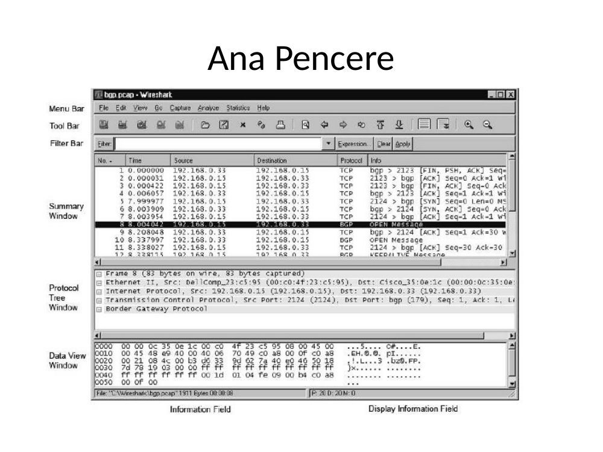
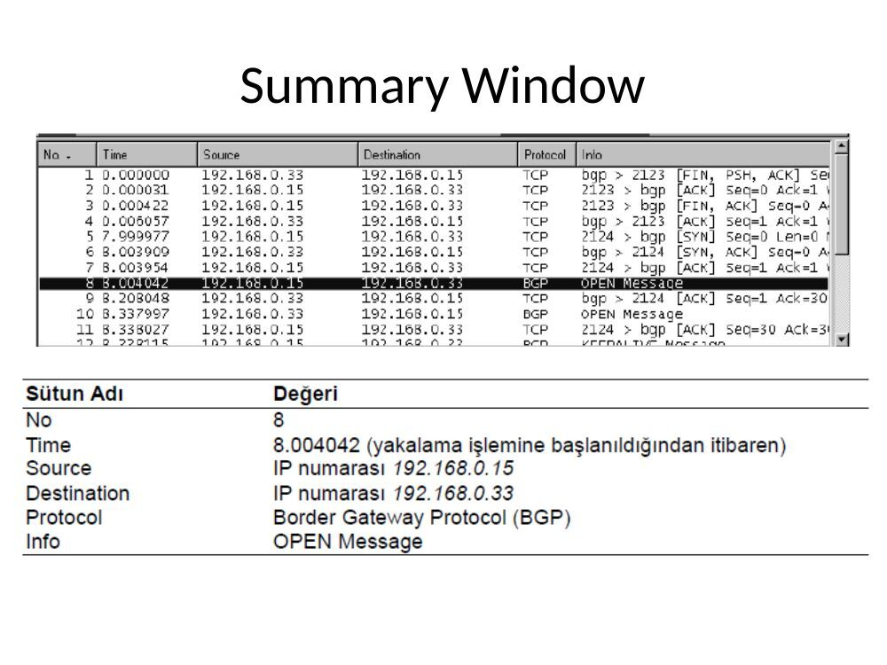
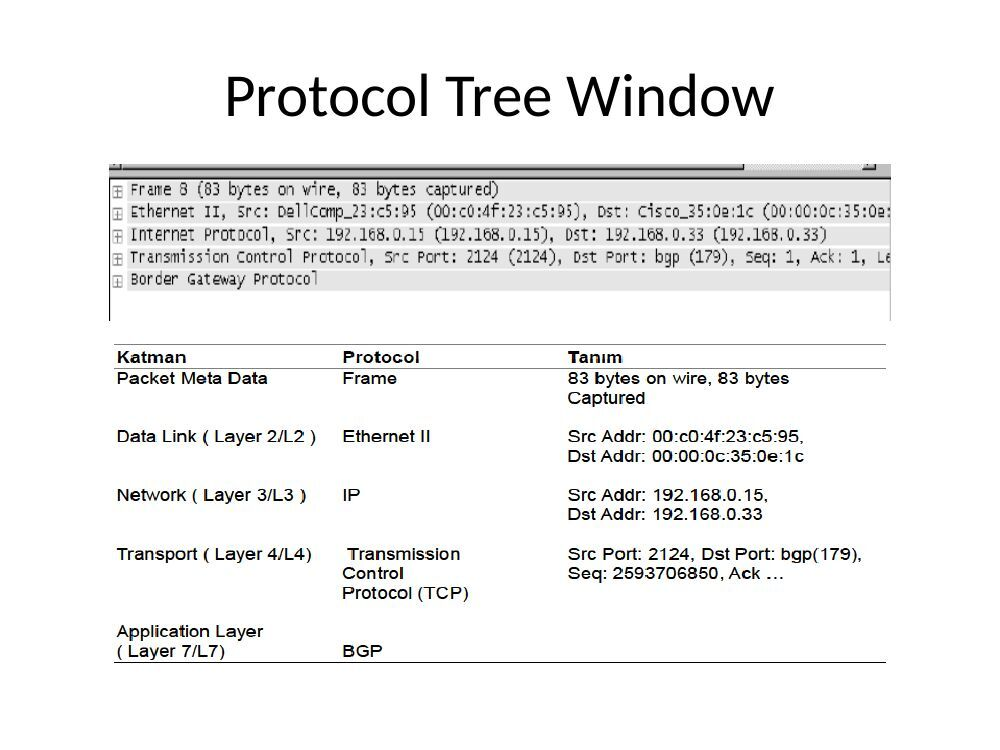
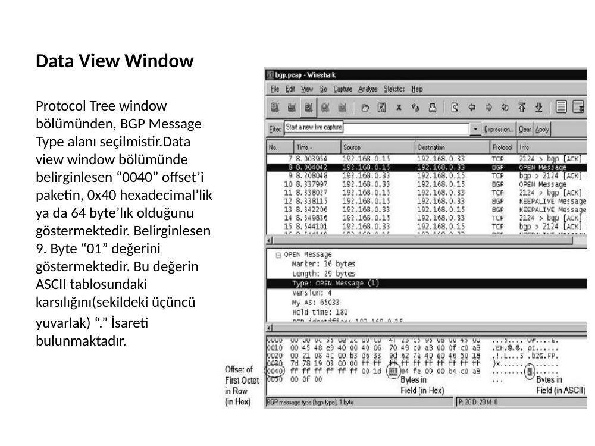
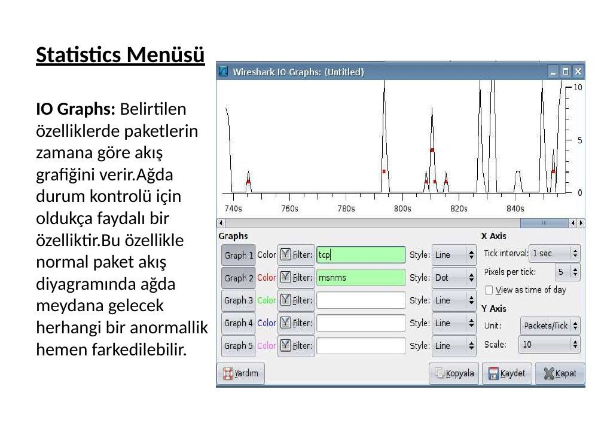
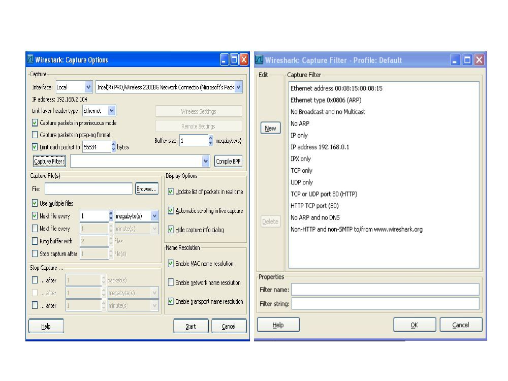

Araştırma Görevlisi Dilara Değerliyurt tarafından hazırlanmış Wireshark ders sunumudur. Belge üzerinde tarih yoktur; arşiv tarihi kaynak dosyanın oluşturulma kaydından alınmıştır. Belgelerin arşiv için hazırlanmış PDF kopyaları yazının sonunda indirilebilir.

## Araştırma Görevlisi (slayt 1)

Araştırma Görevlisi Dilara DEĞERLİYURT

## WIRESHARK (slayt 2)

WIRESHARK

- Bilgisayara ulaşan paketleri yakalamaya ve bu paketlerin içeriğini görüntülemeye imkan tanır.

- Bilgisayara bağlı her türlü ağ kartlarındaki tüm TCP/IP mesajlarını analiz edebilen bir programdır.

- Kurulum için gereken dosyaları http://www.wireshark.org adresinden elde edebilirsiniz.

## WIRESHARK ÖZELLİKLERİ (slayt 3)

WIRESHARK ÖZELLİKLERİ

- Unix ve Windows işletim sistemleri için uygundur.

- Yerel ağ arayüzününden paketleri tutar ve ayrıntılı bir biçimde protokol bilgileriyle görüntüler

- Tutulan paketleri kaydetme özelliği vardır

- Çeşitli kriterlerde paket arar ve filtreler

- Alınan ve gönderilen paketleri filtrelemeyi baz alarak renklere ayırır ve kategorize eder.

- Çeşitli istatistikleri yapılan ayarlar doğrultusunda kullanıcıya sunar.

- 750’nin üzerinde protokolü analiz eder

## Kullanım alanları; (slayt 4)

Kullanım alanları;

- Paketlerdeki ikili veri seklindeki bilgileri, okunabilir bir formata dönüstürmede kullanılır.

- Ağdaki problemleri çözmede kullanılır.

- Ağın performansını analiz etmek için kullanılır.

- Ağa izinsiz girenleri tespit etmede kullanılır.

- Uygulamaların gerçeklestirdiği operasyonları analiz etmede kullanılır.

- Ağ kartındaki hataları bulmada kullanılır.

## Ana Pencere (slayt 5)

Ana Pencere

## Ana Pencere Bilesenleri (slayt 6)

Ana Pencere Bilesenleri Pencere Bileseni Tanımı

- Menu Bar :Menudeki maddelerin, grafiksel ara yüzünü içeren klasik bir uygulamadır.

- Tool Bar :Wireshark’ın sık kullanılan fonksiyonlarının kısa yollarını içerir. Kullanıcıya göre ayarlanabilir.

- Filter Bar :Yakalanan paketleri, istenilen sekilde ayrılarak gösterilmesini sağlar.

- Summary Window :Yakalan paketlerin her biri için, bir satırlık özet bilgi sunar.

- Protocol Tree Window :Summary window’da seçili olan paketin detaylı bilgilerini, kullanıcıların anlayacağı sekilde düzenleyerek sunar.

- Data View Window :Summary window’da seçili olan paketin, detaylı bilgilerini, herhangi bir düzenleme yapmadan sunar.

- Display Information Field :Paketlerin numaralarını, güncel olarak gösterir.

## Summary Window (slayt 7)

Summary Window

## Summary Window (slayt 8)

Summary Window

## Protocol Tree Window (slayt 9)

Protocol Tree Window

- Paketi bütün protokol’lerin bir üst ağacı(tree) olarak canlandıralım. Her bir protokol için ağaç düğümü(tree node) olusturulur. Bu ağaç düğümleri sayesinde, protokol alanı daha genis bir sekilde tanımlanabilir. Herhangi bir ağaç düğümünün alt ağaca sahip olması,onun daha genis bilgiler gösterecek sekilde genisletilebileceğini veya sadece özet bilgiler gösterecek sekilde daraltılabileceğini gösterir.

## Protocol Tree Window (slayt 10)

Protocol Tree Window

## Protocol Tree Window (slayt 11)

Protocol Tree Window

## Data View Window (slayt 12)

Data View Window

Protocol Tree window bölümünden, BGP Message Type alanı seçilmistir.Data view window bölümünde belirginlesen “0040” offset’i paketin, 0x40 hexadecimal’lik ya da 64 byte’lık olduğunu göstermektedir. Belirginlesen

**9.** Byte “01” değerini göstermektedir. Bu değerin ASCII tablosundaki karsılığını(sekildeki üçüncü yuvarlak) “.” İsareti bulunmaktadır.

## Display Information Field (slayt 13)

Display Information Field

## File Menüsü (slayt 14)

File Menüsü

## File Menüsü (slayt 15)

File Menüsü

Menü Seçeneği Tanım

Open : Kayıtlı olan bir wireshark dosyasını açmamıza yarar Open Recent : Son islem gören wireshark dosyalarını listeler ve açmamıza yardımcı olur Merge : İki tane ayrı dosyayı tek bir dosyaymıs gibi gösterir Close: Yakaladığımız dosyaları kapatır Save: Kaydet Save As: Kayıtlı olan bir dosyada yapılan değisiklikleri baska bir lokasyonda bağımsız olarak kaydetmemize olanak sağlar Fıle Set: Dosyadaki bilgileri düzenlemek için bir altmenüdür Export : Baska bir dosyayı export etmemizi sağlar Print : Yazıcıdan çıktı alır Quit: Wireshark uygulamasından çıkar

## Edit Menüsü (slayt 16)

Edit Menüsü

## Edit Menüsü (slayt 17)

Edit Menüsü

Menü Seçeneği Tanım

Find Packet(Paket Bul) : Kullanılan filtreye, hex değere ya da stringe göre arama yapar ve bulduğu paketleri listeler Find Next(Sonrakini Bul) : Aramayla eslesen paketten bir sonraki paketi bulur Find Previus(Öncekini Bul): Aramayla eslesen paketten bir önceki paketi bulur Mark Packet: Summary Window da seçili olan paketi isaretler Find Next Mark : İsaretli olan paketler arasında bir sonraki isaretli paketi bulur Find Previus Mark : İsaretli olan paketler arasında bir önceki isaretli paketi bulur Set Time Referance : Seçilen paketi zaman referansı olarak alır ve sonraki paketlerde o zaman değerlerine göre değerini alır. Preferences : Kullanıcı tanımlı ayarları değistirir

## View Menüsü (slayt 18)

View Menüsü

## Go Menüsü (slayt 19)

Go Menüsü

## Capture Menüsü (slayt 20)

Capture Menüsü

## Capture Menüsü (slayt 21)

Capture Menüsü Menü Seçeneği Tanım

Interfaces: Programda paket yakalama islemini baslattığımız yer Options: Paket ayarlama menüsünü açar Start: Paket yakalama islemini baslatır Stop : Paket yakalama islemini durdurur Restart : Durdurulan paket yakalama islemine tekrar devam eder Capture Filters : Yakalama filtresini ayarlar

## Analyze Menüsü (slayt 22)

Analyze Menüsü

## Analyze Menüsü (slayt 23)

Analyze Menüsü Menü Seçeneği Tanım

Display Filter: Yakalanan paketleri belirtilen ifadelere göre sıralar. Decode As: Paketleri belirli protokollere göre decode eder User Specified Decodes: Kullanıcının belirlediği çevrimleri görüntüler Follow TCP Stream: Seçilen paketle ilgili tcp bağlantılarının tüm tcp segmentlerini ayrı bir pencerede gösterir. Expert İnfo: İletişimde meydana gelen olayların kayıt sistemidir.Yakalanan paketleri errors,notes,warnings,chats kriterlerine göre ayırır.

## Statistics Menüsü (slayt 24)

Statistics Menüsü

## Statistics Menüsü (slayt 25)

Statistics Menüsü

Summary: Açık olan yakalama dosyasında dosya formatı, paket sayısı, boyut, ilk ve son paket yakalama zamanları , filtre ve yakalama arabirimine ilişkin verileri içerir.

## Statistics Menüsü (slayt 26)

Statistics Menüsü

Protocol Hierarchy : Yakalanan paketlerin ağaç şeklinde katman ve protokol hiyerarşisini gösterir.

## Statistics Menüsü (slayt 27)

Statistics Menüsü

Conversations: Kaynak ve hedef noktaları arasındaki trafiğin istatistik bilgisini verir. Noktalar arasındaki toplam gelen giden paket ve byte miktarı portlara göre listelenir.

## Statistics Menüsü (slayt 28)

Statistics Menüsü Endpoints: Hedef ve kaynak adresi ayrımı yapmadan her son nokta için istatistik bilgisini verir.Desteklenen her protokol için ayrı bir sekme mevcuttur.Her sekmede yakalanan son nokta sayıları belirtilmektedir.Örneğin ethernet:3 hali hazırda 3 tane ethernet son noktasının yakalandığını söylemektedir.Eğer protokolle ilgili yakalanmış son nokta yoksa ilgili sekme silik şekilde görünmektedir.Her sıra bir son nokta için istatistiksel değerleri göstermektedir.

## Statistics Menüsü (slayt 29)

Statistics Menüsü

IO Graphs: Belirtilen özelliklerde paketlerin zamana göre akış grafiğini verir.Ağda durum kontrolü için oldukça faydalı bir özelliktir.Bu özellikle normal paket akış diyagramında ağda meydana gelecek herhangi bir anormallik hemen farkedilebilir.

## Statistics Menüsü (slayt 30)

Statistics Menüsü

- Service Response Time: İstek ve cevap arasındaki zamanı gösterir.

- Wlan Traffic Statics: Yakalanan kablosuz ağ trafiğinin istatistik bilgisinin sunar.

## Help Menüsü (slayt 31)

Help Menüsü

## Filtreleme (slayt 32)

Filtreleme

Filter Bar summary window daki aldığımız paketleri filtre etmemize yarayan kısımdır. Filter Bar a herhangi bir filtre girdisi yaptığımızda summary window da sadece filtrelediğimiz paketler görünür olacaktır. Filter Bar da gördüğümüz filtre paketlerin durumlarını belirtir.

## Fitreleme (slayt 33)

Fitreleme

Capture,options penceresinden belirtilen capture filter, paket yakalama sırasında wiresharkın uyacağı koşulları belirtir.

## Şema (slayt 34)

## Görüldüğü gibi capture filter penceresinde Wiresharkın paket yakalama sırasında (slayt 35)

Görüldüğü gibi capture filter penceresinde Wiresharkın paket yakalama sırasında uyacağı kurallar için bir liste sunulmuştur.

- Ethernet address 00:08:15:00:08:15 : Ethernet II altında kaynak veya hedef adreslerinde belirtilen mac adresine ait paketleri yakalar.

- Ethernet type 0x0806 (ARP), 0x0800 (IP), 0x8035(RARP), 0x6003 (DECNET), 0x6004 (DEC LAT), 0x6002 (MOP RC), 0x6001 (MOP DL)

- not broadcast and not multicast: Broadcasting ve multicasting paketlerini yakalamaz.

- not arp: Arp pakerlerini yakalamaz.

- IP address 192.168.0.1 : Belirtilen ip adresini hedef yada kaynak adres kısımlarında barındıran paketler yakalanır.

- IPX only : İlgili protokole ilişkin paketleri yakalar.

- TCP only : İlgili protokole ilişkin paketleri yakalar.

- UDP only : İlgili protokole ilişkin paketleri yakalar.

- TCP or UDP port 80 (http) : Port 80 için tcp ve udp paketlerini yakalar.

- HTTP TCP port (80) : Port 80 için http ve tcp paketlerini yakalar.

- No ARP and no DNS : DNS ve ARP paketleri harici paketleri yakalar

- NonHTTP and nonSMTP to/from www.wireshark.org : Belirtilen adres için

- http ve smtp harici paketleri yakalar.

*Not: Menüler ve arayüz ekranları eski Wireshark sürümlerine aittir; sunumdaki “750’nin üzerinde protokol” ifadesi dönem bilgisidir.*
