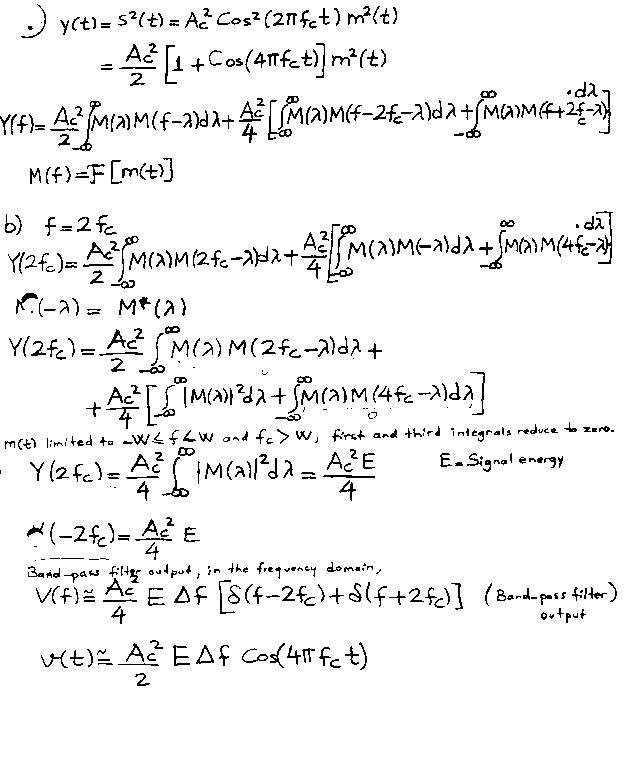

Başkent University Department of Electrical and Electronics Engineering's 1.5-hour "Communication Systems I" first midterm exam of November 28, 2000. On the paper the course code appears under its numbering at the time, EEM 421; in the archive it is filed under Communications I (EEM441). The exam is in English, and the solutions are handwritten and in English. The original exam and the handwritten solution pages can be downloaded as a PDF at the end of the post.

## Question 1: Convolution

The Fourier transforms of the signals x₁(t) and x₂(t) are given in the figure: X₁(f) is a pair of triangles (centered at f₀) with an impulse at the center, while X₂(f) is two impulses at ±f₀ (amplitude K).

1. Find and sketch X₁(f) ∗ X₂(f) in the frequency domain.
2. Find the same result by first computing the product x₁(t)·x₂(t) and then using the property x₁(t)x₂(t) ↔ X₁(f)∗X₂(f).

**Solution.** Since X₁(f) = X(f−f₀) + X(f+f₀), we have x₁(t) = 2x(t)cos ω₀t, and since X₂(f) = K[δ(f−f₀)+δ(f+f₀)], we have x₂(t) = 2K cos ω₀t. Convolution with an impulse yields a shift:

X₁(f) ∗ X₂(f) = K[X(f−2f₀) + 2X(f) + X(f+2f₀)]

In the time domain, x₁x₂ = 4K x(t)cos²ω₀t = 2K x(t)[1 + cos 2ω₀t], and its Fourier transform gives the same expression: a triangle of height 2K at the center and triangles of height K at ±2f₀.

## Question 2: Filter and Multiplier

The input s(t) passes through a filter H(f) to become w(t), and is then multiplied by cos 4πt to obtain r(t). H(f) = 3 (−2 ≤ f ≤ 2 Hz) and 0 elsewhere; S(f) is a triangle that is 4 at f = 0 and falls to zero at ±4 Hz. Sketch W(f) and R(f).

**Solution.** The filter multiplies the −2…2 Hz portion of S(f) by 3; W(f) is a trapezoid in this interval with a peak of 12 and edges of 6. Multiplication by cos 4πt shifts the spectrum by ±2 Hz and halves it:

R(f) = ½W(f−2) + ½W(f+2)

The result is a spectrum with height 3 at 0, height 6 around ±2 Hz, and ending at ±4 Hz.

## Question 3: Envelope Detector

s(t) = A_c[1 + μ cos(2πf_m t)] cos(2πf_ct), μ = 2, f_c ≫ f_m. The output of an ideal envelope detector is v(t):

1. Find the Fourier series of v(t).
2. In v(t), what is the ratio of the second-harmonic amplitude to that of the fundamental component?

**Solution.** Since μ = 2, there is overmodulation, and the output is v(t) = A_c|1 + 2cos(2πf_m t)|: the sign flips when the cosine falls below −½. The period is 1/f_m; the zero crossings lie between t = 1/(3f_m) and 1/(2f_m). The series is written as v(t) = a₀ + 2Σ aₙ cos(2πn f_m t):

- a₀ = A_c/3 + (4A_c/π)·sin(2π/3)
- a₁ = A_c(√3/(2π) + 1/3)
- a₂ = A_c√3/(2π)

The second-harmonic/fundamental ratio is found as a₂/a₁ = 3√3/(2π + 3√3) ≈ 0.452. (The coefficients were checked with numerical integration.)

## Question 4: Square-Law Device

The DSB-SC signal s(t) = A_ccos(2πf_ct)m(t) passes through a square-law device, y(t) = s²(t); then a narrowband filter with center frequency 2f_c and bandwidth Δf is applied.

1. Find the spectrum of y(t).
2. Show that the filter output is v(t) ≈ [A_c²EΔf cos(4πf_ct)]/2 (E is the energy of m(t)).

**Solution.** y(t) = (A_c²/2)[1 + cos 4πf_ct] m²(t). Its spectrum is the sum of M(f)∗M(f) and its copies shifted to ±2f_c. At f = 2f_c, since m(t) is band-limited and f_c > W, the cross terms vanish and only ∫|M(λ)|²dλ = E remains: Y(2f_c) = A_c²E/4. The narrowband filter output multiplies this constant value by Δf, giving v(t) ≈ (A_c²/2)EΔf cos(4πf_ct).

