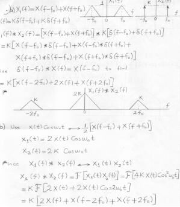
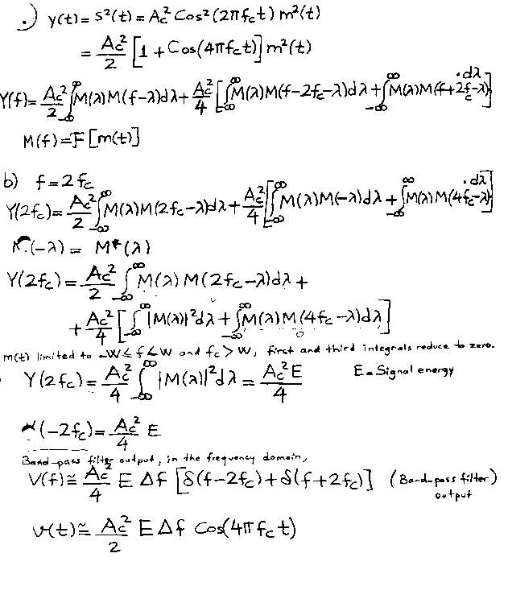

Başkent Üniversitesi Elektrik-Elektronik Mühendisliği Bölümü'nün 28 Kasım 2000 tarihli, 1,5 saatlik "Communication Systems I" birinci ara sınavı. Kâğıtta ders kodu o dönemki numarasıyla EEM 421 yazıyor; arşivde Haberleşme I (EEM441) altında toplandı. Sınav İngilizce, çözümler el yazısıyla ve İngilizce. Orijinal sınav ve el yazısı çözüm sayfaları, yazının sonundaki PDF olarak indirilebilir.

## Soru 1: Evrişim

x₁(t) ve x₂(t) işaretlerinin Fourier dönüşümleri şekilde verilmiş: X₁(f) bir üçgen çifti (f₀ merkezli) ile merkezde bir dürtü, X₂(f) ise ±f₀'da iki dürtü (genlik K).

1. X₁(f) ∗ X₂(f)'yi frekans bölgesinde bulun ve çizin.
2. Aynı sonucu önce x₁(t)·x₂(t) çarpımını hesaplayıp sonra x₁(t)x₂(t) ↔ X₁(f)∗X₂(f) özelliğini kullanarak bulun.

**Çözüm.** X₁(f) = X(f−f₀) + X(f+f₀) olduğundan x₁(t) = 2x(t)cos ω₀t, X₂(f) = K[δ(f−f₀)+δ(f+f₀)] olduğundan x₂(t) = 2K cos ω₀t olur. Dürtüyle evrişim kaydırma verir:

X₁(f) ∗ X₂(f) = K[X(f−2f₀) + 2X(f) + X(f+2f₀)]

Zaman bölgesinde x₁x₂ = 4K x(t)cos²ω₀t = 2K x(t)[1 + cos 2ω₀t] olup Fourier dönüşümü aynı ifadeyi verir: merkezde 2K yüksekliğinde, ±2f₀'da K yüksekliğinde üçgenler.

## Soru 2: Filtre ve çarpıcı

s(t) girişi H(f) filtresinden geçip w(t) olur, sonra cos 4πt ile çarpılarak r(t) elde edilir. H(f) = 3 (−2 ≤ f ≤ 2 Hz), diğer yerlerde 0; S(f), ±4 Hz'de sıfıra inen ve f = 0'da 4 olan bir üçgendir. W(f) ve R(f) çizilecek.

**Çözüm.** Filtre S(f)'nin −2…2 Hz kısmını 3 ile çarpar; W(f) bu aralıkta tepesi 12, kenarları 6 olan bir yamuktur. cos 4πt ile çarpma spektrumu ±2 Hz kaydırır ve yarıya böler:

R(f) = ½W(f−2) + ½W(f+2)

Sonuç, 0'da 3, ±2 Hz civarında 6 yüksekliğinde ve ±4 Hz'de sonlanan bir spektrumdur.

## Soru 3: Zarf detektörü

s(t) = A_c[1 + μ cos(2πf_m t)] cos(2πf_ct), μ = 2, f_c ≫ f_m. İdeal zarf detektörü çıkışı v(t):

1. v(t)'nin Fourier serisini bulun.
2. v(t)'de ikinci harmonik genliğinin temel bileşene oranı nedir?

**Çözüm.** μ = 2 olduğundan aşırı modülasyon vardır ve çıkış v(t) = A_c|1 + 2cos(2πf_m t)| olur: kosinüs −½'nin altına indiğinde işaret döner. Periyot 1/f_m'dir; sıfır geçişleri t = 1/(3f_m) ve 1/(2f_m) arasında yer alır. Seri v(t) = a₀ + 2Σ aₙ cos(2πn f_m t) biçiminde yazılır:

- a₀ = A_c/3 + (4A_c/π)·sin(2π/3)
- a₁ = A_c(√3/(2π) + 1/3)
- a₂ = A_c√3/(2π)

İkinci harmonik/temel oranı a₂/a₁ = 3√3/(2π + 3√3) ≈ 0,452 bulunur. (Katsayılar sayısal integralle kontrol edildi.)

## Soru 4: Karesel eleman

DSB-SC işaret s(t) = A_ccos(2πf_ct)m(t), y(t) = s²(t) karesel elemandan geçiyor; ardından orta frekansı 2f_c ve bant genişliği Δf olan dar bant filtre uygulanıyor.

1. y(t)'nin spektrumunu bulun.
2. Filtre çıkışının v(t) ≈ [A_c²EΔf cos(4πf_ct)]/2 olduğunu gösterin (E, m(t)'nin enerjisi).

**Çözüm.** y(t) = (A_c²/2)[1 + cos 4πf_ct] m²(t). Spektrumu M(f)∗M(f)'nin ve onun ±2f_c'a kaydırılmış kopyalarının toplamıdır. f = 2f_c'da, m(t) bant sınırlı ve f_c > W olduğundan çapraz terimler sıfırlanır ve yalnız ∫|M(λ)|²dλ = E kalır: Y(2f_c) = A_c²E/4. Dar bantlı filtre çıkışı bu sabit değeri Δf ile çarparak v(t) ≈ (A_c²/2)EΔf cos(4πf_ct) verir.

