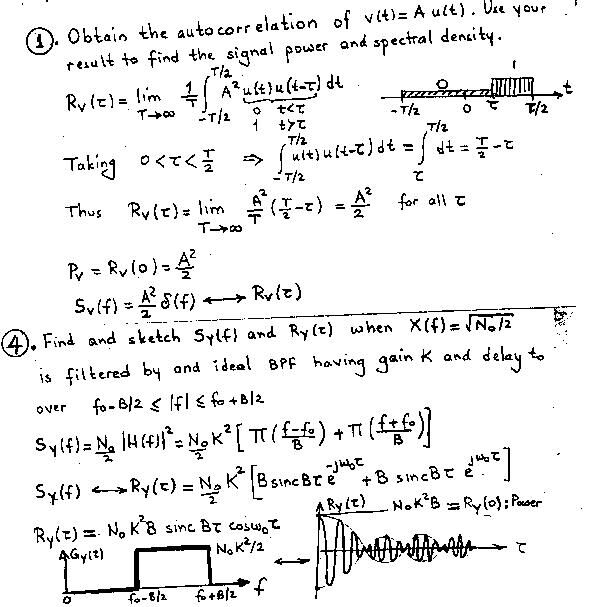
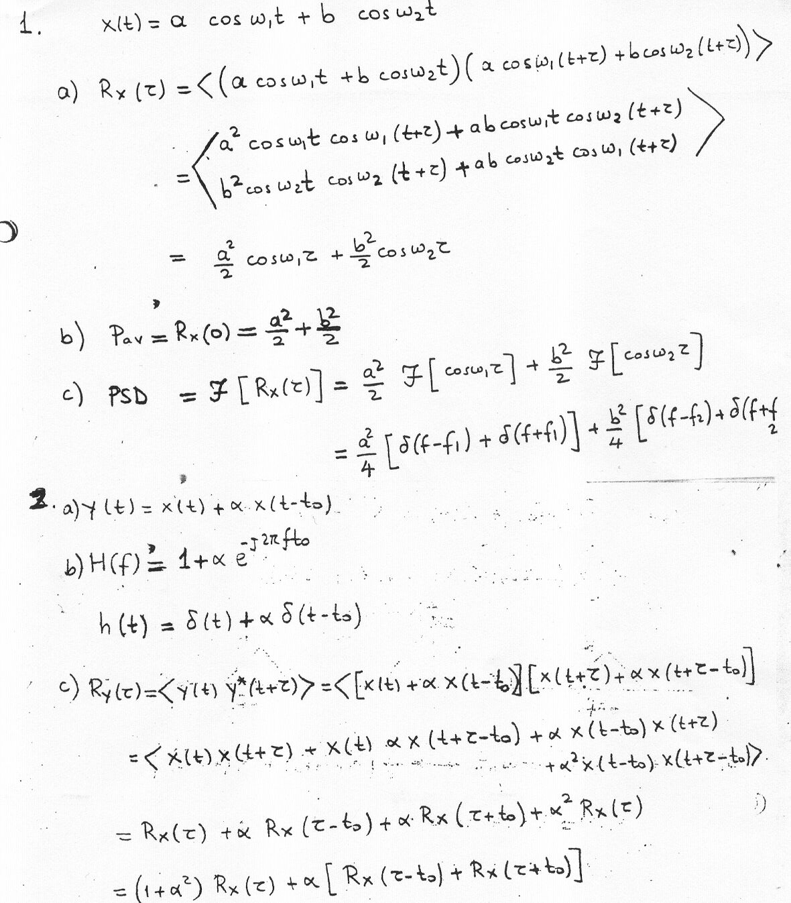

The 90-minute EEM 441 "Communication Systems I" first midterm exam of the Başkent University Department of Electrical and Electronics Engineering, dated November 27, 2001. This post also includes a 45-minute quiz from the same term, dated November 2001, together with its solution. Of the exam's four questions, handwritten solutions are available only for 1 and 4; the others are given as questions only. The original sheets can be downloaded as a PDF at the end of the post.

## Midterm exam, 27.11.2001

1. Find the autocorrelation function of the signal v(t) = A·u(t); using the result, find the power and the spectral density of the signal.
2. The Fourier transform of the pre-envelope of g(t) is defined as G₊(f) = 2G(f)u(f) (u(f) is the unit step). (a) Find the inverse transform of G₊(f). (b) For G(f) = K exp[−(f−f_c)²/2σ_f²], K = (√(2π)σ_f)⁻¹, find the pre-envelope, the complex envelope, and the analytic expression of the bandpass signal g(t); state your assumptions.
3. The impulse response of a linear system is h(t) = e^(−2t)u(t), and the autocorrelation of the input is R_x(τ) = δ(τ). Find (a) the input power spectral density, (b) the output power spectral density, (c) the total output power, (d) the output autocorrelation, (e) the input-output cross-correlation.
4. White noise with X(f) = √(N₀/2) is passed through an ideal bandpass filter with gain K and delay t₀ (f₀ − B/2 ≤ |f| ≤ f₀ + B/2). Find and plot the output power spectral density S_y(f) and the autocorrelation R_y(τ).

### Solution to Question 1

R_v(τ) = lim (1/T)∫ A²u(t)u(t−τ)dt. For 0 < τ < T/2 the integral equals T/2 − τ, so R_v(τ) = A²/2 (for all τ). The power is P_v = R_v(0) = A²/2, and the spectral density is S_v(f) = (A²/2)δ(f).

### Solution to Question 4

S_y(f) = (N₀/2)|H(f)|² = (N₀/2)K²[Π((f−f₀)/B) + Π((f+f₀)/B)] and R_y(τ) = N₀K²B sinc(Bτ)cos(ω₀τ). The output power is R_y(0) = N₀K²B.

## Quiz, November 2001

Duration 45 minutes. The date on the sheet reads as November 13, 2001. For x(t) = a cos ω₁t + b cos ω₂t, the following are requested: (a) the autocorrelation function, (b) the average power, (c) the power spectral density. In the second part, a system that produces y(t) = x(t) + αx(t − t₀) from x(t) is given: (a) write y(t) in terms of x(t), (b) find the transfer function and the impulse response, (c) find R_y in terms of R_x, (d) find the energy spectral density.

**Solution.**

- R_x(τ) = (a²/2)cos ω₁τ + (b²/2)cos ω₂τ
- Average power P = R_x(0) = a²/2 + b²/2
- Power spectral density S_x(f) = (a²/4)[δ(f−f₁) + δ(f+f₁)] + (b²/4)[δ(f−f₂) + δ(f+f₂)]
- y(t) = x(t) + αx(t−t₀)
- H(f) = 1 + αe^(−j2πft₀), h(t) = δ(t) + αδ(t−t₀)
- R_y(τ) = (1 + α²)R_x(τ) + α[R_x(τ−t₀) + R_x(τ+t₀)]
- Energy spectral density |Y(f)|² = |1 + αe^(−j2πft₀)|²|X(f)|² = (1 + α² + 2α cos 2πft₀)|X(f)|²

