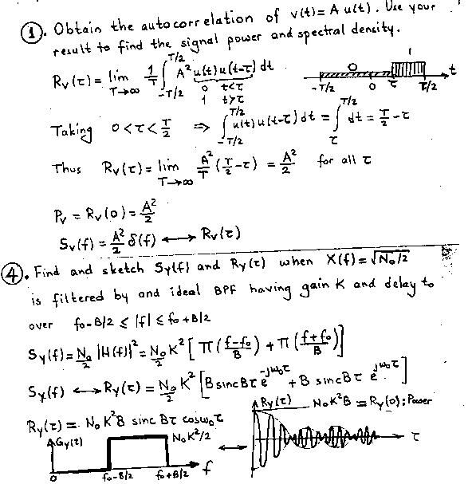
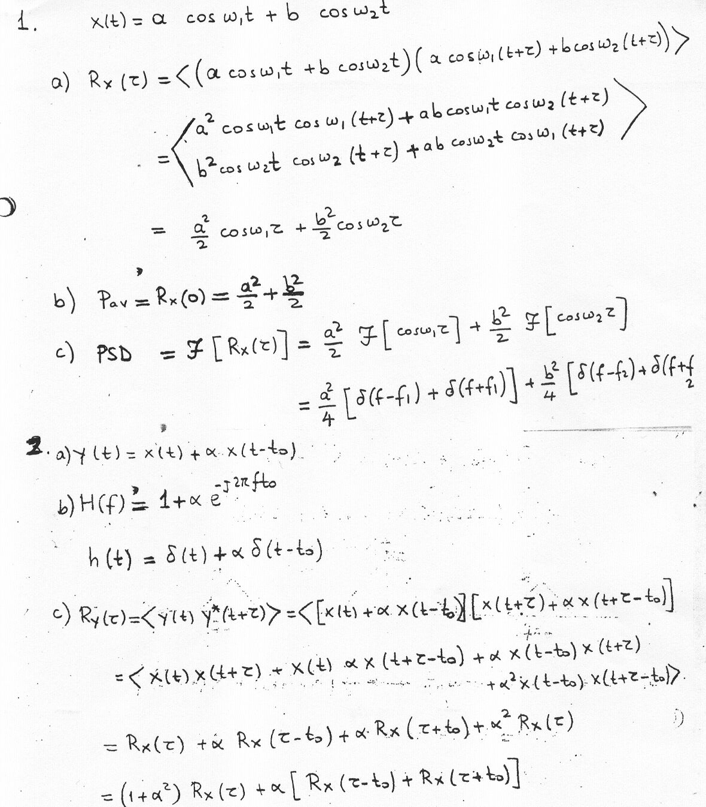

Başkent Üniversitesi Elektrik-Elektronik Mühendisliği Bölümü'nün 27 Kasım 2001 tarihli, 90 dakikalık EEM 441 "Communication Systems I" birinci ara sınavı. Bu yazıda ayrıca aynı dönemden, Kasım 2001 tarihli 45 dakikalık bir quiz ve çözümü bulunuyor. Sınavın dört sorusundan yalnız 1 ve 4'ün el yazısı çözümü elimizde; diğerleri soru olarak verilmiştir. Orijinal kâğıtlar yazının sonundaki PDF olarak indirilebilir.

## Ara sınav, 27.11.2001

1. v(t) = A·u(t) işaretinin özilinti fonksiyonunu bulun; sonucu kullanarak işaretin gücünü ve spektral yoğunluğunu bulun.
2. g(t)'nin ön zarfının Fourier dönüşümü G₊(f) = 2G(f)u(f) ile tanımlanıyor (u(f) birim basamak). (a) G₊(f)'nin ters dönüşümünü bulun. (b) G(f) = K exp[−(f−f_c)²/2σ_f²], K = (√(2π)σ_f)⁻¹ için ön zarfı, karmaşık zarfı ve bant geçiren işaret g(t)'nin analitik ifadesini bulun; varsayımları belirtin.
3. Bir doğrusal sistemin dürtü cevabı h(t) = e^(−2t)u(t), girişin özilintisi R_x(τ) = δ(τ). (a) Giriş güç spektral yoğunluğu, (b) çıkış güç spektral yoğunluğu, (c) toplam çıkış gücü, (d) çıkış özilintisi, (e) giriş-çıkış çapraz ilintisi.
4. X(f) = √(N₀/2) olan beyaz gürültü, kazancı K ve gecikmesi t₀ olan ideal bir bant geçiren süzgeçten geçiyor (f₀ − B/2 ≤ |f| ≤ f₀ + B/2). Çıkış güç spektral yoğunluğu S_y(f) ve özilinti R_y(τ)'yu bulun ve çizin.

### Soru 1 çözümü

R_v(τ) = lim (1/T)∫ A²u(t)u(t−τ)dt. 0 < τ < T/2 için integral T/2 − τ olduğundan R_v(τ) = A²/2 (tüm τ). Güç P_v = R_v(0) = A²/2, spektral yoğunluk S_v(f) = (A²/2)δ(f).

### Soru 4 çözümü

S_y(f) = (N₀/2)|H(f)|² = (N₀/2)K²[Π((f−f₀)/B) + Π((f+f₀)/B)] ve R_y(τ) = N₀K²B sinc(Bτ)cos(ω₀τ). Çıkış gücü R_y(0) = N₀K²B'dir.

## Quiz, Kasım 2001

Süre 45 dakika. Kâğıttaki tarih 13 Kasım 2001 olarak okunuyor. x(t) = a cos ω₁t + b cos ω₂t için (a) özilinti fonksiyonu, (b) ortalama güç, (c) güç spektral yoğunluğu isteniyor. İkinci kısımda x(t)'yi y(t) = x(t) + αx(t − t₀) üreten sistem veriliyor: (a) y(t)'yi x(t) cinsinden yazın, (b) transfer fonksiyonu ve dürtü cevabı, (c) R_y'yi R_x cinsinden, (d) enerji spektral yoğunluğunu bulun.

**Çözüm.**

- R_x(τ) = (a²/2)cos ω₁τ + (b²/2)cos ω₂τ
- Ortalama güç P = R_x(0) = a²/2 + b²/2
- Güç spektral yoğunluğu S_x(f) = (a²/4)[δ(f−f₁) + δ(f+f₁)] + (b²/4)[δ(f−f₂) + δ(f+f₂)]
- y(t) = x(t) + αx(t−t₀)
- H(f) = 1 + αe^(−j2πft₀), h(t) = δ(t) + αδ(t−t₀)
- R_y(τ) = (1 + α²)R_x(τ) + α[R_x(τ−t₀) + R_x(τ+t₀)]
- Enerji spektral yoğunluğu |Y(f)|² = |1 + αe^(−j2πft₀)|²|X(f)|² = (1 + α² + 2α cos 2πft₀)|X(f)|²

