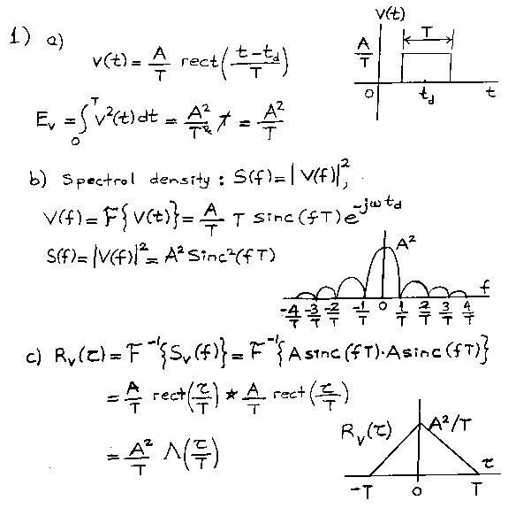
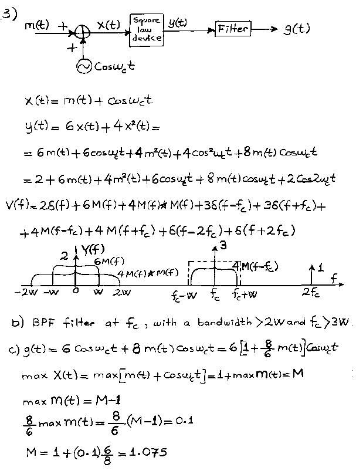
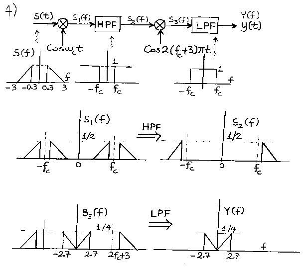

The first midterm exam of EEM 441 "Communication Systems I," a 2-hour exam given on November 21, 2003 by the Department of Electrical and Electronics Engineering at Başkent University. The exam is in English; the handwritten solutions run four pages. The original exam pages and the handwritten solutions can be downloaded as a PDF at the end of the post.

## Question 1: Rectangular pulse

For v(t) = (A/T)·rect[(t − t_d)/T], find and sketch (a) the energy, (b) the spectral density, (c) the autocorrelation function.

**Solution.** (a) E = ∫v²dt = (A²/T²)·T = A²/T. (b) V(f) = A·sinc(fT)e^(−jωt_d); S(f) = |V(f)|² = A²sinc²(fT) (A² at f = 0; zeros at k/T). (c) R_v(τ) = F⁻¹{S(f)} = (A/T)rect(τ/T) ∗ (A/T)rect(τ/T) = (A²/T)Λ(τ/T): a triangle with a peak of A²/T at τ = 0, falling to zero at ±T.

## Question 2: FM instantaneous phase and frequency

x_c(t) = 50 cos[ω_ct + 2πf_d∫₀ᵗ x(α)dα], f_d = 20 Hz/V; x(t) is 8 V from 0 to 4 s, and 0 afterwards. Sketch (a) the instantaneous phase and (b) the instantaneous frequency.

**Solution.** θ(t) = ω_ct + 40π∫₀ᵗ8 dα. For t < 4 the phase deviation is 320πt rad; for t ≥ 4 it is constant at 1280π rad. The instantaneous frequency is f(t) = f_c + f_d·x(t): f_c + 160 Hz for 0 < t < 4, and f_c afterwards.

## Question 3: AM with a square-law element

x(t) = m(t) + cos ω_ct is passed through a square-law element (y = 6x + 4x²) followed by a filter; m(t) has zero mean and the minimum value of x(t) is M. (a) Write y(t) and sketch its spectrum. (b) Specify the filter so that g(t) is an AM signal. (c) What should M be for a modulation index of 0.1?

**Solution.** (a) y(t) = 6m + 6cos ω_ct + 4m² + 4cos²ω_ct + 8m cos ω_ct = 2 + 6m + 4m² + 6cos ω_ct + 8m cos ω_ct + 2cos 2ω_ct. Spectrum: around 0 there are 2δ(f), 6M(f), and 4M∗M; at f_c there are 3δ and 4M(f ∓ f_c); at 2f_c there is δ. (b) A bandpass filter centered at f_c with a bandwidth greater than 2W is needed; f_c > 3W is required. (c) g(t) = 6cos ω_ct + 8m cos ω_ct = 6[1 + (8/6)m]cos ω_ct. If max x = 1 + max m = M, then max m = M − 1; (8/6)(M − 1) = 0.1 ⇒ M = 1.075.

## Question 4: System with multipliers and filters

s(t) is multiplied by cos ω_ct in a multiplier; this is followed by a highpass filter, then a second multiplier with cos 2(f_c + 3)πt, and a lowpass filter. The spectrum of s(t) is a triangle extending to ±3 kHz (with marked points at ±0.3 kHz). Sketch Y(f) (f_c ≫ 3 kHz).

**Solution.** After the first multiplier, S₁(f) = ½[S(f−f_c) + S(f+f_c)]; the highpass filter removes the lower sidebands and keeps the upper sideband (around f_c). In the second multiplication, mixing with f_c + 3 kHz shifts this band to baseband, out to ±2.7 kHz, and inverts the spectrum; after the lowpass filter, Y(f) is a spectrum of height 1/4 over approximately −2.7…2.7 kHz.

*Note: In the question text, the second oscillator is written as "cos 2(f_c+3)πt". The result in the solution is read around ±2.7 kHz; evaluate it together with the visual sketch.*

