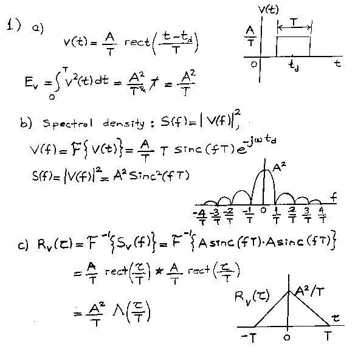
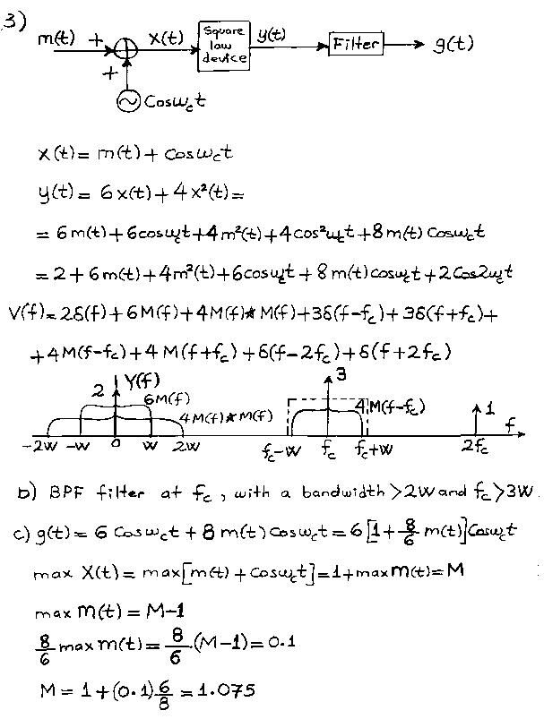
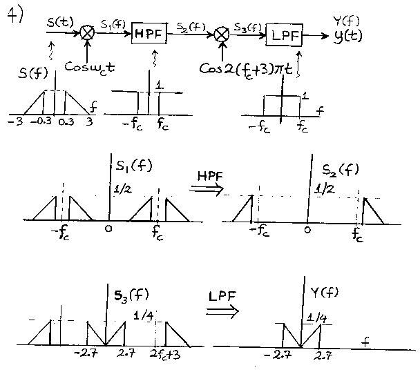

Başkent Üniversitesi Elektrik-Elektronik Mühendisliği Bölümü'nün 21 Kasım 2003 tarihli, 2 saatlik EEM 441 "Communication Systems I" birinci ara sınavı. Sınav İngilizce; el yazısı çözümler dört sayfadır. Orijinal sınav sayfaları ve el yazısı çözümler yazının sonundaki PDF olarak indirilebilir.

## Soru 1: Dikdörtgen darbe

v(t) = (A/T)·rect[(t − t_d)/T] için (a) enerjiyi, (b) spektral yoğunluğu, (c) özilinti fonksiyonunu bulun ve çizin.

**Çözüm.** (a) E = ∫v²dt = (A²/T²)·T = A²/T. (b) V(f) = A·sinc(fT)e^(−jωt_d); S(f) = |V(f)|² = A²sinc²(fT) (f = 0'da A²; sıfırlar k/T'de). (c) R_v(τ) = F⁻¹{S(f)} = (A/T)rect(τ/T) ∗ (A/T)rect(τ/T) = (A²/T)Λ(τ/T): τ = 0'da A²/T tepeli, ±T'de sıfıra inen üçgen.

## Soru 2: FM anlık faz ve frekans

x_c(t) = 50 cos[ω_ct + 2πf_d∫₀ᵗ x(α)dα], f_d = 20 Hz/V; x(t) 0–4 s arasında 8 V, sonra 0. (a) Anlık fazı, (b) anlık frekansı çizin.

**Çözüm.** θ(t) = ω_ct + 40π∫₀ᵗ8 dα. t < 4 için faz kayması 320πt rad, t ≥ 4 için sabit 1280π rad. Anlık frekans f(t) = f_c + f_d·x(t): 0 < t < 4 aralığında f_c + 160 Hz, sonra f_c.

## Soru 3: Karesel eleman ile AM

x(t) = m(t) + cos ω_ct karesel elemandan geçiyor (y = 6x + 4x²), ardından süzgeç; m(t)'nin ortalaması sıfır ve x(t)'nin en küçük değeri M. (a) y(t)'yi yazın ve spektrumunu çizin. (b) g(t)'nin AM işareti olması için süzgeci tanımlayın. (c) Modülasyon indisi 0,1 olması için M kaç olmalı?

**Çözüm.** (a) y(t) = 6m + 6cos ω_ct + 4m² + 4cos²ω_ct + 8m cos ω_ct = 2 + 6m + 4m² + 6cos ω_ct + 8m cos ω_ct + 2cos 2ω_ct. Spektrum: 0 civarında 2δ(f), 6M(f), 4M∗M; f_c'de 3δ, 4M(f ∓ f_c); 2f_c'de δ. (b) f_c merkezli, bant genişliği 2W'den büyük bant geçiren süzgeç gerekir; f_c > 3W olmalıdır. (c) g(t) = 6cos ω_ct + 8m cos ω_ct = 6[1 + (8/6)m]cos ω_ct. max x = 1 + max m = M ise max m = M − 1; (8/6)(M − 1) = 0,1 ⇒ M = 1,075.

## Soru 4: Çarpıcılı süzgeç sistemi

s(t) çarpıcıda cos ω_ct ile çarpılıyor; sonra yüksek geçiren süzgeç, ardından cos 2(f_c + 3)πt ile ikinci çarpıcı ve alçak geçiren süzgeç var. s(t) spektrumu ±3 kHz'e kadar bir üçgendir (içinde ±0,3 kHz işaretli noktalar). Y(f)'yi çizin (f_c ≫ 3 kHz).

**Çözüm.** İlk çarpıcıdan sonra S₁(f) = ½[S(f−f_c) + S(f+f_c)]; yüksek geçiren süzgeç alt yan bantları atıp üst yan bandı (f_c çevresi) bırakır. İkinci çarpmada f_c + 3 kHz ile çarpma bu bandı taban bandına, ±2,7 kHz'e kadar kaydırır ve spektrumu ters çevirir; alçak geçiren süzgeçten sonra Y(f) yaklaşık −2,7…2,7 kHz aralığında 1/4 yüksekliğinde bir spektrumdur.

*Not: Soru metninde ikinci osilatör "cos 2(f_c+3)πt" yazılmıştır. Çözümdeki sonuç ±2,7 kHz çevresinde okunmaktadır; görsel çizimle birlikte değerlendirin.*

